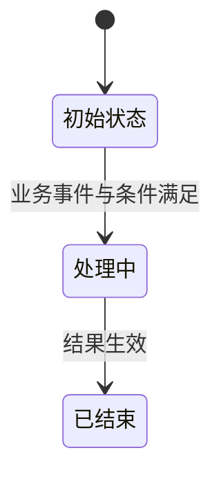

# 业务对象状态

每个核心对象分别定义。业务流程所处环节、对象状态、数量进度、付款或其他独立维度不要混成一个状态。

## 状态与转换填写骨架

| 当前状态 | 事件/角色 | 必须满足的条件 | 目标状态 | 数量、权限或关联单据变化 | 失败结果 |
| --- | --- | --- | --- | --- | --- |
| <待填写> | <待填写> | <引用规则> | <待填写> | <待填写> | <待填写> |

下图只示范语法，不代表真实审批要求；按实际对象替换，图和表中的关键转换应一致。

多明细或部分执行时定义状态归并与数量守恒。哪些历史不能回退、何时需要追加更正由业务规则决定，不为实现方便新增业务状态或覆盖已发生事实。
