# [Charles](https://www.charlesproxy.com/)使用

## 目录
1. [面板](#面板)
1. [显示捕获列表方式](#显示捕获列表方式)
1. [查找](#查找)
1. [代理配置](#代理配置)
1. [捕获系统请求](#捕获系统请求)
1. [捕获移动端请求](#捕获移动端请求)
1. [Map至本地、网址](#map至本地网址)
1. [网速模拟功能](#网速模拟功能)
1. [断点功能](#断点功能)
1. [重复发送请求](#重复发送请求)
1. [HTTPS分析](#https分析)
1. [捕获记录控制](#捕获记录控制)
1. [web界面](#web界面)

---
HTTP调试工具：通过将Charles设置成**系统的网络访问代理服务器**，记录并分析使用该代理的 HTTP 请求和响应。

>1. 旧版 Charles 可能需要匹配的 Java/JRE；现代安装包通常会处理运行环境。能否截取请求取决于应用是否走系统代理或显式代理；防火墙、浏览器代理插件、证书信任和代理绕过规则都会影响捕获结果。
>2. 移动设备使用 Charles 的 HTTP 代理时，通常由代理端解析目标域名；电脑上的 hosts 配置可能影响解析结果。
>
>- Charles默认端口号：**8888**。

### 面板

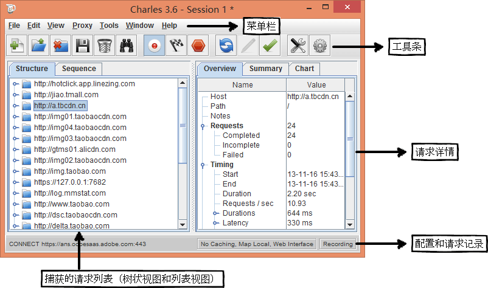

>开启录制后，刷新页面产生的代理请求会记录在当前 session 中。可以新建 session 来单独记录下一次调试。

### 显示捕获列表方式
1. Structure

    视图将网络请求按访问的域名分类

    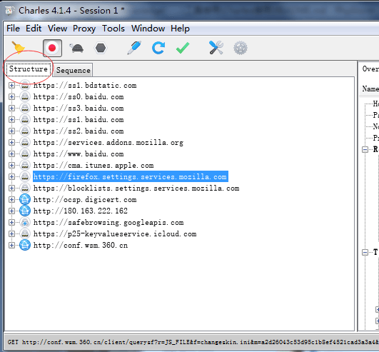

2. Sequence

    视图将网络请求按访问的时间排序（有**Filter**功能）

    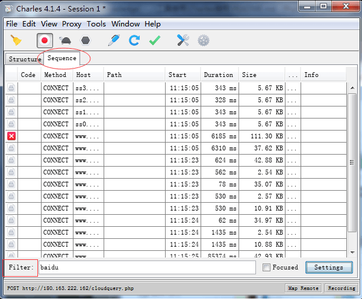

>针对一个域名或网址，右键选择**Focus**或**Ignore**可以专门查看或忽略请求。

### 查找

Ctrl + F（macOS 为 Command + F）调出。

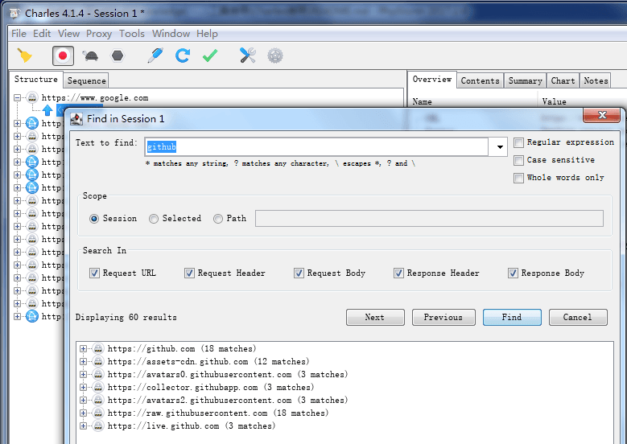

### 代理配置

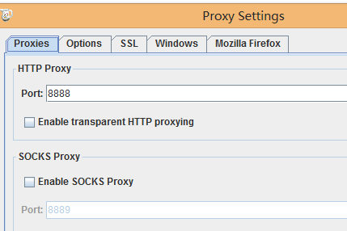

### 捕获系统请求

设置是否成为系统代理，取消勾选**Windows Proxy**或**macOS Proxy**后，显式配置为使用 Charles 的应用仍可被记录。

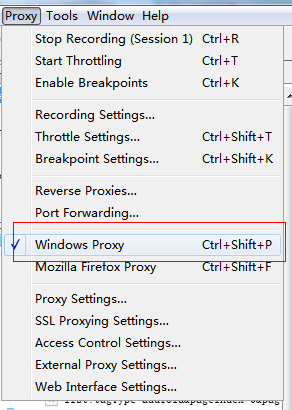

### 捕获移动端请求

移动设备的调试，我们需要把HTTP代理到Charles上：

1. 使移动设备能访问电脑的局域网 IP 和 Charles 的代理端口；

    >若无法抓取信息，则可以重启Charles、重新设置HTTP代理或查看**Access Control Settings**是否允许访问。同时检查 Wi-Fi 是否开启客户端隔离，以及电脑防火墙是否允许该连接。
2. 移动设备的Wi-Fi设置：服务器IP设置成电脑IP，端口号设置成 Charles 的监听端口（默认 8888）；

    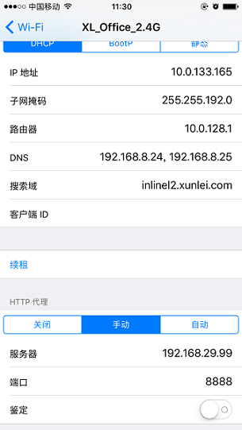
3. Charles设置允许接收的IP地址的范围（有新的不在允许范围内的IP地址请求时，会自动询问是否允许接收）：

    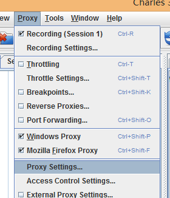

    >进入设置**Proxy - Access Control Settings**，添加允许调试的设备 IP。如果需要允许整个受信任的测试网段，可填写该网段（如 `192.168.1.0/24`）。

>Charles主要面向 HTTP、HTTPS、WebSocket 等基于代理的流量分析；原始 TCP/UDP socket 不属于常规 HTTP 代理抓包范围。

### Map至本地、网址
- 设置路由

    1. Map来源：

        1. `路径/*`表示：路径下所有内容、子路径下所有内容。
        2. `路径/路由`表示：仅此路径下的一个路由。
    2. Map去向：

        - 都不要添加 ~~`*`~~（由来源匹配去向）。

1. Map至本地：

    1. 将**单文件**代理至本地的源码文件：

        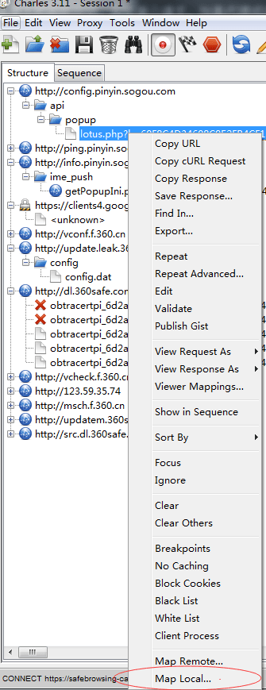

        点击「Map Local」后：

        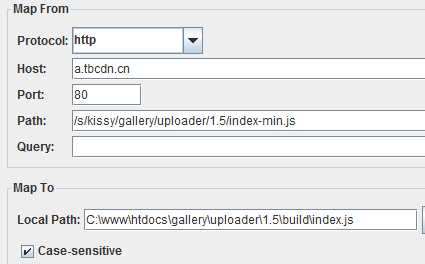

    2. 将**子目录**代理至本地，使用通配符`*`：

        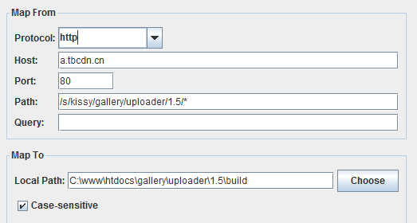

        本地地址选择个子目录，不需要通配符。

    - 校验是否代理成功，最省力的方式是点击工具条上的刷新按钮，刷新单个请求，若代理成功，则Charles会往「Notes」界面打个log:

        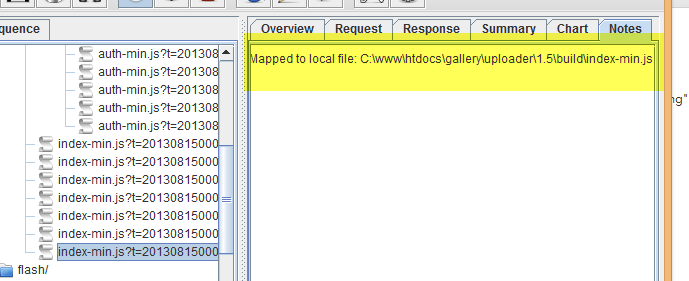
2. Map至网址：

    选择「Map Remote」

    >若勾选了`preserve host in header fields`，则发起请求的请求头`host`会保持Map来源的值，否则`host`是Map去向的值。

    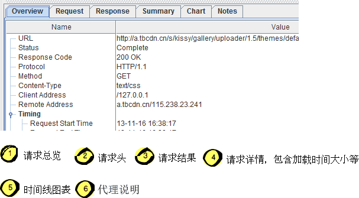

    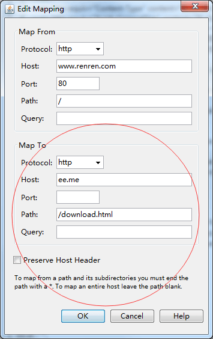

    >把一个原html地址Map至新网址后，要注意相对资源地址仍按浏览器看到的原页面地址解析（页面另设 `<base>` 时按其指定地址解析），因此可能还需要为这些资源路径配置映射（建议直接从源头就修改请求地址，这样就不用配置很多Map至网址）。

### 网速模拟功能

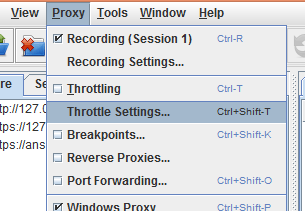

### 断点功能

Charles能够截断发送请求前（篡改Request）和响应后（篡改Response），修改request和response的所有信息。

场景：发送HTTP请求，我们需要测试接口的各种边界情况（如：出错、超时等表现），Charles的断点+随意篡改，非常方便测试，右键选择「BreakPoints」，开启断点：

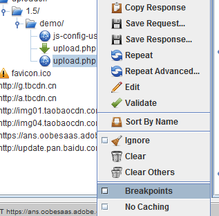

>小技巧：断点配合repeat功能：
>
>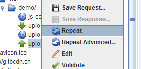

断点列表查看：

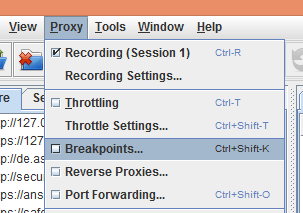

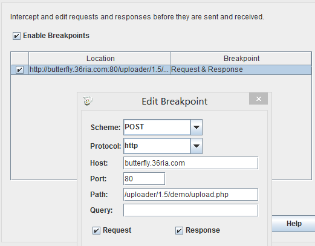

### 重复发送请求

repeat功能不需要刷新页面，只需要repeat请求，还可以进行压力测试。

**repeat**重复发送一次请求；**Repeat Advanced** 可以设置重复次数和并发数。

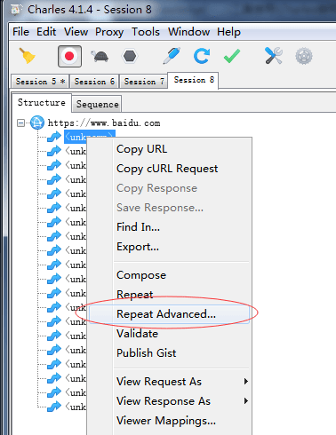

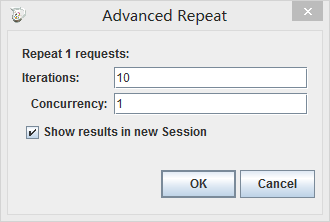

### HTTPS分析
默认只记录 HTTPS 隧道连接。查看请求和响应的明文，需要为目标域名开启 SSL Proxying，且客户端须信任此次 Charles 安装使用的根证书。

1. 安装、信任证书：

    1. 电脑安装证书

        1. 在 **Help -> SSL Proxying -> Install Charles Root Certificate**安装证书；
        2. 去系统设置信任此证书：

            1. macOS：在**钥匙串访问**中双击设置信任

                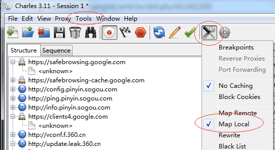
            2. Windows：把证书安装至**受信任的根证书颁发机构**
    2. 移动设备安装证书

        移动设备设置好HTTP代理后，访问[chls.pro/ssl](https://chls.pro/ssl)下载证书并信任。

        1. Android：在系统设置中安装 CA 证书。以 Android 7.0（API 24）或更高版本为目标的应用默认不信任用户安装的 CA；调试自己的应用时，可仅在调试构建中配置信任。[Android 网络安全配置](https://developer.android.com/privacy-and-security/security-config)
        2. iOS

            1. 在`VPN与设备管理`可以查询、删除证书。
            2. 在`证书信任设置`可以开关信任的证书。
2. 设置需要针对的域名：

    设置**Proxy -> SSL Proxying Settings**，把需要抓包的主机和实际 HTTPS 端口（默认 443）添加进去。

    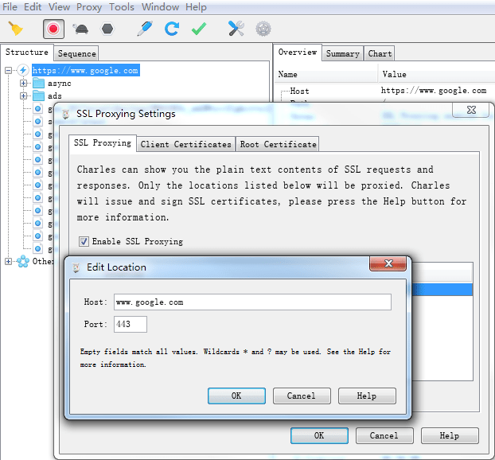

### 捕获记录控制

捕获的请求太多，容易产生干扰，Charles可以对捕获记录进行过滤。

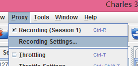

然后配置「exclude」：

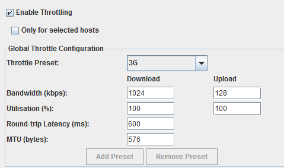

### web界面

Charles有个有趣的web界面：

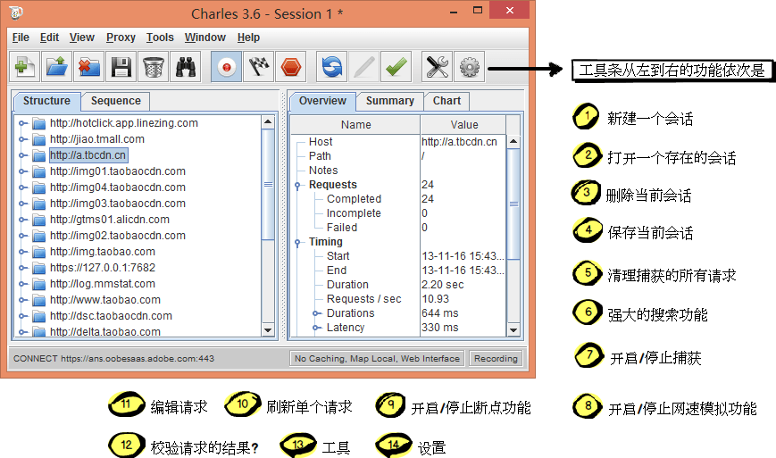

强大的是可以控制是否远程可以访问这个界面，还可以设置用户名和密码。
开启 Web Interface 后，使用已配置 Charles 代理的浏览器访问 <http://control.charles/>。

>tips：若charles是非正常状态下关闭的话，则有些浏览器的代理就不会被自动取消，会出现无法访问网络情况。重新打开Charles再正常关闭可以解决。
