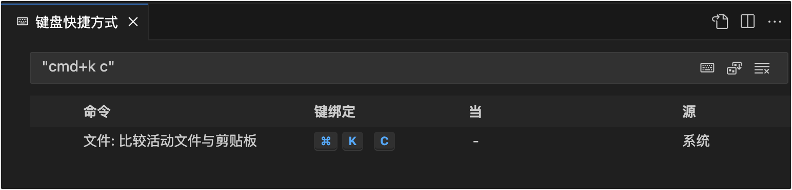

# IDEs' Setting

## TOC

1. [Cursor](#cursor)
1. [Visual Studio Code](#visual-studio-code)
1. [JetBrains](#jetbrains)
1. [IntelliJ IDEA](#intellij-idea)
1. [WebStorm](#webstorm)

---

### Cursor
>继承Visual Studio Code。

1. [settings-cursor.json](./settings-cursor.json)
2. [keybindings-cursor.json](./keybindings-cursor.json)
3. AI配置相关

    1. rules规则、commands指令

        1. 规则<https://cursor.com/cn/docs/context/rules>

            1. 规则的描述（.mdc）带着元数据（`description`、`globs`、`alwaysApply`），能设置何时自动启用；也可以手动@某个规则启用。
            1. 大型语言模型在不同补全之间不会保留记忆。规则在提示级别提供 持久、可重用的上下文。应用后，规则内容会被加入到模型上下文的开头。这为AI在生成代码、理解编辑或协助处理工作流时提供一致的指导、开发规范、约束。
        1. 指令

            必须手动输入`/`触发，用来执行特定的任务流（如写测试、重构代码）。快速调用常用的 Prompt 模板。

        - 项目规则放在 `.cursor/rules/`，项目指令放在 `.cursor/commands/`。用户指令放在 `~/.cursor/commands/`；用户规则可在 Cursor 设置中配置，也可保存在本机的 `~/.cursor/rules/`。

    ><details>
    ><summary>哪些配置会作用于 Tab 补全？</summary>
    >Rules 作用于 Agent 聊天。Tab 有自己的 hook，例如 `beforeTabFileRead` 可控制补全读取文件，`afterTabFileEdit` 可在接受 Tab 编辑后执行脚本。[Cursor Hooks 文档](https://cursor.com/docs/hooks)
    ></details>

    2. Agent Skills

        项目级配置`.agents/skills/` `.cursor/skills/` `.claude/skills/` `.codex/skills/`、用户级配置`~/.agents/skills/` `~/.cursor/skills/` `~/.claude/skills/` `~/.codex/skills/`

        >rules和skills区别：Rule 管长期约束和项目背景，确保 Agent 不跑偏；Skill 管特定任务的可复用流程，确保某类事做完整。（Command 负责手动触发）
    3. hook

        项目级配置`.cursor/hooks.json`（被配置使用的具体hook脚本`.cursor/hooks/脚本`），用户级配置`~/.cursor/hooks.json`（被配置使用的具体hook脚本`~/.cursor/hooks/脚本`）
    4. subagents

        项目级配置：`.cursor/agents/` `.claude/agents/` `.codex/agents/`，用户级配置`~/.cursor/agents/` `~/.claude/agents/` `~/.codex/agents/`

    >若关闭了「Include third-party Plugins, Skills, and other configs. Automatically import agent configs from other tools」，则不会加载其他AI的配置，如`.claude/`、`.codex/`等（`.agents/`无论如何都会加载）

    5. MCP（模型上下文协议）

        项目级配置`.cursor/mcp.json`，用户级配置`~/.cursor/mcp.json`

        >MCP 若通过 `npx` 等命令启动本地服务，Node 版本取决于服务启动时的 `PATH`。另一个终端里的 `nvm use` 只改变该 Shell；要固定版本，可在启动配置中指定 Node 的绝对路径并重启该服务。
    6. AGENTS.md

    | cursor支持功能 | 自动生效 | 可手动调用 | 核心角色 |
    | --------- | ----- | ------- | ------ |
    | AGENTS.md    | 是（根目录作用于全项目，子目录可细化） | 否 | **项目说明**，作为 AI 的 README，可记录开发约定和构建、测试方法 |
    | Rules(*.mdc) | 取决于规则类型（始终、按文件、由 Agent 判断或仅手动） | 是（可`@`引用） | **具体行为规则与约束**（安全、合规、格式等） |
    | Skills       | 是（隐式加载，根据上下文按需加载） | 是（可`/`引用） | **SOP**封装、标准化（描述、指令、工具定义）<br>规定审查标准和输出格式，按需加载资源成为上下文 |
    | Commands     | 否 | 是（用`/`触发） | **快捷入口**：手动触发入口，封装执行其他功能 |
    | Hooks        | 是（事件触发） | 否 | **生命周期自动化**：在特定事件时执行操作 |
    | Subagents    | 由主 Agent 委派 | 是（`/名称`） | **专项分工**：上下文隔离、并行处理、领域专业化 |
    | MCP          | 由 Agent 调用已启用的工具 | 可提示 Agent 调用 | **外部能力扩展**：通过已配置的服务访问数据库、浏览器等资源，具体能力取决于服务提供的工具及其权限 |

    7. plugins：将 [rules、commands、skills、hooks、subagents、MCP](https://cursor.com/cn/docs/reference/plugins) 打包成可分发的包，配置都跟着插件安装路径（项目级或用户级），而不是各个功能路径。也支持用户级私有plugins（不需要发布公开的github，仅把某plugin文件夹复制到`~/.cursor/plugins/local/某plugin`即可）

    >与claude code的扩展基本一致：<https://code.claude.com/docs/zh-CN/features-overview>

    >各个AI工具都会在`~/`放置自己的全局AI配置，并且可能读取其他AI工具的配置路径，如：`.agents`、`.claude`、`.codex`、`.copilot`、`.cursor`、`.qoder`。可以用<https://github.com/vercel-labs/skills>跨Agent的Skills包管理器CLI 工具，负责安装、查找、更新、删除 Skills，如：`npx skills add https://github.com/obra/superpowers --skill '*' -a qoder -g`；也可以用<https://cli.github.com/manual/gh_skill>。

### Visual Studio Code
1. [settings-vscode.json](./settings-vscode.json)
2. [keybindings-vscode.json](./keybindings-vscode.json)

    - 

    - IDE读取[jsconfig.json和tsconfig.json](https://www.typescriptlang.org/zh/tsconfig/)进行[JS语言服务](https://github.com/microsoft/TypeScript/wiki/JavaScript-Language-Service-in-Visual-Studio)。

        `jsconfig.json`/`tsconfig.json`里的`baseUrl`/`paths`等不影响代码“执行”，它只影响IDE（+ TypeScript）编译阶段的“路径解析”，👉 运行时（Node / 浏览器）默认完全不认识这些 alias，需要再通过构建工具（Vite、webpack等）或运行时插件才能使代码指向正确路径。

### JetBrains
通过 JetBrains Account 或离线激活码激活许可证。[JetBrains 激活说明](https://www.jetbrains.com/help/idea/register.html)

### IntelliJ IDEA
1. [Backup and Sync](https://plugins.jetbrains.com/plugin/20868-backup-and-sync)
1. 或 手动导出导入配置（如：我的[settings-IDEA.zip](./settings-IDEA.zip)）。

### WebStorm
1. 在线同步设备可以用：

    ><https://www.jetbrains.com/help/idea/sharing-your-ide-settings.html>。

    1. [Backup and Sync](https://plugins.jetbrains.com/plugin/20868-backup-and-sync) JetBrains账号间同步（2022.3+默认这个）。
    2. 或 手动导出导入配置（如：我的[settings-webstorm.zip](./settings-webstorm.zip)）。
    3. 或 [~~Settings Repository (Deprecated)~~](https://plugins.jetbrains.com/plugin/7566-settings-repository-deprecated-)设置外部同步仓库（如：我的[JetBrainsSettingsRepository](https://github.com/realgeoffrey/JetBrainsSettingsRepository)）。

<details>
<summary></summary>

2. **Help -> Edit Custom VM Options** can change the memories for the IDE.

>~~IDE has its own language plugins. or using 3rd part pack: Chinese Language Pack：please go to [jetbrains-in-chinese](https://github.com/pingfangx/jetbrains-in-chinese) (or [WebStorm-Chinese](https://github.com/ewen0930/WebStorm-Chinese), [PhpStorm-Chinese](https://github.com/ewen0930/PhpStorm-Chinese), or [PyCharm-Chinese](https://github.com/ewen0930/PyCharm-Chinese)).~~

3. （Windows）Terminal的vi乱码解决办法：

    在Git安装目录下的etc目录下的bash.bashrc文件（如：`C:\Program Files\Git\etc\bash.bashrc`），最后一行添加：

    ```text
    export LANG="zh_CN.UTF-8"
    export LC_ALL="zh_CN.UTF-8"
    ```
4. IDE错误（如：无法搜索文件等）的解决办法：

    点击File,选择Invalidate Caches/Restart...

</details>
