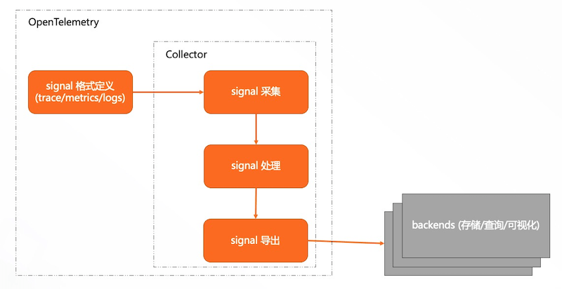

# [OpenTelemetry](https://opentelemetry.io)

## 目录
1. [OpenTelemetry](#opentelemetry-1)

---
### OpenTelemetry
>参考：[OpenTelemetry 官方中文文档](https://opentelemetry.io/zh/docs/)、[追踪中的核心概念](https://opentelemetry.io/docs/concepts/signals/traces/)。

1. 介绍OpenTelemetry（OTel）

    1. 是什么？

        OpenTelemetry 是一组用于生成、采集、处理和导出遥测数据的标准和工具。常见信号包括链路追踪（traces）、指标（metrics）和日志（logs）。

        OpenTelemetry 提供与厂商无关的 API、SDK 和 Collector。应用可直接导出数据，也可先发给 Collector 处理，再送到相应的后端（如 Prometheus 存指标、Jaeger 存追踪）。OTLP 是这套工具使用的遥测传输协议之一。

        >1. 可观测性（observability）：是一种根据系统生成外部数据（可观测性的 "三大支柱"：日志Logging、指标Metric、跟踪Tracing）研判系统内部发生情况的能力。帮助跨职能团队理解和回答有关高度分布式系统中正在发生的事情的具体问题。
        >2. 遥测（telemetry）：在这里指应用或基础设施产生并导出的运行数据。
    2. 不是什么？

        OpenTelemetry不提供与可观测性相关的后端服务，这类后端服务通常提供：存储、查询、可视化等服务。

    

    3. 规范：[opentelemetry-specification](https://github.com/open-telemetry/opentelemetry-specification)

        规范了观测数据的数据模型以及采集、处理、导出方法，包括：trace、metrics、logs（未来不排除会有新的类型）。
    4. 描述：[opentelemetry-proto](https://github.com/open-telemetry/opentelemetry-proto)

        该仓库用 [Protocol Buffers](https://github.com/protocolbuffers/protobuf) 定义 OTLP 消息和服务接口。
2. 概念

    - 事务（transaction）

        这里指一次业务操作，例如提交订单。OpenTelemetry 用 trace 描述执行链路，用 span 记录其中的一步。
    - 属性（attribute）

        描述遥测数据的键值对。例如在 HTTP span 上记录 `http.request.method=GET`。
    - 事件（event）

        span event 记录操作过程中某个时刻发生的事，包含名称、时间戳和可选属性。

        >使用一组属性而不是简单的消息/报文，可以使分析工具正确地索引事件，并使它们可以被搜索到。
    - 上下文（context）

        在执行过程中传递当前 span、baggage 等信息。跨服务调用时，发送方把追踪上下文注入请求，接收方提取后可创建子 span。读链路时，还要区分数据来自哪个实体、描述了哪次操作：

        1. 资源（resource）

            标识产生遥测数据的实体，例如用 `service.name` 标识服务。同一资源可关联多个 span、指标和日志。
        2. 跨度（span）

            链路中的一次操作，有名称、开始和结束时间，可附带属性和事件。

            - 以下标识符把多个 span 关联成一条链路：

                1. traceid

                    标识整条链路，同一链路中的 span 共享此 ID。
                2. spanid

                    标识当前操作。ID 的数值没有先后含义；要看哪些操作并行，可比较起止时间。
                3. parentid

                    指向父 span 的 ID；根 span 没有父 span。

        >日志可以独立产生，也可以携带 Trace ID 和 Span ID，与具体操作关联。span event 直接记录在所属 span 上。
    - 追踪（trace）

        由共享 Trace ID 的一个或多个 span 组成。沿父子关系可以追踪一次请求在多个服务间的处理路径。

        >Jaeger（分布式追踪系统）、Zipkin（分布式实时数据追踪系统）

    >sentry（应用实时错误监控）。

    - 指标（metric）

        观察事件的总体情况。e.g. cpu、内存、硬盘、网络等机器指标，rpc的请求延迟、错误率等网络协议指标，用户数、访问数、订单数等业务指标。

        >Prometheus（收集，系统监控和报警）、Grafana（数据可视化）。
    - 日志（log）

        传统的日志，提供精确的系统记录。
    - baggage

        随上下文跨服务传递的键值对。需要在后端检索某个值时，应在埋点中显式把它记录为属性。避免传递凭据等敏感信息。
    - 采样

        按比例采样可以减少上报和存储的链路数据。例如每秒有 1000 条新链路，按 1/1000 的概率采样，长期平均每秒采中一条，单秒的实际数量会波动。
3. APM（Application Performance Monitoring，应用性能监控）通过Tracing+Metrics+Logging的解决方案：

   1. 基于Metrics告警发现异常
   2. 通过Tracing定位到具体的系统和方法
   3. 根据模块的日志最终定位到错误详情和根源
   4. 调整Metrics等设置，更精确的告警/发现问题
