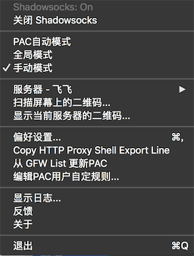
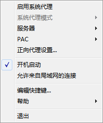
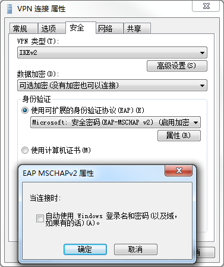
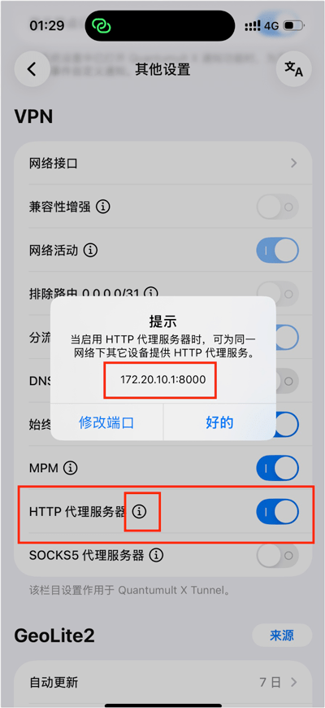
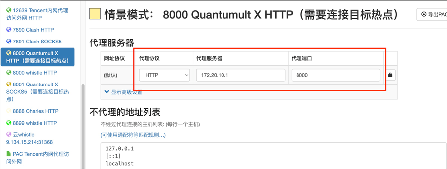
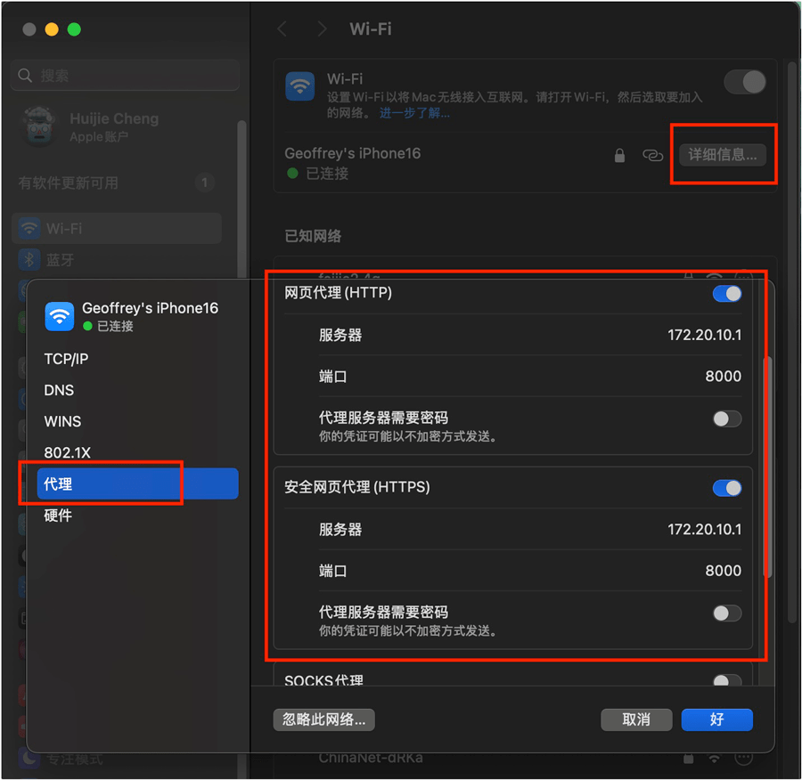
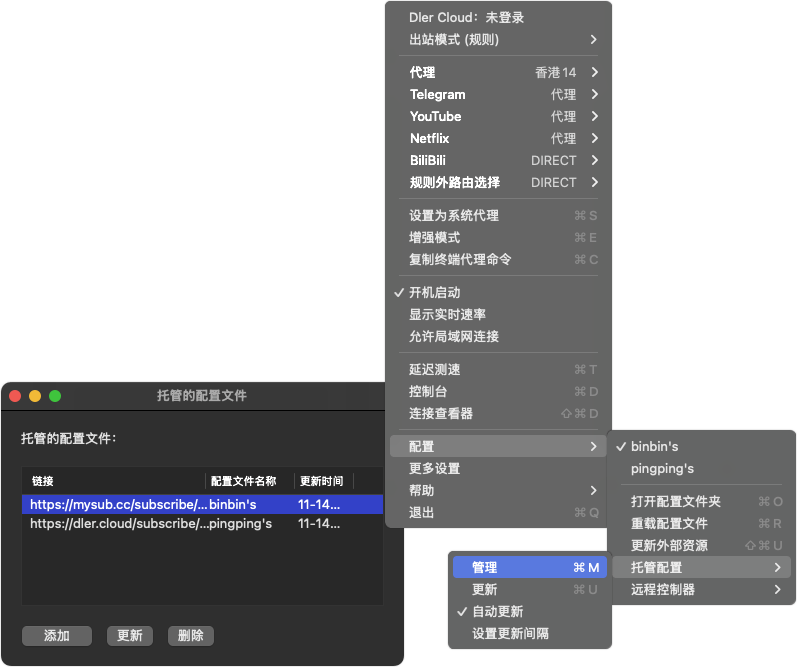

# 科学上网

## 目录
1. [服务端安装](#服务端安装)

    1. [通过Docker安装服务器：Shadowsocks、Cisco IPSec（IPSec Xauth PSK）或IPsec/L2TP（L2TP/IPsec PSK）](#通过docker安装服务器shadowsockscisco-ipsecipsec-xauth-psk或ipsecl2tpl2tpipsec-psk)
    1. [非Docker环境安装服务器：Shadowsocks、IKEv2（IKEv1）](#非docker环境安装服务器shadowsocksikev2ikev1)
1. [客户端配置](#客户端配置)

    1. [Shadowsocks](#shadowsocks客户端配置)
    1. [Cisco IPSec（IPSec Xauth PSK）或IPsec/L2TP（L2TP/IPsec PSK）](#cisco-ipsecipsec-xauth-psk或ipsecl2tpl2tpipsec-psk客户端配置)
    1. [IKEv2（IKEv1）](#ikev2ikev1客户端配置)
1. [案例](#案例)

    1. [ClashX 提供给同局域网其他设备翻墙功能](#clashx-提供给同局域网其他设备翻墙功能)
    1. [Quantumult X 提供给同局域网其他设备翻墙功能](#quantumult-x-提供给同局域网其他设备翻墙功能)
    1. [ClashX的`增强模式`](#clashx的增强模式)
    1. [Quantumult X 配置/添加节点](#quantumult-x-配置添加节点)
    1. [ClashX 配置](#clashx-配置)

---
## 服务端安装

>使用Docker是最快捷的方式。

### 通过Docker安装服务器：Shadowsocks、Cisco IPSec（IPSec Xauth PSK）或IPsec/L2TP（L2TP/IPsec PSK）
>先确认服务器的发行版、架构和虚拟化环境支持 Docker。各发行版的要求见 [Docker Engine 安装文档](https://docs.docker.com/engine/install/)。

- [安装、启动Docker](https://github.com/realgeoffrey/knowledge/blob/master/工具使用/Docker使用/README.md#docker使用)（若已安装Docker，不要再次安装/启动）

1. Shadowsocks服务端安装

    >来自：[Shadowsocks-libev Docker（alpine）](https://github.com/shadowsocks/shadowsocks-libev/tree/master/docker/alpine)。

    ```shell
    docker pull shadowsocks/shadowsocks-libev

    docker run -e PASSWORD=密码 -p 服务端口号:8388 -p 服务端口号:8388/udp -d --restart always shadowsocks/shadowsocks-libev  # 默认加密方式：aes-256-gcm
    ```
2. Cisco IPSec（IPSec Xauth PSK）或IPsec/L2TP（L2TP/IPsec PSK）服务端安装

    >来自：[docker-ipsec-vpn-server](https://github.com/hwdsl2/docker-ipsec-vpn-server)。

    1. 新建一个配置文件，包含：共享的密钥、帐户名称、密码。（帐户名称和密码可以设置多个）

        >文件位置和文件名可任意。仅有一个帐户时省略两个 `VPN_ADDL_` 项；有多个额外帐户时，用户名和密码分别按相同顺序用空格分隔。

        ```text
        VPN_IPSEC_PSK=共享的密钥
        VPN_USER=帐户名称1
        VPN_PASSWORD=密码1
        VPN_ADDL_USERS=帐户名称2
        VPN_ADDL_PASSWORDS=密码2
        ```
    2. 启动

        ```shell
        docker pull hwdsl2/ipsec-vpn-server

        docker run --name ipsec-vpn-server --env-file 「配置文件地址」 --restart=always -v /lib/modules:/lib/modules:ro -p 500:500/udp -p 4500:4500/udp -d --privileged hwdsl2/ipsec-vpn-server
        ```

### 非Docker环境安装服务器：Shadowsocks、IKEv2（IKEv1）
<details>
<summary>（建议<a href="https://github.com/realgeoffrey/knowledge/blob/master/工具使用/科学上网/README.md#通过docker安装服务器shadowsockscisco-ipsecipsec-xauth-psk或ipsecl2tpl2tpipsec-psk">通过Docker安装服务器</a>）</summary>

1. Shadowsocks服务端安装

    >来自：[teddysun:shadowsocks_install](https://github.com/teddysun/shadowsocks_install#shadowsocks-gosh)。

    1. 在Linux服务器（CentOS，Debian，Ubuntu）安装[shadowsocks-go](https://github.com/shadowsocks/shadowsocks-go)。

        ```shell
        wget -O shadowsocks-go.sh https://raw.githubusercontent.com/teddysun/shadowsocks_install/master/shadowsocks-go.sh

        chmod +x shadowsocks-go.sh
        ./shadowsocks-go.sh 2>&1 | tee shadowsocks-go.log
        ```

        >1. 密码：设置独立的随机密码
        >2. 服务器端口号：自己设定（默认：8989）
    2. 查看状态

        ```shell
        /etc/init.d/shadowsocks start   # 启动
        /etc/init.d/shadowsocks stop    # 停止
        /etc/init.d/shadowsocks restart # 重启
        /etc/init.d/shadowsocks status  # 状态
        ```
    3. 卸载

        ```shell
        ./shadowsocks-go.sh uninstall
        ```
2. IKEv2（IKEv1）服务端安装

    >来自：[quericy:one-key-ikev2-vpn](https://github.com/quericy/one-key-ikev2-vpn)。

    >以下是该脚本使用 strongSwan 5.5.1 时的历史步骤。证书、网络和启动方式取决于服务器环境。

    1. 新部署请使用发行版提供的 strongSwan 软件包，按所选软件包的文档配置服务。[strongSwan 官方安装指南](https://docs.strongswan.org/docs/latest/install/install.html)
    2. 旧版脚本的配置提示
        1. 选择**vps类型**：

            1. Xen、KVM
            2. OpenVZ
        2. 设置**IP**：

            服务器IP，绑定的域名（默认：服务器IP）。
        3. 选择**证书类型**：

            1. yes：证书颁发机构签发的 TLS/SSL（X.509）证书

                （未测试）
            2. no：生成自签名证书（默认：生成自签名证书）

                选择默认的Country（C）、Organization（O）、Common Name（CN）。
        4. 设置**pkcs12证书的密码**（默认：空）。
        5. 选择是否使用**SNAT规则**（默认：不使用）

            独立IP的vps才可以使用SNAT，可提升防火墙对数据包的处理速度。若服务器网络设置了NAT（如：AWS的弹性IP机制），则填写网卡连接接口的IP地址。
        6. 选择**防火墙配置**：

            1. yes：firewall
            2. no：iptables（默认）。
    3. 配置用户名、密码、密钥

        1. 默认用户名、密码、密钥将以绿字显示，可根据提示自行修改，多用户则在配置文件中按格式一行一个（多用户时用户名不能使用%any）

            ```shell
            vi /usr/local/etc/ipsec.secrets
            ```
        2. 保存并重启服务生效

            ```shell
            ipsec restart
            ```

    4. 客户端验证

        1. 将提示信息中生成的证书文件**ca.cert.pem**复制到客户端，修改后缀名为**ca.cert.cer**后导入。

            远程复制：

            ```shell
            scp -P 端口号 服务器名@服务器地址:/root/my_key/ca.cert.pem 本地存放路径
            ```
        2. 此脚本的 IKEv1 预共享密钥模式在连接时输入密钥（PSK）。
    5. ipsec启动问题

        此旧版脚本安装的 ipsec 默认不会随服务器启动。

        1. 命令需要手动开启，

            ```shell
            ipsec start   # 启动服务

            ipsec stop    # 关闭服务
            ipsec restart # 重启服务
            ipsec reload  # 重新读取
            ipsec status  # 查看状态
            ipsec --help  # 查看帮助
            ```
        2. 添加 **/usr/local/sbin/ipsec start**到自启动脚本文件中（如：rc.local等）

            ```shell
            vi /etc/rc.d/rc.local

            # 添加
            /usr/local/sbin/ipsec start
            ```
    6. 卸载

        1. 卸载

            ```shell
            cd ~/strongswan-5.5.1

            make uninstall
            ```
        2. 删除脚本所在目录的相关文件（one-key-ikev2.sh、strongswan.tar.gz、strongswan文件夹、my_key文件夹）。
        3. 检查iptables配置。
</details>

---
## 客户端配置

### Shadowsocks客户端配置

>客户端安装：[macOS](https://github.com/shadowsocks/ShadowsocksX-NG)、[Windows](https://github.com/shadowsocks/shadowsocks-windows)。

1. macOS

    

    1. PAC自动模式：

        遵循系统代理的应用先执行 PAC（代理自动配置）脚本，按其返回结果直连或使用本地代理。
    2. 全局模式：

        走系统代理（系统层面的默认代理）的所有请求都走Shadowsocks代理。
    3. 手动模式：

        监听特定端口号的请求（默认代理端口号：`1080`），都走Shadowsocks代理。
2. Windows

    

    1. 开启软件：

        监听特定端口号的请求（默认代理端口号：`1080`），都走Shadowsocks代理。
    2. 启动系统代理（全局模式）：

        走系统代理（系统层面的默认代理）的所有请求都走Shadowsocks代理。
    3. PAC：

        代理自动配置，一般使用[gfwlist](https://github.com/gfwlist/gfwlist)列表。
    4. 允许来自局域网的连接：

        其他设备可连接主机局域网 IP 和客户端监听的端口。代理类型须与该端口提供的协议一致（如 SOCKS5）。

- Chrome插件[SwitchyOmega](https://github.com/FelisCatus/SwitchyOmega)，用于配置 Chrome 的代理规则，原项目已停止维护。

3. iOS

    >使用 VPN 配置的客户端可在系统 VPN 设置中查看连接状态。Wi-Fi 的 HTTP 代理单独配置。

    从提供相应应用的 App Store 安装 `Quantumult X` 等客户端，添加服务器并授权添加 VPN 配置；具体流量按客户端的路由规则处理。

### Cisco IPSec（IPSec Xauth PSK）或IPsec/L2TP（L2TP/IPsec PSK）客户端配置
>1. 参考：[配置 IPSec/Xauth VPN 客户端](https://github.com/hwdsl2/setup-ipsec-vpn/blob/master/docs/clients-xauth-zh.md)。
>2. 参考：[配置 IPsec/L2TP VPN 客户端](https://github.com/hwdsl2/setup-ipsec-vpn/blob/master/docs/clients-zh.md)。

### IKEv2（IKEv1）客户端配置
1. iOS

    >设置 -> 通用 -> VPN

    1. 类型：IKEv2。
    2. 服务器地址：和证书保持一致。
    3. 远程ID：和服务器地址一致。
    4. 本地ID：（不填）。
    5. 鉴定

        1. 用户鉴定：用户名。
        2. 用户名：服务端设置的值。
        3. 密码：服务端设置的值。
    6. 证书

        1. 若客户端已信任签发服务器证书的 CA，且证书名称与服务器身份匹配，可直接验证服务器。
        2. 若使用该脚本生成的私有 CA，需要在客户端导入并信任该 CA 的证书。

            客户端用Safari导入ca.cert.cer并选择**始终信任此证书**。

        >1. 在`VPN与设备管理`可以查询、删除证书。
        >2. 在`证书信任设置`可以开关信任的证书。
2. macOS

    >系统偏好设置 -> 网络

    1. 接口：VPN。
    2. VPN类型：IKEv2。
    3. 服务器地址：和证书保持一致。
    3. 远程ID：和服务器地址一致。
    4. 本地ID：（不填）。
    5. 鉴定设置

        1. 用户名。
        2. 用户名：服务端设置的值。
        3. 密码：服务端设置的值。
    6. 证书

        1. 若客户端已信任签发服务器证书的 CA，且证书名称与服务器身份匹配，可直接验证服务器。
        2. 若使用该脚本生成的私有 CA，需要在客户端导入并信任该 CA 的证书。

            客户端添加ca.cert.cer后，进入「钥匙串访问」把证书设置为「始终信任」。
3. Windows

    1. 设置新的连接或网络 -> 连接到工作区 -> 使用我的Internet连接（VPN）。
    2. Internet地址：和证书保持一致。
    3. 创建好后右键属性 -> 设置VPN类型

        
    4. 用户名：服务端设置的值。
    5. 密码：服务端设置的值。
    6. 证书

        1. 若客户端已信任签发服务器证书的 CA，且证书名称与服务器身份匹配，可直接验证服务器。
        2. 若使用该脚本生成的私有 CA，需要在客户端导入并信任该 CA 的证书。

            1. 搜索`mmc.exe`，打开控制台
            2. 文件 -> 添加/删除管理单元

                选择「证书」→「计算机帐户」→「本地计算机」。
            3. 证书 -> 受信任的根证书颁发机构 -> 证书，右键 -> 所有任务 -> 导入，选择ca.cert.cer导入成功。

---
## 案例

### ClashX 提供给同局域网其他设备翻墙功能

已经联网的mac电脑，开启ClashX，并开启"允许局域网连接"：同一局域网下的机器（手机、电脑、等），HTTP代理到mac电脑的IP+ClashX的HTTP代理端口，即可翻墙。

>连接VPN的手机，也需要有HTTP代理功能才可以提供翻墙功能给连接其热点的设备。

### Quantumult X 提供给同局域网其他设备翻墙功能
1. 提供翻墙的手机（安装了Quantumult X的手机）

    1. 打开手机热点
    2. 打开Quantumult X的VPN开关，并「设置」->「其他设置」->「VPN」->打开「HTTP代理服务器」

        
2. 其他设备（手机、电脑、等） 先连接手机热点，再：

    1. 方案一：浏览器的http代理到手机ip:port

        
    2. 方案二：其他设备系统代理到手机ip:port

        

    即可HTTP请求通过上面手机Quantumult X的VPN功能。

>使用 SOCKS5 时，服务端需开启相应监听端口，客户端也须选择 SOCKS5。

### ClashX的`增强模式`
ClashX`的增强模式`原理：通过虚拟网卡接收路由到该接口的流量。

- 有些应用可能不会遵循`系统代理`设置，使用`增强模式`可以让 ClashX 处理其中按路由进入虚拟网卡的流量

    1. ClashX 会安装一个虚拟网卡并设置为默认路由
    2. ClashX 虚拟网卡只能处理 TCP，UDP 和 ICMP 流量
    3. ICMP 流量不能被代理，ClashX 虚拟网卡将直接返回响应结果

    >e.g. git不走系统代理，可通过两种方案让git通过ClashX代理：①`git config --global http.proxy 'http://127.0.0.1:7890'` 或 ②开启ClashX的`增强模式`。

### Quantumult X 配置/添加节点
支持满足其规则的配置，如：Shadowsocks、ShadowsocksR、HTTP、Socks5、VMess、Trojan等代理协议。

1. 方案一

    完整的配置文件：设置 -> 配置文件 - 下载配置 -> 输入配置链接，**会覆盖之前所有配置**。

    >e.g. 填上`https://dler.cloud/subscribe/**********?quantumultx=smart`
2. 方案二

    仅新增节点：设置 -> 节点 - 节点资源 -> 右上角添加 -> 资源 - 节点 - 资源路径，**在原有配置的基础上添加节点**。

    >e.g. 填上`https://iplcsub.com/subscribe/****/****/ssr/`

### ClashX 配置
支持满足其规则的配置，如：Shadowsocks(SS)、ShadowsocksR(SSR)、Socks、Snell、V2Ray、Trojan等代理协议。

1. 配置 -> 托管配置 -> 管理，可以新增/删除进行配置管理。

    可以在多个配置间切换。

    >e.g. 添加`https://mysub.cc/subscribe/****/*****/clash/`或`https://dler.cloud/subscribe/**********?clash=smart`

    
