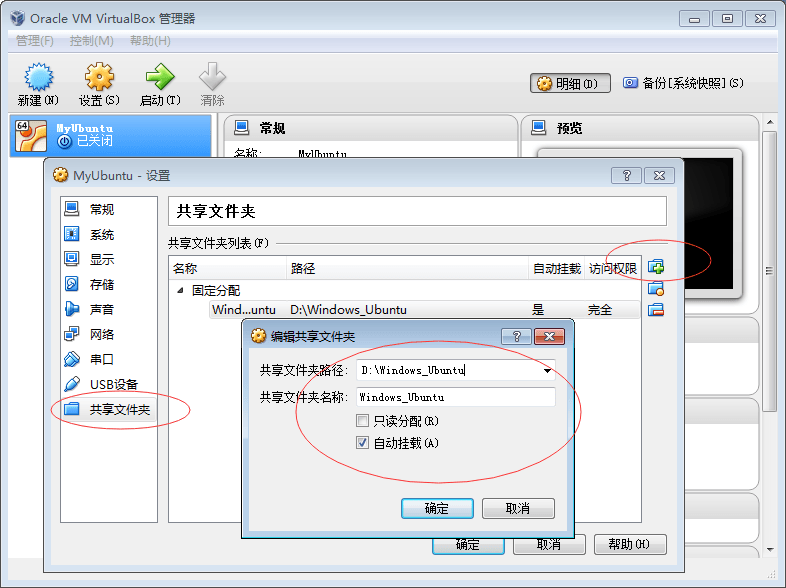

### Laravel框架配置+LNMP环境配置（Ubuntu15.04）

>历史环境记录：Ubuntu 15.04、PHP 5 和对应 Laravel 安装方式均已过期，不建议用于新项目；以下内容仅适合维护旧环境时参考。
>
>若默认 apt 镜像找不到 vivid，将 Ubuntu 源改指向[官方旧版本归档](https://old-releases.ubuntu.com/ubuntu/dists/vivid/)，保留对应的发行代号和组件。Vivid 的 APT 需要安装 `apt-transport-https` 才能使用 HTTPS。缺少该包时，可先用 `http://old-releases.ubuntu.com/ubuntu/`，保留 APT 仓库签名校验，运行 `sudo apt-get update` 和 `sudo apt-get install apt-transport-https`。装有该包时，可将源设为 `https://old-releases.ubuntu.com/ubuntu/`，再运行 `sudo apt-get update`。[Ubuntu APT 手册](https://manpages.ubuntu.com/manpages/bionic/man1/apt-transport-https.1.html)

1. 安装**Ubuntu Desktop**或**Ubuntu Server**

    >安装完毕之后可以弹出安装用的 ISO 虚拟光盘
2. 安装LNMP环境

    >LNMP：Linux Nginx MySQL PHP。

    1. 安装**php5-fpm**，并安装**php5-mcrypt**和**php5-curl**和**php5-cli**和**php5-gd**扩展

        ```shell
        sudo apt-get install php5-fpm php5-mcrypt php5-curl php5-cli php5-gd
        ```

        启用 mcrypt 模块：

        ```shell
        sudo php5enmod mcrypt
        sudo service php5-fpm restart
        ```

        >若 Nginx 日志提示连接 FPM 套接字时权限不足，检查 `/etc/php5/fpm/pool.d/www.conf` 的 `listen` 路径和套接字权限。默认 Nginx 用户为 www-data 时，可设置 `listen.owner = www-data`、`listen.group = www-data`、`listen.mode = 0660`，再重启 php5-fpm。
    2. 安装**mysql-server**、**php5-mysql**

        >desktop还可以安装：**mysql-client**、**mysql-workbench**

        ```shell
        sudo apt-get install mysql-server php5-mysql
        ```
    3. 安装**nginx**

        ```shell
        sudo apt-get install nginx
        ```
3. 检查 Apache 与 Nginx 的端口

    如果已有 Apache 占用 80 端口，可按第 7 步将 Apache 改为监听 8080，再启动 Nginx；只运行 Nginx 时，可停用 Apache。
4. 修改项目权限

    以普通用户部署项目。以下以 /opt/www/mylaravel.com 为项目根目录。新建项目先按第 5 步将文件放到该位置，再设置权限，使 Web 服务组可以读取代码、进入目录。

    ```shell
    sudo chown -R "$USER":www-data /opt/www/mylaravel.com
    sudo chmod -R g=rX,o-rwx /opt/www/mylaravel.com
    ```
5. *可选：下载 PHP 框架 Laravel 并安装*

    本文的 `app/storage` 路径对应 [Laravel 4.2](https://laravel.com/docs/4.2/installation)。新建同版本测试项目时，先安装兼容 PHP 5 的 [Composer 2.2 LTS](https://getcomposer.org/download/)，然后在自己的主目录运行：

    ```shell
    cd ~
    composer create-project laravel/laravel mylaravel.com '4.2.*'
    ```

    维护已有项目时，保留原来的 `composer.lock`，在项目目录运行 `composer install`。旧依赖需要有可用的下载源或备份。

    将新建项目移至 */opt/www*（目标项目目录应尚不存在），然后按第 4 步设置代码权限：

    ```shell
    sudo mkdir -p /opt/www
    sudo mv "$HOME/mylaravel.com" /opt/www/
    cd /opt/www/mylaravel.com
    ```

    Laravel 4.2 还需要部署用户和 PHP 服务都能写入 `app/storage`。先用 `sudo usermod -aG www-data "$USER"` 将当前部署用户加入 `www-data`，退出会话后重新登录，用 `id -nG` 确认组成员资格，再回到项目目录。

    目录的 setgid 位让新文件继承 `www-data` 组。部署命令和 PHP 进程创建文件时应保留组写权限，例如对该运行目录使用合适的 `umask`（如 `0007`），并确认应用创建文件时请求的权限允许组写。

    ```shell
    sudo chmod -R ug+rwX,o-rwx app/storage
    sudo find app/storage -type d -exec chmod g+s {} \;
    ```
6. 在服务器nginx配置虚拟主机：

    ```shell
    sudoedit /etc/nginx/sites-available/default
    ```

    >在已有 server 块之外加入以下配置。默认站点应已链接到 sites-enabled，fastcgi_pass 路径应与 PHP-FPM 的 listen 一致：
    >
    >```text
    >server{
    >    listen 80;
    >    server_name mylaravel.com;
    >    root /opt/www/mylaravel.com/public;
    >    index index.php index.html index.htm;
    >    location / {
    >        try_files $uri $uri/ /index.php?$query_string;
    >    }
    >    location = /index.php {
    >        try_files $uri =404;
    >        fastcgi_pass unix:/var/run/php5-fpm.sock;
    >        include fastcgi_params;
    >        fastcgi_param SCRIPT_FILENAME $document_root/index.php;
    >    }
    >    location ~* \.php(?:/|$) { return 404; }
    >}
    >```

    要换端口号，修改虚拟主机的 `listen`，并在客户端使用相应端口访问。备份文件放在 sites-enabled 目录之外，避免被通配符重复加载。先检查配置，再重载 Nginx：

    ```shell
    sudo nginx -t && sudo service nginx reload
    ```

    本机测试可修改**运行浏览器的客户端**的 hosts 文件（Linux 为 `/etc/hosts`）。下例适用于浏览器与服务器在同一台机器上，远程访问时换成服务器 IP。

    加入解析域名：

    ```text
    127.0.0.1    mylaravel.com
    ```

    有问题可以查看nginx错误日志 */var/log/nginx/error.log* ，或查看laravel错误日志 *mylaravel.com/app/storage/logs/laravel.log*
7. *可选：用apache2配置虚拟主机*

    以下示例假设已安装 Apache 2.4 并启用 PHP 处理器（如 Ubuntu 的 `libapache2-mod-php5`）。与 Nginx 共存时，在 */etc/apache2/ports.conf* 将冲突的 `Listen 80` 改为 `Listen 8080`。为 abc.com 设置客户端域名解析，再建立 */etc/apache2/sites-available/abc.com.conf*：

    ```text
    <VirtualHost *:8080>
        DocumentRoot /opt/www/mylaravel.com/public
        ServerName abc.com
        ErrorLog ${APACHE_LOG_DIR}/abc-error.log
        CustomLog ${APACHE_LOG_DIR}/abc-access.log combined
        <Directory /opt/www/mylaravel.com/public>
            Require all granted
            Options -Indexes +FollowSymLinks
            AllowOverride All
        </Directory>
    </VirtualHost>
    ```

    启用站点和 rewrite 模块，使 Laravel 的 public/.htaccess 生效。验证配置后重启 Apache，访问 `http://abc.com:8080/`：

    ```shell
    sudo a2ensite abc.com.conf
    sudo a2enmod rewrite
    sudo apache2ctl configtest && sudo service apache2 restart
    ```

    以后停用该站点时，运行 `sudo a2dissite abc.com.conf`，检查配置后重载 Apache。
8. 修改服务器上传文件大小

    1. 修改php上传文件大小限制

        查找php配置文件路径，在终端输入：

        ```shell
        php5-fpm -i | grep 'Loaded Configuration File'
        ```

        根据找到的路径打开php.ini，修改 upload_max_filesize 为100M、修改 post_max_size 为150M，重启php：

        ```shell
        sudo service php5-fpm restart
        ```
    2. 修改nginx上传文件大小限制

        在虚拟主机配置文件的 `server` 块或 */etc/nginx/nginx.conf* 的 `http` 块中增加：

        ```text
        client_max_body_size 150m;
        ```
        保存后运行 `sudo nginx -t && sudo service nginx reload` 使配置生效。
9. 在 Nginx 开启 gzip 压缩

    在 nginx.conf 的 http 块中设置，已有同名指令时修改原值：

    ```text
    gzip on;
    gzip_min_length 1k; # 最小响应长度
    gzip_buffers 4 16k;
    gzip_comp_level 2;  # 范围 1 至 9
    gzip_types application/javascript text/javascript text/css application/xml;
    ```

    text/html 默认已包含。保存后检查配置并重载 Nginx。
10. 安装软件

    1. 安装**openssh-server**

        ```shell
        sudo apt-get install openssh-server
        ```

        用于被远程连接，windows安装xshell程序可以远程连接安装了openssh-server的主机。
    2.
        >desktop版设置共享文件夹（安装完毕后可以弹出安装光盘）：
        >
        >    1. 虚拟机为linux（desktop）：
        >
        >        虚拟机运行期间，在虚拟机窗口选择「设备」 -> 「插入增强功能光盘镜像」，在客户机内运行安装程序，成功执行之后，关闭虚拟机，在虚拟机设置共享文件夹：
        >
        >         
        >
        >         再次运行虚拟机，终端执行：
        >         ```shell
        >         mkdir -p "文件夹路径"
        >         sudo mount -t vboxsf "虚拟机设置的文件夹名称" "文件夹路径"
        >         ```
        >
        >         如需通过 /etc/rc.local 开机挂载，请使用绝对挂载路径：
        >         `sudo vim /etc/rc.local`
        >
        >        在「exit 0」之前添加：
        >         `mount -t vboxsf "虚拟机设置的文件夹名称" "文件夹路径"`
        >    2. 虚拟机为windows xp：
        >
        >         在「软件中心」安装Virtual Box，配置安装xp镜像iso。
        >         安装「增强功能」（虚拟机中双击我的电脑中virtul box图标或在视窗下选择「设备」 -> 「安装增强功能」）；安装完毕后在视窗下选择「设备」 -> 「共享文件夹」，分配好共享路径（勾选「自动挂载」）；最后在虚拟机中映射路径。
        >    3. Linux Server 客户机同样可安装增强功能，并按第 1 项使用 vboxsf 挂载。

    3.
        >安装Less（CSS预处理器）
        >   `sudo apt-get install node-less`

        >>  转换.less为.css：
        >>  `lessc 地址file.less > 地址file.css`
    4. 安装shadowsocks客户端

        原笔记使用 shadowsocks-go 配合 SwitchySharp，将浏览器的 SOCKS5 代理指向本机。该客户端已由[上游项目标记为弃用](https://github.com/shadowsocks/shadowsocks-go)，仅作历史记录。
    5. 安装WebStorm/PhpStorm

        下载与此系统兼容的历史版本。若该版本未附带 Java 运行时，按对应版本要求安装 JDK，再解压并运行 bin 目录下的启动脚本。
    6. 安装rapid SVN

        图形界面：
        在「软件中心」搜索并下载rapid SVN，选择checkout（签出），url填写局域网HTTP地址，目标目录填写本地存放地址。
        增加：文件右键 -> Add
        删除：文件右键 -> 删除
        提交：文件或总的文件夹选择commit
        安装命令行客户端：

        ```shell
        sudo apt-get install subversion
        ```
    7. 安装meld diff

        在「软件中心」搜索安装meld diff，并在rapid SVN中配置此软件：svn -> 查看 -> 首选项 -> 程序选项卡 「diff tool」填入①meld ②%1 %2。
    8. 安装服务器搜索工具xunsearch

        [xunsearch官网](https://www.xunsearch.com/)下载，并解压出文件夹，打开文件夹，运行脚本即可完成安装。

        ```shell
        cd 文件夹
        sh setup.sh
        ```

        >若安装失败，查看setup.log纠错后再执行脚本一遍

        安装运行完成后（可以删除下载的安装文件夹），执行：

        ```shell
        sudo 安装目录/xunsearch/bin/xs-ctl.sh restart
        ```

        放置到系统启动自动运行文件 */etc/rc.local* 内（在exit 0之前）：

        ```shell
        路径/xunsearch/bin/xs-ctl.sh restart
        ```
    9. 安装groovy语言`sudo apt-get install groovy`
    10. 设置 VPN（历史配置）

        PPTP 已过时，不适合保护敏感通信。原笔记的入口为「系统设置」 -> 「网络」，添加一个接口为「VPN」、连接类型为「点到点隧道协议（PPTP）」的连接；VPN网关、用户名、密码设置正确后，高级设置里选开「使用点到点加密」、选开「发送PPP回响包」。保存之后会新增一个vpn连接，成功选择vpn连接成功后，会在连接图标上出现一把锁。
    11.
        >安卓环境配置
        >   *JDK -> Genymotion -> Android sdk -> IDE -> ndk*
        >>  ubuntu环境下genymotion模拟器兼容性差、死机无法使用，因此放弃在ubuntu下进行的安卓开发
