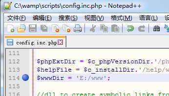
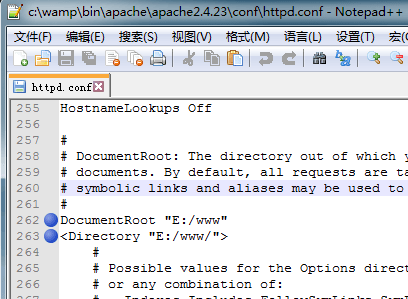
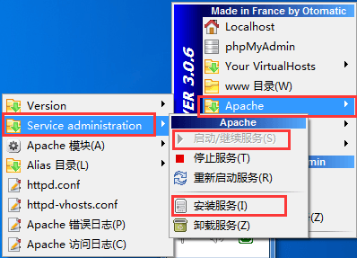
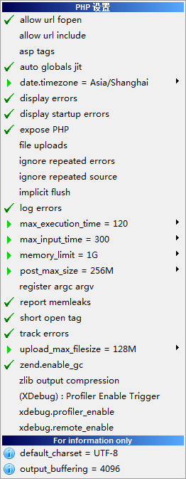
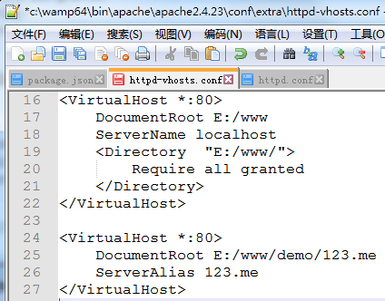
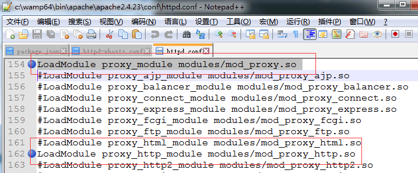
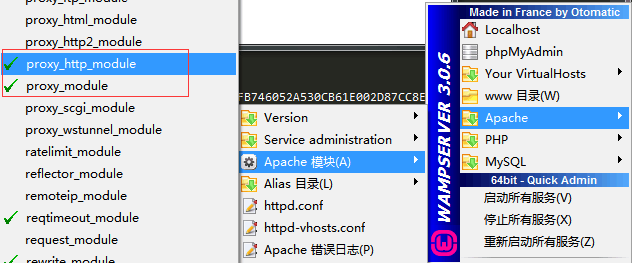

### WAMP环境配置（Windows）

>历史环境记录：文中 Wampserver 3.0.6、PHP 5.x/7.0、Windows XP/7 等版本均已过期，新环境请使用仍受支持的 Windows、WampServer、Apache/PHP/MySQL 版本。

>[官网](https://wampserver.aviatechno.net/)下载。本文使用版本 **Wampserver 3.0.6 64 bit x64** ，其中包括Apache 2.4.23、PHP 5.6.25/7.0.10、MySQL 5.7.14、PhpMyAdmin 4.6.4、Adminer 4.2.5、PhpSysInfo 3.2.5。
>
>旧记录中提到的 Windows 7/XP 兼容方式仅适合维护遗留环境，不建议新装。

>WAMP：Windows Apache MySQL PHP。

1. 安装

    安装接近尾声时会提示选择程序打开的**浏览器**和**文本编辑器**。
2. 调整语言

    程序安装好并启动，右击系统托盘中WampServer图标，选择：**language -> chinese**。
3. 配置 www 目录

    1. 进入程序所在的文件夹，找到 *路径\wamp\scripts* 下的 **config.inc.php**：

        文本打开并找到`$wwwDir`（默认：安装目录的 www 文件夹），修改为自定义位置`$wwwDir = 'E:/www';`，如图：

        

        >注意：Windows 里的文件夹为`E:\www`，这里的是 `E:/www`，斜线方向有区别。
    2. 保存文件，退出并重新启动 WampServer。这一步只调整托盘菜单打开的位置，Apache 站点根目录见第 4、7 节。

        左击系统托盘中的WampServer，选择 **www 目录** 菜单项后就会打开设置好的目录。

        >请先确保系统中存在此文件夹。
4. 配置 Apache Web 服务器

    1. 设置主目录

        左击系统托盘中的WampServer，选择 **Apache -> httpd.conf** 配置文件：

        1. 找到`DocumentRoot`，设置为`DocumentRoot "E:/www"`。
        2. 找到`<Directory "${INSTALL_DIR}/www/">`，设置为`<Directory "E:/www/">`。

        
    2. 启动

        若 Apache 服务未安装，以管理员身份运行 WampServer，在 **Apache -> Service administration** 中选择 **安装服务**。服务已安装时直接选择 **启动/继续服务**。确保监听端口（本例为 80）未被其他程序占用。

        
5. 配置 PHP 解释器

    左击系统托盘中的WampServer，选择 **PHP -> PHP 设置** ，按项目需要调整。若菜单没有相应数值，可从托盘菜单打开 Apache 使用的 `php.ini`，修改后重启 Apache。下列时区、执行时间、内存和上传限制是旧项目示例。上传时 `post_max_size` 应大于 `upload_max_filesize`，以容纳整个请求体。

    1. **date.timezone** 设置为`Asia/Shanghai`
    2. **max_execution_time** 设置为`120`
    3. **max_input_time** 设置为`300`
    4. **memory_limit** 设置为`1G`
    5. **post_max_size** 设置为`256M`
    6. **upload_max_filesize** 设置为`128M`

    
6. 配置 MySQL 数据库

    左击系统托盘中的WampServer，选择 **phpMyAdmin** 。

    >本文旧版首次安装时，MySQL 的 `root` 密码可能为空。仅在本机初始化时使用，随后设置密码。应用连接数据库时使用单独授权的账号。
7. 配置 虚拟主机
    1. 左击系统托盘中的WampServer，选择 **Apache -> httpd-vhosts.conf** 配置文件：

        1. 配置localhost虚拟主机：

            ```text
            # 修改已有的 localhost 虚拟主机：
            <VirtualHost *:80>
                DocumentRoot E:/www
                ServerName localhost
                <Directory  "E:/www/">
                    Require local
                </Directory>
            </VirtualHost>
            ```
        2. 在默认配置后面添加新的虚拟主机：

            ```text
            <VirtualHost *:80>
                DocumentRoot E:/www/demo/123.me
                ServerName demo.test
                <Directory "E:/www/demo/123.me/">
                    Require local
                </Directory>
            </VirtualHost>
            ```

            >在www文件内新建demo文件夹，再在demo文件夹内新建123.me文件夹。

        
    2. 用管理员权限打开 *C:\WINDOWS\system32\drivers\etc* 下的 **hosts**，增加代码：

        ```text
        127.0.0.1 demo.test
        ```
    3. 确认 `httpd.conf` 已包含 `conf/extra/httpd-vhosts.conf`，重启 Apache。将首页放在 `E:/www/demo/123.me/`，用本机浏览器访问 `http://demo.test/`。
8. 在APACHE服务器上的访问方式上去除**index.php**

    启用 Apache 的 `rewrite_module`，在项目对应的 `<Directory>` 中允许 `AllowOverride FileInfo` 并启用 `Options +FollowSymLinks`，修改服务器配置后重启 Apache。在与入口 `index.php` 相同的目录新建 `.htaccess`。下面的旧项目从 `PATH_INFO` 读取路由，需确认 PHP 处理器接受 `index.php/路径`：

    ```text
    RewriteEngine on
    RewriteCond %{REQUEST_FILENAME} !-d
    RewriteCond %{REQUEST_FILENAME} !-f
    RewriteRule ^(.*)$ index.php/$1 [END]
    ```

    若应用从原始请求 URI 读取路由，可将最后一行改为 `RewriteRule ^ index.php [END]`。
9. 开启代理转发

    1. 左击系统托盘中的WampServer，选择 **Apache -> httpd.conf** 配置文件:

        1. 找到`LoadModule proxy_module modules/mod_proxy.so`，去除注释。
        2. 找到`LoadModule proxy_http_module modules/mod_proxy_http.so`，去除注释。

        
    2. 也可通过托盘菜单启用上述两个模块，任选一种方式即可：

        
    3. 左击系统托盘中的WampServer，选择 **Apache -> httpd-vhosts.conf** 配置文件，添加：

        ```text
        <VirtualHost *:80>
            ServerName proxy.test
            <Location "/">
                Require local
            </Location>
            ProxyPass / http://127.0.0.1:8080/
            ProxyPassReverse / http://127.0.0.1:8080/
        </VirtualHost>
        ```

        将两个后端地址改为实际运行的 HTTP 服务地址，按第 7 节把 `proxy.test` 映射到本机并重启 Apache，即可访问 `http://proxy.test/`。
10. 后续

    升级Chrome之后导致出现 Aestan Tray Menu 找不到有效路径问题，查看 `路径\wamp` 下的 **wampmanager.ini** 和 **wampmanager.conf**，先退出 WampServer，在 `wampmanager.conf` 中将浏览器路径改为实际的 Chrome 可执行文件路径，再启动 WampServer。`wampmanager.ini` 是生成的菜单文件，重启后可核对其中的路径。
