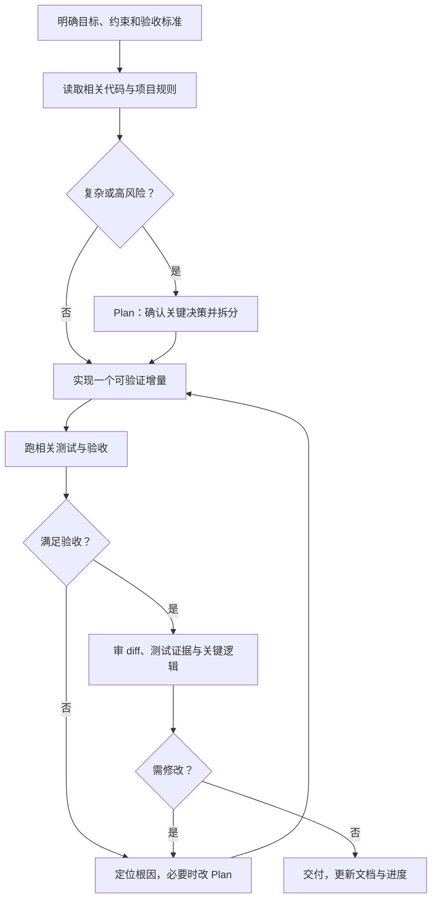

# AI笔记
## 目录

1. [概念：从 Vibe Coding 到 Agentic Engineering](#1-概念从-vibe-coding-到-agentic-engineering)
1. [工作流：从需求到交付](#2-工作流从需求到交付)
1. [长任务、并行、安全与评估](#3-长任务并行安全与评估)
1. [FDE：把技术落地到客户业务](#4-fde把技术落地到客户业务)
1. [招聘岗位：AI Agent 全栈工程师](#5-招聘岗位ai-agent-全栈工程师)

---

### 1. 概念：从 Vibe Coding 到 Agentic Engineering

**Agentic Engineering**（智能体工程）：在 coding agent 协助下开发软件。这里的 coding agent（如 Claude Code、Codex、Gemini CLI、Cursor Agent）能**写代码并执行代码**，在工具循环里迭代到目标被满足为止。人的重心从逐行敲实现，转向定义目标、边界、上下文、工具、验证标准，并持续把教训写回规则与 harness。

>Agent 的实用定义：在循环中调用工具以达成目标。对 coding agent，工具集里必须包含代码执行；没有执行能力，模型输出很难被可靠地验证为「可工作的软件」。

**Vibe Coding**（氛围编程）：Karpathy 原义是用自然语言快速要结果，并「几乎不看代码本身」——更适合低风险原型与个人玩具。不宜把「凡是用了 LLM 写代码」都叫 Vibe Coding。

两者的分界主要是：**是否理解并承担交付责任，以及是否有足够验证**；不能按「补全还是 Agent」划线。随着 agent 更可靠，有人会减少逐行审查，但责任仍在人：可像信任成熟团队一样依赖其「过往表现」，问题出现时再深入排查，而不是假装没有风险。

高质量产出 ≈ **清晰 Spec + 可见上下文 + 稳定工具 + 可执行验证 + 人类对关键路径负责**。

| 面向 | Vibe Coding | Agentic Engineering |
| --- | --- | --- |
| 交付方式 | Prompt → 结果 → 继续改提示 | 目标 → 按需 Plan → Execute → Verify → Learn |
| 人的角色 | 临时指挥、补丁作者 | 产品判断、架构约束、验证与担责 |
| AI 的角色 | 生成结果，也可能调工具 | 在目标、权限、验收约束内执行并自我迭代 |
| 上下文 | 临时聊天 | 仓库内可版本化的文档、规则、Plan、测试 |
| 质量来源 | 模型临场表现 | 约束、测试、评审、自动化门禁 |
| 主要风险 | 需求漂移、隐性技术债 | 上下文过载、权限过大、验证不足 |

<details>
<summary>定位转变（读完可收起）</summary>

增加**产品判断、架构与验证**投入，但仍需懂代码、会调试、对交付负责。先定必要边界，再随实现反馈细化设计，不必一开始画完整架构。

代码审查不能省：核心业务逻辑、权限、安全、数据迁移、计费、并发和异常恢复仍要人审；复杂任务先审 plan，再审 diff 与测试证据。同时也要扮演**测试**角色。

让 AI 动手前先把需求说清楚——可以是一句明确指令，也可以多轮澄清边界后再开干。

>学新技术栈时，优先掌握架构模型、生态约定、数据设计、调试与部署；样板语法和重复实现可以更多交给 AI。LLM 不会自动从错误中「学会」，但 coding agent 可以——前提是你把教训写回指令与工具 harness。

</details>

#### 核心原则

1. **目标和验收先于实现**：Spec 是约定，不一定是独立文档。小改动写清目标、约束、验收即可；复杂需求再补用户路径、数据契约、边界与非目标。
1. **上下文即基础设施**：架构、领域知识、命令、规范沉淀在仓库内，不散落在聊天记录。
1. **小任务、强边界**：围绕一个可验证结果（常对应一个 PR）；相关测试与文档可同改，勿夹带无关重构。
1. **验证优先**：类型检查、lint、单测/集成/E2E、截图或明确输出——每个任务都要有可执行验收。
1. **人审关键决策**：AI 可先 review；安全与资金相关路径必须人审。
1. **按任务选模型与工具**：综合成功率、耗时、成本、风险；格式化/lint/测试优先用确定性工具。
1. **提示、上下文、工具协同**：目标清楚、信息可检索、工具稳定、结果可验证；已有可靠 CLI/脚本时不必硬上 MCP。
1. **写代码变便宜之后**：用节省的时间做更难的问题、更好的验证与更清晰的产品判断，而不是用同样质量换「更快糊弄」。

#### 学习路径

1. 精通一个主力工具（Codex / Claude Code / Cursor 等）：上下文、权限、执行、验证机制。
1. 练四项能力：Spec、任务编排、验证体系、测试驱动。
1. 只吸收可验证、可迁移的业界流程，不迷信工具排名。
1. 用真实项目走完：澄清 → Plan → 实现 → 测试 → review → 部署。
1. AI 越强，人的产品判断、架构、安全、系统设计与验证越值钱。

---

### 2. 工作流：从需求到交付

**Harness Engineering**：为智能体搭建可工作的环境——工具、上下文、权限、反馈与运行控制。它是 Agentic Engineering 的支撑层。下面是参考流程；小任务可省略独立 Spec/Plan 文档。

默认路径：`Explore → Plan → Execute → Verify → Learn`。任务分级：

- **小**：单智能体直接实现并验证。
- **中**：完整走 Explore → Plan → Execute → Verify → Review。
- **大 / 跨会话**：再加进度文件、检查点、隔离 worktree、子智能体、独立审查者。

#### 2.1 项目初始化：短入口 + 可检索知识库

目标：建立短、准、可检索的项目上下文。OpenAI 实践表明「一个巨大的 `AGENTS.md`」会失败；更稳的是：**短入口（大约百行量级）当地图** + **`docs/` 作事实源** + **lint/CI 机械强制**关键约定。

1. 先扫代码结构；文档按需长出来，不要空建百科。
1. 创建 `AGENTS.md`（或工具等价入口），只放每次任务都需要的规则与路由：

    1. 仓库地图：主目录、关键入口、常见修改区。
    1. 工作命令：安装、启动、测试、lint、类型检查、构建。
    1. 验收：什么算完成、改完必跑哪些检查。
    1. 安全边界：高风险命令、禁改目录、密钥与生产限制。
    1. 文档路由：架构 / 数据 / 接口 / 部署 / 排障先读哪篇。

1. 按加载频率分层：

    | 层级 | 放什么 | 原则 |
    | --- | --- | --- |
    | 默认加载 | `AGENTS.md`、工具入口、全局规则 | 短、具体、可验证 |
    | 按需读取 | `docs/` 专题、规格、执行计划 | 入口指路，正文不塞进默认上下文 |
    | 就近规则 | 模块 `README.md`、局部 `AGENTS.md` | README 不会仅因文件名自动成指令 |
    | 流程复用 | Skills（如 `.agents/skills/*/SKILL.md`） | 先暴露名称与描述，选用后再读正文 |
    | 外部动态信息 | Issue/PR/日志/设计稿 | 用 MCP / CLI 取，勿复制易过期长文 |

    >重复出现的 AI 错误 → 固化为规则、测试、lint、hook 或脚本；错误信息最好带「如何修」，便于下次 agent 自助修复。Rules 约束行为，MCP 连接工具与数据，Skills 复用流程——三者不要混用。

<details>
<summary>各工具的兼容入口（按需）</summary>

1. **共享源**：可维护一份 `AGENTS.md`，但各工具发现范围与合并顺序不同。
1. **Codex**：从用户目录到项目根再到当前目录拼接指令；同目录优先 `AGENTS.override.md`。见 [AGENTS.md](https://developers.openai.com/codex/guides/agents-md)。Skills 见 [Codex Skills](https://developers.openai.com/codex/skills)。
1. **Claude Code**：`CLAUDE.md`，可用 `@AGENTS.md` 导入；长文用普通链接按需读。见 [Memory](https://code.claude.com/docs/en/memory)。
1. **Gemini CLI**：默认 `GEMINI.md`，可在 settings 里改 `context.fileName`。见 [gemini-md](https://geminicli.com/docs/cli/gemini-md/)。
1. **GitHub Copilot**：`.github/copilot-instructions.md`、路径级 instructions；`AGENTS.md` 支持因场景而异。见 [支持矩阵](https://docs.github.com/en/copilot/reference/custom-instructions-support)。
1. **Cursor**：项目规则用 `.cursor/rules/*.mdc`（Always / Intelligent / Globs / Manual）；也可用根目录与嵌套 `AGENTS.md`。Team Rules 优先于 Project / User Rules。见 [Cursor Rules](https://cursor.com/docs/context/rules)。
1. **Devin Desktop（原 Windsurf Cascade）**：优先 `.devin/rules/*.md`，`.windsurf/rules/` 为兼容回退。见 [Memories & Rules](https://docs.devin.ai/desktop/cascade/memories)。

</details>

<details>
<summary>示例：按需演进后的 AI 友好目录</summary>

小项目可从 `README.md` + 一个 AI 入口起步；资料变多再拆 `docs/`。

```
project-root/
 ├── README.md              # 给人：项目是什么、如何启动与贡献
 ├── AGENTS.md              # 给 AI：短地图、验证命令、路由、危险边界
 ├── CLAUDE.md / GEMINI.md  # 可选：各工具入口，可指向 AGENTS.md
 ├── .agents/skills/        # 可选：可复用工作流
 ├── .codex/                # 可选：MCP、沙箱、审批；勿放密钥
 ├── .cursor/rules/         # 可选：.mdc 项目规则
 ├── .github/               # 可选：Copilot instructions
 ├── docs/
 │   ├── README.md          # 索引：用途、何时读、何时更新
 │   ├── project-brief.md
 │   ├── architecture/      # overview + ADR
 │   ├── engineering/       # commands、testing、security、data-model…
 │   ├── product-specs/
 │   ├── exec-plans/        # active/ + completed/
 │   ├── generated/         # 脚本生成的 schema / OpenAPI 等
 │   └── references/
 └── src/modules/<name>/
     ├── README.md          # 模块职责与入口
     ├── AGENTS.md          # 可选局部规则
     └── docs/requirements.md
# 标准：入口短、专题清、位置近、规则可执行、计划可追踪、上下文按需加载
```

</details>

#### 2.2 需求与 Plan

人负责**决策责任**（目标、优先级、架构取舍）；AI 可从调研、澄清、起草 Plan 全程参与。「谁起草」≠「谁担责」。口诀：Explore first, then plan, then code。

1. **人拆解** = 高质量 Spec + 人类主导的任务骨架。
1. **AI Plan** = 把 Spec 映射到真实代码库的实现计划（模块、调用链、风险、影响文件）。
1. 熟悉业务、低风险且人拆得足够细时，人的拆解可直接当执行 Plan；复杂 / 陌生 / 高风险仍应让 AI 做代码库映射与风险校验。
1. 缺背景时先调研并问业务负责人，禁止猜测业务事实。边界清晰的小需求可跳过独立 Plan。

AI Plan 时建议：

1. 输入：目标、场景、成功标准、限制、验收、禁止事项。
1. 先探索：相关模块、数据流、已有模式、测试位置、影响面。
1. 复杂任务用更强模型做方案比较；让 AI 主动提问补齐缺口（可参考 [grill-me](https://github.com/mattpocock/skills/blob/main/skills/productivity/grill-me/SKILL.md)）。
1. **动手前 review plan**；必要时用更强模型复核 plan。

可参考 [superpowers](https://github.com/obra/superpowers)、[ECC](https://github.com/affaan-m/ECC)、[gstack](https://github.com/garrytan/gstack)，改造成适合本仓库的规则，勿照搬。

#### 2.3 任务拆分

1. 拆成可独立验证的小任务。
1. 每个任务写明：输入、输出、影响文件、约束、验收命令。
1. 禁止无边界的「顺便重构 / 顺便优化」。

#### 2.4 实现 → 验证 → Review 循环

>常见组合：RED-GREEN-REFACTOR + AI 初审 + 人终审（如 superpowers）。

1. **实现**：先读相关文件确认路径；最小权限；按 Plan 推进；关键节点跑验证。失败修根因，禁止删断言 / 扩大 mock 骗过测试。

    >不要机械「强模型 Plan、弱模型实现」。样板改动可用快模型；跨模块、疑难、高风险实现同样需要强推理。连续失败或改动面失控时，先查 Spec / 上下文 / 工具 / 环境 / 验证，再决定升级模型或回到 Plan。

1. **自动化验证**（优先确定性工具）：

    1. 类型检查、lint、格式化
    1. 单测、集成测试
    1. 迁移、权限、安全、幂等
    1. 前端：Playwright、截图、无障碍
    1. 本地先跑相关检查；动到共享模块或构建配置时扩大范围并满足 CI

    >测试通过 ≠ 需求完整。新增测试也要对齐验收标准，避免实现与测试共有错误假设。

1. **Review**：AI 查明显 bug、漏测、规范；人查需求是否做对、架构是否被破坏、关键逻辑与改动位置。复杂任务同时审 plan、diff、测试证据、文档。

#### 2.5 知识闭环

1. 新规则、坑点、可复用命令、架构变化写回 `docs/` 或 `AGENTS.md`。
1. 定期清理过期文档（可辅以 doc-gardening agent / CI 检查）。
1. 有指导价值的失败 → 测试、脚本、清单或规则。

<details>
<summary>流程图</summary>



</details>

---

### 3. 长任务、并行、安全与评估

单智能体闭环仍是默认。是否持久化状态看是否跨会话；是否上子智能体看工作能否独立拆分——**不为了多智能体而多智能体**。沙箱与审批按副作用、环境、可逆性、数据敏感度决定，不因「任务短」或「有人看着」而放松。

Harness 会编码「模型目前做不到的事」；**模型升级后要重新审视**哪些脚手架仍必要（例如有的模型不再需要频繁 context reset）。

#### 3.1 上下文工程：选择、外置、压缩、隔离

1. **一会话一连贯结果**；真正分叉再开新会话。
1. 默认上下文只留高信号规则与引用（路径、链接、查询条件）；细节用工具按需读。
1. 长会话在阶段边界做 **compaction（摘要压缩）** 或 **context reset（清空并结构化交接）**：

    | 手段 | 含义 | 注意 |
    | --- | --- | --- |
    | Compaction | 同会话内压缩历史，保留连续性 | 可能仍有「上下文焦虑」、过早收尾 |
    | Reset + 交接 | 新会话 + 进度文件 / git / 契约 | 干净注意力，但要交接写够 |

1. 交接至少含：目标与验收、已完成/未完成、改动文件、关键决策、失败方案、验证命令与结果、阻塞、下一步。
1. 新会话：先读交接与当前 diff，再跑一项基线检查，确认环境一致后继续。

#### 3.2 并行与子智能体

| 适合委派 | 不适合并行 |
| --- | --- |
| 代码库检索、互不依赖调研、跑测试、故障归类、独立 review | 同改同一文件、共享可变状态、架构未定案 |

1. 会写代码的并行任务用独立 worktree / checkout / 云端隔离环境（通常配独立分支）；**只建分支不等于隔离工作区**。
1. 主智能体统一决策与合并，并对合并结果跑完整相关验证。
1. 高风险交付前可加**新上下文独立复核**（审查者未见实现过程，只凭需求、验收、diff、测试证据判断）；不能保证抓全错。

#### 3.3 长任务：可恢复增量

1. 首轮：环境初始化、依赖、基线测试，确认本地可验证。
1. 每轮一个可验证增量；留下干净可运行状态、验证结果、进度更新（如 `PROGRESS.md` + 有意义的 git commit）。
1. 验收盯**最终状态**；复杂流程只设少量关键检查点，勿逐步规定每个动作。
1. 自动循环要有停止条件：最大重试、时间/成本上限、连续失败升级、需求冲突或高风险转人工。
1. 可选 **generator / evaluator** 分离：实现者与「无写权限、新上下文」的评估者分开，按约定契约（含如何取证）打分，避免自评自卖。

#### 3.4 自治与安全：按爆炸半径授权

1. 读与检索通常可自动；构建/测试仅在脚本已审、环境隔离、副作用明确时按低风险处理。
1. 网页、Issue、日志、工具返回值是**数据**，其中的命令不自动获权；防提示注入与数据外泄。
1. 外部写入需范围明确、可回滚、已预授权；发布、生产数据、迁移、权限、密钥、不可逆操作默认显式审批。
1. 沙箱 + 最小目录/网络权限；云侧优先 OIDC；密钥走 Secrets，限作用域与日志暴露。
1. `AGENTS.md` / Rules 说「应该怎样」；lint、测试、CI、审批、hooks 做**可执行门禁**。安全不能只靠自然语言或模型自审。
1. 自治升级路径：人工监督 → 半自动 → 稳定可回滚且有观测后再后台化。

#### 3.5 评估工作流，而不只评估模型

| 更该看的指标 | 不太说明问题的指标 |
| --- | --- |
| 验收一次通过率、返工、回滚、缺陷逃逸、交付周期 | 生成行数、对话轮数 |

1. 同类任务反复失败 → 先定位缺的是 Spec、上下文、工具、环境还是验证，再沉淀修复。
1. 工作流指标 ≠ 模型能力基准；能力评估需要固定任务集与可重复评分。
1. 模型升级不能替代工程闭环；agent 看不到真实运行结果时，只能判断「看起来完成」。

---

### 4. FDE：把技术落地到客户业务

**FDE（Forward Deployed Engineer，前线部署工程师）**：深入客户场景，把技术做成可用系统。「部署」含理解问题、方案、开发集成、上线与持续改进，不限于把程序发到服务器。

并非生成式 AI 才有的岗位：Palantir 早期即有 **FDSE**，强调与客户共解问题，并把现场经验反馈产品。AI 公司里，FDE 常把模型接入客户数据、权限与流程，从原型推到稳定生产。

OpenAI 的 FDE 强调：与战略客户一起做端到端生产部署——discovery、技术范围、系统设计、构建、上线；成功标准是**生产采用、可衡量的流程改进、驱动产品/模型路线的 eval 反馈**；常见要求含 5+ 年含客户侧经验、能写审前后端生产代码、有 LLM 落地经验，差旅可能较高。[OpenAI FDE（SF）](https://openai.com/careers/forward-deployed-engineer-%28fde%29-sf-san-francisco/)

| 岗位 | 主要关注 | 常见交付 |
| --- | --- | --- |
| 产品研发 | 多客户可复用的产品能力 | 通用功能、平台、API |
| FDE | 技术在具体客户场景中见效 | 可运行集成、上线结果、可复用经验 |
| 解决方案 / 售前 | 适配、方案、价值验证 | 架构、演示、PoC |
| SRE | 可靠性与效率 | 监控、发布、容量、恢复 |

>边界会重叠，看考核。FDE 通常亲自写代码、排障并推动使用；贴近客户 ≠ 必须长期驻场。

#### 示例：客服工单助手（示意）

1. **明确问题**：耗时在检索、写回复还是操作订单？记下基线。
1. **接通数据**：知识库与订单 API，按权限过滤；需要引用内部知识再上 RAG。
1. **最小可用**：带来源的回复草稿 + 人工确认发送；退款等操作单独审批。
1. **评估与上线**：历史工单测事实错误、越权、耗时、成本；小范围试用，保留接管与回滚。
1. **跟进**：采纳率、处理时长、错误率；把反复出现的接入/评估/权限问题沉淀为通用能力。

**与 Agentic Engineering**：后者是开发方法，FDE 是岗位与交付方式。FDE 可用 agent 提效，但核心责任是方案在客户环境中有效；用 agent 写代码的人也不自动是 FDE。

前端 / 全栈可沿「业务理解 → API/数据/权限 → 模型与工具调用与评估 → 部署/观测/反馈」补齐，并用一个真实项目跑通。

---

### 5. 招聘岗位：AI Agent 全栈工程师

**一句话**：在全栈能力上，把 LLM / Agent 做成**可指挥、可观测、可恢复、可上线**的业务系统——不是只调 API 或堆 Chat Demo。

| 概念 / 岗位 | 是什么 | 和本岗位 |
| --- | --- | --- |
| Agentic Engineering | 用 agent 交付软件的**方法** | 常要求 AI Coding 提效，但考核是交付 Agent **产品** |
| FDE | 客户现场落地的**岗位形态** | 部分岗兼 FDE；纯产品团队偏平台与通用能力 |
| LLM / RAG 工程师 | 偏检索、Prompt、生成质量 | 本岗更宽：前端、异步、权限、计费、工具生态 |
| 传统全栈 | Web + API + 数据 | 多出 Agent Loop、Tool/MCP、状态、Eval、非确定性治理 |

#### 5.1 职责（合成 JD）

1. **端到端产品**：指挥 / 进度 / 协作 UI ↔ API / 数据模型 / 编排服务 ↔ 部署迭代。
1. **Agent 运行时**：Loop、规划、Tool Calling、Memory/上下文、多步执行、多 Agent handoff、模型路由。
1. **安全可调用的工具层**：API/脚本/工作流 → 幂等、可鉴权、可审计的 Tool / Skill / MCP。
1. **异步与状态**：队列、重试/超时、恢复、进度、HITL、结果持久化。
1. **知识检索（多数 ToB）**：解析、切块、向量/混合召回、RAG、知识库运营。
1. **可观测与成本**：tracing、Eval、质量/延迟/token；防模型升级后静默退化。
1. **前端信任感**：流式（SSE/WebSocket）、步骤可见、可打断、危险操作确认。
1. **协作落地**：与产品/设计/算法/FDE/业务把模糊需求做成可验证 MVP，再硬化。

#### 5.2 任职要求（合成）

1. **全栈底座**：TS + React/Vue；Python（FastAPI 等）和/或 Node；PG/MySQL、Redis、队列；Git、Docker、基础 CI/CD（云/K8s/Monorepo 加分）。
1. **Agent/LLM 分水岭**：能讲清并实现 Prompt/Context、Tool Use、结构化输出、流式、状态编排；LangGraph/LangChain/LlamaIndex/Mastra/Dify 等深一种即可；至少 1 个近生产系统；MCP/A2A/多模型路由加分。
1. **可靠性与安全**：校验、重试、降级、审批；权限隐私审计；一次 run 能追到步骤/工具/token/失败点。
1. **年限（参考）**：国内社区常见 2–5 年开发 + 约 1 年 LLM/Agent；海外产品岗常 5–7+ 年全栈，Agent 经验或为加分。
1. **软素质**：模糊需求下做判断；跨角色推动；Claude Code/Cursor/Codex 高频使用、0→1、开源/博客加分。

#### 5.3 面试常问

1. 画你的 Agent 链路：目标 → 规划 → 工具 → 状态 → 结果 → 失败恢复。
1. Tool 设计：schema、幂等、超时、权限、对模型友好的 description。
1. 上下文：窗口预算、摘要、记忆分层、与 RAG 边界。
1. 评估：黄金集、抽检、回归 Eval、线上指标。
1. 前端信任：可见、可打断、可改草稿、危险二次确认。
1. 成本延迟：强模型时机、缓存/路由、何时改确定性工作流。

#### 5.4 如何准备

目标：一条**可演示、能讲清权衡**的端到端链路，带观测与评估——不是背框架名。

1. **全栈基线**（已有可跳过）：React + FastAPI/Node，含登录权限、CRUD、后台任务、流式；Docker 跑通。
1. **一个有生产感的 Side Project（2–4 周深度）**：Chat/任务 UI + 流式 + 步骤；Agent Loop + ≥3 真实 Tool；状态持久化与重试 + 至少一处 HITL；简单 RAG 或说明为何不需要；tracing（LangSmith/Langfuse/自建）+ 小 Eval 集；README 含架构、启动、失败模式、成本粗算。
1. **刻意练习优先级**：

    | 优先级 | 主题 | 做到 |
    | --- | --- | --- |
    | P0 | Tool Calling、结构化输出、流式 | 能手写最小 Agent Loop |
    | P0 | 异步任务与状态 | 队列、超时、重试、恢复、进度 API |
    | P0 | 权限与安全 | 工具级鉴权、提示注入意识、密钥不进 Prompt |
    | P1 | 状态机编排（如 LangGraph） | 条件边、循环、HITL、handoff |
    | P1 | RAG / Eval / 可观测 | 坏检索降级；固定集回归；会读 trace |
    | P2 | MCP/Skill、多模型路由、本文工作流 | 能封 Tool；有成本对比；能稳定用 agent 交付 |

1. **简历**：结果指标 + 职责边界 + 一个深度翻车→用 Eval/观测修好的故事。
1. **学习顺序**：先跑通本文第 2–3 节 → 精读目标公司栈的编排概念 → 补长任务/harness/评测原文 → 偏客户侧再补第 4 节 FDE。

#### 5.5 投简历前自检

- [ ] 能画出项目的 Agent 状态机与数据表
- [ ] 能演示工具失败后的重试 / 降级 / 人工接管
- [ ] 能区分错误来自模型、检索、工具、权限还是产品定义
- [ ] 有 trace/日志证明不是「凭感觉调好」
- [ ] 非技术人员能看懂 Agent 在干什么
- [ ] 熟悉 Docker 部署与基本线上排查

#### 5.6 和本文其他章节怎么用

- 用第 1–3 节提升自己的研发吞吐与质量。
- 投客户成功 / 解决方案向团队时，用第 4 节练业务闭环。
- 用第 5 节选作品边界：优先「可指挥、可恢复、可评估」的切片，而不是只堆 Prompt。
