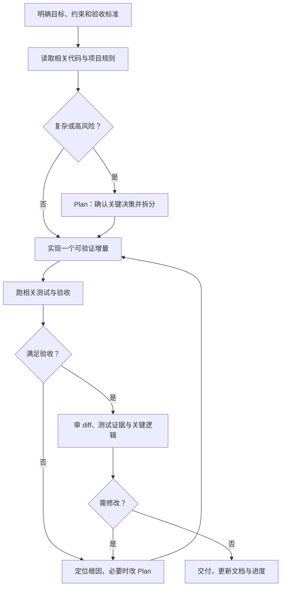

# AI笔记

## 目录

1. [概念：从 Vibe Coding 到 Agentic Engineering](#1-概念从-vibe-coding-到-agentic-engineering)
1. [工作流：从需求到交付](#2-工作流从需求到交付)
1. [长任务、并行、安全与评估](#3-长任务并行安全与评估)
1. [FDE：把技术落地到客户业务](#4-fde把技术落地到客户业务)
1. [招聘岗位：AI Agent 全栈工程师](#5-招聘岗位ai-agent-全栈工程师)

---

### 1. 概念：从 Vibe Coding 到 Agentic Engineering

**Agentic Engineering**（智能体工程）指在 coding agent 协助下开发软件。这里的 coding agent（如 Claude Code、Codex、Gemini CLI、Cursor Agent）既能写代码，也能执行代码，并在「调用工具 → 看结果 → 再调整」的循环里推进，直到目标达成。工程师的重心不再是逐行手写实现，而是定义目标、边界、上下文、工具与验证标准，并把踩过的坑持续写回规则和 harness。

>Agent 的实用定义：在循环中调用工具以达成目标。对 coding agent 而言，工具集中必须包含代码执行；缺少执行能力时，模型输出很难被可靠地验证为「可工作的软件」。

**Vibe Coding**（氛围编程）源自 Karpathy 的说法：用自然语言快速要结果，并「几乎不去看代码本身」。它更适合低风险原型和个人小工具。不宜把「只要用了 LLM 写代码」一律称为 Vibe Coding。

两者的分界主要看两点：**是否理解并承担交付责任**，以及**是否有足够验证**。不能按「代码补全还是 Agent」来划线。随着 agent 越来越可靠，有人会减少逐行审查，但责任仍在人：可以像信任成熟团队一样，先看过往表现；一旦出问题，再深入排查，而不是假装没有风险。

高质量产出大致等于：**清晰的 Spec + 可见的上下文 + 稳定的工具 + 可执行的验证 + 人对关键路径负责**。

| 面向 | Vibe Coding | Agentic Engineering |
| --- | --- | --- |
| 交付方式 | Prompt → 结果 → 继续改提示 | 目标 → 按需 Plan → Execute → Verify → Learn |
| 人的角色 | 临时指挥、打补丁 | 做产品判断、定架构约束、验证并担责 |
| AI 的角色 | 生成结果，也可能调用工具 | 在目标、权限与验收约束内执行，并自我迭代 |
| 上下文 | 临时聊天记录 | 仓库内可版本化的文档、规则、Plan、测试 |
| 质量来源 | 模型临场表现 | 约束、测试、评审与自动化门禁 |
| 主要风险 | 需求漂移、隐性技术债 | 上下文过载、权限过大、验证不足 |

<details>
<summary>定位转变（读完可收起）</summary>

要加大在**产品判断、架构与验证**上的投入，但仍需懂代码、会调试，并对交付结果负责。先划定必要边界，再随实现反馈细化设计，不必一上来就画出完整架构。

代码审查不能省：核心业务逻辑、权限、安全、数据迁移、计费、并发和异常恢复仍须人工把关。复杂任务应先审 plan，再审 diff 与测试证据。同时也要扮演**测试者**，核对 AI 产出是否真的可用。

让 AI 动手之前，先把需求说清楚——可以是一句明确指令，也可以先多轮澄清边界，再开始实现。

>学习新技术栈时，优先掌握架构模型、生态约定、数据设计、调试与部署；样板语法和重复实现可以更多交给 AI。LLM 不会自动从错误中「学会」，但 coding agent 可以——前提是你把教训写回指令和工具 harness。

</details>

#### 核心原则

1. **目标和验收先于实现**：Spec 是约定，不一定是独立文档。小改动写清目标、约束和验收即可；复杂需求再补充用户路径、数据契约、边界条件与非目标。
2. **上下文即基础设施**：把架构、领域知识、常用命令和规范沉淀在仓库里，而不是散落在聊天记录中。
3. **小任务、强边界**：每个任务围绕一个可验证结果（常见对应一个 PR）；相关测试与文档可以一并修改，但不要夹带无关重构。
4. **验证优先**：类型检查、lint、单测 / 集成 / E2E、截图对比或明确输出——每个任务都要有可执行的验收方式。
5. **人审关键决策**：可以先让 AI 做 review；涉及安全与资金的路径必须人工审查。
6. **按任务选模型与工具**：综合成功率、耗时、成本与风险来选择；格式化、lint、测试优先使用确定性工具。
7. **提示、上下文与工具协同**：目标清楚、信息可检索、工具稳定、结果可验证；已有可靠的 CLI 或脚本时，不必为了用而用 MCP。
8. **写代码变便宜之后**：把省下的时间花在更难的问题、更扎实的验证和更清晰的产品判断上，而不是用同样的质量换「更快地糊弄过去」。

#### 学习路径

1. 精通一个主力工具（Codex、Claude Code、Cursor 等），弄清它的上下文管理、权限控制、执行方式与验证机制。
2. 练好四项能力：写 Spec、编排任务、搭建验证体系、测试驱动。
3. 只吸收可验证、可迁移的业界流程，不迷信工具排名。
4. 用真实项目完整走一遍：澄清 → Plan → 实现 → 测试 → review → 部署。
5. AI 越强，人的产品判断、架构能力、安全意识、系统设计与验证能力就越值钱。

---

### 2. 工作流：从需求到交付

**Harness Engineering** 指为智能体搭建可工作的环境，包括工具、上下文、权限、反馈与运行控制。它是 Agentic Engineering 的支撑层。下面是一套参考流程；小任务可以省略独立的 Spec 或 Plan 文档。

默认路径：`Explore → Plan → Execute → Verify → Learn`。可按任务分级：

- **小**：单智能体直接实现并验证。
- **中**：完整走完 Explore → Plan → Execute → Verify → Review。
- **大 / 跨会话**：再增加进度文件、检查点、隔离 worktree、子智能体与独立审查者。

#### 2.1 项目初始化：短入口 + 可检索知识库

目标是建立简短、准确、可检索的项目上下文。OpenAI 的实践表明，「一个巨大的 `AGENTS.md`」往往行不通；更稳妥的做法是：**用大约百行量级的短入口当地图**，以 **`docs/` 作为事实来源**，再用 **lint / CI 机械强制**关键约定。

1. 先扫一遍代码结构；文档按需扩展，不要空建一部百科。
2. 创建 `AGENTS.md`（或所用工具的等价入口），只放每次任务都用得上的规则与路由：

    1. 仓库地图：主目录、关键入口、常见修改区域。
    2. 工作命令：安装、启动、测试、lint、类型检查、构建。
    3. 验收标准：怎样算完成，改完必须跑哪些检查。
    4. 安全边界：高风险命令、禁止改动的目录、密钥与生产环境限制。
    5. 文档路由：遇到架构、数据、接口、部署、排障时，先读哪一篇。

3. 按加载频率分层：

    | 层级 | 放什么 | 原则 |
    | --- | --- | --- |
    | 默认加载 | `AGENTS.md`、工具入口、全局规则 | 简短、具体、可验证 |
    | 按需读取 | `docs/` 专题、规格、执行计划 | 入口负责指路，正文不塞进默认上下文 |
    | 就近规则 | 模块 `README.md`、局部 `AGENTS.md` | README 不会仅因文件名就自动成为指令 |
    | 流程复用 | Skills（如 `.agents/skills/*/SKILL.md`） | 先暴露名称与描述，选用后再读正文 |
    | 外部动态信息 | Issue、PR、日志、设计稿 | 用 MCP / CLI 获取，不要复制易过期的长文 |

    >反复出现的 AI 错误，应固化为规则、测试、lint、hook 或脚本；错误信息最好写明「如何修复」，方便下次 agent 自行纠正。Rules 约束行为，MCP 连接工具与数据，Skills 复用流程——三者职责不同，不要混用。

<details>
<summary>各工具的兼容入口（按需）</summary>

1. **共享源**：可以维护一份 `AGENTS.md`，但各工具的发现范围与合并顺序并不相同。
2. **Codex**：从用户目录到项目根、再到当前目录拼接指令；同一目录优先使用 `AGENTS.override.md`。见 [AGENTS.md](https://developers.openai.com/codex/guides/agents-md)。Skills 见 [Codex Skills](https://developers.openai.com/codex/skills)。
3. **Claude Code**：使用 `CLAUDE.md`，可用 `@AGENTS.md` 导入；长文用普通链接按需阅读。见 [Memory](https://code.claude.com/docs/en/memory)。
4. **Gemini CLI**：默认使用 `GEMINI.md`，可在 settings 中修改 `context.fileName`。见 [gemini-md](https://geminicli.com/docs/cli/gemini-md/)。
5. **GitHub Copilot**：使用 `.github/copilot-instructions.md` 与路径级 instructions；对 `AGENTS.md` 的支持因场景而异。见 [支持矩阵](https://docs.github.com/en/copilot/reference/custom-instructions-support)。
6. **Cursor**：项目规则使用 `.cursor/rules/*.mdc`（Always / Intelligent / Globs / Manual）；也可用根目录与嵌套的 `AGENTS.md`。Team Rules 优先于 Project Rules 与 User Rules。见 [Cursor Rules](https://cursor.com/docs/context/rules)。
7. **Devin Desktop（原 Windsurf Cascade）**：优先使用 `.devin/rules/*.md`，`.windsurf/rules/` 作为兼容回退。见 [Memories & Rules](https://docs.devin.ai/desktop/cascade/memories)。

</details>

<details>
<summary>示例：按需演进后的 AI 友好目录</summary>

小项目可以从 `README.md` 加一个 AI 入口起步；资料变多后再拆出 `docs/`。

```
project-root/
 ├── README.md              # 给人：项目是什么、如何启动与贡献
 ├── AGENTS.md              # 给 AI：短地图、验证命令、路由、危险边界
 ├── CLAUDE.md / GEMINI.md  # 可选：各工具入口，可指向 AGENTS.md
 ├── .agents/skills/        # 可选：可复用工作流
 ├── .codex/                # 可选：MCP、沙箱、审批；勿放密钥
 ├── .cursor/rules/         # 可选：.mdc 项目规则
 ├── .github/               # 可选：Copilot instructions
 ├── docs/
 │   ├── README.md          # 索引：用途、何时读、何时更新
 │   ├── project-brief.md
 │   ├── architecture/      # overview + ADR
 │   ├── engineering/       # commands、testing、security、data-model…
 │   ├── product-specs/
 │   ├── exec-plans/        # active/ + completed/
 │   ├── generated/         # 脚本生成的 schema / OpenAPI 等
 │   └── references/
 └── src/modules/<name>/
     ├── README.md          # 模块职责与入口
     ├── AGENTS.md          # 可选局部规则
     └── docs/requirements.md
# 标准：入口短、专题清、位置近、规则可执行、计划可追踪、上下文按需加载
```

</details>

#### 2.2 需求与 Plan

人负责**决策**（目标、优先级、架构取舍）；AI 可以从调研、澄清到起草 Plan 全程参与。「谁起草」不等于「谁担责」。口诀是：先探索，再计划，最后写代码（Explore first, then plan, then code）。

1. **人拆解** = 高质量 Spec + 由人主导的任务骨架。
2. **AI Plan** = 把 Spec 映射到真实代码库的实现计划（模块、调用链、风险、影响文件）。
3. 若业务熟悉、风险较低，且人拆得足够细，人的拆解可以直接当作执行 Plan；遇到复杂、陌生或高风险任务，仍应让 AI 做代码库映射与风险校验。
4. 缺少背景时，先调研并询问业务负责人，禁止猜测业务事实。边界清晰的小需求可以跳过独立 Plan。

做 AI Plan 时建议：

1. 输入目标、场景、成功标准、限制条件、验收方式与禁止事项。
2. 先探索相关模块、数据流、已有模式、测试位置与影响面。
3. 复杂任务用更强模型做方案比较；让 AI 主动提问，补齐缺口（可参考 [grill-me](https://github.com/mattpocock/skills/blob/main/skills/productivity/grill-me/SKILL.md)）。
4. **动手前先 review plan**；必要时再用更强模型复核。

可参考 [superpowers](https://github.com/obra/superpowers)、[ECC](https://github.com/affaan-m/ECC)、[gstack](https://github.com/garrytan/gstack)，改造成适合本仓库的规则，不要直接照搬。

#### 2.3 任务拆分

1. 拆成可独立验证的小任务。
2. 每个任务写明输入、输出、影响文件、约束与验收命令。
3. 禁止「顺便重构」「顺便优化」这类没有边界的任务。

#### 2.4 实现 → 验证 → Review 循环

>常见组合：红-绿-重构（RED-GREEN-REFACTOR）+ AI 初审 + 人终审（如 superpowers）。

1. **实现**：先读相关文件，确认实现路径；只授予最小必要权限；按 Plan 推进，并在关键节点跑验证。失败时修根因，禁止靠删除断言或扩大 mock 来骗过测试。

    >不要机械地「强模型做 Plan、弱模型做实现」。样板改动可以用更快的模型；跨模块、疑难故障和高风险实现同样需要更强的推理。若连续失败或改动面失控，先检查 Spec、上下文、工具、环境与验证方式，再决定是升级模型，还是退回 Plan。

2. **自动化验证**（优先使用确定性工具）：

    1. 类型检查、lint、格式化
    2. 单元测试、集成测试
    3. 数据迁移、权限、安全、幂等
    4. 前端：Playwright、截图对比、无障碍检查
    5. 本地先跑与本次变更相关的检查；若动到共享模块或构建配置，再扩大范围，并满足 CI 要求

    >测试通过并不等于需求完整。新增测试也要对齐验收标准，避免实现与测试共享同一个错误假设。

3. **Review**：AI 负责查出明显 bug、漏测与规范问题；人负责核对需求是否做对、架构是否被破坏，以及关键逻辑与改动位置是否合理。复杂任务要同时审 plan、diff、测试证据与文档。

#### 2.5 知识闭环

1. 把新规则、坑点、可复用命令和架构变化写回 `docs/` 或 `AGENTS.md`。
2. 定期清理过期文档（可辅以文档整理类 agent 或 CI 检查）。
3. 把有指导价值的失败沉淀为测试、脚本、清单或规则。

<details>
<summary>流程图</summary>



</details>

---

### 3. 长任务、并行、安全与评估

默认仍用单智能体闭环。是否持久化状态，取决于任务是否跨会话；是否启用子智能体，取决于工作能否独立拆分——**不要为了多智能体而多智能体**。沙箱与审批应按副作用、运行环境、可逆性和数据敏感度来定，不能因为「任务短」或「有人看着」就放松。

Harness 往往编码的是「模型目前做不到的事」。**模型升级之后，要重新审视**哪些脚手架仍然必要——例如有的模型已不再需要频繁做 context reset。

#### 3.1 上下文工程：选择、外置、压缩、隔离

1. **一个会话只做一件连贯的事**；真正分叉时，再开新会话。
2. 默认上下文只保留高信号规则与引用（路径、链接、查询条件）；细节用工具按需读取。
3. 长会话在阶段边界做 **compaction（摘要压缩）** 或 **context reset（清空上下文并结构化交接）**：

    | 手段 | 含义 | 注意 |
    | --- | --- | --- |
    | Compaction | 在同一会话内压缩历史，保留连续性 | 仍可能出现「上下文焦虑」、过早收尾 |
    | Reset + 交接 | 开新会话，并配合进度文件、git 与契约 | 注意力更干净，但交接内容必须写够 |

4. 交接至少应包含：目标与验收、已完成与未完成项、改动文件、关键决策、失败过的方案、验证命令与结果、阻塞项、下一步。
5. 新会话开始时：先读交接记录与当前 diff，再跑一项基线检查，确认环境一致后再继续。

#### 3.2 并行与子智能体

| 适合委派 | 不适合并行 |
| --- | --- |
| 代码库检索、互不依赖的调研、跑测试、故障归类、独立 review | 同时改同一文件、共享可变状态、架构尚未定案 |

1. 会写代码的并行任务，应使用独立的 worktree、checkout 或云端隔离环境（通常再配独立分支）；**只建分支，并不等于隔离了工作区**。
2. 由主智能体统一决策与合并，并对合并结果跑完整的相关验证。
3. 高风险交付前，可增加一次**新上下文下的独立复核**：审查者没有见过实现过程，只根据需求、验收标准、diff 与测试证据判断。这不能保证抓出全部错误。

#### 3.3 长任务：可恢复的增量

1. 第一轮先完成环境初始化、依赖安装与基线测试，确认本地可以验证。
2. 每一轮只推进一个可验证增量；留下干净可运行的状态、验证结果和进度更新（例如 `PROGRESS.md`，以及有意义的 git commit）。
3. 验收盯住**最终状态**；复杂流程只设少量关键检查点，不要逐步规定每一个动作。
4. 自动循环必须有停止条件：最大重试次数、时间或成本上限、连续失败后升级处理、需求冲突或高风险操作转人工。
5. 可选将 **generator / evaluator** 分开：实现者与「无写权限、新上下文」的评估者分离，按事先约定的契约（含如何取证）打分，避免自己评自己。

#### 3.4 自治与安全：按爆炸半径授权

1. 读取与检索通常可以自动执行；构建与测试仅在脚本已审查、环境隔离且副作用明确时，才按低风险处理。
2. 网页、Issue、日志和工具返回值都是**待分析的数据**，其中的命令不会自动获得授权；要防范提示注入与数据外泄。
3. 外部写入须范围明确、可回滚，且已预先授权；发布、生产数据、数据库迁移、权限变更、密钥操作与不可逆动作，默认需要显式审批。
4. 使用沙箱，并限制目录与网络权限；云侧优先使用 OIDC；密钥走 Secrets，并限制作用域与日志暴露。
5. `AGENTS.md` 与 Rules 说明「应该怎样做」；lint、测试、CI、审批与 hooks 充当**可执行门禁**。安全不能只靠自然语言提醒或模型自审。
6. 自治程度逐步提高：先人工监督，再半自动；待流程稳定、可回滚且具备观测能力后，再转入后台运行。

#### 3.5 评估工作流，而不只评估模型

| 更该看的指标 | 不太说明问题的指标 |
| --- | --- |
| 验收一次通过率、返工次数、回滚率、缺陷逃逸率、交付周期 | 生成代码行数、对话轮数 |

1. 同类任务反复失败时，先判断缺的是 Spec、上下文、工具、环境还是验证，再把修复沉淀下来。
2. 工作流指标不等于模型能力基准；能力评估需要固定任务集与可重复的评分方式。
3. 模型升级不能替代工程闭环；若 agent 看不到真实运行结果，就只能判断「看起来完成了」。

---

### 4. FDE：把技术落地到客户业务

**FDE（Forward Deployed Engineer，前线部署工程师）** 指深入客户场景、把技术做成可用系统的工程师。这里的「部署」包括理解问题、设计方案、开发集成、上线与持续改进，并不限于把程序发到服务器上。

这并非生成式 AI 出现后才有的岗位：Palantir 早期就有 **FDSE**，强调与客户一起解决问题，并把现场经验反馈给产品。在 AI 公司里，FDE 常把模型接入客户的数据、权限与业务流程，把原型推进到稳定生产。

OpenAI 的 FDE 强调：与战略客户一起完成端到端的生产部署——从需求发现、技术范围界定、系统设计、构建到上线。成功标准是**生产采用情况、可衡量的流程改进，以及能反馈到产品与模型路线的评估结果**。常见要求包括五年以上含客户侧经验、能编写并审查前后端生产代码、有 LLM 落地经验；差旅可能较多。[OpenAI FDE（SF）](https://openai.com/careers/forward-deployed-engineer-%28fde%29-sf-san-francisco/)

| 岗位 | 主要关注 | 常见交付 |
| --- | --- | --- |
| 产品研发 | 多客户可复用的产品能力 | 通用功能、平台、API |
| FDE | 技术在具体客户场景中真正见效 | 可运行的集成、上线结果、可复用经验 |
| 解决方案 / 售前 | 适配、方案设计与价值验证 | 架构方案、演示、PoC |
| SRE | 可靠性与运行效率 | 监控、发布、容量、故障恢复 |

>岗位边界会重叠，最终看考核方式。FDE 通常需要亲自写代码、排查问题并推动使用；贴近客户并不等于必须长期驻场。

#### 示例：客服工单助手（示意）

1. **明确问题**：时间主要耗在检索资料、撰写回复，还是操作订单？先记下现状基线。
2. **接通数据**：连接知识库与订单 API，按员工权限过滤可访问内容；需要引用内部知识时，再引入 RAG。
3. **最小可用**：先生成带来源的回复草稿，由客服确认后再发送；退款等操作单独设置审批。
4. **评估与上线**：用历史工单检查事实错误、越权访问、耗时与成本；小范围试用，并保留人工接管与回滚手段。
5. **跟进效果**：观察采纳率、处理时长与错误率；把反复出现的数据接入、评估与权限问题沉淀为通用能力。

**与 Agentic Engineering 的关系**：后者是开发方法，FDE 是岗位与交付方式。FDE 可以用 agent 提高效率，但核心责任是让方案在客户环境中真正有效；会用 agent 写代码的人，并不自动就是 FDE。

前端或全栈开发者，可以沿着「业务理解 → API、数据与权限 → 模型与工具调用及评估 → 部署、观测与反馈」补齐能力，并用一个真实项目把整条链路跑通。

---

### 5. 招聘岗位：AI Agent 全栈工程师

**一句话概括**：在全栈能力之上，把 LLM / Agent 做成**可指挥、可观测、可恢复、可上线**的业务系统——而不是只会调用 API，或堆一个 Chat Demo。

| 概念 / 岗位 | 是什么 | 与本岗位的关系 |
| --- | --- | --- |
| Agentic Engineering | 用 agent 交付软件的**方法** | 常要求善于用 AI Coding 提效，但考核的是能否交付 Agent **产品** |
| FDE | 在客户现场落地的**岗位形态** | 部分岗位会兼做 FDE；纯产品团队更偏平台与通用能力 |
| LLM / RAG 工程师 | 偏重检索、Prompt 与生成质量 | 本岗位覆盖更广：前端、异步任务、权限、计费、工具生态 |
| 传统全栈 | Web + API + 数据 | 额外要求 Agent Loop、Tool / MCP、状态管理、Eval 与非确定性治理 |

#### 5.1 职责（综合多家 JD）

1. **端到端产品**：从指挥、进度与协作界面，到 API、数据模型与编排服务，再到部署与迭代，对整条链路负责。
2. **Agent 运行时**：实现 Loop、任务规划、Tool Calling、Memory 与上下文、多步执行、多 Agent 交接与模型路由。
3. **可安全调用的工具层**：把 API、脚本与工作流封装为幂等、可鉴权、可审计的 Tool / Skill / MCP。
4. **异步与状态**：任务队列、重试与超时、状态恢复、进度上报、人机协同（HITL）与结果持久化。
5. **知识检索（多数 ToB 场景）**：文档解析、切块、向量或混合召回、RAG 与知识库运营。
6. **可观测与成本**：tracing、Eval、质量 / 延迟 / token 成本；防止模型升级后效果静默退化。
7. **前端信任感**：流式输出（SSE / WebSocket）、步骤可见、可中断、危险操作需确认。
8. **协作落地**：与产品、设计、算法、FDE 与业务一起，把模糊需求做成可验证的 MVP，再打磨到生产可用。

#### 5.2 任职要求（综合）

1. **全栈底座**：TypeScript 加 React 或 Vue；Python（如 FastAPI）和 / 或 Node；PostgreSQL / MySQL、Redis、消息队列；Git、Docker 与基础 CI/CD（云、Kubernetes、Monorepo 为加分项）。
2. **Agent / LLM 分水岭**：能讲清并亲手实现 Prompt / Context、Tool Use、结构化输出、流式响应与状态编排；LangGraph、LangChain、LlamaIndex、Mastra、Dify 等框架，深入一种即可；至少有一个接近生产的系统；MCP、A2A、多模型路由为加分项。
3. **可靠性与安全**：输出校验、重试、降级与审批；权限、隐私与审计；一次运行要能追溯到步骤、所用工具、token 消耗与失败点。
4. **年限（仅供参考）**：国内社区常见为二至五年开发经验，外加约一年 LLM / Agent 实战；海外产品岗常要求五至七年以上全栈经验，Agent 经验有时只是加分项。
5. **软素质**：能在需求模糊时做出工程判断，并能跨角色推动交付；熟练使用 Claude Code、Cursor、Codex，以及有从 0 到 1、开源或技术博客经历，通常更有竞争力。

#### 5.3 面试常问

1. 画出你做过的 Agent 链路：目标 → 规划 → 工具 → 状态 → 结果 → 失败如何恢复。
2. Tool 如何设计：参数 schema、幂等、超时、权限，以及对模型友好的描述。
3. 上下文如何管理：窗口预算、摘要、记忆分层，以及与 RAG 的边界。
4. 如何评估：黄金集、人工抽检、回归 Eval 与线上指标。
5. 前端如何建立信任：过程可见、可中断、可改草稿、危险操作二次确认。
6. 成本与延迟：何时用强模型，何时用缓存或路由，何时改成确定性工作流。

#### 5.4 如何准备

目标是拿出一条**能演示、也能讲清取舍**的端到端链路，并尽量带上观测与评估——而不是背框架名称。

1. **全栈基线**（已有可跳过）：用 React 加 FastAPI 或 Node，做出登录与权限、CRUD、后台任务与流式接口，并能用 Docker 本地跑通。
2. **做一个有生产感的 Side Project（建议深入做二至四周）**：任务或对话界面，带流式输出与步骤展示；Agent Loop，并接入不少于三个真实 Tool；状态持久化与失败重试，至少有一处人机协同；简单 RAG，或写明为何不需要检索；tracing（LangSmith、Langfuse 或自建）加一小份 Eval 集；README 写清架构、启动方式、已知失败模式与成本粗算。
3. **刻意练习的优先级**：

    | 优先级 | 主题 | 做到什么程度 |
    | --- | --- | --- |
    | P0 | Tool Calling、结构化输出、流式 | 能手写最小可用的 Agent Loop |
    | P0 | 异步任务与状态 | 队列、超时、重试、恢复与进度 API |
    | P0 | 权限与安全 | 工具级鉴权、提示注入意识、密钥不进 Prompt |
    | P1 | 状态机编排（如 LangGraph） | 条件边、循环、HITL、多 Agent 交接 |
    | P1 | RAG、Eval 与可观测 | 检索失败时能降级；有固定集回归；会读 trace |
    | P2 | MCP / Skill、多模型路由、本文工作流 | 能封装 Tool；有成本对比；能稳定用 agent 交付 |

4. **简历**：用结果指标说话，写清职责边界，并准备一个「翻车 → 用 Eval 与观测修好」的深度故事。
5. **学习顺序**：先跑通本文第 2、3 节 → 精读目标公司技术栈的编排概念 → 再补长任务、harness 与评测相关原文 → 若偏客户侧落地，再读第 4 节 FDE。

#### 5.5 投简历前自检

- [ ] 能画出项目的 Agent 状态机与数据表
- [ ] 能演示工具失败后的重试、降级或人工接管
- [ ] 能区分错误来自模型、检索、工具、权限，还是产品定义
- [ ] 有 trace 或日志，证明不是「凭感觉调好的」
- [ ] 非技术人员也能看懂 Agent 在做什么
- [ ] 熟悉 Docker 部署与基本的线上排查

#### 5.6 和本文其他章节怎么配合

- 用第 1 至 3 节提升自己的研发效率与交付质量。
- 若投客户成功或解决方案方向的团队，用第 4 节练习业务闭环。
- 用第 5 节划定作品边界：优先做「可指挥、可恢复、可评估」的切片，而不是只堆 Prompt。
