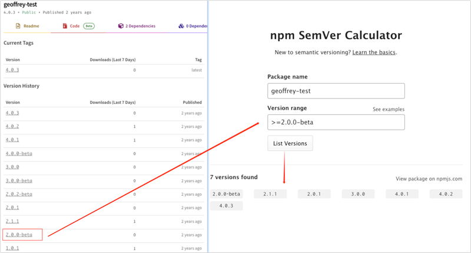
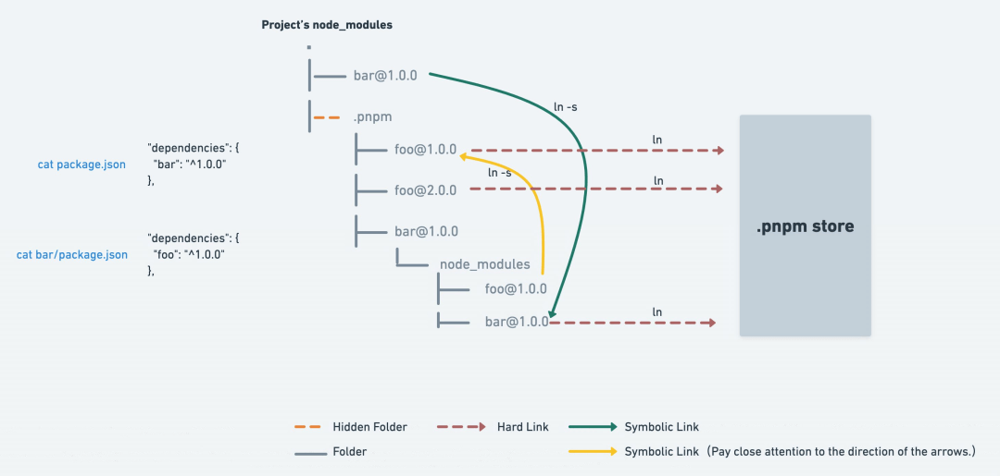
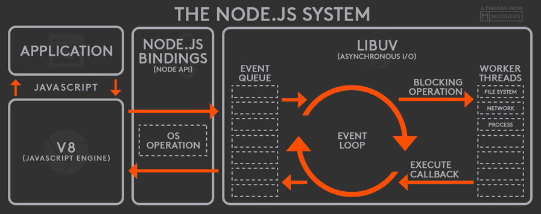
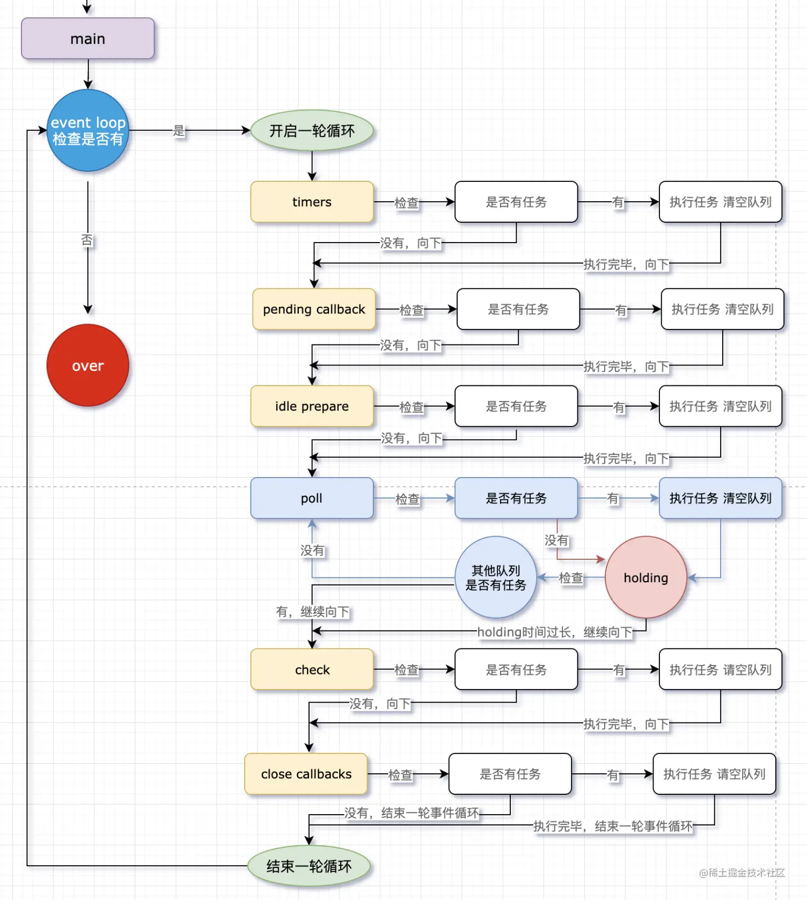

# Node.js学习笔记

## 目录
1. [安装](#安装)

    1. [nvm更新Node.js版本](#nvm更新nodejs版本)
    1. [n更新Node.js版本](#n更新nodejs版本)
1. [npm](#npm)

    1. [一个项目中同时安装、使用同个依赖包的不同版本](#一个项目中同时安装使用同个依赖包的不同版本)
    1. [依赖管理（npm、yarn、pnpm）](#依赖管理npmyarnpnpm)
1. [CommonJS规范](#commonjs规范)
1. [原理机制](#原理机制)

    1. [Node.js的运行机制](#nodejs的运行机制)
    1. [Node.js的`事件循环（event loop）`](#nodejs的事件循环event-loop)
    1. [特性](#特性)
    1. [Node.js核心模块（需要`require`引入）](#nodejs核心模块需要require引入)
    1. [Node.js全局变量](#nodejs全局变量)
    1. [Tips](#tips)
1. [工具使用](#工具使用)

    1. [Egg.js](#eggjs)
    1. [Koa](#koa)
    1. [express](#express)
    1. [pm2](#pm2)

---
## 安装

### nvm更新Node.js版本
>新安装的话，推荐使用[fnm](https://github.com/Schniz/fnm)。

1. macOS或Linux的[nvm](https://github.com/nvm-sh/nvm)

    >旧 Node.js 版本可能缺少 macOS arm64 官方二进制包。若项目必须在 Apple Silicon 上运行 x64 版本，可在已安装 Rosetta 的机器上打开[Rosetta模式](https://support.apple.com/en-hk/HT211861)：<https://github.com/nvm-sh/nvm/issues/2350>（任何应用：打开“应用程序”，右键 App → 显示简介，勾选：“使用 Rosetta 打开”，然后运行应用（记得用完后取消勾选）；终端：`arch -x86_64 zsh`进入临时会话，`exit`即可退出）。

    ```shell
    nvm list-remote
    nvm install v新版本号
    nvm use v新版本号
    nvm alias default v新版本号

    nvm list
    nvm uninstall v旧版本号 # 先切换到其他版本，再卸载旧版本
    ```

    >安装的全局软件包位置：`/Users/「用户名」/.nvm/versions/node/v「版本号」/lib/node_modules`
2. <details>

    <summary>Windows的<a href="https://github.com/coreybutler/nvm-windows">nvm-windows</a></summary>

    >安装nvm-windows时，需要删除原本安装在电脑上的Node.js。

    ```shell
    nvm node_mirror https://npmmirror.com/mirrors/node/    # 设置node源
    nvm npm_mirror https://npmmirror.com/mirrors/npm/      # 设置npm源

    nvm list available
    nvm install 新版本号
    nvm use 新版本号

    nvm list
    nvm uninstall 旧版本号      # 还可以再去目录中删除 C:\Users\「用户名」\AppData\Roaming\nvm\v「版本号」
    ```
    </details>

>切换版本之后需重装Node.js的全局模块包。

3. 项目锁定 Node 版本：优先 `package.json` 的 `engines`，`.nvmrc` 仅作 nvm 便捷

    **更推荐**：在 `package.json` 写 `engines`，声明允许的 Node 版本范围（包管理器与文档常见；CI 需自行配置才会强制）：

    ```json
    {
      "engines": {
        "node": ">=20 <21"
      }
    }
    ```

    >配合严格检查：npm 可在 `.npmrc` 写 `engine-strict=true`（或 `npm config set engine-strict true`），安装时版本不符会报错。Yarn Berry（v2+）默认不因 `engines` 失败，勿照搬该配置名。

    **`.nvmrc` 的作用**（以 [nvm-sh/nvm](https://github.com/nvm-sh/nvm) 为主）：读取项目根目录该文件后，本目录执行 `nvm use` / `nvm install` 无需再手写版本号。主要用于本地版本管理器切换，**不能替代** `engines`。nvm-windows 官方不支持 `.nvmrc`，仍需 `nvm use <版本号>`。

    ```shell
    # .nvmrc 选择 engines 范围内的主版本（精确复现时写完整的 x.y.z 版本号）
    echo "20" > .nvmrc

    nvm install   # 按 .nvmrc 安装（若尚未安装）
    nvm use       # 按 .nvmrc 切换
    ```

    >推荐写法：`engines` = 允许范围（真相来源）；`.nvmrc` = 本地钉选版本（落在该范围内）。不要只写 `.nvmrc` 而不写 `engines`。

### [n](https://github.com/tj/n)更新Node.js版本

<details>
<summary>安装 n 并切换 Node.js 版本</summary>

>不支持Windows。

1. 安装

    ```shell
    npm install -g n

    # 或：brew、curl
    ```
2. 切换版本

    ```shell
    n ls


    # 安装最新的长期支持正式发布版本
    n lts

    # 安装最新正式发布版本
    n latest

    # 安装指定版本
    n 新版本号


    # 展示已经安装的版本，并选择使用哪个版本
    n


    # 删除指定版本
    n rm 旧版本号

    # 删除当前版本之外的所有版本
    n prune

    # 删除当前版本安装的node和npm
    n uninstall
    ```
</details>

---
### npm
npm（Node Package Manager）。

1. `npm`CLI

    >在任意命令后添加`-h`、`--help`查看当前命令的所有参数。在任意命令后添加`--verbose`查看完整日志；日志都可以在`~/.npm/_logs/`查看。

    1. 制作

        1. 登录

            `npm login`
        2. 初始化`package.json`

            `npm init`（采用默认值可用 `npm init -y`）

            - 修改初始化信息

                ```shell
                npm set init-author-name "名字"
                npm set init-author-email "邮箱"
                npm set init-license "MIT"
                ```

                >初始化信息会存放在`~/.npmrc`文件里。
        3. 调试开发

            `npm link`、`npm unlink`

            1. 仅本地

                1. 引用本地模块的仓库：`npm link 本地模块的路径`

                    - 取消：

                        引用本地模块的仓库：`npm unlink 模块名`
            2. 全局

                1. 本地模块：`npm link`

                    也支持bin。

                    - 取消：

                        本地模块：`npm unlink`
                2. 引用本地模块的仓库：`npm link 模块名`

                    - 取消：

                        引用本地模块的仓库：`npm unlink 模块名`
        4. 发布

            `npm publish [--tag <tag名，默认：latest>]`

            >1. 标签tag 和 版本号version关系：发布时使用指定的 tag，省略时通常为 latest。一个 tag 同时只指向一个版本，可通过 dist-tag 调整，version可以没有tag（tag被删除 或 被新的version设置同名tag）。
            >2. 注意：设置源为npm的网站（`https://registry.npmjs.org/`）才可以推送到官方npm。
            >3. 交互式发布按 npm 登录流程完成双因素认证。自动化发布可使用受支持的 [trusted publishing](https://docs.npmjs.com/trusted-publishers/)。
        5. 「下线」

            >npm 公共仓库允许新包在发布后 72 小时内撤回，前提是没有其他包依赖它。超过 72 小时，还须同时满足上周下载量少于 300 且只有一名维护者等条件。[npm 撤回政策](https://docs.npmjs.com/policies/unpublish/)

            `npm deprecate <pkg>[@<version>] "<message>"` 会在安装时提示弃用，原版本仍可下载。
        6. 打印登录名

            `npm whoami`
        7. 登出

            `npm logout`
    2. 查看信息

        1. 查看模块官方信息

            `npm view [<@scope>/]<pkg>[@<version>] [<field>[.subfield]...]`

            - `npm view <pkg> versions`：展示所有版本
        2. 查看已安装的模块和依赖

            `npm list [[<@scope>/]<pkg> ...]`

            >仅查看顶层依赖：`npm list --depth=0`
        3. 查看已安装模块是否需要升级

            `npm outdated [[<@scope>/]<pkg> ...]`
        4. 查看、添加、删除 仓库的标签

            >latest 是常用默认标签，也可设置 next、beta 等标签。标签名不能与有效的 semver 范围冲突。

            ```shell
            npm dist-tag ls [<pkg>]                     # 打印所有标签
            npm dist-tag add <pkg>@<version> [<tag>]    # 把一个版本号 发布到一个标签
            npm dist-tag rm <pkg> <tag>                 # （发布）删除一个标签
            # 删除一个标签 或 其他版本号发布了同名标签，会导致原版本号不再拥有标签
            ```
    3. 安装

        >改变安装包的顺序会影响安装包的内容和依赖。

        - <details>

            <summary>手动安装npm自己</summary>

            1. 在本地Node.js同目录下创建目录`node_modules\npm`；
            2. 下载并解压<https://github.com/npm/cli/releases>至本地Node.js同目录下的`node_modules\npm`；
            3. 拷贝`node_modules\npm\bin`下面的`npm`、`npm.cmd`（、`npx`、`npx.cmd`）到本地Node.js同目录下。
            </details>

        1. 安装包

            安装的版本号受version和tag影响。安装到本地或全局的`node_modules`。包声明了 bin 时，全局安装会把对应命令链接到全局 bin 目录。

            1. 安装方式

                1. `npm install`安装所在目录的`package.json`文件描述内容

                    >CI 中可用 [`npm ci`](https://docs.npmjs.com/cli/v11/commands/npm-ci/) 按已提交的锁文件干净安装。它会清理已有 `node_modules`，依赖声明与锁文件不一致时会报错。

                    1. 最新（主版本号最新，第一个数）：

                        `*`、`x`（任意稳定版本范围）；`latest` 是发布标签
                    2. 次版本号最新（第二个数）：

                        `1`、`1.x`、`^1.2.3`
                    3. 补丁号最新（第三个数）：

                        `1.2`、`1.2.x`、`~1.2.3`
                    4. 确定的版本：

                        `1.2.3`

                    >`主版本号.次版本号.补丁号`，详细定义查看[Semantic](http://semver.org/lang/zh-CN/)。

                    - npm的版本号限制逻辑

                        >可以使用官方工具验证：<https://semver.npmjs.com/>

                        1. `*`、`x`：不限制任何版本号
                        2. `^`：**保持第一个非零数字不变，后面的可以升级**
                        3. `~`：**保持次版本号不变，允许补丁升级**

                        | 指定版本 | `^` 支持范围 | `~` 支持范围 |
                        | ------- | ---------------- | ---------------- |
                        | `1.0.0` | `>=1.0.0 <2.0.0` | `>=1.0.0 <1.1.0` |
                        | `0.1.0` | `>=0.1.0 <0.2.0` | `>=0.1.0 <0.2.0` |
                        | `0.0.1` | `=0.0.1`         | `>=0.0.1 <0.1.0` |

                        4. `>`、`>=`、`<`、`<=`
                        5. `||`

                        - 带预发布后缀的版本号（如 `-beta`、`-alpha`、`-rc`）：

                            语法上可写，但**难以用一段范围同时覆盖「某主版本下所有预发布版」**。可写死单一版本（如`3.0.0-beta.1`），或写范围如`>=0.13.0-0`（表示`0.13.0-*`的预发布版 + 正式版`>=0.13.0`），无法简洁表达「所有 x.x.x-*」。

                            
                2. `npm install [<@scope>/]<name>[@<tag>]`

                    >显式指定版本号、标签或 semver 范围分别表示精确选择、跟随标签和按范围解析。npm 11 按名称添加新依赖时也会考虑包的 `engines.node`，裸包名与显式 `@latest` 的结果可能不同。[npm install](https://docs.npmjs.com/cli/v11/commands/npm-install/)

                    1. 没有后缀，查找安装范围。
                    2. `@内容`

                        1. 具体版本号
                        2. 标签
                        3. 版本范围：`>`、`>=`、`<`、`<=` + 版本号，查找安装范围

                            >e.g. `npm install npm-devil@">=0.0.1 <0.0.5"`
                3. 参数

                    1. `--force`、`-f`：解除多项保护（如允许某些依赖冲突），不能保证重新下载所有包。
                    2. `--save`、`-S`：安装信息保存到`package.json`的`dependencies`（执行时依赖插件）。
                    3. `--save-dev`、`-D`：安装信息保存到`package.json`的`devDependencies`（开发时依赖插件）。
                    4. `--save-optional`、`-O`：安装信息保存到`package.json`的`optionalDependencies`。
                    5. `--no-save`：不保存任何安装信息（不写入package.json、package-lock.json）。
            2. 作用域

                1. 本地：在本地被`require`引入后使用。
                2. 全局：在命令行中使用，或被全局命令引用。
        2. 升级

            `npm update [-g] [<pkg>...]`

            在满足 `package.json` 中版本范围的前提下，将依赖升级到最新版本，并把解析后的版本写入 `package-lock.json`（`package.json` 中的版本范围通常不会改变）。

            | 命令 | `npm update` | `npm install <pkg>@latest或@版本` |
            |------------------|---------------------------------|-------------------------------------------|
            | 依据             | 只按package.json里已有版本范围升级（如^1.2.0） | 不管当前范围，直接装该包当前最新版 |
            | package.json     | 不改写版本范围 | 会改成最新版（如^2.0.0） |
            | package-lock.json| 会更新解析结果 | 会更新解析结果 |
            | 风险             | 不会超出你定的范围，相对稳 | 可能跨major，有破坏性变更风险 |

            - 升级npm自己

                通过版本管理器安装或更新 Node.js 时会随附兼容的 npm。单独升级 npm 前先核对其 engines 要求。
        3. 卸载

            `npm uninstall [<@scope>/]<pkg>[@<version>]... [--save-prod|--save-dev|--save-optional] [--no-save]`
        4. 重装npm

            使用原先的版本管理器或官方安装程序重新安装对应的 Node.js 版本，可恢复随附的 npm。
        5. 验证缓存（垃圾收集不需要的数据、验证缓存的完整性）

            `npm cache verify`

            > - 除非回收磁盘空间，否则不要使用以下清空npm缓存
            >
            >    `npm cache clean -f`

        - `package-lock.json`

            更新成功（`npm update`）或第一次安装（`npm install`）时生成，用以记录当前状态下实际安装的各个npm包的具体来源和版本号。执行 `npm install` 时，锁定版本若仍满足依赖声明就会复用，声明不匹配时会更新锁文件。

            >1. 若使用lock机制，则应该将`package-lock.json`提交到版本控制。
            >2. 若不使用lock机制，则应该把`package-lock=false`加入`.npmrc`，并把`.npmrc`提交到版本控制。

            1. `version`：版本号
            2. `resolved`：软件包位置
            3. `integrity`：校验码

            - 当一个库被作为依赖安装到其他项目中时，npm（以及yarn/pnpm）会完全忽略库的`package-lock.json`文件

                1. 发布到npm的库中的`package-lock.json`对安装不会产生任何影响（用户安装库时，npm会忽略库内的 lock 文件）
                2. 只有库开发者 本地开发以及CI 会用到`package-lock.json`

                >最终安装哪个版本的 依赖库，由 宿主项目（用户的项目）的package-lock.json + 库的dependencies 依赖扁平化算法决定。

                - 风险：

                    1. 开发环境依赖版本与用户环境不一致

                        解决：固定依赖版本范围（用`~`或固定版本而不是 ~~^~~）
                    2. 若不提交`package-lock.json`，则库开发者们的开发环境安装依赖版本不同

                        解决：考虑始终提交`package-lock.json`用于开发环境一致；*若不提交，则需要通过其他方式（如在`package.json`中精确指定版本号，并依赖完善的测试流程）来管理开发环境的一致性*
        6. 安全审计（检测并修复依赖中的已知安全漏洞）

            1. `npm audit`：扫描依赖树，检查并报告已知安全漏洞
            2. `npm audit fix --dry-run`：预览`npm audit fix`将执行的变更，不实际安装或修改lock文件
            3. `npm audit fix`：尝试在现有依赖约束内应用修复并更新锁文件；部分问题需要人工处理
            4. `npm audit fix --force`：允许跨主版本强制升级以修复漏洞，可能引入不兼容变更
    4. 执行脚本

        1. `npm run 「package.json中scripts字段的命令」 -- 「添加脚本后面的参数」`

            非`-`开头的参数可以忽略`--`而传递。e.g. `npm run gulp runCss`等价于：`npm run gulp -- runCss`

            >执行的命令，优先找本地`node_modules/.bin`的命令，然后才找`$PATH`的命令（暂时未找到绕过**先找本地的**方法）。
        2. [npx](https://docs.npmjs.com/cli/v11/commands/npm-exec/)

            npm 7 起，npx 由 npm exec 实现。请求的包在本地有匹配版本时可直接使用；缺少时可安装到 npm 缓存，并将其 bin 临时加入本次命令的 PATH。缓存可供后续调用复用。
        3. `npm exec -- <命令> [参数]`：用 `--` 区分 npm 的参数与要执行的命令。
        4. `npm init <initializer>` 会执行对应的初始化包。以下箭头表示两侧命令等价：

           ```shell
           npm init foo -> npm exec create-foo
           npm init @usr/foo -> npm exec @usr/create-foo
           npm init @usr -> npm exec @usr/create
           npm init @usr@2.0.0 -> npm exec @usr/create@2.0.0
           npm init @usr/foo@2.0.0 -> npm exec @usr/create-foo@2.0.0
           ```
   5. 对比

        [`npm diff --diff=「<pkg>@<version>或本地路径」 --diff=「<pkg>@<version>或本地路径」 [多个文件或文件夹]`](https://docs.npmjs.com/cli/commands/npm-diff)：前者为参考系，后者为改动结果。
2. [`package.json`](https://docs.npmjs.com/cli/v9/configuring-npm/package-json)字段

    包描述、说明文件。

    >npm、yarn、pnpm等，不同的包管理器配置不同。

    1. `name`

        仓库名。

        >组成：小写、无空格、字母数字下划线中划线。
    2. `version`

        版本号`x.x.x`。

        >`npm version [<newversion> | major | minor | patch | premajor | preminor | prepatch | prerelease | from-git]`更新`version`。
    3. `dependencies`

        生产环境依赖。

        >[node_modules 困境](https://zhuanlan.zhihu.com/p/137535779)。

        1. 安装依赖（`npm install`）是从（项目根目录）最外层往（引用处）最里层安装，若本层已经有同名但不同版本的库文件夹，则往里层尝试安装；
        2. 引用依赖是从（引用处）最里层往（项目根目录）最外层引用，一旦找到库目录就检索完毕。

        <details>
        <summary>e.g.</summary>

        1. 项目依赖逻辑：

            ```text
            .
            └── package.json
                .dependencies
                ├── A.v1
                |   .dependencies
                |   ├── B.v1
                |   ├── C.v1
                |   └── D.v1
                └── B.v2
                    .dependencies
                    ├── A.v2
                    └── C.v2
                        .dependencies
                        ├── A.v3
                        |   .dependencies
                        |   └── D.v1
                        └── D.v2
            ```
        2. `npm install`后的文件结构：

            ```text
            .
            ├── node_modules/
            |   ├── A.v1/
            |   |   └── node_modules/
            |   |       └── B.v1/
            |   ├── B.v2/
            |   |   └── node_modules/
            |   |       ├── A.v2/
            |   |       ├── C.v2/
            |   |       |   └── node_modules/
            |   |       |       └── A.v3/
            |   |       |           └── node_modules/
            |   |       |               └── D.v1/   # 注意，D.v1又安装了一遍
            |   |       └── D.v2/   # 注意，是C.v2引用D.v2，但安装在这里
            |   ├── C.v1/
            |   └── D.v1/
            |
            └── package.json
            ```
        </details>
    4. `devDependencies`

        开发、测试依赖。

        >- 何时不被安装：
        >
        >    1. 项目不会安装依赖库的`devDependencies`。
        >    2. `NODE_ENV`值为`production`时，项目不会安装自己的`devDependencies`。
        >
        >        >`export NODE_ENV=production;`。
        >    3. `npm install --production`不会安装自己的`devDependencies`。
    5. `peerDependencies`

        声明插件与宿主库的兼容范围。例如 React 组件库可将 React 声明为 peer，同时在开发依赖中安装测试使用的版本。[npm package.json](https://docs.npmjs.com/cli/v11/configuring-npm/package-json/#peerdependencies)

        | 版本 | npm v3～v6 | npm v7+ |
        | --- | --- | --- |
        | 安装过程 | 使用者安装 peer，缺失或版本不兼容时警告 | 默认尝试解析并安装非可选 peer |
        | 冲突处理 | 检查警告并调整宿主或插件版本 | 无法解析依赖树时可能报 ERESOLVE；使用 --legacy-peer-deps 会忽略 peer 约束 |

    | 字段 | 安装时的用途 | 常见例子 |
    | --- | --- | --- |
    | dependencies | 随使用方安装，供运行时引用 | HTTP 客户端 |
    | devDependencies | 开发项目自身时安装 | 构建工具、测试框架 |
    | peerDependencies | 要求插件所在位置能解析到兼容的宿主版本 | React、webpack |

    >前端产物包含哪些模块由引用关系和打包配置决定。peer 约束也不保证整棵依赖树只含一个版本。

    - e.g. 宿主有3个依赖库a、b、c，他们的依赖逻辑是a->b->c，a、b、c描述依赖的不同方式产生的不同效果

        1. 依赖放在`dependencies`：

            可能导致：依赖分身
        2. 依赖放在`peerDependencies`：

            宿主环境会安装要求的版本；预发布版需要兼容范围显式纳入（因为npm SemVer逻辑，查看上面的「npm的版本号限制逻辑」）
        3. 删掉依赖项：

            需要宿主环境手动引入所有依赖。没有上述问题，但运行报错后宿主环境才能发现原来要手动引入依赖

        >没有完全无副作用的方案。

    6. `peerDependenciesMeta`

        配置`peerDependencies`行为的选项。
    7. `optionalDependencies`

        如果一个依赖关系可以被使用，但你希望npm在找不到它或安装失败的情况下继续进行，那么你可以把它放在optionalDependencies对象中。optionalDependencies中的条目会覆盖dependencies中同名的条目，所以通常最好只放在一个地方。
    8. `overrides`

        可以重写项目依赖的依赖，及其依赖树下某个依赖的版本号，进行包的替换。overrides 支持任意深度的嵌套。

        >npm 只读取根项目的 overrides。Yarn 使用根 package.json 的 [resolutions](https://yarnpkg.com/configuration/manifest#resolutions)。现代 pnpm 可在根 pnpm-workspace.yaml 中声明 overrides，旧版项目也常用 package.json 的 pnpm.overrides。
    9. `bundleDependencies`

        指定的包也将在发布或`npm pack`的时候一并被打包（当其他人使用这个包时，就可以直接使用打包在项目内的依赖，而不需要在通过包管理器去下载）。
    10. `main`

        代码入口，默认：`index.js`。

        >引用仓库的代码入口，不在引用链路内的仓库文件最终不会被使用到。

        - 其他非官方的代码入口（若不存在则退回`main`）：

            1. `module`：ES6 Module
            2. `unpkg`：`<script>`引用（针对[unpkg.com](https://unpkg.com/)）
            3. `jsdelivr`：`<script>`引用（针对[www.jsdelivr.com](https://www.jsdelivr.com/)）
    11. `browser`

        若是作用域浏览器客户端，则替代 ~~`main`~~ 使用。
    12. [`scripts`](https://docs.npmjs.com/cli/using-npm/scripts)

        可执行脚本，用`npm run 脚本名`执行。

        - scripts的钩子（Hooks）机制（无需手动`npm run`就可触发；但也支持手动单独执行；`--ignore-scripts`忽略钩子触发）

            1. 自定义脚本钩子（配对机制）

                执行顺序：运行`npm run <name>`时，自动按`pre<name>` → `<name>` → `post<name>` 顺序执行。

                边界处理：`pre/post`缺失则静默跳过，核心脚本`<name>`缺失则直接报错。

                >兼容性：Yarn@2+ 已废弃对自定义脚本的`pre/post`自动触发支持。
            1. 内置命令钩子（自动触发）

                触发机制：与`npm install/publish/pack`等内置核心命令绑定（前后缀`pre<event>`、`post<event>` 或特殊的钩子`prepare`、`prepublishOnly`、`dependencies`）。

                执行方式：在对应的 npm 生命周期节点由系统自动触发。

        >若执行时打印不出信息，则尝试执行时添加`--foreground-scripts`。[As of npm@7 these scripts run in the background. To see the output, run with: `--foreground-scripts`](https://docs.npmjs.com/cli/v10/using-npm/scripts#life-cycle-scripts).

    >`scripts`中命令能使用的环境变量：
    >
    >    1. npm 提供部分包信息，如 `npm_package_name`、`npm_package_version`。需要其他字段时可从 `npm_package_json` 指向的文件读取。
    >    2. `npm_config_名字`：可以拿到npm配置（`.npmrc`）。

    13. `config`

        配置仅`scripts`中命令能使用的环境变量，用法：`process.env.npm_package_config_键名`。

        ><details>
        ><summary>e.g.</summary>
        >
        >```js
        >// ./package.json
        >{
        >  "config" : { "xx" : "any thing" },
        >  "scripts" : { "start" : "node server.js" }
        >}
        >
        >
        >// ./server.js
        >console.log(process.env.npm_package_config_xx)
        >
        >
        >// 终端
        >$ npm run start
        >any thing
        >$ node server.js
        >undefined
        >```
        ></details>
    14. `files`

        将仓库作为依赖项安装时要包含的路径、文件的数组。
    15. `bin`

        `{ 新增的命令: 对应的可执行文件路径 }`
    16. `man`

        `man`说明文档路径。
    17. `directories: { bin: 路径, man: 路径 }`

        多命令、多说明文档。
    18. `engines`

        该仓库在哪个版本的Node.js（、npm、yarn、等）上运行。

        >e.g. `"engines": { "node": ">=0.10.3 <15" }`。
    19. `os`

        支持运行的操作系统。
    20. `cpu`

        支持运行的 CPU 架构。
    21. `private`

        设置为`true`，则无法`npm publish`，用于避免不小心公开项目。
    22. `publishConfig`

        发布时的配置（覆盖`.npmrc`）。
    23. `workspaces`

        工作区相关。
    24. `description`

        描述，也作为在npm官网被搜索的内容。
    25. `repository`

        仓库远程版本控制，可以是github等。

        ><details>
        ><summary>e.g.</summary>
        >
        >```json
        >"repository": {
        >    "type": "git",
        >    "url": "git@github.com:用户名/仓库名.git"
        >}
        >
        >// 针对Monorepo：
        >"repository": {
        >  "type": "git",
        >  "url": "https://github.com/用户名/仓库名.git",
        >  "directory": "packages/文件夹名"
        >}
        >```
        ></details>
    26. `keywords`

        在npm官网被搜索的关键字。
    27. `author`

        仓库作者。
    28. `contributors`

        仓库贡献者。
    29. `license`

        证书。
    30. `homepage`

        主页。
    31. `bugs`

        链接到软件包的问题跟踪器，最常用的是GitHub的issues页面。
    32. `funding`

        捐款。

    - 其他依赖库需要使用的特有属性，可以在相应的依赖库文档中找到如何使用它们：

        1. `eslintConfig`
        2. `babel`
        3. `browserslist`

            支持哪些浏览器（及其版本）。
        4. `gitHooks`
        5. `lint-staged`
        6. `sideEffects`

            >webpack
        7. `exports`（Node.js 原生支持，定义包对外开放的入口和子路径；与 main 同时存在时优先）
        8. `types`
        9. `jest`
        10. `husky`
        11. `「依赖库相关名字」`
3. 包的制作-使用

    1. 制作：

        可按 CommonJS 或 ES modules 编写，入口与扩展名、package.json 的 type 保持一致。
    2. 使用：

        1. 在Node.js环境下使用（`require`）

            >如：`vue-cli`。
        2. 在浏览器环境下使用

            1. 用打包工具（`webpack`、`browserify`、`rollup`）打包成能够在浏览器运行的JS代码。
            2. 直接制作可兼容在浏览器环境运行的代码。

            >如：`Vue.js`。
    - 作用域的包

        `@scope/project-name`
4. [`.npmrc`](https://docs.npmjs.com/cli/configuring-npm/npmrc)

    `npm config set xxx=yyy` 默认写入用户配置。`--location=project` 写入项目配置，`--location=global` 写入全局配置。用 `npm config get xxx` 查看当前生效的值。

    >`npm config ls -l`查看所有已有配置和默认配置。

    - 常用：`package-lock`、`registry`、`audit`
    - 注释：`;`或`#`。
    - 优先级（降序）

        1. per-project config file (/path/to/my/project/.npmrc)
        2. per-user config file (~/.npmrc)
        3. global config file ($PREFIX/etc/npmrc)
        4. npm builtin config file (/path/to/npm/npmrc)
    - 针对部分配置名，在npm cli中用`--no-配置名`可以覆盖某个配置名的值

>项目中使用某个开源库时，要考虑它的License和文件大小（若使用webpack打包，则可以使用[webpack-bundle-analyzer](https://github.com/webpack-contrib/webpack-bundle-analyzer)进行分析）。

#### 一个项目中同时安装、使用同个依赖包的不同版本
>很容易导致ts类型的冲突，需要额外处理全局类型问题。

1. npm aliases（npm：6.9.0+）

    >[pnpm aliases](https://pnpm.io/zh/aliases)也类似。

    1. 安装带别名的指定仓库：

        `npm install 「别名」@npm:「[<@scope>/]<pkg>[@<version>]」 --save`
    2. 会写入package.json的依赖：

        ```json
        "dependencies": {
          "「别名」": "npm:「[<@scope>/]<pkg>[@<version>]」"
        }
        ```
    3. 使用时，根据「别名」进入指定的版本中。例如依赖声明里同时写 `"chalk4": "npm:chalk@4"` 和 `"chalk5": "npm:chalk@5"`，在 ES module 中即可分别使用 `import chalk4 from "chalk4"` 与 `import chalk5 from "chalk5"`。
2. 包装模块可声明指定版本的目标依赖，再从自己的公共入口导出功能。调用方引用包装模块的入口，不依赖 node_modules 的具体布局。
3. Monorepo

    各工作区可声明不同版本。物理布局及依赖提升取决于包管理器和配置。

#### 依赖管理（npm、yarn、pnpm）
1. npm

    npm 根据依赖声明、锁文件和缓存解析依赖树，获取缺少的包，再按安装策略布置到 node_modules。

    1. npm@2-

        直接按照包依赖的树形结构下载填充本地目录结构，嵌套的node_modules结构（嵌套地狱）。
    2. npm@3+

        `扁平化嵌套`（副作用：~~不确定性~~、依赖分身、幽灵依赖）。尽量把依赖提升（hoist）到项目目录的node_modules（**幽灵依赖**），提升只能提升依赖的一个版本（不确定性，不确定提升哪个版本；之后`package-lock.json`解决，按照`package-lock.json`文件安装），后面再遇到相同包的不同版本，依然还是用嵌套的方式，可能相同版本在不同依赖位置嵌套安装多次（**依赖分身**）。

        >一些安装方式（可能与引用不同版本或循环引用之类的有关），会导致没有把依赖包安装到node_modules顶层，而是直接安装到嵌套的内部。尝试：`npm i npm-package-i@0.0.13 vue-eslint-parser@9.4.2`，然后观察`eslint-plugin-vue`被安装到了/node_modules/npm-package-i/node_modules/，而没有平铺在最外层。
2. yarn

    Yarn Classic 默认使用 node_modules 和依赖提升。现代 Yarn 默认使用 Plug'n'Play，通过映射表解析依赖，也可配置 nodeLinker 使用 node_modules。

    >`yarn.lock`只包含版本锁定，并不确定依赖结构，需要结合`package.json`确定依赖结构。
3. pnpm

    pnpm install：项目直接依赖，作为软链接平铺安装在`./项目/node_modules` -> 真实依赖代码，从内容可寻址的 store 导入本地虚拟 store（可使用写时复制、硬链接或复制）（`./项目/node_modules/.pnpm`） -> 真实依赖内部 需要依赖其他仓库的，都通过 软链接 指向本地虚拟store。

    1. hard link（硬链接）

        store 以内容标识文件；同一文件系统上选择硬链接导入时，项目中的文件与 store 中的文件共享 inode。不同包版本中内容相同的文件也可复用。

        >1. hard links指通过索引节点来进行连接。在 Linux 的文件系统中，保存在磁盘分区中的文件不管是什么类型都给它分配一个编号，称为索引节点号(Inode Index)。在 Linux 中，多个文件名指向同一索引节点是存在的。比如：A 是 B 的硬链接（A 和 B 都是文件名`ln A B`），则 A 的目录项中的 inode 节点号与 B 的目录项中的 inode 节点号相同，即一个 inode 节点对应两个不同的文件名，两个文件名指向同一个文件，A 和 B 对文件系统来说是完全平等的。删除其中任何一个都不会影响另外一个的访问。
        >2. inode通过唯一的编号（inode number）标识文件，系统通过此编号而非文件名操作文件。inode是文件系统的基石，通过分离文件名与元数据实现了高效的文件管理。
    2. symbolic link（软链接）

        >`ln -s A B`

        真实依赖内部 需要依赖其他仓库的 和 项目直接依赖，都通过 软链接 指向本地虚拟store（`./项目/node_modules/.pnpm`）。

    >独立链接布局让项目直接看到自己声明的依赖，提升配置、不同的 peer 组合也会影响实际可见性和包实例数量。

    

    - 部署工具若不能保留软链接，可评估 pnpm 的 hoisted 布局。避免直接编辑 node_modules 中的文件，需修改依赖时可使用包管理器的 patch 功能。

---
### [CommonJS规范](https://github.com/realgeoffrey/knowledge/blob/master/网站前端/JS模块化方案/README.md#commonjs规范)

`require()` 同步加载模块。模块初始状态下，`exports` 和 `module.exports` 指向同一对象，所以添加属性可以使用 `exports.name = value`。需要整体导出函数或替换对象时，给 `module.exports` 赋值。单独给 `exports` 重新赋值只会改变模块内部的局部变量。

```js
// sum.cjs
module.exports = (a, b) => a + b;

// main.cjs
const sum = require('./sum.cjs');
console.log(sum(2, 3)); // 5
```

同一进程中，按同一文件名解析到的普通模块通常只求值一次。循环依赖期间，调用方可能读到尚未初始化完成的导出。[Node.js CommonJS 模块](https://nodejs.org/api/modules.html)


---
## 原理机制

### Node.js的运行机制
1. [V8](https://v8.dev/)引擎（JS引擎）解析应用程序输入的JS脚本。

    >大量同步计算会占用事件循环线程。常见例子包括复杂正则匹配和大型 JSON 的编解码。
    >
    >1. 使用正则表达式时注意ReDoS（Regular expression Denial of Service，正则表达式拒绝服务攻击）风险。
    >2. `JSON.parse/stringify`随着输入参数线性增加执行时间。
2. 解析后的代码，能够与操作系统进行交互。

    >以文件读取为例：JS 调用 node:fs → Node.js 的原生绑定 → libuv → 操作系统。
3. [libuv](https://github.com/libuv/libuv)负责事件循环和异步 I/O。网络 I/O 通常依靠操作系统的就绪或完成通知，文件系统等部分操作使用线程池。主线程通过[Event Loop（事件循环）](https://github.com/realgeoffrey/knowledge/blob/master/网站前端/Node.js学习笔记/README.md#nodejs的事件循环event-loop)处理相应的回调。
4. V8引擎再将结果返回给应用程序。

>异步 I/O 的错误按接口约定传递：回调检查 err，Promise 使用 await 配合 try/catch，流可通过 pipeline 统一处理错误。资源的关闭应放在对应的清理路径。



- <details>

    <summary>Node.js依赖项</summary>

    1. 类库

        1. V8
        2. libuv
        3. llhttp
        4. c-ares
        5. OpenSSL
        6. zlib
    2. 工具

        1. npm
        2. gyp
        3. gtest
    </details>

### Node.js的`事件循环（event loop）`
与[浏览器的`事件循环（event loop）`](https://github.com/realgeoffrey/knowledge/blob/master/网站前端/JS学习笔记/README.md#浏览器的事件循环event-loop)类似。由libuv引擎实现。

```text
main
 ↓
                 # 宏任务                                               # 微任务（不是event loop）
                 ┌─────────────────────────────────┐                     process.nextTick
              ┌─>│  timers(setTimeout,setInterval) │                            ↓
              │  └─────────────┬───────────────────┘                          Promise
              │  ┌─────────────┴───────────────────┐
              │  │pending callbacks(OS,delayed I/O)│
              │  └─────────────┬───────────────────┘
              │  ┌─────────────┴───────────────────┐
              │  │   idle, prepare(Node.js core)   │
check         │  └─────────────┬───────────────────┘    ┌────────────┐
event loop ─→ │  ┌─────────────┴───────────────────┐    │ incoming:  │
              │  │           poll(a lot)           │<───┤connections,│
              │  └─────────────┬───────────────────┘    │ data, etc. │
              │  ┌─────────────┴───────────────────┐    └────────────┘
              │  │       check(setImmediate)       │
              │  └─────────────┬───────────────────┘
              │  ┌─────────────┴───────────────────┐
              └──┤         close callbacks         │
 ↓               └─────────────────────────────────┘
over
```

>注意：从 Node.js 20（libuv 1.45.0）开始，timers 只在 poll 阶段之后运行；上图仍可作为阶段模型理解，但不要把旧版“poll 前后都可能运行 timers”的细节当作当前行为。

1. main

    启动入口文件，运行主函数。
2. event loop

    检查系统中是否有异步任务，决定是否进入事件循环。

    1. 事件循环按阶段处理回调；每个阶段会处理该阶段队列中的回调，但受系统上限、I/O状态和回调耗时影响，不应理解为无条件清空整个队列。
    2. poll 阶段

        1. 有 I/O 回调就依次执行，直到队列耗尽或达到系统限制。
        2. 队列为空且有 setImmediate() 回调时，进入 check。否则可以等待 I/O，等待时间受定时器等条件限制。
        3. 在同一个 I/O 回调里安排 setImmediate() 与 setTimeout(fn, 0)，通常先进入 check 执行 immediate。入口顶层的这两个回调不应依赖固定先后顺序。[Node.js 事件循环](https://nodejs.org/en/learn/asynchronous-work/event-loop-timers-and-nexttick)
3. over

    当没有维持事件循环的活动句柄、请求或待处理的回调时，进程可自然退出。



4. 微任务

    在普通事件循环回调返回后，Node.js 先清空 `process.nextTick` 队列，再处理 Promise 回调和 `queueMicrotask`。CommonJS 入口的顶层代码也遵循这个顺序。

    直接运行 ES 模块或通过 `import()` 加载时，模块顶层在微任务中执行，此时排入的 Promise 回调和 `queueMicrotask` 会先于 `process.nextTick` 执行。如果在 CommonJS 入口顶层用 `require()` 同步加载 ES 模块，则模块顶层排入的 `process.nextTick` 先执行。[Node.js 微任务顺序](https://nodejs.org/api/process.html#when-to-use-queuemicrotask-vs-processnexttick)

### 特性
1. 单线程

    ><details>
    ><summary>尽量不用同步方法，尽量不阻塞进程</summary>
    >
    >高开销的同步方法：
    >
    >1. `crypto`加密
    >
    >    1. `crypto.randomBytes`（同步版本）
    >    2. `crypto.randomFillSync`
    >    3. `crypto.pbkdf2Sync`
    >    - 同时你应当非常小心对加密和解密给予大数据输入的情况。
    >2. `zlib`压缩
    >
    >    1. `zlib.inflateSync`
    >    2. `zlib.deflateSync`
    >3. `fs`文件系统
    >4. `child_process`子进程
    >
    >    1. `child_process.spawnSync`
    >    2. `child_process.execSync`
    >    3. `child_process.execFileSync`
    ></details>

    一个事件循环线程可处理多个并发连接。长时间执行的 JS 会推迟该线程上其他请求的回调。CPU 密集型任务可分配给 worker_threads，文件系统等操作可使用 libuv 线程池。
2. 非阻塞I/O

    回调函数异步执行，通过事件循环检查已完成的I/O进行依次处理。

    >1. 阻塞I/O、非阻塞I/O的区别：阻塞调用会占用调用线程直到操作返回；非阻塞调用允许该线程继续处理其他工作。
    >2. I/O主要指由[libuv](https://github.com/libuv/libuv)支持的，与系统磁盘和网络之间的交互。
    >3. 大多数Node.js核心API所提供的异步方法都遵从惯例：**错误信息优先**的回调模式（Error-first Callback，第一个参数是错误信息，若不报错则其值为`null`）。
    >
    >    `EventEmitter`类事件函数不属于此范畴。
3. 事件驱动

    用事件驱动（事件循环）来完成服务器的任务调度。

>1. Node.js开发应用程序：不善于计算，善于I/O（任务调度）。如：长连接的实时交互应用程序。
>2. Node.js服务器：没有根目录概念，没有web容器。URL通过顶层路由设计，呈递静态文件。
>3. 事件循环逻辑和触发JS时机都是由系统（C/C++）控制，在需要时才开启某个具体js调用栈。
>
>只有打通和后端技术的桥梁、实现互联互通，Node.js才能在公司业务中有更长远的发展。

### Node.js[核心模块](https://nodejs.org/api/)（需要`require`引入）
>核心模块随 Node.js 提供，支持 CommonJS require 和 ES module import。使用 node: 前缀可明确引用内置模块；require 从 Node.js 14.18.0 / 16.0.0 起支持该前缀。有些模块必须写前缀，如 node:test。

1. `http`：HTTP 请求相关 API

    1. 接口永远不会缓冲整个请求或响应，所以用户可以流式地传输数据。
    2. 为了支持所有可能的HTTP应用程序，Node.js的HTTP API都是非常底层的。

        它仅进行流处理和消息解析。它将消息解析为消息头和消息主体，但不会解析具体的消息头或消息主体。

    ><details>
    ><summary>e.g.</summary>
    >
    >1. Node.js原生处理POST/GET请求
    >
    >    ```js
    >    const http = require("http");
    >
    >    http
    >      .createServer((req, res) => {
    >        let body = "";
    >        req.setEncoding("utf8"); // 保证跨数据块的多字节字符完整解码
    >        req.on("data", (chunk) => {
    >          body += chunk;
    >        });
    >        req.on("end", () => {
    >          // 接受完成
    >          const text = `收到${req.method}请求\nurl是：${req.url}${req.method === "POST" ? `\nbody是: ${body}` : ""}\n`;
    >          console.log(text);
    >          res.end(text);
    >        });
    >      })
    >      .listen(3000, "127.0.0.1");
    >    ```
    >2. Node.js原生发起POST请求
    >
    >    ```js
    >    const http = require("http");
    >
    >    const req = http.request(
    >      "http://127.0.0.1:3000/",
    >      {
    >        method: "POST",
    >        headers: {
    >          "Content-Type": "application/json; charset=UTF-8",
    >        },
    >      },
    >      (res) => {
    >        res.setEncoding("utf8");
    >        let body = "";
    >        res.on("data", (chunk) => {
    >          body += chunk || "";
    >        });
    >        res.on("end", () => {
    >          // 响应接受完成
    >          console.log(body);   // body是GET/POST的响应内容
    >        });
    >      }
    >    );
    >
    >    req.on("error", (e) => {
    >      console.warn(e);
    >    });
    >
    >    req.write(JSON.stringify({ a: "发起的请求body" })); // 保证：发起请求的body和请求头匹配
    >    req.end();
    >    ```
    >3. Node.js原生发起GET请求
    >
    >    ```js
    >    const http = require("http");
    >
    >    const req = http.request(
    >      "http://127.0.0.1:3000/",
    >      {
    >        method: "GET",
    >      },
    >      (res) => {
    >        res.setEncoding("utf8");
    >        let body = "";
    >        res.on("data", (chunk) => {
    >          body += chunk || "";
    >        });
    >        res.on("end", () => {
    >          // 响应接受完成
    >          console.log(body);   // body是GET/POST的响应内容
    >        });
    >      }
    >    );
    >
    >    req.on("error", (e) => {
    >      console.warn(e);
    >    });
    >
    >    req.end();
    >    ```
    ></details>
2. `http2`
3. `https`
4. `fs`：以标准POSIX函数为模型的方式与文件系统进行交互

    大多数文件操作提供回调、同步（方法名以 Sync 结尾）和 Promise（node:fs/promises）三种接口。下面是同一次重命名的三种独立写法，请任选其一。

    ><details>
    ><summary>e.g.</summary>
    >
    >```js
    >// 异步（结果在回调；若出错，则回调函数第一个参数不为null或undefined）
    >require('fs').rename('before.json', 'after.json', err => {
    >  if (err) {
    >    return console.error(err)
    >  }
    >  //完成
    >})
    >
    >
    >// 同步（阻塞线程，直到文件操作结束。结果在执行语句返回。需要try-catch等方式处理错误）
    >try {
    >  require('fs').renameSync('before.json', 'after.json')
    >  //完成
    >} catch (err) {
    >  console.error(err)
    >}
    >
    >
    >// Promise
    >require("fs").promises
    >  .rename("before.json", "after.json")
    >  .then((data) => {
    >    console.log('succeeded', data);
    >  })
    >  .catch((error) => {
    >    console.error('failed' ,error);
    >  });
    >```
    ></details>

    - 尽量选择使用**流**读写文件的内容

        >（不使用流的）读操作都会在返回数据之前将文件的全部内容读取到内存中，这意味着大文件会对内存的消耗和程序执行的速度产生重大的影响；（不使用流的）写操作都是在将全部内容写入文件之后才会将控制权返回给程序（在异步的版本中，这意味着执行回调）。

        - 导出文件需求：

            1. 后端返回 JSON（一次 JSON.stringify 整个对象需要相应内存；逐条生成时可采用 NDJSON 等流式格式），前端根据数据生成文件并[创建下载](https://github.com/realgeoffrey/knowledge/blob/master/网站前端/JS方法积累/实用方法/README.md#原生js点击下载)。
            2. 后端直接返回文件，前端请求下载文件（get请求）

                1. 可选择先在服务端生成文件，也可直接把生成的数据流交给响应；
                2. 已保存的文件可用可读流传给前端。
5. `events`：事件触发器

    >`EventEmitter`类：`require('events')`

    1. 使用 EventEmitter 接口的对象通过 on/emit 订阅和触发事件。Node.js 也支持 EventTarget。
    2. `EventEmitter`以注册的顺序同步地调用所有监听器。
6. `path`：处理文件路径

    >e.g. 当前文件所在目录的相对位置：`require('path').resolve(__dirname, '../../xx/xxx.txt')`
7. `stream`：数据流

    流是一种以高效的方式处理读/写文件、网络通信、或任何类型的端到端的信息交换。

    >e.g. 在传统的方式中，当告诉程序读取文件或通信时，这会将文件或信息从头到尾读入内存，然后进行处理。若使用流，则可以逐个片段地读取并处理（而无需全部保存在内存中），能够一边读取一边处理更加高效。

    1. 经典 Node.js stream 继承 EventEmitter。Web Streams 使用另一套接口。
    2. Node.js提供了多种流对象（`fs`、`http`、`process`等都有流操作方式），除非要创建新类型的流实例，否则极少需要直接使用`stream`。
    3. 流类型：可读（Readable）、可写（Writable）、可读可写（Duplex）、可修改或转换数据（Transform）。

    >将可读流复制到可写流时，可用 node:stream/promises 的 pipeline 处理背压、结束和错误。手动写入时，write() 返回 false 表示应等 drain 再继续。
8. `readline`：用于一次一行地读取可读流中的数据

>Buffer是数据以二进制形式临时存放在内存中的物理映射，stream为搬运数据的传送带和加工器，有方向、状态、缓冲大小。

9. `buffer`：缓冲区

    `Buffer`用于表示固定长度的字节序列。是JS`Uint8Array`的子类，并使用涵盖额外用例的方法对其进行扩展。

    >小块 Buffer 可能共享内存池。Buffer.from(arrayBuffer) 与源共享底层字节，Buffer.from(buffer) 则复制内容。
10. `string_decoder`：字符串解码器

    提供了用于将`Buffer`对象解码为字符串（以保留编码的多字节UTF-8和UTF-16字符的方式）的API。
11. `os`：提供了与操作系统相关的实用方法和属性
12. `util`：提供常用函数的集合，用于弥补核心JavaScript的功能过于精简的不足
13. `process`：进程

    `require("node:process") === process`
14. `child_process`：衍生子进程

    衍生的Node.js子进程独立于父进程，但两者之间建立的IPC通信通道除外。每个进程都有自己的内存，带有自己的V8实例。

    >由于需要额外的资源分配，因此不建议衍生大量的Node.js子进程。
15. `cluster`：集群（运行多个Node.js实例）

    创建共享服务器端口的子进程。为了充分利用多核系统，有时需要启用一组Node.js进程去处理负载任务。
16. `worker_threads`：工作线程（单个Node.js实例中并行运行多个应用程序线程）
17. `crypto`：加密

     OpenSSL的哈希、HMAC、加密、解密、签名、以及验证功能的一整套封装。
18. `zlib`：提供`Gzip、Deflate/Inflate、Brotli`的压缩功能

    >压缩和解压缩是围绕`stream`流API构建的。
19. `dgram`：数据报

    对UDP datagram sockets（UDP的数据报套接字）的一层封装。
20. `net`：用于创建基于流的TCP或IPC的服务器（`net.createServer`）与客户端（`net.createConnection`）
21. `dns`：解析域名
22. `url`：解析URL。
23. `querystring`：解析和格式化URL查询字符串
24. `tls`：实现安全传输层（TLS）及安全套接层（SSL）协议，建立在OpenSSL的基础上
25. `module`：模块

    提供几个对象属性。
26. `timers`

    >Node.js中的定时器函数实现了与网络浏览器提供的定时器API类似的API，但使用的是围绕Node.js事件循环构建的不同的内部实现。

    1. 定时器函数是全局的，所以不需要调用 ~~`require('node:timers')`~~ 来使用该API。
    2. 提供了一组可返回Promise对象的可供选择的定时器函数：`require('node:timers/promises')`。
27. `perf_hooks`：性能钩子

    实现w3c的Performance API的子类。
28. `assert`：断言
29. `repl`：REPL（交互式解释器）

    - 终端使用Node.js的REPL：

        1. `_`

            打印最后一次操作结果（不执行语句、没有副作用）。
        2. `.help`、`.editor`、`.break`、`.clear`、`.load`、`.save`、`.exit`
        3. 可以直接使用系统模块，不需要`require`引入。

            >e.g. REPL中`http === require('http')`。
30. `v8`：V8的api
31. `vm`：提供V8虚拟机上下文中进行编译和运行代码
32. `console`控制台

    `require("node:console").Console === console.Console`
33. `inspector`：与V8调试器交互
34. `tty`：终端

    >在大多数情况下，没有必要或不可能直接使用此模块。
35. C++相关

    1. C++ addons
    2. C/C++ addons with Node-API
    3. C++ embedder API

- 其他功能（稳定性以所用 Node.js 版本为准）

    1. `wasi`：实现WebAssembly系统接口规范
    2. `diagnostics_channel`：诊断通道
    3. `trace_events`：跟踪事件
    4. `async_hooks`：异步钩子去跟踪异步资源
    5. `Corepack`：管理包管理器版本的独立工具；从 Node.js 25 起需单独安装
    6. `require('crypto').webcrypto`：实现Web Crypto API规范
    7. `require('node:stream/web')`：Web Streams API
    8. `test`：测试

- 弃用

    1. ~~`domain`~~
    2. ~~`punycode`~~

### Node.js[全局变量](https://nodejs.org/api/globals.html)
用 globalThis 访问全局对象。模块顶层声明属于当前模块作用域。

1. CommonJS 模块内提供的变量

    1. `require`
    2. `exports`
    3. `module`
    4. `__filename`：当前正在执行的脚本所在文件夹的绝对路径+文件名。
    5. `__dirname`：当前正在执行的脚本所在文件夹的绝对路径。
2. `process`：描述当前Node.js进程状态的对象，提供了一个与操作系统的简单接口。

    1. `process.cwd()`：进程当前工作目录的绝对路径，可由 `process.chdir()` 改变。
3. `Buffer`：固定长度的字节序列。

    >虽然`Buffer`在全局作用域内可用，但仍然建议通过`import/require`语句显式地引用它：`const { Buffer } = require('node:buffer')`。

    可以将buffer视为整数数组：数组的每一项都是整数，并代表一个数据字节。
4. `setImmediate/clearImmediate`
5. 类似于浏览器的全局对象`window`所包含的全局变量

    1. `setTimeout/clearTimeout`、`setInterval/clearInterval`
    2. `console`
    3. `URL`、`URLSearchParams`
    4. `Error`

        >默认情况下，未捕获的异常会导致进程以非零状态退出。需要在退出前同步记录异常时，可以监听 `uncaughtExceptionMonitor`，保留默认退出行为。未处理的 Promise 拒绝还受 `--unhandled-rejections` 配置影响。
        >
        >1. 将未捕获的异常同步追加到当前目录的日志文件
        >
        >    ```js
        >    const { appendFileSync } = require('node:fs')
        >    const { inspect } = require('node:util')
        >    process.on('uncaughtExceptionMonitor', err => {
        >      appendFileSync('fatal.log', inspect(err) + '\n')
        >    })
        >    ```
        >2. 捕获未捕获的失败Promise实例
        >
        >    ```js
        >    process.on('unhandledRejection', err => {
        >      // 执行逻辑
        >    })
        >    ```
    5. `debugger`

        1. `node inspect 脚本.js`：命令行调试
        2. `node --inspect 脚本.js`：与Chrome配合调试（默认监听 `127.0.0.1:9229`。远程调试可用 [SSH 隧道](https://nodejs.org/en/learn/getting-started/debugging#enabling-remote-debugging-scenarios) 转发本地端口，避免将调试器暴露到公网）

            >有时因为运行的代码，就算退出了程序也无法关闭占用inspect的9229（默认）端口。需要手动杀死占用端口的进程，e.g. `lsof -i :9229`然后`kill -9 「PID」`。

            - `--inspect-brk`：在用户脚本开头暂停，等待调试器。
    6. `Blob`
    7. `Event`、`EventTarget`
    8. `TextDecoder`、`TextEncoder`
    9. `WebAssembly`
    10. `AbortController`、`AbortSignal`
    11. `BroadcastChannel`
    12. `queueMicrotask`

        将微任务放入队列以便调用回调。
    13. `MessageChannel`、`MessageEvent`、`MessagePort`
    14. `performance`
    15. `structuredClone`
    16. `DOMException`

### Tips
1. 服务端开发注意点：

    1. 相对于客户端，服务端要处理大量并发的请求。

        >需要学习服务端的各种 高并发、数据库IO 解决方案。前端处理客户端问题无法接触到这些，需要重新踩服务端的坑。

        同一事件循环上的 JS 回调依次执行，但发出的数据库请求可能同时在途。连接池大小和数据库容量仍会限制吞吐量。
    2. 基本数据库的使用，以及如何在Node.js中使用。

        如：MySQL、Redis、MongoDB、等。
    3. 异常处理、错误报警

        按 API 的错误通道处理 I/O 失败（同步抛错、await 拒绝、回调 err 或流 error），并需要把错误上报（打日志`console`或借助第三方监控告警）。
1. 与浏览器JS的区别

    除了全局变量、提供的模块、模块系统、API不同之外，在Node.js中，可以控制运行环境：除非构建的是任何人都可以在任何地方部署的开源应用程序，否则开发者知道会在哪个版本的Node.js上运行该应用程序——与浏览器环境（无法选择访客会使用的浏览器）相比起来非常方便。
1. Node.js运行环境退出（命令行执行完毕后自动退出）：

    活跃的服务器、被引用的定时器及待完成的 I/O 可维持进程运行。仅创建一个永远 pending 的 Promise 通常不会维持事件循环。
1. 每个 HTTP 请求应有明确的结束路径。错误发生时若响应头尚未发送，可写入错误状态；已发送部分响应时应交给框架错误处理或结束连接。
1. [CLI命令行](https://nodejs.org/api/cli.html)（`man node`）

    ```shell
    node [options] [v8-options] [-e string | script.js | -] [--] [arguments ...]
    node inspect [-e string | script.js | - | <host>:<port>] ...
    node [--v8-options]
    ```

    1. 不带参数执行以启动交互式解释器。
    2. `-`：标准输入的别名。 类似于在其他命令行工具中使用 -，这意味着脚本是从标准输入读取的，其余的选项将传给该脚本。
    3. `--`：指示 node 选项的结束。 将其余参数传给脚本。 如果在此之前没有提供脚本文件名或评估/打印脚本，则下一个参数用作脚本文件名。

    >`node -e "「js代码文本」"`：eval执行字符串；`node -p "「js代码文本」"`：eval执行字符串（`-e`）并打印。
1. 抓包Node.js发起的http/https请求

    1. 本机全局代理到抓包软件、或用Proxifier等软件转发到抓包软件
    2. <details>

        <summary>或 代码设置Node.js发起请求时通过代理转发</summary>

        1. Node.js的`host`和`port`参数

            ```js
            const http = require("http");
            const req = http.request(
              {
                port: "8899",      // 代理端口
                host: "127.0.0.1", // 代理地址

                path: "http://127.0.0.1:8080/", // 访问地址
                method: "POST",
                headers: {
                  "Content-Type": "application/json; charset=UTF-8",
                },
              },
              (res) => {
                res.setEncoding("utf8");
                let body = "";
                res.on("data", (chunk) => {
                  body += chunk || "";
                });
                res.on("end", () => {
                  console.log(body); // body是POST请求后返回的响应body
                  // 返回接受完成
                });
              }
            );

            req.on("error", (e) => {
              console.warn(e);
            });

            req.write(JSON.stringify({ a: "发起的请求body" })); // 保证：发起请求的body和请求头匹配
            req.end();
            ```
        2. [axios](https://github.com/axios/axios)的`proxy`参数
        3. 旧项目中的 [request](https://github.com/request/request) 也提供 `proxy` 参数。
        </details>
1. 最外层`return`语句

    CommonJS 文件由 Node.js 包装在函数中，顶层 return 会结束当前模块的求值，其他活动任务可继续运行。ES module 中的顶层 return 是语法错误。
1. Node.js可以用ES6 Module规范运行文件

    .mjs 总是 ES module，.cjs 总是 CommonJS。.js 通常由最近的 package.json 的 type 决定。缺少明确类型时，Node.js 20.19.0 / 22.7.0 起默认对有歧义的输入检测 ESM 专属语法。建议包作者显式声明 type。[模块判定规则](https://nodejs.org/api/packages.html#syntax-detection)

---
## 工具使用

### [Egg.js](https://github.com/eggjs/egg)

> 以下内容适用于 Egg 3.x 的经典 Loader + CommonJS 项目，使用前先确认项目版本。

1. Egg 基于 Koa，增加了目录约定、Loader、插件、配置、生命周期、多进程和日志等能力。

    - Application：承载具体业务，是最终启动单元。
    - Framework：应用的运行底座，可聚合团队通用能力。
    - Plugin：可复用能力，可提供 Service、中间件、配置和扩展。

    插件安装在 `dependencies` 中，由 `config/plugin.js` 开启；业务参数写在配置文件中：

    ```js
    // config/plugin.js
    exports.example = {
      enable: true,
      package: 'egg-example',
    };

    // config/config.default.js
    exports.example = {
      endpoint: 'https://example.com',
    };
    ```

2. 推荐目录：

    ```text
    egg-project
    ├── config
    │   ├── config.default.js
    │   ├── config.local.js
    │   ├── config.unittest.js
    │   ├── config.prod.js
    │   └── plugin.js
    ├── app.js
    ├── agent.js
    ├── app
    │   ├── router.js
    │   ├── controller
    │   ├── service
    │   ├── middleware
    │   ├── extend
    │   └── schedule
    └── test
    ```

    Router 和 Controller 只属于应用；Service、中间件和扩展可由应用、框架或插件提供。

3. 运行环境与配置：

    ```text
    环境优先级：config/env → EGG_SERVER_ENV → NODE_ENV
    配置加载：config.default.js → config.{env}.js → EGG_APP_CONFIG
    ```

    `NODE_ENV` 默认映射：未设置 → `local`、`test` → `unittest`、`production` → `prod`。代码通过 `app.config.env` 获取最终环境。

    自定义服务器环境：`NODE_ENV=production EGG_SERVER_ENV=sit npm start`

    - 本地复用目标环境配置，并叠加本地参数：

        ```js
        const { spawn } = require('node:child_process');

        const targetEnv = 'test3';
        const localOverrides = {    // 比如原本的 config.local.js 内容
          example: { timeout: 1000 },
        };

        spawn('npm', ['run', 'dev'], {
          stdio: 'inherit',
          env: {
            ...process.env,
            EGG_SERVER_ENV: targetEnv,
            EGG_APP_CONFIG: JSON.stringify(localOverrides),
          },
        });
        ```

        加载结果：`config.default.js → config.test3.js → localOverrides`。

        - `config/env` 优先级最高，使用前需确认其内容。
        - `localOverrides` 必须可 JSON 序列化，不要覆盖 `env`。
        - 当前环境是 `test3`，不会加载 `config.local.js` 或 `plugin.local.js`。
        - 如需保留完整的 `local` 语义，应在 `config.local.js` 中显式组合目标配置。

4. Loader：

    ```text
    加载单元：插件 → 底层框架 → 上层框架 → 应用
    文件顺序：plugin → config → extend → app.js/agent.js
             → service → middleware → controller → router
    ```

    - `app/extend` 的同名属性由后加载层覆盖。
    - `app/service` 出现同路径 Service 时启动报错。
    - 同名中间件文件由后加载层覆盖，但最终执行列表中不能重复。
    - 文件名会转为驼峰 API，如 `user_info.js` → `ctx.service.userInfo`。

5. 请求处理：

    - Router：定义 method、URL 和 Controller 映射。
    - Controller：校验输入、调用 Service、组织响应。
    - Service：处理业务逻辑、数据库和第三方服务调用。

    ```js
    // app/router.js
    module.exports = app => {
      app.router.get('/users/:id', app.controller.user.show);
    };

    // app/controller/user.js
    const { Controller } = require('egg');

    class UserController extends Controller {
      async show() {
        const { id } = this.ctx.params;
        if (!/^\d+$/.test(id)) this.ctx.throw(400, 'invalid user id');

        const user = await this.ctx.service.user.find(id);
        if (!user) this.ctx.throw(404, 'user not found');

        this.ctx.body = user;
      }
    }

    module.exports = UserController;
    ```

    所有外部输入都应在边界处校验；请求数据放在 `ctx`，不要写入 `app`。跨 Worker 或多机共享状态应使用外部存储。

6. 中间件：

    ```js
    // app/middleware/request_time.js
    module.exports = options => {
      return async function requestTime(ctx, next) {
        const start = Date.now();
        try {
          await next();
        } finally {
          ctx.set(options.header, `${Date.now() - start}ms`);
        }
      };
    };

    // config/config.default.js
    exports.middleware = ['requestTime'];
    exports.requestTime = {
      header: 'X-Response-Time',
      match: '/api',
    };
    ```

    `middleware` 数组决定启用和执行顺序；`match` 和 `ignore` 不能同时设置。全局执行链先 `coreMiddleware`，后 `appMiddleware`。

7. 生命周期与定时任务：

    ```text
    configWillLoad → configDidLoad → didLoad → willReady
    → didReady → serverDidReady → beforeClose
    ```

    耗时初始化放在异步生命周期中，资源在 `beforeClose` 中释放。定时任务放在 `app/schedule`；`worker` 表示每台机器选择一个 Worker 执行，并非整个集群只执行一次。集群级唯一任务应使用分布式锁、消息队列或独立调度平台。

8. 日志、安全与部署：

    - 请求使用 `ctx.logger`，应用级任务使用 `app.logger`，Agent 使用 `agent.logger`。
    - 不记录密码、Token、完整 Cookie 或未经脱敏的个人信息。
    - 保持安全插件开启，不全局关闭 CSRF；限制请求体、上传文件和批量操作大小。
    - SQL 使用参数化查询；出站请求使用域名白名单，防止 SSRF。
    - `npm run dev` 默认使用 `local`，`npm test` 使用 `unittest`。
    - 生产环境显式设置 `NODE_ENV=production EGG_SERVER_ENV=prod`。
    - 容器中以前台模式运行，并通过 `SIGTERM` 优雅退出。

### [Koa](https://github.com/koajs/koa)
关键点：级联（洋葱模型） + 通过上下文（ctx）在中间件间传递数据 + ctx.body的值为HTTP响应数据。

1. 级联（Cascading）：中间件按顺序执行，随着第二个参数`next`执行进入执行栈，所有中间件运行完毕后自动返回响应

    ```js
    const Koa = require('koa')
    const app = new Koa()

    // 单次请求按①②③④⑤⑥执行，最后发送响应

    app.use(async (ctx, next) => {
      // ①
      await next()
      // ⑥
    })

    app.use((ctx, next) => {
      // ②
      return next().then(() => {
        // ⑤
      })
    })

    app.use((ctx, next) => {
      // ③
      return next()
    })

    app.use(async ctx => {
      // ④
      ctx.body = "OK"
    })

    app.use(async ctx => {
      // 前一个中间件没有执行`next`，因此后面的中间件不再被执行
    })

    app.listen(3000)
    ```

    >1. 为了能够更好的链式调用中间件，要使用`await next()`或`return next()`的方式，否则虽然会`next`进入下一个中间件，但下一个中间件的异步代码会导致请求先返回之后再处理异步后代码。
    >2. 是否继续由当前中间件决定。匹配到路由的处理函数也可以调用 next()。
    >3. 不允许一个中间件中执行多次`next`（[koa-compose源码](https://github.com/koajs/compose/blob/master/index.js#L36)）。

    - 洋葱模型优点：

        1. 可读性和可维护性：洋葱模型将中间件按照顺序组织成层次结构，使得代码更具可读性和可维护性。每个中间件函数只需关注自身的特定任务，降低了代码的复杂性。
        2. 异步流程控制：洋葱模型使得开发人员可以方便地控制异步请求的处理流程。每个中间件函数可以在执行下游中间件之前和下游处理完成之后执行特定的操作，处理验证、日志记录、错误处理等任务。
        3. 错误处理：洋葱模型在处理错误时非常灵活。中间件函数可以通过`try-catch`捕获和处理错误，从而避免错误导致整个应用程序崩溃或中断请求处理流程。
        4. 中间件的扩展和定制：洋葱模型允许开发人员在请求的处理流程中动态地添加、删除或修改中间件函数。这种灵活性使得可以根据具体需求定制中间件的功能，从而满足不同的业务需求。
        5. 中间件能使用之后的中间件所添加的东西，方便中间件之间互相组合使用。
2. `const app = new Koa()`实例

    1. `app.context`

        上下文，可以添加新值
    2. `app.env`

        获取`NODE_ENV`的值（默认：`'development'`）
    3. `app.use(async (上下文, next) => {})`

        使用中间件
    4. `app.callback()`

        返回一个函数，用于`http.createServer()`的第一个参数
    5. `app.listen(数字)`

        创建并返回HTTP服务器

        - <details>

            <summary>语法糖</summary>

            等价于：

            ```js
            const http = require('http');
            const Koa = require('koa');
            const app = new Koa();
            http.createServer(app.callback()).listen(数字);
            ```
            </details>
    6. `app.on('error', (err, ctx) => {})`

        >[koa的错误处理](https://github.com/koajs/koa/blob/master/docs/error-handling.md)。

        若请求的中间件链抛出异常或返回被拒绝的 Promise（包括 `await next()` 传回的错误），Koa 默认会触发 `app` 的 `error` 事件。脱离请求链的异步任务需要自行处理错误。
    7. `app.keys = `

        设置签名的cookie密钥

    - 其他

        1. `app.maxIpsCount`

            从代理 ip 消息头读取的最大ip数（默认：`0`，表示无限）
        2. `app.middleware`

            所有用到的中间件的引用（数组）。
        3. `app.proxy = `

            若设置为`true`，则header fields将被信任
        4. `app.proxyIpHeader`

            代理 ip 消息头（默认：`'X-Forwarded-For'`）
        5. `app.subdomainOffset`

            `.subdomains`忽略的偏移量（默认：`2`）
        6. `app.emit(事件名[, ...args])`

            发起一个`EventEmitter`事件。
        7. `app.request`
        8. `app.response`
3. 上下文（context）

    >`app.context`、中间件的第一个参数。

    每一个请求都将创建一个新的上下文（来自`app.context`），并在中间件间引用传递和新赋值。

    - 对上下文的写入和读取

        1. 写入：

            1. 统一写入`app.context.新属性 = 值`
            2. 中间件写入

                ```js
                app.use(async (ctx, next) => {
                  ctx.新属性 = 值
                  await next()
                })
                ```
        2. 读取：

            ```js
            app.use((ctx) => {
              console.log(ctx.新属性)
            })
            ```

    - HTTP响应的内容：所有中间件执行结束之后的`ctx.body`值

    1. `.request`

        Koa的`Request`

        1. `.header` === `.request.header` === `.headers` === `.request.headers`
        1. `.header=` === `.request.header=` === `.headers=` === `.request.headers=`
        1. `.method` === `.request.method`
        1. `.method=` === `.request.method=`
        1. `.request.length`
        1. `.url` === `.request.url`
        1. `.url=` === `.request.url=`
        1. `.originalUrl` === `.request.originalUrl`
        1. `.origin` === `.request.origin`
        1. `.href` === `.request.href`
        1. `.path` === `.request.path`
        1. `.path=` === `.request.path=`
        1. `.query` === `.request.query`可能已经经过一次解码（和.url结果不一致）

            >ctx.query 是解析后的键值，ctx.querystring 保留查询字符串。已解码的值不宜再统一调用 decodeURIComponent。
        1. `.query=` === `.request.query=`
        1. `.querystring` === `.request.querystring`
        1. `.querystring=` === `.request.querystring=`
        1. `.request.body`（由请求体解析中间件提供，Koa 核心不解析请求体）
        1. `.request.search`
        1. `.request.search=`
        1. `.host` === `.request.host`
        1. `.hostname` === `.request.hostname`
        1. `.request.URL`
        1. `.request.type`
        1. `.request.charset`
        1. `.fresh` === `.request.fresh`
        1. `.stale` === `.request.stale`
        1. `.socket` === `.request.socket`
        1. `.protocol` === `.request.protocol`
        1. `.secure` === `.request.secure`
        1. `.ip` === `.request.ip`
        1. `.ips` === `.request.ips`
        1. `.subdomains` === `.request.subdomains`
        1. `.is()` === `.request.is()`
        1. `.accepts()` === `.request.accepts()`
        1. `.acceptsEncodings()` === `.request.acceptsEncodings()`
        1. `.acceptsCharsets()` === `.request.acceptsCharsets()`
        1. `.acceptsLanguages()` === `.request.acceptsLanguages()`
        1. `.request.idempotent`
        1. `.get(请求头名)` === `.request.get(请求头名)`获取请求头中某个请求头的值
    2. `.response`

        Koa的`Response`

        1. `.response.header` === `.response.headers`
        1. `.body` === `.response.body`
        1. `.body=` === `.response.body=`
        1. `.response.socket`
        1. `.status` === `.response.status`
        1. `.status=` === `.response.status=`
        1. `.message` === `.response.message`
        1. `.message=` === `.response.message=`
        1. `.length` === `.response.length`
        1. `.length=` === `.response.length=`
        1. `.type` === `.response.type`
        1. `.type=` === `.response.type=`
        1. `.headerSent` === `.response.headerSent`
        1. `.redirect()` === `.response.redirect()`
        1. `.attachment()` === `.response.attachment()`
        1. `.response.get()`
        1. `.set()` === `.response.set()`
        1. `.append()` === `.response.append()`
        1. `.remove()` === `.response.remove()`
        1. `.lastModified` ≈ `.response.lastModified`
        1. `.lastModified=` === `.response.lastModified=`
        1. `.etag` ≈ `.response.etag`
        1. `.etag=` === `.response.etag=`
        1. `.response.is()`
        1. `.response.vary()`
        1. `.response.flushHeaders()`
    3. `.state`

        推荐的命名空间，用于通过中间件传递信息。

        ```js
        // 前面的中间件设置
        ctx.state.属性1 = 值

        // 后面的中间获得
        ctx.state.属性1
        ```
    4. `.app`

        应用程序实例引用（`const app = new Koa()`）。
    5. `.cookies`

        >使用[cookies](https://github.com/pillarjs/cookies)模块。

        1. `.cookies.get(名[, options])`
        2. `.cookies.set(名[, 值 [, options]])`
    6. `.throw([状态[, 信息[, properties]]])`

        抛出错误（可以被`try-catch`捕获处理）
    7. `.assert(值[, status[, 信息[, properties]]])`

        当`值`为`false`时抛出一个类似`.throw`的错误。与Node.js的`assert()`方法类似.

        e.g. `ctx.assert(ctx.state.user, 401, 'User not found. Please login!');`
    8. `.req`

        Node.js的`Request`
    9. `.res`

        Node.js的`Response`

        - 绕过Koa的`Response`处理是不被支持的. 应避免使用以下Node.js属性：

            1. ~~`res.statusCode`~~
            2. ~~`res.writeHead()`~~
            3. ~~`res.write()`~~
            4. ~~`res.end()`~~
    10. ~~`.respond`~~

        是否绕过Koa的`Response`。
4. 调试模式

    运行前添加环境变量：`DEBUG=koa*`

### [express](https://github.com/expressjs/express)
1. 路由按注册时的路径与 HTTP 方法匹配。普通中间件可结束响应，或调用 next() 把控制交给后续匹配项。
2. 错误处理中间件使用四个参数 `(err, req, res, next)`，放在路由之后。Express 4 中要将异步拒绝传给 next(err)；Express 5 会自动转发处理函数返回的 Promise 的拒绝。[Express 错误处理](https://expressjs.com/en/guide/error-handling/)

- express 与 koa 对比

    | 区别 | express | koa |
    | :--- | :--- | :--- |
    | 中间件模型 | next() 继续匹配，不能用 await next() 等待下游完成 | await next() 等待下游返回 |
    | 捕获错误 | next(err) 进入后续错误处理中间件 | 上游可用 try/catch 包住 await next() |
    | 响应机制 | res.send()、res.json() 或 res.end() 结束响应 | 通常由框架在中间件链完成后发送 ctx.body |
    | 内置能力 | 路由、静态文件、请求体解析等 | 路由和请求体解析通常由独立中间件提供 |

### [pm2](https://github.com/Unitech/pm2)
后台运行、进程管理（自动重启、永保活动状态、不停机重新加载，显示进程信息，配置进程处理条件）、多进程运行、负载均衡、处理log输出。

1. [`pm2` CLI](https://pm2.keymetrics.io/docs/usage/pm2-doc-single-page/)

    `pm2` +

    1. `start`、`stop`、`restart`、`startOrRestart`、`delete`、`reload` + 执行文件、进程名/进程id/all、配置脚本（.js、.json、.yml）

        1. `start 执行文件或配置脚本`

            1. `-- 「参数，已空格分隔」`

                传递进执行脚本。只能用在命令行最后，`--`之后的所有内容都将当做是参数。
            2. `--node-args="「参数」"`

                >相同：`--interpreter-args="「参数」"`。

                传递给Node.js的`node`运行命令（不是~~传递进执行脚本~~），如：`--inspect`。
            3. `--log 「out、error脚本路径」`

                1. `--output 「out脚本路径」`
                2. `--error 「error脚本路径」`
            4. `-i 「进程数：max、-1、数字」`

                cluster模式。

                1. `--merge-logs`

                    当多进程使用同一个进程名时，不用进程id区分log文件（同名的多进程写到同一个log文件）。
            5. `--watch`

                监听改动文件后重新执行指令（先kill再重启）

                1. `--ignore-watch="「文件或文件夹」"`
            6. `--interpreter=bash/python/ruby/coffee/php/perl/node`

                需要配置`exec_mode: fork`、`exec_interpreter: 对应语言`。
            7. `--max-memory-restart 「数字」K/M/G`

                达到最大内存就自动重启应用。
            8. `--restart-delay 「数字」ms`
            9. `--time`

                每行log前缀添加时间戳
            10. `--env 「环境名」`

                使用配置脚本中的`env_「环境名」`的环境变量配置。不传则默认使用配置脚本中`env`的环境变量配置。

                ><details>
                ><summary>e.g.</summary>
                >
                >```js
                >// 默认使用
                >"env": {
                >  "DEBUG": "this"
                >},
                >// 传`--env xx`时使用
                >"env_xx": {
                >  "DEBUG": "that"
                >}
                >```
                ></details>
            11. `--cron 「cron格式」`

                cron形式的自动重启配置
            12. `--no-daemon`

                不使用pm2自己的守护进程运行——前台运行（pm2默认后台运行，start后命令行就退出）。

        2. `stop all或进程名或进程id或执行文件或配置脚本`
        3. `restart all或进程名或进程id或执行文件或配置脚本`
        4. `startOrRestart all或进程名或进程id或执行文件或配置脚本`
        5. `delete all或进程名或进程id或执行文件或配置脚本`
        6. `reload all或进程名或进程id或配置脚本`

            如果是在cluster mode，reload会依序升级重启每一个程序，应用正确报告就绪并排空请求时可减少中断，重载超时可能回退到 restart
        7. `start/stop/restart/startOrRestart/delete/reload 配置脚本 --only 「进程名」`

            仅对某一个进程进行操作。

        >若使用配置脚本，则命令行参数大部分会被忽略（除了部分参数，如：`--env`、`--only`、等）。

        - 命令行参数都可以用配置脚本设置，参考：[pm2: Attributes available](https://pm2.keymetrics.io/docs/usage/application-declaration/#attributes-available)。
    2. `ecosystem/init`

        初始化`ecosystem.config.js`文件。
    3. `list/ls/l/status`
    4. `monit`
    5. `logs`

        1. `「进程名」`
        2. `--json`
        3. `--format`
    6. `reloadLogs`

        重载所有logs。
    7. `flush`

        清空所有logs。
    8. `describe 「进程id或进程名」`
    9. `show 「进程id或进程名」`
    10. `ping`

        判断pm2守护进程正在运行。
    11. `kill`

        停止 PM2 守护进程及其管理的应用。之后再运行需要守护进程的命令会启动新的守护进程。

        >pm2卡死的时候使用。
    12. 系统重启或pm2自己的重启

        >重启信息记录在：`$HOME/.pm2/dump.pm2`。

        1. `startup`
        2. `save`
        3. `unstartup`
        4. `resurrect`
    13. `serve 「文件路径，默认：./」 「端口号，默认：8080」`

        静态服务。
    14. `install 「模块名」`

        1. `pm2 install typescript` -> `pm2 start app.ts --watch`
    15. `update`

        更新在内存中运行的pm2。

        >先在全局更新`npm install pm2@latest -g`，然后再更新在内存中运行的pm2。
    16. `deploy`

        部署、发布。
