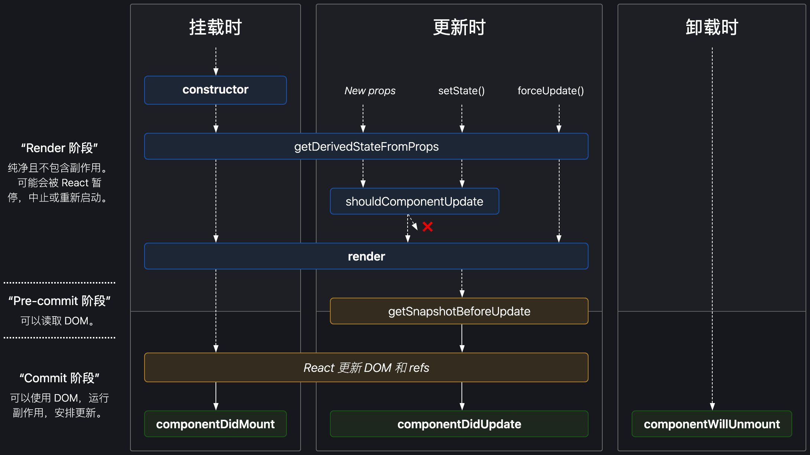
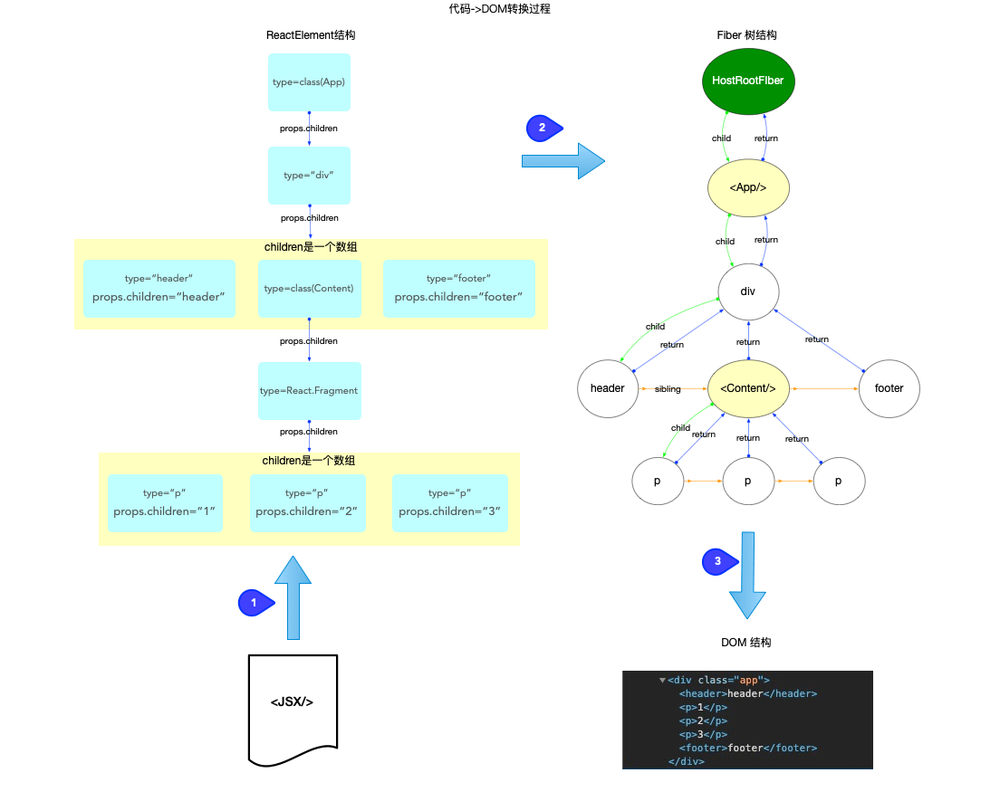
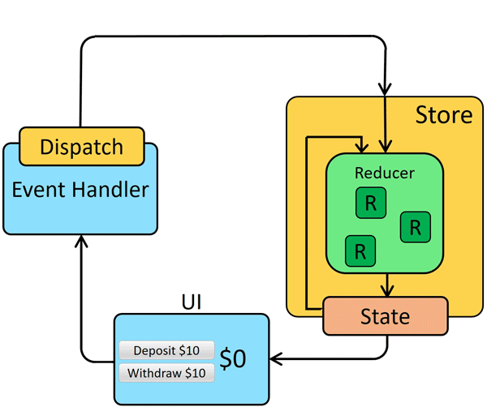
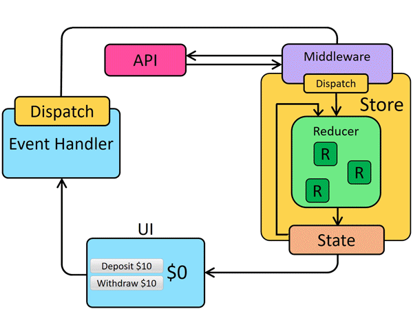

# React学习笔记

## 目录
1. [react](#react)

    1. [Activity 与 useEffectEvent](#activity-与-useeffectevent)
    1. [JSX](#jsx)
    1. [组件](#组件)

        1. [通信](#通信)
        1. [元素渲染](#元素渲染)
    1. [生命周期](#生命周期)
    1. [Hook](#hook)
    1. [与第三方库协同](#与第三方库协同)
    1. [Virtual DOM（fiber、调和）](#virtual-domfiber调和)
    1. [React性能优化](#react性能优化)
    1. [React18新增](#react18新增)

    - <details>

        <summary>其他</summary>

        1. [代码分割（动态加载）](#代码分割动态加载)
        1. [类型检查](#类型检查)
        1. [测试](#测试)
        </details>
1. [create-react-app](#create-react-app)
1. [redux](#redux)

    1. [redux工具](#redux工具)
    1. [dva](#dva)
    1. [rematch](#rematch)
1. [mobx](#mobx)
1. [umi](#umi)
1. [react-native](#react-native)

    1. [核心概念](#核心概念)
1. [Vue与React对比](#vue与react对比)
1. [ant-design例子](#ant-design例子)

---
## [react](https://github.com/facebook/react)

### Activity 与 useEffectEvent

2026-11-26 核对的稳定版为 React 19.3.1。`Activity` 和 `useEffectEvent` 从 19.2 起可用。`ViewTransition` 在 19.3 转为稳定 API，用于协调浏览器视图过渡。[React 版本](https://react.dev/versions) · [19.3.1 包记录](https://registry.npmjs.org/react/19.3.1) · [19.2 发布说明](https://react.dev/blog/2025/10/01/react-19-2) · [19.3 发布说明](https://react.dev/blog/2026/09/09/react-19-3)

`<Activity mode={open ? 'visible' : 'hidden'}>` 适合需要保留输入内容的面板。隐藏时 React 保留状态、清理 Effect，并降低子树更新的优先级。再次显示时，React 用原有状态显示面板，重新建立订阅等 Effect。[Activity](https://react.dev/reference/react/Activity)

`useEffectEvent` 适合让订阅回调读取最近一次提交的 props 和 state。例如切换聊天室需要重新订阅，所以 `roomId` 应列入 Effect 依赖。切换主题只影响通知的外观，显示通知的 Effect Event 可以读取最新的 `theme`。只在同一组件的 Effect、其注册的回调或其他 Effect Event 中调用它，依赖数组中应省略 Effect Event 本身。[useEffectEvent](https://react.dev/reference/react/useEffectEvent)

### JSX
>JSX 是 JavaScript 的语法扩展。Babel、TypeScript 等编译器可以把 JSX 转成 JavaScript 调用。TypeScript 也可以配置为保留 JSX，交给后续工具转换。[编写 JSX](https://react.dev/learn/writing-markup-with-jsx)

1. JSX是一个表达式

    >`if`、`for`不是表达式。
2. 多行 JSX 通常写成 `return (…)`，左括号与 `return` 放在同一行，避免自动分号插入。并列的根元素可用 `<>…</>` 包裹。
3. `<组件名称>`

    1. 用单个标识符引用自定义组件时，以大写字母开头，例如 `<DatePicker />`。

        >首字母小写的简单标签会按名称传给渲染器，例如 React DOM 把 `<button>` 作为 HTML 元素处理。
    2. `.`

        `<对象.属性名>`（不要求~~大写字母开头~~）

        ><details>
        ><summary>e.g.</summary>
        >
        >```jsx
        >import React from "react";
        >
        >const myComponents = {
        >  datePicker: function datePicker (props) {
        >    return <div>传值data：{props.data}</div>;
        >  }
        >};
        >
        >export default (props) => {
        >  return <myComponents.datePicker data={props.data} />;
        >}
        >```
        ></details>
    3. 动态选择组件时，先把查找结果赋给大写变量，再写 JSX。

        ><details>
        ><summary>e.g.</summary>
        >
        >```jsx
        >// 错误！不能是一个表达式。
        >// return <components[props.storyType] story={props.story} />;
        >
        >// 正确！大写字母开头的变量（不能是小写字母开头）
        >const SpecificStory = components[props.storyType];
        >return <SpecificStory story={props.story} />;
        >```
        ></details>
4. 把字符串作为 JSX 的文本子节点时，React 将它作为文本显示，其中的 HTML 标签不会被解析。直接插入 HTML 时见下方 `dangerouslySetInnerHTML`。
5. Props

    1. 内置 DOM 属性多用小驼峰式（camelCase），`aria-*` 和 `data-*` 保持小写及连字符

        >React DOM 的内置属性按文档中的名字书写，例如 `tabIndex`、`onClick`。自定义组件自行决定 prop 名称，React 会原样传入。[常用 DOM 属性](https://react.dev/reference/react-dom/components/common)

        1. 普通 HTML 元素使用 `className`，例如 `<div className="card" />`。自定义元素可以按其 API 传入 `class`。
        2. `htmlFor`替代`for`
        3. 受控表单使用 `value` 或 `checked`，可编辑时用 `onChange` 更新对应状态。下拉选项由 `<select value={…}>` 控制。
        4. 非受控组件的：`defaultValue`、`defaultChecked`
        5. `style`
        6. [事件名](https://react.dev/reference/react-dom/components/common#react-event-object)
        7. 针对`<svg>`等有带`:`的属性，采用小驼峰式（camelCase）替换

            >e.g. `xlink:actuate` -> `xlinkActuate`、`xlink:arcrole` -> `xlinkArcrole`、`xlink:href` -> `xlinkHref`、`xlink:role` -> `xlinkRole`、`xlink:show` -> `xlinkShow`、`xlink:title` -> `xlinkTitle`、`xlink:type` -> `xlinkType`、`xml:base` -> `xmlBase`、`xml:lang` -> `xmlLang`、`xml:space` -> `xmlSpace`、`xmlns:xlink` -> `xmlnsXlink`

        - 特殊情况用`-`短横线隔开式（kebab-case）的属性名：

            1. 无障碍属性`aria-*`
            2. `data-*`

        - 特殊属性

            1. `dangerouslySetInnerHTML={{ __html: 'innerHtml内容' }}`

                为浏览器DOM提供innerHTML的替换方案。仅传入来源可信且已按需净化的 HTML，未经处理的用户输入会带来 XSS 风险。
            2. `suppressContentEditableWarning`
            3. `suppressHydrationWarning`
    2. 赋值

        1. `{}`包裹JS表达式赋值给Props：

            `某prop={JS表达式}`
        2. 字符串字面量：

            `某prop="某字符串"`
        3. 显式写出 prop 名但省略值，等价于传入 `true`：

            `某prop`
    3. `{...某对象}`展开元素

        很容易将不必要的props传递给不相关的组件，或者将无效的HTML属性传递给DOM。需要谨慎的使用该语法，如：`const {children, xx, ...otherProps} = props; return <组件名 {...otherProps} />`。

        >e.g. `<Item {...itemProps} />`。列表的标识单独写成 `<Item key={item.id} {...itemProps} />`。
    4. 包含在开始和结束标签之间的表达式内容将作为特定属性：`props.children`

        1. 可插入内容：

            1. 字符串字面量
            2. 组件、HTML标签
            3. `{JS表达式}`

                >1. `&&`、`||`
                >2. `condition ? true : false`
                >3. `Array`方法

                1. 自定义组件可以约定接收函数等数据作为 `children`。例如父级传入渲染函数，子组件调用它并渲染返回值。
                2. DOM 标签中可以直接渲染 React 元素、字符串、数字、这些节点组成的数组等。React 19 起也支持显示 `bigint`。普通对象不能直接渲染，先取出需要显示的字段。

                    >`false`、`true`、`null`、`undefined` 不显示内容。`0` 会显示为文本，因此数量判断宜写成 `count > 0 && <List />`。
        2. 对空白的处理：

            1. 同一行有意义的空格会保留，例如 `<span>你好 </span>`。
            2. 多行文本会去掉缩进和空行，相邻的非空文本行通常用一个空格连接。
            3. 标签边界需要明确的空格时，写 `{' '}`。
6. 元素组成的数组，会按顺序渲染（注意添加`key`）
7. 注释

    ```jsx
    {/* 单行注释 */}

    {/*
      多行注释
    */}
    ```

- <details>

    <summary>实现</summary>

    - 经典 JSX 转换的前提（旧项目常见）：

        1. 打包工具：需要`import React from "react";`。
        2. `<script>`加载：需要把`React`挂载到全局变量。

            - 为`非构建工具（未使用JSX预处理器）`处理的`<script>`，添加JSX支持：

                1. 添加`<script src="https://unpkg.com/babel-standalone@6/babel.min.js"></script>`；
                2. 在使用JSX的.js文件引用加上`type="text/babel"`。

    1. 经典转换会把 JSX 转译成 `React.createElement` 调用，生成 React 元素。

        - 元素描述由 `type`、`props`、`key` 等构成，应视为只读。元素可以由 React 用来创建或更新 DOM；业务代码不要依赖内部字段。[createElement](https://react.dev/reference/react/createElement)

        >经典转换要求 `React` 在作用域中。旧的 `React.createFactory` 已于 React 19 移除。

        <details>
        <summary>e.g.</summary>

        ```jsx
        import React from 'react';

        const element = (
          <h1 className="greeting">
            Hello, world!
          </h1>
        );


        // 上面的 JSX 经经典转换后，等价于以下调用：
        const compiledElement = React.createElement(
          'h1',
          {className: 'greeting'},
          'Hello, world!'
        );


        // => 创建React元素
        const description = {   // 仅示意 type 和 props
          type: 'h1',
          props: {
            className: 'greeting',
            children: 'Hello, world!'
          }
        };
        ```
        </details>
    2. 自动 JSX 转换由编译器引入运行时，无需为了写 JSX 而导入 React。它随 React 17 推广，并回移至部分旧版本。React 19 要求使用新转换。[React 19 升级指南](https://react.dev/blog/2024/04/25/react-19-upgrade-guide#new-jsx-transform-is-now-required)

        <details>
        <summary>e.g.</summary>

        ```jsx
        function App() {
          return <h1>Hello World</h1>;
        }


        // => 编译结果：
        // 运行时函数由编译器引入
        import {jsx as _jsx} from 'react/jsx-runtime';

        function CompiledApp() {
          return _jsx('h1', { children: 'Hello World' });
        }
        ```
        </details>
    </details>


---
### 组件
组件接收 props，返回描述界面的 React 节点，也可以返回 `null` 表示没有内容。新代码通常使用函数组件，已有 class 组件仍受支持。[Component](https://react.dev/reference/react/Component)

1. 组件类型：

    1. class组件（class components）

        ><details>
        ><summary>e.g.</summary>
        >
        >```jsx
        >class 组件名 extends React.Component {    // 或 React.PureComponent
        >  render() {
        >    return (
        >      <div className="m-div" onClick={this.props.onClick}>
        >        {this.props.value}
        >      </div>
        >    );
        >  }
        >}
        >```
        ></details>
    2. 函数组件（function components，FC）

        函数组件通过 props 接收输入，通过 `useState` 等 Hook 保存状态，通过 Effect 与外部系统同步。函数组件没有组件实例 `this`。

        ><details>
        ><summary>e.g.</summary>
        >
        >```jsx
        >function ActionButton({ onClick, value }) {
        >  function handleClick(event) {
        >    console.log(event.type);
        >    onClick?.(event);
        >  }
        >
        >  return <button onClick={handleClick}>{value}</button>;
        >}
        >```
        ></details>

        每次渲染会重新执行组件函数，并得到这一次的 props、state 和事件处理函数。React 会按组件在树中的位置和身份保留 Hook 的状态。[状态快照](https://react.dev/learn/state-as-a-snapshot)
2. 限制

    1. Props不能被修改（只读）。
    2. 组件只能显性接受传入的Props内容（在外层传`style`、`className`等，需要在组件内接受并处理）。
    3. 组件支持默认导出和具名导出，导入方式要与导出方式对应。
3. State

    每个挂载位置有各自的 state。父组件可以把 state 作为 props 传下去，或将共享状态提升到最近的共同父组件。

    1. 初始化：

        ```jsx
        class Counter extends React.Component {
          state = { count: 0 }; // 也可以在 constructor 内 super(props) 后给 this.state 赋初值

          render() {
            return <span>{this.state.count}</span>;
          }
        }
        ```
    2. 初始化后用 `setState` 更新状态。`forceUpdate()` 只请求重新渲染。
    3. `setState` 将更新加入队列。当前执行的代码需要根据前值计算下一状态时，使用 updater 函数。多个更新可以一起渲染和提交。[setState](https://react.dev/reference/react/Component#setstate)

        >class 组件的 `setState` 会将更新对象浅合并到原 state。函数组件的 `useState` setter 则用新值替换该项状态。

        1. 连续更新和更新后的回调：

            >[原因讨论](https://github.com/facebook/react/issues/11527)。

            1. `setState`的第一个参数：传递一个函数，而不是一个对象，可以依次处理队列中的待更新状态和对应的 props。

                ><details>
                ><summary>e.g.</summary>
                >
                >```jsx
                >// 连续入队时，这种写法可能重复使用同一个旧值
                >this.setState({
                >  counter: this.state.counter + this.props.increment
                >});
                >
                >
                >// 用 updater 处理前一个待更新状态
                >this.setState((state, props) => ({  // 第一个参数是上一个State，第二个参数是此函数运行时的Props
                >  counter: state.counter + props.increment
                >}));
                >```
                >
                >```jsx
                >class Counter extends React.Component {
                >  state = { count: 0 };
                >
                >  incrementCount() {
                >    // 每次都基于队列中的前一个值递增
                >    this.setState((state) => {
                >      return { count: state.count + 1 }
                >    });
                >  }
                >
                >  handleSomething() {
                >    this.incrementCount();
                >    this.incrementCount();
                >    this.incrementCount();
                >  }
                >
                >  render() {
                >    return <button onClick={() => this.handleSomething()}>{this.state.count}</button>;
                >  }
                >}
                >```
                ></details>
            2. 若要确保更新State之后执行方法，则使用`componentDidUpdate`或`setState`的第二个回调函数参数。

        - <details>

            <summary>历史行为：React 17 及更早版本的 legacy root</summary>

            React 17 及以前默认在 React 事件处理函数内批处理；定时器、Promise 或原生监听器中的更新通常分开处理。React 18 起，使用 `createRoot` 时这些来源的更新也能批处理。代码应按 updater 和提交后的回调安排工作。[React 18 工作组说明](https://github.com/reactwg/react-18/discussions/21)
            </details>
    4. `setState`设置相同的值：

        `shouldComponentUpdate` 可以跳过本次重新渲染。执行了 `render` 之后，React 会根据输出差异决定是否修改 DOM。

        >1. `React.Component`的`shouldComponentUpdate`默认按 `true` 处理，会重新渲染。
        >2. `React.PureComponent`的`shouldComponentUpdate`默认实现（修改实现会Warning提示）：浅比较`props`和`state`，若相同则返回`false`不更新，若不相同则返回`true`更新。
    5. 父组件重新渲染时，React 默认递归渲染它返回的子组件。复用同一个 JSX 元素、`shouldComponentUpdate` 或 `memo` 都可能跳过部分工作。提交时仅将需要的改动写入 DOM。[渲染与提交](https://react.dev/learn/render-and-commit)
    6. 属性值改变的策略

        1. 需要跨渲染保留、变化时又应更新界面的值可放入 state 或订阅的外部 store。能从 props 和 state 在渲染时算出的值，直接计算即可。

            >使用函数组件的话，放在`useState`等里效果相同。

            class 组件用 `this.setState(update, callback)` 请求更新，可选的 `callback` 在提交后执行。

            - 不可变性（引用数据类型）

                >`state`、`props`、store、等，都建议遵循不可变性。

                ><details>
                ><summary>可以用<a href="https://github.com/immerjs/immer">immer</a>处理（与react组件配合方式：<a href="https://immerjs.github.io/immer/zh-CN/example-setstate">React & Immer</a>）。</summary>
                >
                >e.g.
                >
                >```js
                >import { produce } from "immer"
                >
                >const baseState = [
                >    {
                >        willDo: "Learn typescript",
                >        done: true
                >    },
                >    {
                >        willDo: "Try immer",
                >        done: false
                >    }
                >]
                >
                >const nextState = produce(baseState, draftState => {
                >    draftState.push({willDo: "Tweet about it"})
                >    draftState[1].done = true
                >})
                >```
                >
                >上面的示例中，对`draftState`的修改都会反映到`nextState`上，并且不会修改`baseState`。而immer使用的结构是共享的，`nextState`在结构上与`baseState`共享未修改的部分。
                ></details>

                更新嵌套对象或数组时，从发生变化的位置逐层复制到 state 根节点。未修改的分支可以复用原引用。

                >优势：
                >
                >1. 简化复杂的功能，方便切换历史数、time-travel。
                >2. 跟踪数据的改变，方便确定数据是否发生了变化。
        2. 不在模板内展示的值（如：仅作为事件触发修改的状态值 或 仅在JS逻辑中改变的值），直接放在class中的实例属性中。

            >使用函数组件的话，放在`useRef`里效果相同。

            - 定时器、监听器或订阅等外部资源，需要在卸载时清理。
        3. 所有这个组件的实例全部共用同一个值，不响应式更新，放在组件外部。

        ><details>
        ><summary>e.g.</summary>
        >
        >```jsx
        >let value = 0  // 该组件的所有实例共享
        >
        >class MyComponent extends React.Component {
        >  constructor (props) {
        >    super(props)
        >    this.state = {
        >      cur: 0    // 需要放到模板内展示
        >    }
        >  }
        >
        >  componentDidMount () {
        >    this.timerID = setInterval(
        >      () => {},
        >      1000
        >    );
        >  }
        >
        >  componentWillUnmount () {
        >    clearInterval(this.timerID);
        >  }
        >
        >  isLoading = false // 不需要在模板内展示
        >
        >  render () {
        >    return (
        >      <View
        >        onClick={() => {
        >          this.setState(state => ({ cur: state.cur + 1 }))
        >          this.isLoading = !this.isLoading // 直接赋值修改
        >          value = value + 1                // 直接赋值修改
        >        }}
        >        p1={this.state.cur}
        >        p2={this.isLoading}
        >        p3={value}
        >      >
        >        {this.state.cur}
        >        {String(this.isLoading)} {/* 实例字段与外部变量在下一次渲染时才反映到界面 */}
        >        {value}
        >      </View>
        >    )
        >  }
        >}
        >```
        ></details>
    7. `forceUpdate`

        跳过 ~~`shouldComponentUpdate`~~，直接触发`render`。
4. Props

    >可以把任何东西当做Props传递，如：组件、函数、JS的任意数据类型。只读的，不应以任何方式修改。

    1. 默认值

        class 组件的静态 `defaultProps` 在 prop 缺省或为 `undefined` 时生效；显式传入 `null` 会保留。React 19 的函数组件用参数默认值，例如 `function Avatar({ size = 40 })`。

        ><details>
        ><summary>e.g.</summary>
        >
        >```jsx
        >class 组件名 extends React.Component {
        >  static defaultProps = {
        >    属性1: "默认值1",
        >    属性2: "默认值2"
        >  };
        >}
        >
        >// 或
        >组件名.defaultProps = {   // 覆盖class内部的静态属性
        >    属性2: "默认值2_",
        >    属性3: "默认值3"
        >}
        >
        >
        >// 结果：默认的Props为`{属性2: "默认值2_", 属性3: "默认值3"}`
        >```
        ></details>
    2. 特殊属性

        1. `key`的取值和逻辑，与[Vue中`key`的注意点（17.i）](https://github.com/realgeoffrey/knowledge/blob/master/网站前端/Vue.js学习笔记/README.md#指令--特殊attribute)一致

            >`key`不是Props（经过React特殊处理），无法传递给子节点。

            列表项使用来自数据、在同级中唯一且稳定的 `key`。增删或重排时，React 据此匹配对应的项。普通条件分支可以不写 `key`。同一位置切换同类型组件时，更改 `key` 可主动重置其状态，例如 `<Chat key={contact.id} />`。[保留与重置状态](https://react.dev/learn/preserving-and-resetting-state)
        2. `ref`

            >React 18 及以前会特殊处理 `ref`，普通函数组件的 props 无法直接取得它。React 19 起，函数组件可将 `ref` 作为 prop 接收并转发。

            >函数组件没有类实例，通常将收到的 `ref` 传给内部 DOM 节点，或用 `useImperativeHandle` 暴露方法。

            1. 由`React.createRef()`创建，`.current`获取DOM或子组件实例。

                >class 组件通常用实例字段保存 `createRef()` 的结果，函数组件和自定义 Hook 用 `useRef` 在各次渲染间保存同一个 ref 对象。

                1. 本组件内使用，获取DOM。
                2. 可以从父级传递`React.createRef()`实例到子组件：

                    >React 18 及以前的函数组件要接收 `ref`，可使用 `forwardRef`，如下例。

                    1. 将已有 ref 传给 class 子组件的 `ref`，父组件会得到该子组件的实例。
                    2. 也可以用普通 prop（如 `inputRef`）传给子组件，由子组件把它绑定到内部 DOM 节点。
                    3. 使用 `forwardRef` 的子组件可将第二个参数 `ref` 绑定到内部 DOM 节点。

                        - 在HOC中使用，获取HOC传入组件内部节点的`ref`
            2. 回调Refs

                React 在提交阶段把节点交给 ref 回调。React 19 支持从回调返回清理函数，节点分离或回调被替换时执行清理。没有返回清理函数时，React 19 保留传入 `null` 的兼容行为。[ref 回调](https://react.dev/reference/react-dom/components/common#ref-callback)

                1. 在`componentDidMount`或`componentDidUpdate`触发前，React会保证`回调Refs`一定是最新的；
                2. 可以在组件间传递；
                3. 内联 ref 回调随每次渲染产生新引用。提交时，React 清理旧回调，再把 DOM 节点传给新回调。

                    >这是因为在每次渲染时会创建一个新的函数实例，所以React清空旧的`ref`并且设置新的。通过将`ref`的回调函数定义成`class`的绑定函数的方式可以避免上述问题，但是大多数情况下它是无关紧要的。
            3. ~~`this.refs.值`~~（React 19 已移除字符串 ref）

            ><details>
            ><summary>e.g.</summary>
            >
            >```jsx
            >// Father.jsx 与子组件
            >import React from "react";
            >export default class Father extends React.Component {
            >  constructor(props) {
            >    super(props);
            >    this.divRef = React.createRef();
            >    this.sonRef = React.createRef();
            >    this.sonDomRef = React.createRef();
            >    this.sonForwardRef = React.createRef();
            >    this.funcRef1 = null;
            >    this.funcRef2 = null;
            >  }
            >  render() {
            >    return (
            >      <div onClick={() => { console.log(this.divRef, this.sonDomRef, this.sonRef, this.sonForwardRef, this.funcRef1, this.funcRef2); }}>
            >        <div
            >          className="m-ref"
            >          ref={this.divRef} // 本组件内使用，获取DOM
            >        >
            >          this.divRef
            >        </div>
            >
            >        <Son1
            >          ref={this.sonRef} // 获取子组件（不是子组件内部DOM）
            >        />
            >
            >        <Son2
            >          refData={this.sonDomRef} // 获取子组件内部节点的`ref`
            >        />
            >
            >        <Son3
            >          ref={this.sonForwardRef} // 本例通过 forwardRef 获取内部 DOM
            >        />
            >
            >        <div
            >          className="m-ref-func"
            >          ref={(dom) => { // 此内联回调被替换时，旧回调收到 null，新回调收到 dom
            >            console.log(dom, "m-ref-func");
            >            this.funcRef1 = dom;
            >          }}
            >        >
            >          this.funcRef1
            >        </div>
            >
            >        <Son4
            >          funcRef={(dom) => { // 此内联回调被替换时，旧回调收到 null，新回调收到 dom
            >            console.log(dom, "Son4");
            >            this.funcRef2 = dom;
            >          }}
            >        />
            >      </div>
            >    );
            >  }
            >}
            >
            >
            >// class 子组件：ref 指向 Son1 的实例
            >class Son1 extends React.Component {
            >  render() {
            >    return <div className="m-son-1">Son1</div>;
            >  }
            >}
            >
            >// 普通 prop 传递 ref
            >function Son2({ refData }) {
            >  return <div className="m-son-2" ref={refData}>Son2</div>;
            >}
            >
            >// 兼容 React 18 的写法；React 19 可直接从 props 读取 ref
            >const Son3 = React.forwardRef(function Son3(props, ref) {
            >  return <div className="m-son-3" ref={ref}>Son3</div>;
            >});
            >
            >// 普通 prop 传递回调 ref
            >function Son4({ funcRef }) {
            >  return <div className="m-son-4" ref={funcRef}>Son4</div>;
            >}
            >```
            ></details>

            - 适用场景

                >避免使用ref来做任何可以通过声明式实现来完成的事情。

                1. 管理焦点，文本选择或媒体播放。
                2. 触发强制动画。
                3. 集成第三方DOM库。
    3. 把 JSX 内容或 React 元素传入子组件

        1. `children`

            传入子组件内的内容（开始标签和结束标签之间的内容），都会在子组件的`props.children`中。
        2. 传参

        ><details>
        ><summary>e.g.</summary>
        >
        >```jsx
        >export default function Father () {
        >  return (
        >    <Son1
        >      aa={<Son2 />}             // 传参
        >      bb={<p>from Father 2</p>} // 传参
        >    >
        >
        >      {/*children*/}
        >      <p>from Father 3</p>
        >      <Son2 />
        >
        >    </Son1>
        >  );
        >}
        >
        >function Son1 (props) {
        >  return (
        >    <div className="m-son-1">
        >      {props.children}
        >      {props.aa}
        >      {props.bb}
        >    </div>
        >  );
        >}
        >
        >function Son2 (props) {
        >  return (
        >    <div className="m-son-2">Son2</div>
        >  );
        >}
        >```
        ></details>

        - 插槽（类似Vue）

            父级可以用 props 提供子级所需的内容。若传入的是组件类型，应在模块顶层定义，让父组件更新时保留插槽子树的状态。

            ><details>
            ><summary>e.g.</summary>
            >
            >```tsx
            >// Father.tsx
            >import Son from "./Son";
            >function Frame({ children }: { children: React.ReactNode }) {
            >  return <div>②father's Slot 父组件数据{children}</div>;
            >}
            >function Content({ children }: { children: React.ReactNode }) {
            >  return <div>④father's children 父组件数据{children}</div>;
            >}
            >export default function SlotComponent() {
            >  return <Son Slot={Frame} children={Content} />;
            >}
            >```
            >
            >```tsx
            >// Son.tsx
            >interface Props {
            >  Slot: React.FC<{ children: React.ReactNode }>;
            >  children: React.FC<{ children: React.ReactNode }>;
            >}
            >export default function Son(props: Props) {
            >  // children需要换个变量名才可以<组件名>
            >  const { Slot, children: Children } = props;
            >
            >  return (
            >    <>
            >      ①slot son 子组件数据
            >      <Slot>
            >        <div>③slot son's Slot 子组件数据</div>
            >      </Slot>
            >      <Children>
            >        <div>⑤slot son's children 子组件数据</div>
            >      </Children>
            >    </>
            >  );
            >}
            >```
            >
            >```text
            >->
            >①slot son 子组件数据
            >②father's Slot 父组件数据
            >③slot son's Slot 子组件数据
            >④father's children 父组件数据
            >⑤slot son's children 子组件数据
            >```
            ></details>

    - 组合、~~继承~~

        用组合（`import`和Props）的方式、而不是 ~~继承（`extends`）~~ 的方式构建新组件。

        - 特例关系（specialization）

            一个组件是其他组件的特殊实例（special case）。

            ><details>
            ><summary>e.g.</summary>
            >
            >```jsx
            >function Dialog(props) {
            >  return (
            >    <FancyBorder color="blue">
            >      <h1 className="Dialog-title">
            >        {props.title}
            >      </h1>
            >      <p className="Dialog-message">
            >        {props.message}
            >      </p>
            >    </FancyBorder>
            >  );
            >}
            >
            >// WelcomeDialog 可以说是 Dialog 的特殊实例
            >function WelcomeDialog() {
            >  return (
            >    <Dialog
            >      title="Welcome"
            >      message="Thank you for visiting our spacecraft!" />
            >  );
            >}
            >```
            ></details>
5. 书写方式

    1. `render`函数中事件触发组件方法时传递`this`的绑定事件方式：

        >非React提供的事件监听回调函数的this绑定也同理。

        1. 仅一次声明（推荐）

            ```jsx
            class 组件名 extends React.Component {
              constructor (props) {
                super(props);

                // 关键代码：
                this.handleClick = this.handleClick.bind(this);
              }

              handleClick () {
                console.log(this, arguments) // 组件实例this, [事件回调参数]
              }

              render () {
                return (
                  <button onClick={this.handleClick} />
                );
              }
            }
            ```

            ```jsx
            class 组件 extends React.Component {
              // 关键代码：
              handleClick = (..._arguments) => {  // 类字段中的箭头函数保留实例 this
                console.log(this, _arguments); // 组件实例this, [事件回调参数]
              };

              render () {
                return (
                  <button onClick={this.handleClick} />
                );
              }
            }
            ```
        2. 组件render时会创建不同回调函数

            在 JSX 中直接传箭头函数很常见。若子组件依赖 `memo` 的浅比较，新的函数引用会使该 prop 每次都不同。

            ><details>
            ><summary>e.g.</summary>
            >
            >```jsx
            >class 组件 extends React.Component {
            >  handleClick () {
            >    console.log(this, arguments); // 组件实例this, [事件回调参数]
            >  };
            >
            >  render () {
            >    return (
            >      <button onClick={e => this.handleClick(e)} />
            >    );
            >  }
            >}
            >```
            ></details>
    2. `this.`会取到最新值，注意异步操作后的取值

        可以用解构的方式在方法顶部先固定`this.`当前的值，之后异步时使用。
6. 样式

    1. `style`

        React DOM 的 `style` 接受样式对象，例如 `style={{ ...基础样式, ...(选中 ? 高亮样式 : {}) }}`。

        1. `style`在React应用中多用于在渲染过程中添加**动态计算**的样式。

            通常不推荐将`style`属性作为设置元素样式的主要方式。在多数情况下，应使用`className`属性来引用外部CSS样式表中定义的class。
        2. 样式不会自动补齐前缀。若需要，则需要手动补充。

            ><details>
            ><summary>e.g.</summary>
            >
            >```js
            >const divStyle = {
            >  transition: 'all',
            >
            >  MozTransition: 'all',
            >  OTransition: 'all',
            >  WebkitTransition: 'all',
            >  msTransition: 'all'      // 'ms' is the only lowercase vendor prefix
            >};
            >```
            ></details>
        3. 数字形式的长度值通常按像素处理，例如 `height: 20`。百分比、`rem` 等需写成字符串，例如 `width: '50%'`。无单位属性如 `opacity`、`zIndex` 可直接使用数字。[style](https://react.dev/reference/react-dom/components/common#applying-css-styles)
    2. `className`

        在其他地方全局引入`.css`文件（`import './x.css'` 或 html的css引入），`className="类名"`或`className={变量或类名字符串}`

        - 除了引入.css文件（或CSS预处理器文件）之外，其他支持：[组件样式使用方案（如：React、Vue）](https://github.com/realgeoffrey/knowledge/blob/master/网站前端/HTML+CSS学习笔记/README.md#组件样式使用方案如reactvue)
7. 事件处理

    1. 小驼峰式（camelCase）定义事件名

        >其他写法（~~大驼峰式PascalCase~~、~~`-`短横线隔开式kebab-case~~、等）无效
    2. React DOM 将事件对象传给处理函数。这个对象提供 `target`、`currentTarget`、`preventDefault()` 等 DOM 事件接口。需要底层浏览器事件时读取 `e.nativeEvent`；两者的事件类型有时不同。[React 事件对象](https://react.dev/reference/react-dom/components/common#react-event-object)

        1. React DOM 16 及以前会复用事件，异步读取时需先保存用到的值或调用 `e.persist()`。React DOM 17 起移除了事件池。
        2. 阻止默认行为、阻止冒泡，必须显式调用：`e.preventDefault()`、`e.stopPropagation()`。
        3. 以点击为例，`onClickCapture` 从祖先向目标执行，接着执行目标的 `onClick`，再向祖先冒泡。`e.stopPropagation()` 可阻止继续传播。`onScroll` 是例外，仅在绑定它的元素上触发。混用原生监听器时，实际顺序还取决于绑定节点和监听阶段。[响应事件](https://react.dev/learn/responding-to-events#event-propagation)

    - <details>

        <summary>原理</summary>

        1. React DOM 通过浏览器原生事件实现派发。React 17 起，大部分事件委托给 React 根容器。旧版 React DOM 通常委托给 `document`。部分事件（如 `scroll`、`load`）在目标元素上监听。[React 17 的事件委托变更](https://legacy.reactjs.org/blog/2020/08/10/react-v17-rc.html#changes-to-event-delegation)
        2. “顶层注册，事件收集，统一触发”的事件机制

            1. 顶层注册：React DOM 创建根时就为支持委托的事件注册监听器。之后即使给组件新增 `onClick`，根容器也能通过已有的监听器派发点击事件。
            2. 事件收集：事件触发时（上述被绑定的事件处理函数被执行），构造合成事件对象，按照冒泡或捕获的路径去组件中收集真正的事件处理函数。
            3. 统一触发：发生在收集过程之后，对所收集的事件逐一执行，并共享同一个合成事件对象。
        3. JSX 中的 `onClick` 等 prop 保存处理函数，React 派发事件时取用。
        4. [实现步骤](https://github.com/7kms/react-illustration-series/blob/main/docs/main/synthetic-event.md)：

            1. 监听原生事件：对齐DOM元素和fiber元素
            2. 收集listeners：遍历fiber树，收集所有监听本事件的listener函数
            3. 派发合成事件：构造合成事件，遍历listeners进行派发

        - 设计原因

            1. 多个节点可以共享根容器上的原生监听器。
            2. 统一规范，进行浏览器兼容，实现更好的跨平台
            3. 减少旧版 React DOM 中的事件对象分配（16 及以前）

                事件对象可能会被频繁创建和回收，因此旧版 React DOM 引入事件池，在事件池中获取或释放事件对象。即React事件对象不会被释放掉，而是存放进一个数组中，当事件触发，就从这个数组中弹出，避免频繁地去创建和销毁(垃圾回收) 。
        </details>
    - debounce/throttle事件处理

        1. class组件

            ```jsx
            // debounce 使用 lodash 的实现，支持 cancel()
            class SearchBox extends React.Component {
              search = debounce(value => this.props.onSearch(value), 500);

              componentWillUnmount() {
                this.search.cancel();
              }

              render() {
                return <input onChange={e => this.search(e.currentTarget.value)} />;
              }
            }
            ```
        2. 函数组件

            ```jsx
            function SearchBox({ onSearch }) {
              const latestOnSearch = React.useRef(onSearch);
              React.useLayoutEffect(() => {
                latestOnSearch.current = onSearch;
              }, [onSearch]);

              const [search] = React.useState(() =>
                debounce(value => latestOnSearch.current(value), 500)
              );
              React.useLayoutEffect(() => () => search.cancel(), [search]);

              return <input onChange={e => search(e.currentTarget.value)} />;
            }
            ```
8. 特殊组件

    1. 高阶组件（higher order component，HOC）

        >是一种设计模式。高阶函数 (Higher-Order Function，HOF)：以函数为参数或/和返回值的函数。

        参数为组件，返回值为新组件的函数。

        1. HOC不应该修改和继承传入的组件，而应该使用组合的方式，通过将组件包装在容器组件中实现功能。
        2. 是纯函数，没有副作用。
        3. 约定：

            1. 将不相关的Props传递给被包裹的组件。

                `key` 由 React 使用。函数包装组件在 React 19 可直接接收和传递 `ref`，见下文。
            2. 最大化可组合性。
        4. 注意事项：

            1. 不要在`render`方法中使用

                ><details>
                ><summary>e.g.</summary>
                >
                >```jsx
                >class Parent extends React.Component {
                >  render() {
                >    // 每次调用 render 函数都会创建一个新的 EnhancedComponent
                >    // EnhancedComponent1 !== EnhancedComponent2
                >    const EnhancedComponent = enhance(MyComponent);   // 应该在非render处仅创建一次
                >    // 这将导致子树每次渲染都会进行卸载，和重新挂载的操作！
                >    return <EnhancedComponent />;
                >  }
                >}
                >```
                ></details>
            2. 调用方依赖原组件的静态方法时，需要显式保留它们

                >[hoist-non-react-statics](https://github.com/mridgway/hoist-non-react-statics)。

                ><details>
                ><summary>e.g.</summary>
                >
                >```jsx
                >import hoistNonReactStatic from 'hoist-non-react-statics';
                >
                >function enhance(WrappedComponent) {
                >  class Enhance extends React.Component {/*...*/}
                >  hoistNonReactStatic(Enhance, WrappedComponent);  // 把所有WrappedComponent的静态方法（不包括react原生静态方法）拷贝到Enhance
                >  return Enhance;
                >}
                >```
                ></details>
            3. 包装函数组件时，React 19 可从 props 接收 `ref` 并继续传递给内部组件。18 及以前使用 `forwardRef`；各版本的 `key` 均由 React 自身使用。[forwardRef](https://react.dev/reference/react/forwardRef)

        ><details>
        ><summary>e.g.</summary>
        >
        >```jsx
        >// 高阶组件 HOCComponent.js
        >import React from "react";
        >export default (WrappedComponent) =>
        >  class WrapperComponent extends React.Component {
        >    render () {
        >      return <WrappedComponent {...this.props} />;
        >    }
        >  }
        >```
        >
        >```jsx
        >// 利用高阶组件生成的新组件 WrappedComponent.js
        >import React from "react";
        >import HOC from "./HOCComponent";
        >export default HOC(
        >  class WrappedComponent extends React.Component {
        >    render () {
        >      return <div>WrappedComponent</div>
        >    }
        >  }
        >);
        >```
        >
        >```jsx
        >// 使用组件
        >import WrappedComponent from "./WrappedComponent";
        ><WrappedComponent a='aa' b='bb' />
        >```
        ></details>
    2. `<React.Fragment>`

        1. Fragment 将多个子节点分组，不增加包装 DOM。显式写法支持 `key`。React 19.3 起还支持 `ref`，其值为可操作这组 DOM 节点的 `FragmentInstance`。[Fragment](https://react.dev/reference/react/Fragment)
        2. 短语法：`<>子节点</>`（不支持所有属性，包括不支持`key`属性）。
    3. 表单

        1. 受控组件（controlled components）

            >事件：`onChange`。每当表单字段变化时，该事件都会被触发。

            React state 决定文本框、文本域和下拉框的 `value`，以及复选框、单选框的 `checked`。可编辑的受控表单在 `onChange` 中同步更新对应状态。[input](https://react.dev/reference/react-dom/components/input) · [select](https://react.dev/reference/react-dom/components/select)

            1. `<input type="text">`、`<textarea>`

                ><details>
                ><summary>e.g.</summary>
                >
                >```jsx
                >class TextField extends React.Component {
                >  constructor (props) {
                >    super(props);
                >    this.state = { value: "初始化值" };
                >
                >    this.handleChange = this.handleChange.bind(this);
                >  }
                >
                >  handleChange (event) {
                >    this.setState({ value: event.target.value });
                >  }
                >
                >  render () {
                >    return (
                >      <input type="text" value={this.state.value} onChange={this.handleChange} />
                >    );
                >  }
                >}
                >```
                ></details>
            2. `<input type="checkbox">`

                ><details>
                ><summary>e.g.</summary>
                >
                >```jsx
                >function Checkbox() {
                >  const [checked, setChecked] = React.useState(true);
                >
                >  return (
                >    <label>
                >      <input
                >        type="checkbox"
                >        checked={checked}
                >        onChange={e => setChecked(e.currentTarget.checked)}
                >      />
                >      Check Me!
                >    </label>
                >  );
                >}
                >```
                ></details>
            3. `<input type="radio">`

                ><details>
                ><summary>e.g.</summary>
                >
                >```jsx
                >function Radio() {
                >  const [radioValue, setRadioValue] = React.useState("chooseB");
                >
                >  return <>
                >    <label htmlFor="chooseA">
                >      <input
                >        type="radio"
                >        name="choose"
                >        id="chooseA"
                >        value="chooseA"
                >
                >        checked={radioValue === "chooseA"}
                >        onChange={(e) => {
                >          setRadioValue(e.currentTarget.value);
                >        }}
                >      />
                >      选中A
                >    </label>
                >    <label htmlFor="chooseB">
                >      <input
                >        type="radio"
                >        name="choose"
                >        id="chooseB"
                >        value="chooseB"
                >
                >        checked={radioValue === "chooseB"}
                >        onChange={(e) => {
                >          setRadioValue(e.currentTarget.value);
                >        }}
                >      />
                >      选中B
                >    </label>
                >  </>
                >}
                >```
                ></details>
            4. `<select>`

                ><details>
                ><summary>e.g.</summary>
                >
                >```jsx
                >class FruitSelect extends React.Component {
                >  constructor (props) {
                >    super(props);
                >    this.state = { value: "coconut" };
                >
                >    this.handleChange = this.handleChange.bind(this);
                >  }
                >
                >  handleChange (event) {
                >    this.setState({ value: event.target.value });
                >  }
                >
                >  render () {
                >    return (
                >      <select value={this.state.value} onChange={this.handleChange}>
                >        <option value="grapefruit">葡萄柚</option>
                >        <option value="lime">酸橙</option>
                >        <option value="coconut">椰子</option>
                >        <option value="mango">芒果</option>
                >      </select>
                >    );
                >  }
                >}
                >```
                >
                >```jsx
                >class FruitMultiSelect extends React.Component {
                >  constructor (props) {
                >    super(props);
                >    this.state = { value: ["coconut", "mango"] };
                >
                >    this.handleChange = this.handleChange.bind(this);
                >  }
                >
                >  handleChange (event) {
                >    const values = Array.from(event.currentTarget.selectedOptions, option => option.value);
                >    this.setState({ value: values });
                >  }
                >
                >  render () {
                >    return (
                >      <select multiple={true} value={this.state.value} onChange={this.handleChange}>
                >        <option value="grapefruit">葡萄柚</option>
                >        <option value="lime">酸橙</option>
                >        <option value="coconut">椰子</option>
                >        <option value="mango">芒果</option>
                >      </select>
                >    );
                >  }
                >}
                >```
                ></details>

            - `<input value="hi" readOnly />` 表示有意只读。要允许输入，可传入 state 与更新它的 `onChange`。受控文本框应始终收到字符串，初始数据可能为空时可写 `value={name ?? ''}`。同一输入框在挂载期间应保持受控或非受控。
        2. 非受控组件（uncontrolled components）

            表单数据将交由DOM节点来处理。

            - 默认值`defaultValue`、`defaultChecked`

                >e.g. `<input defaultValue="默认值" type="text" ref={this.input} />`

            - `<input type="file" />`始终是一个非受控组件

            - `<input type="checkbox">`

                ><details>
                ><summary>e.g.</summary>
                >
                >```jsx
                >function Checkbox() {
                >  return (
                >    <label>
                >      <input type="checkbox" defaultChecked />
                >      Check Me!
                >    </label>
                >  );
                >}
                >```
                ></details>

            ><details>
            ><summary>e.g.</summary>
            >
            >```jsx
            >class FileForm extends React.Component {
            >  constructor(props) {
            >    super(props);
            >    this.handleSubmit = this.handleSubmit.bind(this);
            >    this.fileInput = React.createRef();
            >  }
            >  handleSubmit(event) {
            >    event.preventDefault();
            >    const file = this.fileInput.current.files[0];
            >    if (file) alert(`Selected file - ${file.name}`);
            >  }
            >
            >  render() {
            >    return (
            >      <form onSubmit={this.handleSubmit}>
            >        <label>
            >          Upload file:
            >          <input type="file" ref={this.fileInput} />
            >        </label>
            >        <br />
            >        <button type="submit">Submit</button>
            >      </form>
            >    );
            >  }
            >}
            >```
            ></details>
    4. 错误边界（error boundaries）

        在 class 组件中用 `static getDerivedStateFromError(error)` 设置后备界面的状态，可在 `componentDidCatch(error, info)` 中记录错误。把错误边界包在可能出错的子树外，某个区域渲染失败时就能显示该区域的后备界面。[错误边界](https://react.dev/reference/react/Component#catching-rendering-errors-with-an-error-boundary)

        - 错误边界覆盖后代的渲染等 React 管理的工作。以下场景有不同的处理方式：

            1. 普通事件处理函数中的错误由处理函数处理。
            2. 定时器或独立 Promise 的错误在异步任务中处理。`useTransition` 返回的 `startTransition` 所执行的 Action 抛错时可由错误边界接住。
            3. 服务端渲染错误交给框架或服务端渲染 API 处理。
            4. 该错误边界它自身抛出的错误

                若一个错误边界无法渲染错误信息，则错误会冒泡至最近（**就近原则**）的上层错误边界。

        >支持所有React渲染器：[react-error-boundary](https://github.com/bvaughn/react-error-boundary)（函数组件没有错误边界，可以直接用这个第三方库的class组件错误边界）
    5. 严格模式`<React.StrictMode>`

        >仅在开发模式下运行；它们不会影响生产构建。

        严格模式检查所包裹的组件树。[StrictMode](https://react.dev/reference/react/StrictMode)

        1. 检查渲染是否纯净。开发时 React 会额外调用组件函数、部分 class 方法、state 初始化器和 updater 等应为纯函数的逻辑。
        2. 在根部启用严格模式时，首次挂载会额外运行一轮 Effect 的建立和清理，帮助发现遗留的定时器和订阅。
        3. ref 回调也会额外经历建立和清理，帮助发现清理遗漏。
        4. 对仍受支持的过时 API 发出警告。React 19 已移除字符串 ref、`findDOMNode` 和旧 Context API。[React 19 升级指南](https://react.dev/blog/2024/04/25/react-19-upgrade-guide#removed-deprecations)
    6. `React.memo(函数组件[, 对比props的方法]);`

        >默认逐项使用 `Object.is` 比较 props。自定义比较函数接收前后两组 props，确认输出与行为均可复用时返回 `true`。

        `memo` 让 React 在父组件重新渲染且 props 相等时通常可以跳过子组件渲染。子组件自身 state 或其读取的 context 改变时仍会更新。自定义比较应覆盖每个影响输出和行为的 prop，包括函数。[memo](https://react.dev/reference/react/memo)

        ><details>
        ><summary>e.g.</summary>
        >
        >```jsx
        >function MyComponent({ label, onClick }) {
        >  return <button onClick={onClick}>{label}</button>;
        >}
        >
        >function areEqual(prevProps, nextProps) {
        >  return prevProps.label === nextProps.label && prevProps.onClick === nextProps.onClick;
        >}
        >
        >// 此例也可省略 areEqual，默认比较已能得到相同结果
        >export default React.memo(MyComponent, areEqual);
        >```
        ></details>
    7. `ReactDOM.createPortal(组件, 挂载去的DOM节点)`

        将子节点渲染到指定的、已存在的 DOM 容器，常用于模态框和提示层。React 的 context 和事件冒泡仍沿原组件树传递；CSS 继承、布局和原生 DOM 事件路径取决于实际 DOM 位置。[createPortal](https://react.dev/reference/react-dom/createPortal)
    8. `<Profiler id="id值" onRender={回调函数}>`

        >生产构建默认会被禁用。

        测量渲染一个React应用多久渲染一次以及渲染一次的“代价”。它的目的是识别出应用中渲染较慢的部分。
    9. `<React.Suspense>`、`React.lazy`

        在模块顶层声明 `const Editor = React.lazy(() => import('./Editor'))`，默认导出应为组件。第一次渲染 `<Editor />` 时开始加载，最近的 `<Suspense fallback={<Spinner />}>` 在等待期间显示后备内容。Suspense 也支持读取由框架或 `use` 集成的数据；普通 Effect 里发起的请求需要自行管理加载状态。[lazy](https://react.dev/reference/react/lazy) · [Suspense](https://react.dev/reference/react/Suspense)
9. 命名规范

    1. 事件监听Props命名为：`on[Event]`；事件监听处理函数命名为：`handle[Event]`。
10. `displayName`

    [React DevTools](https://github.com/facebook/react/tree/master/packages/react-devtools)使用该字符串来确定要显示的名字。

    1. class组件的静态属性`displayName` 或 `函数组件名.displayName` 赋值 `新组件名`

        ><details>
        ><summary>e.g.</summary>
        >
        >```jsx
        >class 组件名 extends React.Component {
        >  static displayName = '新组件名'
        >}
        >
        >// 或
        >组件名.displayName = '新组件名'   // 覆盖class内部的静态属性
        >
        >
        >// 结果：显示为：`新组件名`
        >```
        ></details>

        >默认显示：class组件名或函数组件名。
    2. `React.createContext()的对象.displayName = 「context名」`

        显示为：`「context名」.Provider`和`「context名」.Consumer`。

        >默认显示：`Context.Provider`和`Context.Consumer`。
    3. 用 `const Input = React.forwardRef(function Input(props, ref) { … })` 给渲染函数命名，或设置 `Input.displayName`，便于在 DevTools 中识别包装组件。

#### 通信
1. 父子组件间通信

    1. 父级（Props） -> 子级。其中Props包括：数据（可以是父级的State） + 父级的方法。

        >单向数据流：父组件可以向子组件传递props，但子组件不能修改父组件传递来的props，子组件只能通过触发父组件传递下来的方法导致父组件进行数据更改。

        ><details>
        ><summary>e.g.</summary>
        >
        >```tsx
        >import { useState } from "react";
        >
        >function Parent() {
        >  const [count, setCount] = useState(0);
        >  return <Child count={count} onAdd={() => setCount(n => n + 1)} />;
        >}
        >
        >function Child({ count, onAdd }: { count: number; onAdd: () => void }) {
        >  return <button onClick={onAdd}>已点击 {count} 次</button>;
        >}
        >```
        ></details>
    2. 父 -> 子：触发子组件的方法

        1. 父级引用子级的方法

            1. 子组件是class组件

                父级ref引用子级实例，直接调用实例方法。

                >例如父组件用对象 ref 渲染 `<Son ref={a} />`，挂载后可在事件处理器中调用 `a.current?.实例方法()`。
            2. 子组件是函数组件

                子级用 `useImperativeHandle` 暴露方法。React 19 的函数组件可从 props 接收 ref，React 18 及以前用 `forwardRef` 接收。

                >例如 `a.current?.focus()` 让父组件聚焦子组件里的输入框。
        2. 父级通过 props 描述目标状态，例如 `<Dialog open={isOpen} />`。需要与浏览器或第三方控件同步时，子组件再用 Effect 处理。
2. 非父子组件通信

    1. 祖孙组件间的通信

        1. Props逐层往下传递
        2. 从祖辈向所有孙辈传递

            <details>
            <summary>Context提供了一种直接访问祖先节点上的状态的方法，避免了多级组件层层传递props。</summary>

            函数组件通过 `useContext(MyContext)` 订阅上方最近的 Provider。React 用 `Object.is` 比较前后两次的 `value`，值改变时通知读取这个 Context 的组件。仅为无关的父级更新创建新对象，也会改变 `value` 的引用。[useContext](https://react.dev/reference/react/useContext)
            </details>

            >兄弟节点间通信，可以通过在公共的祖先组件设置`Provider`并且`value`传递能够修改`value`值的方法，兄弟节点设置`Consumer`，进行通信。

            1. 在组件外创建 `const MyContext = React.createContext(默认值)`。

                返回一个 Context 对象。仅当组件上方没有匹配的 Provider 时使用静态默认值。
            2. 祖辈组件设置：`<MyContext.Provider value={/* 某个值 */}>`

                >同一 Context 的 Provider 可以嵌套，内层值覆盖外层值。React 19 起也可以写 `<MyContext value={value}>`。[createContext](https://react.dev/reference/react/createContext)

            3. 孙辈组件读取 Context 的方式：

                从组件树中离自身最近（**就近原则**）匹配`Provider`中读取到当前的`context`值。

                1. `contextType`

                    class组件的静态属性添加`contextType`。

                    ><details>
                    ><summary>e.g.</summary>
                    >
                    >```jsx
                    >class 组件名 extends React.Component {
                    >  static contextType = MyContext;
                    >}
                    >
                    >// 或
                    >组件名.contextType = MyContext   // 覆盖class内部的静态属性
                    >```
                    ></details>

                    孙辈组件中通过`this.context`使用。
                2. 函数组件在顶层调用 `const data = useContext(MyContext)`。
                3. `<MyContext.Consumer>{(data) => { return 组件 }}</MyContext.Consumer>`

                    孙辈组件中通过`props.children`传入函数使用。

                    >`Provider`及其内部`Consumer组件`都不受制于`shouldComponentUpdate`函数，因此当`Consumer组件`在其祖辈组件退出更新的情况下也能更新。

            ><details>
            ><summary>e.g.</summary>
            >
            >```tsx
            >// 使用 Provider、Consumer
            >import React, { useState } from "react";
            >import { MyContext1 } from "../../context";
            >import TheContextSon from "./TheContextSon";
            >
            >export default function TheContext() {
            >  const [data, setData] = useState({ a: 10 });
            >
            >  return (
            >    <>
            >      <MyContext1.Provider value={{ state: data, dispatch: setData }}>
            >        {/* 子组件1、兄弟组件，正常工作 */}
            >        <TheContextSon />
            >
            >        {/* 子组件2、兄弟组件，正常工作 */}
            >        <TheContextSon />
            >      </MyContext1.Provider>
            >
            >      {/* 在 Provider 外，读取默认值 */}
            >      <TheContextSon />
            >    </>
            >  );
            >}
            >```
            >
            >```tsx
            >// ./TheContextSon.tsx
            >import React from "react";
            >import { MyContext1 } from "../../context";
            >
            >export default function TheContextSon() {
            >  return (
            >    <MyContext1.Consumer>
            >      {({ state, dispatch }) => {
            >        return (
            >          <div
            >            onClick={() => {
            >              dispatch({ a: state.a - 1 });
            >            }}
            >          >
            >            {JSON.stringify(state)}
            >          </div>
            >        );
            >      }}
            >    </MyContext1.Consumer>
            >  );
            >}
            >```
            >
            >```ts
            >// ../../context.ts
            >import React from "react";
            >
            >export const MyContext1 = React.createContext({
            >  state: { a: 1 },
            >  dispatch(data: { a: number }) {}
            >});
            >```
            ></details>
    2. 通用

        1. 状态管理（redux、mobx）
        2. 开发人员维护事件订阅机制（事件总线，event bus）
        3. ~~其他能被任意地方调用的全局属性（如：cookie、Web Storage、window、等）~~
        4. ~~`postMessage`（或`MessageChannel`）~~

>1. 若多个组件需要反映相同的变化数据，则将共享状态提升到最近的共同父组件中去。
>
>    应当依靠自上而下的数据流，而不是尝试在不同组件间同步State。
>2. 若某些数据可以由Props或State推导得出，则它就不应该存在于State中

#### 元素渲染
1. React 18 起，从 `react-dom/client` 导入 `createRoot`。客户端空容器创建一次根节点，用 `root.render(<App />)` 挂载；服务端输出的 React HTML 则用 `hydrateRoot(container, <App />)` 接管，客户端首次输出应与服务端一致。React 17 及更早的 `ReactDOM.render` 在 18 属于兼容入口，19 已移除。[React 19 迁移指南](https://react.dev/blog/2024/04/25/react-19-upgrade-guide#removed-reactdom-render)
2. React DOM

    1. 管理根DOM内所有内容。
    2. 将React元素和它的子元素与它们之前的状态进行比较，并只会进行必要的更新来使DOM达到预期的状态（调和，reconcile）。
3. React元素（React elements）

    1. 不可变对象（[immutable](https://zh.wikipedia.org/wiki/不可变对象)）
    2. 创建开销极小的**普通对象**
4. 组件渲染

    组件渲染时返回 React 节点，例如元素、字符串、数字、节点数组或 `null`。React 在提交阶段把必要的更改写入 DOM。

    1. `render`方法（或函数组件）返回`null`，组件会正常运行和执行生命周期函数，只是不渲染出任何DOM（因为渲染空内容）。

- API

    1. `React.cloneElement(element[, props[, ...children]])`（已废弃：~~`React.addons.cloneWithProps`~~）

        克隆并返回新的 React 元素。显式传入的 props 覆盖同名旧值，省略 children 参数则保留原有 children。

        >原元素的 `key` 和 `ref` 默认保留，显式传入时可覆盖。[cloneElement](https://react.dev/reference/react/cloneElement)

        ><details>
        ><summary>e.g.</summary>
        >
        >把接收到的参数传递给 `props.children` 中的元素：
        >
        >```jsx
        >const { children, ...otherProps } = props;
        >
        >return (
        >  <>
        >    {React.Children.map(children, (child) => {
        >      if (!React.isValidElement(child)) return child; // 例如文本节点
        >      return React.cloneElement(child, {...otherProps, 新增参数: '值'});
        >    })}
        >  </>
        >)
        >```
        ></details>
    2. `React.isValidElement(对象)`

        验证对象是否为React元素。返回：`true/false`。
    3. `React.Children` + `.map/.forEach/.count/.only/.toArray`

        处理`this.props.children`

---
### 生命周期
>以下方法适用于 class 组件。渲染阶段可以重试或放弃，DOM 读取、订阅和清理要选择对应的提交阶段方法。[Component](https://react.dev/reference/react/Component)

1. `constructor(props)`

    1. 在构造函数中使用 `this` 之前先调用 `super(props)`。
    2. 作用

        1. 通过给`this.state`赋值对象来初始化内部`state`（不能用 ~~`this.setState`~~）。
        2. 为事件处理函数绑定实例`this`。
    3. 避免将`props`的值复制给`state`。

    >避免引入任何副作用或订阅。
2. `static getDerivedStateFromProps(props, state)`

    >这是静态方法，不能访问组件实例。

    1. 调用`render`方法之前调用。
    2. 首次挂载和后续更新都可能调用，包括本地 state 更新。仅在确实需要根据 props 调整已保存状态时使用。能直接根据 props 计算的值，可在 render 中计算。

        返回一个对象来更新`state`，若返回`null`则不更新`state`。

        ><details>
        ><summary>e.g.</summary>
        >
        >```jsx
        >class ExampleComponent extends React.Component {
        >  // 在构造函数中初始化state 或 使用属性初始化器
        >  state = {
        >    isScrollingDown: false,
        >    lastRow: null
        >  };
        >
        >  static getDerivedStateFromProps(props, state) {
        >    if (props.currentRow !== state.lastRow) {
        >      return {
        >        isScrollingDown: props.currentRow > state.lastRow,
        >        lastRow: props.currentRow
        >      };
        >    }
        >
        >    // 返回 null 表示无需更新 state
        >    return null;
        >  }
        >}
        >```
        ></details>


>[React：你可能不需要使用派生 state](https://zh-hans.reactjs.org/blog/2018/06/07/you-probably-dont-need-derived-state.html)

3. `shouldComponentUpdate(nextProps, nextState)`

    >`this.props`和`this.state`都是当前值（未改变的，不是 ~~`nextProps`~~、~~`nextState`~~）。调用组件方法`this.func`，组件方法用当前值，若需要用next值，要用传参的方式`this.func(nextProps, nextState)`或`其他方法(nextProps, nextState)`。

    1. 重新渲染前被触发。

        1. 返回 `true`，继续渲染。若输出相同，React 可以复用现有 DOM。
        2. 返回 `false`，React 通常跳过本组件这次由 props 或 state 引起的重新渲染。子组件自身的更新仍可进行。
    2. 首次渲染 或 调用`forceUpdate`时不执行。
    3. 不建议进行深层比较或使用`JSON.stringify`。这样非常影响效率，且会损害性能。

    >应该仅作为性能优化的方式而存在。不要企图依靠此方法来“阻止”渲染，因为这可能会产生bug。应该考虑使用内置的`PureComponent`组件。
4. `render()`

    >不可省略。应该为纯函数。
5. `getSnapshotBeforeUpdate(prevProps, prevState)`

    1. 在 React 把本次更新写入 DOM 前读取旧 DOM，例如记住列表滚动位置。
    2. 返回的值传递给`componentDidUpdate`的第三个参数。
6. `componentDidMount()`

    组件已经装载。

    >执行有副作用的操作。依赖DOM的初始化操作、网络请求、订阅。
7. `componentDidUpdate(prevProps, prevState, snapshot)`

    更新后会被立即调用。首次渲染时不执行。

    >`getSnapshotBeforeUpdate`返回的值作为第三个参数。
8. `componentWillUnmount()`

    1. React 将组件从页面移除前调用，用于撤销挂载时建立的资源。
    2. 注意内存泄漏（全局副作用）：手动绑定的事件（如：`addEventListener`）、订阅、定时器、http连接、以及任何需要手动关闭的内容，需要在`componentWillUnmount`手动清除。

    >组件自身的 `render` 返回 `null` 仍保留该组件实例。开发环境下，根节点启用严格模式时，React 会额外执行一次挂载、清理和重新挂载，帮助检查清理逻辑。
9. `UNSAFE_componentWillReceiveProps(nextProps)/componentWillReceiveProps`

    1. 当`props`发生变化时执行；若父组件导致组件重新渲染，即使`props`没有更改，也会执行。
    2. 首次渲染时不执行。
    3. 此函数可以通过调用`this.setState()`来更新组件状态。
10. `UNSAFE_componentWillUpdate(nextProps, nextState)/componentWillUpdate`

    1. 当组件收到新的`props`或`state`时，会在渲染之前执行。
    2. 首次渲染时不执行。

    >不可调用`this.setState`；在`componentWillUpdate`返回之前，你也不应该执行任何其他操作（例如，redux的`store.dispatch(某个action)`）触发对React组件的更新。
11. `UNSAFE_componentWillMount()/componentWillMount`

    >这是旧式的挂载前方法。服务端渲染也会执行渲染阶段代码，包括构造函数和 `render`。在客户端提交后才能启动订阅。

>上述三个 `UNSAFE_` 方法属于旧 API。旧的渲染尝试有可能被丢弃。初始化 state 用字段或构造函数，与外部系统同步用挂载、更新和卸载方法，更新 DOM 前读取快照用 `getSnapshotBeforeUpdate`。[旧生命周期方法](https://react.dev/reference/react/Component#unsafe_componentwillmount)

12. 错误边界

    错误边界可以为后代在构造、渲染或生命周期中抛出的错误展示备用 UI。边界自身的错误交给更上层边界。事件处理器、服务端渲染以及普通定时器或异步回调中的错误需要在相应位置处理。React 19 的 Transition Action 抛错时可由错误边界处理。[错误边界](https://react.dev/reference/react/Component#catching-rendering-errors-with-an-error-boundary)

    1. `static getDerivedStateFromError(error)`

        1. 若后代组件抛出错误则被调用。返回一个对象以更新`state`。
        2. 参数：error，抛出的错误（与`componentDidCatch`第一个参数相同）

        >必须是纯函数。
    2. `componentDidCatch(error, info)`

        1. 若后代组件抛出错误则被调用。无返回值。
        2. 参数：error，抛出的错误（与`getDerivedStateFromError`参数相同）；info，带有componentStack key 的对象，其中包含有关组件引发错误的栈信息。
        3. 应该用于记录错误之类的情况。

        >允许执行副作用。

    <details>
    <summary>e.g.</summary>

    ```jsx
    // MyErrorBoundary.jsx
    export default class MyErrorBoundary extends React.Component {
      constructor(props) {
        super(props);
        this.state = { hasError: false };
      }

      static getDerivedStateFromError(error) {
        // 更新state使下一次渲染能够显示自定义降级后的UI
        return { hasError: true };  // 返回内容被设置为state
      }

      componentDidCatch(error, errorInfo) {
        // 应该用于记录错误之类的情况
        console.log(error, errorInfo);
      }

      render() {
        // 捕获子组件树中的错误，自定义降级后的UI
        if (this.state.hasError) {
          return <h1>Something went wrong!!!</h1>;
        }

        // 未捕获子组件树中的错误，展示子节点
        return this.props.children;
      }
    }


    // App.jsx
    <MyErrorBoundary >
      子级展示内容，会被父级错误边界捕获错误
    </MyErrorBoundary>
    ```
    </details>

>[生命周期图谱](https://projects.wojtekmaj.pl/react-lifecycle-methods-diagram/)（class 组件的挂载、更新、卸载流程）。



### Hook
Hook是一些可以在**函数组件**里“钩入”React state及生命周期等特性的**函数**。

- 使用规则（eslint-plugin-react-hooks）：

    1. `useState`、`useEffect` 等 Hook 在函数组件或自定义 Hook 顶层按固定顺序调用。React 19 的 `use(resource)` 有专门规则，允许在循环和条件内读取资源，但仍须在组件或 Hook 中调用；处理 Promise 拒绝应交给错误边界。[use](https://react.dev/reference/react/use)

        若想要有条件地执行一个 Effect，可以将判断放到 Hook 内部。

        >常规 Hook 必须放在可能提前 `return` 的分支之前。
    2. 只能在React的函数组件 或 自定义Hook 中调用Hook。

        不能在~~class组件~~中使用；不要在~~其他JS函数~~中调用。

    <details>
    <summary>原因</summary>

    React 按同一组件中 Hook 的调用顺序关联每次渲染的状态。如果本轮跳过某个 `useState`，下方 Hook 就无法与上一轮一一对应。下面用数组演示单个组件的调用顺序，每次调用组件前都要把索引归零。[Hook 规则](https://react.dev/reference/rules/rules-of-hooks)

    ```js
    // e.g. 模拟实现
    const hookStates = [];    // 放着此组件的所有的hooks数据
    let hookIndex = 0;      // 代表当前的hooks的索引

    function render() {
      hookIndex = 0;
      return Component(); // Component 代表本例中使用 Hook 的单个组件
    }

    // 只演示直接传值的 useState，省略批处理、函数式更新等逻辑
    function useState(initialState){
      // 如果有老值取老值,没有取默认值
      if (!(hookIndex in hookStates)) hookStates[hookIndex] = initialState;
      // 暂存索引
      const currentIndex = hookIndex;
      function setState(newState){
        hookStates[currentIndex] = newState;
        render();
      }
      return [hookStates[hookIndex++], setState];   // 用类数组形式保存所有使用的Hooks，调用一次hook就使索引加1
    }
    ```

    >React 的实现把许多 Hook 的状态保存在组件对应的 Fiber 上。上述数组仅用来演示调用顺序，Fiber 的内部字段会随版本变化。

    </details>

- <details>

    <summary>hook解决的问题（相对class组件的优势）</summary>

    1. class组件的不足

        1. 状态逻辑难复用：

            在组件之间复用状态逻辑很难，可能要用到render props（渲染属性）或HOC（高阶组件），可能增加组件树的层级，是否生成额外的 DOM 取决于组件返回的内容。

            >①[`Mixin`已被证伪（`React.createClass`）](https://zh-hans.legacy.reactjs.org/blog/2016/07/13/mixins-considered-harmful.html)（隐式依赖、mixin还可以依赖其他mixin，没有依赖关系图、是扁平化结构，名称冲突，重构/改名 风险很大、mixin一旦编写完成就很难移除或修改，使用相同mixin的组件间互相耦合，随业务增长从而复杂性增加、封装边界逐渐瓦解），②HoC被认为props来源不明，③render props被诟病嵌套地狱。以上三个问题也同样在Vue使用相关功能时出现。
        2. 趋向复杂难以维护：

            在生命周期函数中混杂不相干的逻辑，类组件中到处都是对状态的访问和处理，导致组件难以拆分成更小的组件。
        3. `this`实例绑定

            把普通类方法作为事件回调传递时，要绑定实例或使用箭头函数字段，否则方法里读取的 `this` 可能是 `undefined`。
    2. hook优势

        1. 能优化class组件的上面三大问题

            1. 更好的可复用性：

                可以更容易地将组件逻辑封装为自定义的Hooks以复用。
            2. 简化组件逻辑：

                1. 可以将组件的状态（state）和副作用（side effects）分离，使组件的逻辑更加清晰和易于理解。
                2. 可以将相关的逻辑聚合在一起（而不用像class组件那样在不同的生命周期方法中进行分散编写）。
            3. 无需关注`this`
        2. 函数式编程：

            Hooks鼓励使用函数式编程的风格编写组件，这有助于组件的可测试性和可维护性。渲染过程应保持纯粹，外部副作用放在事件处理器或 Effect 中。
    </details>

- 函数组件每次渲染时都会重新执行函数体。传参中的表达式按普通 JavaScript 规则求值。若构造初始 state 成本较高，可以传纯初始化函数。

    ```js
    const ref = useRef(null);
    const [items, setItems] = useState(createInitialItems);
    // 写成 useState(createInitialItems())，则每次渲染都会先执行 createInitialItems()。
    ```

1. `useState`

    `const [变量名, 修改变量的方法名] = useState(初始值 或 初始方法)`

    1. `变量名`

        值：一开始是初始值（或初始方法返回的值），后续是传入`修改变量的方法名`的新值（或函数返回的新值）。
    2. `修改变量的方法名`（返回空）

        1. 可传入：新值 或 函数（`(旧值) => 新值`）
        2. 若新状态与当前值相同，React 通常跳过本次更新；有时仍会调用组件函数再跳过子组件。

            >使用 `Object.is` 比较新旧值。对象和数组按引用比较。
        3. 与`this.setState`不同点：不会把新的state和旧的state进行合并，而是用新的state整个替换旧的state。
    3. 传函数作为初始值时，React 调用它取得初始状态。初始化函数和更新函数都应保持纯粹，开发环境的严格模式可能调用它们两次来检查纯度。
    4. 每次渲染读到的是该次 state 的快照。若一次点击中需要累加两次，写两次 `setCount(n => n + 1)`，两个更新函数会依次处理队列中的值。[useState](https://react.dev/reference/react/useState)
2. `useReducer`

    >`useState`的替代方案。

    `const [变量名, 修改变量的方法名] = useReducer(reducer函数, 初始值或传入初始函数的值[, 初始函数])`

    1. 若 reducer 返回的状态与当前值相同，React 通常跳过本次更新；有时仍会调用组件函数再跳过子组件。

        >使用 `Object.is` 比较新旧值。对象和数组按引用比较。

    ><details>
    ><summary>e.g.</summary>
    >
    >```jsx
    >function init(initialCount) {
    >  return { count: typeof initialCount === "number" ? initialCount : initialCount?.count ?? 0 };
    >}
    >
    >function reducer(state, action) {
    >  switch (action.type) {
    >    case 'increment':
    >      return {count: state.count + 1};
    >    case 'decrement':
    >      return {count: state.count - 1};
    >    case 'reset':
    >      return init(action.payload);
    >    default:
    >      throw new Error();
    >  }
    >}
    >
    >function Counter({initialCount}) { // props传入作为初始化数据
    >  // <Counter initialCount={数字}/>
    >  const [state, dispatch] = useReducer(reducer, initialCount, init);   // 若有最后一个初始化方法，则init(initialCount)为初始state
    >
    >  // <Counter initialCount={{ count: 数字 }}/>
    >  // const [state, dispatch] = useReducer(reducer, initialCount);  // 若没有最后一个初始化方法，则第二个参数直接为初始state
    >
    >  return (
    >    <>
    >      Count: {state.count}
    >      <button
    >        onClick={() => dispatch({type: 'reset', payload: initialCount})}>
    >        Reset
    >      </button>
    >      <button onClick={() => dispatch({type: 'decrement'})}>-</button>
    >      <button onClick={() => dispatch({type: 'increment'})}>+</button>
    >    </>
    >  );
    >}
    >```
    ></details>
3. `useEffect`

    >Effect 让组件与外部系统保持同步，例如按当前 roomId 连接聊天室，在 roomId 改变或组件卸载时断开旧连接。只为响应点击的操作可直接写在事件处理器中，只依赖 props 或 state 的计算可直接放在渲染中。

    ```js
    useEffect(() => {
      /* 副作用逻辑 */

      return () => {
       /* 清除副作用逻辑 */
      }
    }, [/* 用到的响应式依赖 */])
    ```

    1. 首次挂载后会执行 Effect。省略依赖数组时，后续每次提交也会执行。

        非交互更新时，浏览器通常先绘制页面。点击等交互触发更新时，Effect 也可能在绘制前执行。[React `useEffect`](https://react.dev/reference/react/useEffect#caveats)

        >Effect 只在客户端执行。服务端输出的初始 HTML 不包含 Effect 建立的订阅或通过它加载的数据。
    2. return的清除方法，会在依赖变化后、下一次 Effect 执行前清理旧的副作用，组件卸载时也会执行清理。
    3. `依赖项`，数组中任意一项与上次不同，都会重新执行 Effect。

        >React 用 `Object.is` 逐项比较依赖。依赖数组应直接写在调用处，项目数量和顺序保持固定。

        1. 列出 Effect 读取的响应式值，包括 props、state，以及在组件体中声明并被 Effect 引用的函数和变量。遗漏依赖会让回调继续使用旧渲染的值。
        2. Effect 没有使用响应式值时可传 `[]`。重新挂载会再次执行，在根节点启用严格模式时，开发环境还会额外执行一次「建立 → 清理 → 建立」。
        3. 遇到 `exhaustive-deps` 的缺少依赖提示，先补全依赖。对象或函数若只在 Effect 内使用，可以移到 Effect 内部，只保留构造它所用的响应式值。与组件数据无关的常量可移到组件外。[移除 Effect 依赖](https://react.dev/learn/removing-effect-dependencies)
    4. 在 Effect 中请求数据

        >Effect 可以返回清理函数，也可以省略返回值。`async` 函数会返回 Promise，因此把异步操作写在 Effect 内部。

        ```jsx
        // loadBio(person) 返回 Promise；旧请求即使晚到，也不能覆盖新结果。
        useEffect(() => {
          let ignore = false;
          setBio(null);
          setError(null);
          loadBio(person).then(
            result => { if (!ignore) setBio(result); },
            error => { if (!ignore) setError(error); }
          );
          return () => { ignore = true; };
        }, [person]); // loadBio 在组件外定义
        ```

><details>
><summary>执行时机</summary>
>
>1. `useEffect`
>
>    1. 首次渲染：
>
>        React 提交 DOM 更新后执行 Effect，与浏览器绘制的相对顺序见上文。
>    2. 非首次渲染：
>
>        需要重新执行时：提交 DOM 更新 -> 使用旧依赖执行清理 -> 使用新依赖执行 Effect
>    3. 卸载组件：
>
>        执行最后一次 Effect 留下的清理函数。
>
>2. `useLayoutEffect`
>
>    React 提交 DOM 后、浏览器绘制前执行，适合测量布局并立即调整显示位置。依赖改变时先清理旧的布局 Effect，再执行新的布局 Effect。卸载前执行最后一次清理。
>
>    在布局 Effect 内更新 state 会阻塞当前绘制，React 也会立即处理剩余的 Effect，包括 `useEffect`。[useLayoutEffect](https://react.dev/reference/react/useLayoutEffect)
></details>

4. `useLayoutEffect`

    与`useEffect`函数签名一致。

    >React 用 `Object.is` 逐项比较依赖。依赖数组应直接写在调用处，项目数量和顺序保持固定。

    - 区别：

        1. `useEffect`

            提交 DOM 更新后执行，通常允许浏览器先绘制。
        2. `useLayoutEffect`

            DOM变更之后**同步**执行useLayoutEffect函数，阻塞浏览器渲染（useLayoutEffect执行完毕之后线程才会去执行浏览器绘制）。
5. 自定义Hook

    通过自定义Hook，可以将组件逻辑提取到可重用的函数中。和使用官方hook一样的使用方式。

    1. 自定义 Hook 的名字以 `use` 开头，后接大写字母，例如 `useOnlineStatus`。在函数顶层组合其他 Hook，参数和返回值由使用场景决定。

        >`useSomething`的命名约定可以让我们的linter插件在使用Hook的代码中找到bug。
    2. 复用自定义 Hook 会复用逻辑，每次调用的本地 state 和 Effect 都独立。若要让多个组件读取同一份数据，可提升状态、使用 Context 或订阅同一个外部 store。

    >可参考使用：[react-use](https://github.com/streamich/react-use)。
6. `useContext`

    `const 变量名 = useContext(React.createContext的返回值)`，返回该`context`的当前值

    ><details>
    ><summary><code>useContext(MyContext)</code>相当于class组件中的<code>static contextType = MyContext</code>或<code>&lt;MyContext.Consumer&gt;</code>。</summary>
    >
    >1. 因此，使用`useContext`之后，就不需要使用`<MyContext.Consumer>`或`static contextType = MyContext`。
    >2. `useContext(MyContext)`只是让你能够读取`context`的值以及订阅`context`的变化。你仍然需要在上层组件树中使用`<MyContext.Provider>`来为下层组件提供`context`。
    ></details>

    1. 当前的context值由上层组件中距离当前组件最近（**就近原则**）的`<MyContext.Provider>`的`value`属性决定。
    2. 调用了`useContext`的组件总会在`context`值变化时重新渲染

        只有上方最近的 Provider 提供的值按 `Object.is` 比较发生变化时，Context 才会通知这个组件。

        >使用 `React.memo` 的组件也会收到它已订阅的 Context 更新。

    ><details>
    ><summary>e.g.</summary>
    >
    >```tsx
    >// 祖先
    >import React, { useState } from "react";
    >import { MyContext2 } from "../../context";
    >import TheContextHook from "./TheContextHook";
    >
    >export default function TheHooks() {
    >  const [data, setData] = useState({ b: 10 });
    >
    >  return (
    >    <>
    >      <MyContext2.Provider value={{ state: data, dispatch: setData }}>
    >        <TheContextHook />  {/* 子组件1、兄弟组件，正常工作 */}
    >        <TheContextHook />  {/* 子组件2、兄弟组件，正常工作 */}
    >      </MyContext2.Provider>
    >
    >      <TheContextHook />    {/* 在 Provider 外，读取默认值 */}
    >    </>
    >  );
    >}
    >```
    >
    >```tsx
    >// ./TheContextHook.tsx
    >import React, { useContext } from "react";
    >import { MyContext2 } from "../../context";
    >
    >export default function TheContextHook() {
    >  const { state, dispatch } = useContext(MyContext2);
    >
    >  return (
    >    <div
    >      onClick={() => {
    >        dispatch({ b: state.b + 1 });
    >      }}
    >    >
    >      {JSON.stringify(state)}
    >    </div>
    >  );
    >}
    >```
    >
    >```ts
    >// ../../context.ts
    >import React from "react";
    >
    >export const MyContext2 = React.createContext({
    >  state: { b: 1 },
    >  dispatch(data: { b: number }) {}
    >});
    >```
    ></details>
7. `useRef`

    `const 带current属性的变量 = useRef(current属性的初始值);`

    >1. `useRef`创建的是一个普通JS对象（`{ current: 值 }`），它和自建一个`{ current: 值 }`对象的唯一区别是：`useRef`会在每次渲染时返回同一个`ref`对象。
    >2. 当`ref`对象内容发生变化时，`useRef`并不会~~发起通知~~。变更`.current`属性不会~~引发组件重新渲染~~。

    1. DOM或子组件实例

        ><details>
        ><summary>e.g.</summary>
        >
        >```jsx
        >export default function UseRefDemo() {
        >  const inputEl = useRef(null);    // 挂载后指向 HTMLInputElement
        >  const onButtonClick = () => {
        >    // `current` 指向已挂载到 DOM 上的文本输入元素
        >    inputEl.current?.focus();
        >  };
        >
        >  return (
        >    <>
        >      <input ref={inputEl} type="text" />
        >      <button onClick={onButtonClick}>Focus the input</button>
        >    </>
        >  );
        >}
        >```
        ></details>
    2. 方便地保存任何可变值

        1. 类似于一个class的实例属性。
        2. 除可预测的一次性初始化外，避免在渲染期间读写 `ref.current`。事件处理器和 Effect 可以读写 ref，界面需要展示并随之更新的值应保存到 state。

        ><details>
        ><summary>e.g.</summary>
        >
        >1. 事件处理器
        >
        >    ```jsx
        >    export default function UseRefDemo() {
        >      const xx = useRef(123);
        >
        >      return (
        >        <>
        >          <button onClick={() => { xx.current = xx.current + 1; }}>修改xx</button>
        >          <button onClick={() => { console.log(xx); }}>打印xx</button>
        >        </>
        >      );
        >    }
        >    ```
        >2. `useEffect`
        >
        >    ```jsx
        >    function Timer() {
        >      const intervalRef = useRef(0);
        >
        >      useEffect(() => {
        >        const id = setInterval(() => {
        >          // ...
        >        }, 1000);
        >        intervalRef.current = id;
        >        return () => {
        >          clearInterval(id);
        >        };
        >      }, []);
        >
        >      return <button onClick={() => clearInterval(intervalRef.current)}>停止</button>;
        >    }
        >    ```
        ></details>

    - 作为依赖项（如：`useEffect`、`useCallback`、`useMemo`、等的依赖项）

        >e.g. `const ref = useRef(null)`

        1. `useRef` 在同一组件实例中返回稳定对象，依赖数组可以省略这个本地 `ref`。通过 props 接收的 `ref` 可能被替换，使用时应列入依赖。
        2. 修改 `ref.current` 不会触发重新渲染，因此依赖数组里的 `ref.current` 无法用来订阅变化。需要随值重新同步时用 state，订阅外部数据源可用 `useSyncExternalStore`。[useRef](https://react.dev/reference/react/useRef)

><details>
><summary>为什么在渲染时创建 Promise 并把 resolve 写入 ref，重新渲染后可能等不到结果？</summary>
>
>`useState(new Promise(executor))` 和 `useRef(new Promise(executor))` 中，JavaScript 每次渲染都会先运行 Promise 构造器，并同步调用 executor。React 保留首次初始化的 Promise，后续 executor 却可能把另一个 Promise 的 resolve 写进同一个 ref。此时调用 resolve，先前等待的 Promise 仍然挂起。
>
>把用户操作触发的异步任务放到事件处理器中。若任务用于同步外部数据，可在 Effect 中启动并清理，参见上面的请求示例。给 `use(resource)` 提供 Promise 时，应从框架、缓存或服务端取得稳定的 Promise。[use](https://react.dev/reference/react/use)
></details>

8. `useMemo`

    ```jsx
    const memoizedValue = useMemo(
      () => computeExpensiveValue(a, b),
      [a, b]    // 依赖项数组
    );
    ```

    返回一个`memoized`值。

    1. 初次渲染时调用计算函数。后续渲染若依赖未变，React 通常复用上次计算的值。

        >React 用 `Object.is` 逐项比较依赖。依赖数组应直接写在调用处，项目数量和顺序保持固定。
    2. 若没有提供依赖项数组（第二个参数为`undefined`），则`useMemo`在每次渲染时都会计算新的值。

        传 `[]` 表示计算没有响应式依赖。React 可在特定情况下丢弃缓存，例如初次挂载时发生挂起。开发环境严格模式也可能额外调用计算函数来检查纯度。[useMemo](https://react.dev/reference/react/useMemo)
    3. 传入`useMemo`的函数会在渲染期间执行。

        不要在这个函数内部执行与渲染无关的操作。诸如副作用这类的操作属于`useEffect`的适用范畴，而不是 ~~`useMemo`~~。
    4. 返回值类型与计算函数的结果相同。返回 Promise 时拿到的是 Promise 本身。启动请求或定时器会在渲染时产生副作用，应按触发原因放进事件处理器或 Effect。

    >父组件可用 `useMemo(() => <List items={items} />, [items])` 复用同一 JSX 节点，让 React 跳过仅由父组件更新引起的 List 渲染。

>`useMemo(() => fn, deps)`相当于`useCallback(fn, deps)`，均返回`fn`。

9. `useCallback`

    ```jsx
    const memoizedCallback = useCallback(
      (props) => {  // 传入 memoizedCallback 的参数会到达 props
        doSomething(a, b, props);
      },
      [a, b]        // 依赖项数组
    );
    ```

    返回一个`memoized`回调函数。

    >React 用 `Object.is` 逐项比较依赖。依赖数组应直接写在调用处，项目数量和顺序保持固定。

    1. 提供函数和依赖数组。React 返回一个函数引用，依赖未变时通常复用上次的引用，调用它时才执行业务逻辑。
    2. 若`useCallback`第一个参数方法返回Promise实例，则`useCallback`返回的是`返回Promise实例的方法`。

        <details>
        <summary>e.g.</summary>

        ```jsx
        const memoizedCallback = useCallback(
          async (data) => {
            await new Promise((resolve) => {
              setTimeout(resolve, 1000);
            });
            console.log(props.show, data);
          },
          [props.show]
        );


        // 事件处理器中调用 memoizedCallback(123) 会得到一个 Promise。
        ```
        </details>
    3. 回调读取创建它的那次渲染中的值。已经注册到定时器或订阅里的旧回调，不会因为后续生成了新回调而自动更新。需要重新订阅时，让 Effect 依赖回调并清理旧订阅。
    4. 与debounce/throttle等配合使用方式，搜索本文上面内容

    >函数只在一个 Effect 中使用时，直接把函数定义移进 Effect 往往更简单。[useCallback](https://react.dev/reference/react/useCallback)

- `useMemo`、`useCallback`辩证看待：

    1. 缓存使用有成本（首次渲染的负担，增加程序的复杂性，缓存、闭包等开销），避免滥用
    2. 把回调传给使用 `React.memo` 的子组件，或作为另一个 Hook 的依赖时，`useCallback` 可保持函数引用稳定。
    3. `useMemo` 可复用计算结果，适合跳过耗时计算或保持传给子组件的对象引用稳定。
    4. `React.memo` 默认逐个用 `Object.is` 比较 props。原始值相同即可，内联创建的对象或函数通常会改变引用。组件自身的 state 或它读取的 Context 仍可触发渲染。

        ><details>
        ><summary>e.g.</summary>
        >
        >点击第一个计数器只改变它的 count，第二个计数器收到相同的 count 和 onClick，React 通常可以跳过它的渲染。
        >
        >```jsx
        >import React from "react";
        >
        >const CountButton = React.memo(function ({ onClick, count }) {
        >  console.log("子级渲染", count);
        >  return <button onClick={onClick}>{count}</button>;
        >});
        >
        >export default function Demo() {
        >  const [count1, setCount1] = React.useState(0);
        >  const increment1 = React.useCallback(() => setCount1((c) => c + 1), []);
        >
        >  const [count2, setCount2] = React.useState(0);
        >  const increment2 = React.useCallback(() => setCount2((c) => c + 1), []);
        >
        >  console.log("父级渲染");
        >
        >  return (
        >    <>
        >      <CountButton count={count1} onClick={increment1} />
        >      <CountButton count={count2} onClick={increment2} />
        >    </>
        >  );
        >}
        >```
        ></details>
10. `useImperativeHandle`

    `useImperativeHandle(ref, createHandle, [deps])`

    >React 用 `Object.is` 逐项比较依赖。依赖数组应直接写在调用处，项目数量和顺序保持固定。

    自定义父组件通过 ref 能调用的方法。React 19 函数组件可直接接收 `ref` prop；下面展示兼容 React 18 的 `forwardRef` 写法。

    ><details>
    ><summary>e.g.</summary>
    >
    >```tsx
    >import { forwardRef, useImperativeHandle, useRef } from "react";
    >
    >type Handle = { focus(): void };
    >const Son = forwardRef<Handle>(function Son(_, ref) {
    >  const input = useRef<HTMLInputElement>(null);
    >  useImperativeHandle(ref, () => ({
    >    focus() { input.current?.focus(); }
    >  }), []);
    >  return <input ref={input} />;
    >});
    >
    >function Parent() {
    >  const child = useRef<Handle>(null);
    >  return (
    >    <>
    >      <Son ref={child} />
    >      <button onClick={() => child.current?.focus()}>聚焦</button>
    >    </>
    >  );
    >}
    >```
    ></details>

>上述带依赖数组的 Hook 都应列出回调中读取的响应式值，例如 props、state 和组件体中定义的函数。React 保证引用稳定的本地 state setter 或本地 ref 对象可省略。

11. `useDebugValue`

    `useDebugValue(value[, 格式化函数])`，在React开发者工具中显示`自定义Hook`的标签
12. `useDeferredValue(value)`

    返回可延后更新的值。例如输入框显示最新的搜索词，耗时的结果列表使用延后的搜索词。后台渲染可以被新的输入打断；请求次数需要单独管理。[useDeferredValue](https://react.dev/reference/react/useDeferredValue)
13. `useTransition()`

    返回 `[isPending, startTransition]`。将切换标签页等非紧急更新放进 `startTransition`，用 `isPending` 展示过渡状态。控制输入框的文本更新应保持同步。[useTransition](https://react.dev/reference/react/useTransition)
14. `useId()`

    生成可用于无障碍关联的唯一 ID，例如把 label 的 `htmlFor` 和 input 的 `id` 配对。列表项的 key 应来自数据。[useId](https://react.dev/reference/react/useId)
15. `useInsertionEffect`

    供 CSS-in-JS 库在布局 Effect 前插入样式。业务组件要测量 DOM 时使用 `useLayoutEffect`。[useInsertionEffect](https://react.dev/reference/react/useInsertionEffect)
16. `useSyncExternalStore(subscribe, getSnapshot, getServerSnapshot?)`

    订阅 React 外的数据源。`subscribe` 注册监听并返回取消订阅的函数，`getSnapshot` 返回当前快照，数据未变时应返回相同的值。组件参与服务端渲染时，提供与客户端首次水合一致的 `getServerSnapshot`。[useSyncExternalStore](https://react.dev/reference/react/useSyncExternalStore)

17. React 19 的表单 Actions

    1. `useActionState(action, initialState)` 返回 `[state, formAction, isPending]`。把 `formAction` 交给 `<form action={formAction}>`，提交时 action 依次收到上一次的状态和本次的 FormData，可返回新的结果或错误提示。[useActionState](https://react.dev/reference/react/useActionState)
    2. 表单里的提交按钮可以从 `react-dom` 导入 `useFormStatus`，用 `const { pending } = useFormStatus()` 控制按钮是否禁用。调用它的组件必须位于目标表单内部。[useFormStatus](https://react.dev/reference/react-dom/hooks/useFormStatus)
    3. `const [shownLikes, addLike] = useOptimistic(likes, (n, delta) => n + delta)` 可在点赞 Action 开头调用 `addLike(1)` 暂时显示新数量。请求成功后更新真实的 `likes`，Action 结束后，界面回到真实数据。[useOptimistic](https://react.dev/reference/react/useOptimistic)
18. `useEffectEvent`（React 19.2）

    让 Effect 注册的回调读取最近一次提交的 props 和 state，例如消息到达时用当前主题弹出提示。控制订阅目标的值（例如聊天室 ID）仍是 Effect 的依赖。[useEffectEvent](https://react.dev/reference/react/useEffectEvent)

><details>
><summary>从class迁移到Hook</summary>
>
>1. `constructor`：
>
>    函数组件不需要构造函数。你可以通过调用`useState`来初始化state。若计算的代价比较昂贵，则可以传一个函数给`useState`。
>2. `getDerivedStateFromProps`：
>
>    可推导的值直接在渲染时计算。需要在数据项切换时清空整个子树的本地状态，可更换子树的 key。
>3. `shouldComponentUpdate`：
>
>    `React.memo`。
>4. `render`：
>
>    这是函数组件体本身。
>5. `componentDidMount`、`componentDidUpdate`、`componentWillUnmount`：
>
>    把同一项外部同步的建立和清理写进一个 `useEffect`，依赖数组描述何时重新同步。需要在绘制前测量布局时用 `useLayoutEffect`。
>6. `getSnapshotBeforeUpdate`、`componentDidCatch`、`getDerivedStateFromError`：
>
>    这些方法没有直接对应的 Hook。函数组件可放在 class 错误边界内；必须在 DOM 变更前读取快照时，可保留对应的 class 组件。
></details>

- 例子

    1. 用 `key` 重置子组件状态

        ```jsx
        function EditorPage() {
          const [version, setVersion] = useState(0);
          return (
            <>
              <button onClick={() => setVersion(v => v + 1)}>重置编辑器</button>
              <Editor key={version} />
            </>
          );
        }
        ```

        key 改变时，React 会卸载旧编辑器，清理它的 Effect，并以初始状态挂载新的编辑器。普通的父组件重新渲染会保留位置、类型与 key 相同的子组件状态。[保留和重置状态](https://react.dev/learn/preserving-and-resetting-state)

---
### 与第三方库协同
>把第三方组件接入 React 时，先确定谁负责更新哪一段 DOM。例如集成地图库时，React 渲染容器，地图库管理容器里的节点。[通过 ref 操作 DOM](https://react.dev/learn/manipulating-the-dom-with-refs)

1. 用 ref 取得容器，再把第三方实例的生命周期和组件的挂载、更新、卸载对应起来。

    1. 渲染一个空的 `<div ref={containerRef} />`。让 React 始终把它当作空容器，第三方库就可以独立维护其子节点。
    2. 在 Effect 中初始化实例，按需同步变化的 props，在清理函数中解除订阅并销毁实例。类组件对应 `componentDidMount`、`componentDidUpdate`、`componentWillUnmount`。

### Virtual DOM（fiber、调和）
1. Virtual DOM 通常指用 JavaScript 值描述的界面树。每次渲染，组件根据当时的 props 和 state 返回界面描述。

    React 元素记录 `type`、`key` 和 `props`，子节点通过 `props.children` 传递。内置标签的类型是字符串，自定义组件的类型可以是函数。

    <details>
    <summary>e.g. 虚拟DOM的数据结构</summary>

    ```jsx
    // 组件：
    const Greet = ({ name }) => (
      <div>
        <h2>Hello, {name}</h2>
      </div>
    );
    ```

    ```js
    // 渲染 <Greet name="Ada" /> 时，组件返回的元素示意，仅列出相关字段
    const element = {
      type: 'div',
      key: null,
      props: {
        children: {
          type: 'h2',
          key: null,
          props: { children: ['Hello, ', 'Ada'] }
        }
      }
    };
    ```
    </details>

><details>
><summary>虚拟DOM系统的辩证思考：<a href="https://github.com/y8n/blog/issues/5">理解 Virtual DOM</a>、<a href="https://www.zhihu.com/question/31809713/answer/53544875">尤雨溪回答</a></summary>
>
>声明式渲染让组件可以直接描述目标界面。理解它的成本时，可以分别观察组件计算和 DOM 更新。
>
>1. 渲染阶段调用组件并比较输出，这部分 JavaScript 计算也有开销。
>2. 提交阶段把必要的变化应用到 DOM。例如父组件重新渲染后，输入框仍处在原位置、属性也相同，React 可以保留原节点和用户输入。[渲染与提交](https://react.dev/learn/render-and-commit)
>3. 打开了函数式UI编程的大门。
>4. 可以渲染到DOM以外的端，如：ReactNative、SSR。
></details>

2. diff

    >经典调和文档将同层子节点的匹配描述为启发式的 `O(n)` 算法，其中 `n` 是参与比较的节点数。组件类型和同一父节点下稳定的 `key` 帮助 React 识别新旧子节点。这个复杂度只描述匹配过程，整次更新还包括组件计算、提交与浏览器绘制。

    列表头部插入一行时，使用记录的 ID 作 `key`，原有行即使下标改变，仍能保留自己的输入状态。
3. [调和（reconciliation）](https://legacy.reactjs.org/docs/reconciliation.html)

    React 将新的子元素与上次提交的子树匹配，决定哪些组件可以沿用状态，以及哪些节点要创建、移动或移除。

    >以下源码术语以 React 19.2 为例。在已挂载子树的更新中，新增或移动可用 `Placement` 标记，需要删除的子节点收集在父 Fiber 的 `deletions` 中，父节点带有 `ChildDeletion` 标记。[ReactChildFiber 源码](https://github.com/facebook/react/blob/v19.2.0/packages/react-reconciler/src/ReactChildFiber.js)

    1. 调和：当前节点

        <details>

        <summary>e.g. 模拟来自：<a href="https://codesandbox.io/p/sandbox/tinyreact-functional-component-x51ul?file=/src/index.js">CodeSandbox</a></summary>

        ```js
        let rootInstance = null;

        // 教学实现：只演示一个根容器和普通 DOM 节点。辅助函数见折叠标题链接中的完整示例。
        function render(element, container) {
          const prevInstance = rootInstance;
          const nextInstance = reconcile(container, prevInstance, element);
          rootInstance = nextInstance;
        }

        function reconcile(parentDom, instance, element) {
          if (instance === null && element === null) return null;
          // 如果没有对应的之前虚拟 DOM 节点实例，
          // 则创建一个实例（包括 DOM 节点、传入的 element 数据、子实例列表等），并添加到页面 DOM 中。这也是第一次执行 render 时的逻辑
          if (instance === null) {
            // Create instance
            const newInstance = instantiate(element);   // 初始化
            parentDom.appendChild(newInstance.dom);
            return newInstance;
          }
          // 如果已经有虚拟 DOM 节点实例，但是本次渲染传入的 element 数据为空，
          // 则意味着新 UI 中不再需要该节点，因此从 DOM 中删除之前的 DOM 节点，并返回空结果
          else if (element === null) {
            // Remove instance
            parentDom.removeChild(instance.dom);
            return null;
          }
          // 如果当前虚拟 DOM 实例和新的 element 类型是一致的，说明节点类型没有变化，例如之前是一个 div，现在仍然是一个 div，
          // 则只检查是否有对应的节点属性需要变更，并递归处理所有子节点实例
          else if (instance.element.type === element.type) {
            // Update instance
            updateDomProperties(instance.dom, instance.element.props, element.props);
            instance.childInstances = reconcileChildren(instance, element);         // *调和子节点
            instance.element = element;
            return instance;
          }
          // 最后一种情况是当前虚拟 DOM 实例和新的 element 类型不一致，
          // 则创建新实例并进行替换
          else {
            // Replace instance
            const newInstance = instantiate(element);   // 初始化
            parentDom.replaceChild(newInstance.dom, instance.dom);  // 不进行调和，直接替换
            return newInstance;
          }
        }
        ```
        </details>
    2. 调和：子节点

        >以fiber为例：

        1. 新节点是单节点（reconcileSingleElement）

            按顺序查找相同 key 的旧子节点。遇到不同 key，记录删除并继续查找；找到相同 key 后，类型兼容就复用，并删除剩余兄弟节点。类型不兼容则删除该节点和剩余兄弟节点，创建新节点。
        2. 新节点是多节点

            先按顺序匹配前缀，再视情况处理剩余节点。属性变化可以在复用节点上更新；只有新插入或需要移动才涉及放置标记。以下以已挂载的普通元素列表为例。

            1. 第一轮遍历

                1. `let i = 0`，遍历`newChildren`，将`newChildren[i]`与`oldFiber`比较，判断DOM节点是否可复用。

                    1. 若可复用，i++，则继续比较`newChildren[i]`与`oldFiber.sibling`，可以复用则继续遍历。
                    2. 若不可复用，分两种情况：

                        1. key不同导致不可复用，立即跳出整个遍历，第一轮遍历结束。
                        2. key 相同但 type 不同，记录删除旧节点，为新类型创建节点，继续比较下一对。
                2. 当 `i === newChildren.length` 或 `oldFiber === null` 时，一侧已遍历完。
            2. 第二轮遍历

                1. 若`newChildren`与`oldFiber`同时遍历完，则不需要第二轮遍历
                2. 若`newChildren`没遍历完，`oldFiber`遍历完，则剩下的`newChildren`全部标记`Placement`新增
                3. 若新列表已遍历完，把剩余旧节点加入父节点的删除列表。
                4. 若都没有遍历完

                    把剩余旧节点按 key 建表（没有显式 key 时用原下标）。遍历剩余新节点，查表匹配可复用项，判断是否需要移动；最后删除表中剩余项。
    >这直接影响组件状态的保留。[保留和重置 state](https://react.dev/learn/preserving-and-resetting-state)
    >
    >1. 匹配发生在同一父节点内。把组件移到另一个父节点下，即使沿用相同的 key，也会重新挂载。
    >2. 同一位置改变组件类型或 key 会重置子树。切换联系人时，可以用 `<Chat key={contact.id} />` 重置草稿；列表每次渲染都生成随机 key 则会意外清空输入。
4. [Fiber](https://github.com/facebook/react/tree/main/packages/react-reconciler)（`/ˈfaɪbər/`React16新增的调和引擎）

    1. 产生原因

        - React15架构

            1. Reconciler（调和器）：（Stack Reconciler）负责找出变化的组件
            2. Renderer（渲染器）：负责将变化的组件渲染到页面上

            React 15 的 Stack Reconciler 同步递归处理更新。若一次更新长时间占用主线程，浏览器就要推迟绘制和处理输入。在 60 Hz 屏幕上，两次刷新之间约有 16.7 ms，渲染、布局和绘制都要分享这段时间。

        - React16+架构

            1. Scheduler（调度器）按任务优先级安排执行时机。调和器内部用 lanes 表示有待处理的更新。
            2. Reconciler（调和器）在 render 阶段调用组件、匹配子节点，并记录待提交的工作。
            3. 提交时，React DOM 等渲染器把变化应用到目标环境。

            React 16 引入 Fiber，将遍历进度保存在可复用的工作单元里。React 18 的 Transition 等特性利用这个基础，允许一次后台渲染暂停、恢复，或被更新的输入取代。一次普通同步更新仍可能一直执行到完成。[React 18 发布说明](https://react.dev/blog/2022/03/29/react-v18)

            - 关键点

                1. 时间切片让并发渲染可以在工作单元间暂停。
                2. React 让出主线程后，浏览器有机会处理输入和绘制；单个组件内长时间运行的同步函数仍会阻塞。
                3. 调度器检查耗时等条件来决定是否让出，再安排后续任务。具体实现随版本和运行环境变化。[Scheduler 源码](https://github.com/facebook/react/blob/v19.2.0/packages/scheduler/src/forks/Scheduler.js)
                4. 紧急更新可以打断进行中的过渡渲染，例如打字时优先更新输入框。
                5. 用 `startTransition` 标记允许延后的状态更新，例如根据输入重新渲染结果列表。

        >1. Stack Example: <https://claudiopro.github.io/react-fiber-vs-stack-demo/stack.html>
        >2. Fiber Example: <https://claudiopro.github.io/react-fiber-vs-stack-demo/fiber.html>
    2. fiber数据结构：（兄弟节点间的单向）链表结构

        <details>
        <summary>e.g. fiber的数据结构FiberNode</summary>

        ```text
        // 选取部分内部字段作示意
        tag、key、elementType、type、stateNode（宿主元素对应 DOM 节点，类组件对应实例）

        // 用于连接其他Fiber节点形成Fiber链表树
        return: Fiber | null, // 父 fiber（树）
        child: Fiber | null, // 第一个子 fiber（树）
        sibling: Fiber | null, // 下一个兄弟 fiber（单向链表）
        index: number, // 在父 fiber 下面的子 fiber 中的下标

        ref,

        // 副作用相关
        flags: Flags, // 记录更新时当前 fiber 的副作用(删除、更新、替换等)状态
        subtreeFlags: Flags, // 当前子树的副作用状态
        deletions: Array<Fiber> | null, // 要删除的子 fiber

        // 工作单元，用于计算 state 和 props 渲染
        pendingProps: any, // 本次渲染需要使用的 props
        memoizedProps: any, // 上次渲染使用的 props
        updateQueue: mixed, // 用于状态更新、回调函数、DOM更新的队列
        memoizedState: any, // 上次渲染后的 state 状态
        dependencies: Dependencies | null, // contexts、events 等依赖

        mode,

        // 优先级相关（react枚举用户交互优先级）
        lanes: Lanes,           // 车道模型（大量使用位运算）
        childLanes: Lanes,

        // currentFiber tree 和 workInProgress tree之间的相互引用
        alternate: Fiber | null
        ```
        </details>
    3. 实现更新过程可控

        - Scheduler任务调度循环

            调度器安排需要异步执行的工作，并在任务可以继续时把控制权交还给调和器。

            - fiber构造循环

                控制fiber树的构造，整个过程是一个深度优先遍历。是其中一项任务。

                React 在根节点上记录待处理更新，按其优先级选择同步处理或安排后续工作。一次调度可以处理多个更新。

        1. 任务拆分

            将调和阶段（Reconciler）递归遍历虚拟DOM这个大任务分成若干小任务，每个任务只负责一个节点的处理。
        2. 任务具备优先级

            Fiber 的 `lanes` 记录本节点待处理的更新，`childLanes` 汇总后代待处理的更新。这样遍历时可以跳过本轮没有工作的子树。

        >- 双缓冲（double buffering）与两棵 Fiber 树
        >
        >    1. workInProgress tree：代表当前正在执行更新的Fiber树
        >
        >        渲染时记录节点上的 `flags`，并把后代的标记汇总到 `subtreeFlags`，供提交阶段查找需要处理的工作。
        >    2. current 树代表已经提交的界面。
        >
        >        提交时根节点的 `current` 指向完成的树。

        3. 任务挂起、恢复、终止

            React 构建 work-in-progress 树时可以复用对应的 Fiber。并发渲染期间，屏幕继续显示上次提交的界面。

            1. 暂停

                在工作单元之间检查是否应让出主线程，把当前进度保存在工作树上。
            2. 恢复

                下次获得执行机会时，如果这项工作仍然有效，就可以从保存的位置继续。
            3. 终止

                更紧急的更新到来时，React 可以优先处理它，再用最新状态重试被打断的渲染。

                >render 阶段应保持纯净，因为一次渲染可能被丢弃。commit 阶段同步完成该次 DOM 变更。订阅等外部副作用应放在 Effect，类组件可在 `componentDidMount` 中订阅并在 `componentWillUnmount` 中清理。

- <details>

    <summary>ReactElement、Fiber、DOM 三者的关系</summary>

    1. ReactElement对象

        JSX 转换会创建描述界面的 React 元素。经典转换调用 `React.createElement`，自动转换由编译器引入 JSX runtime。
    2. fiber对象

        React 利用 Fiber 跟踪组件身份、状态和待处理工作。函数组件可以对应一个 Fiber，却不创建额外的 DOM 容器。
    3. DOM对象（文档对象模型）

        JS可以访问和操作存储在DOM中的内容（操作DOM对象），进而触发UI渲染。

    例如计数器从 1 更新到 2，组件返回新的元素描述，React 可以沿用原按钮，只在提交时更新按钮里的文本。

    
    </details>

### React性能优化
1. 在启用 profiling 的生产构建中复现慢交互，用 React DevTools Profiler 记录哪些组件更新、各自渲染了多久。优化后在同一构建配置下重复该交互，再比较两次记录。[React Profiler 构建说明](https://react.dev/reference/react/Profiler#caveats)
2. 长列表考虑虚拟列表

    >如：[react-window](https://github.com/bvaughn/react-window)。
3. 把输入框的临时状态放在需要它的组件里，缩小每次按键触发的渲染范围。
4. 父组件渲染时，`memo` 包装的子组件可以跳过一次渲染。默认逐项用 `Object.is` 比较 props，子组件自身的 state 或它读取的 context 变化仍会触发更新。类组件可用 `PureComponent` 或 `shouldComponentUpdate`。[memo](https://react.dev/reference/react/memo)
5. `useMemo` 可以复用昂贵计算的结果，`useCallback` 可以给依赖引用比较的子组件传入稳定函数。每次都新建的对象或函数可能使缓存失效。启用 React Compiler 的项目中，编译器也可以自动完成许多此类优化。
6. 更新对象或数组状态时，只复制发生变化的层级，让未修改的部分保留原引用。
7. 代码分割（动态加载）（`<React.Suspense>`、`React.lazy`）
8. 避免过深层级的结构

    1. `<React.Fragment>`减少无效节点
9. 为列表项选择稳定的业务 ID 作 key，让排序后的行保留原来的状态和 DOM。
10. 使用 Redux 时，让组件订阅实际用到的字段，避免一处数据变化带动无关组件更新。
11. SSR 可以提早显示 HTML。首屏显示和可交互时间要分别测量，客户端仍需下载代码并完成水合。

- [网站性能优化](https://github.com/realgeoffrey/knowledge/blob/master/网站前端/前端内容/README.md#网站性能优化)-JS代码性能优化（JS通用）

### React18新增
1. 新的客户端和服务端渲染APIs

    React 18 的 `createRoot` / `hydrateRoot` 带来自动批处理，并让启用 Transition 的更新可以被更紧急的更新打断。18 仍保留 legacy root 以便逐步迁移，19 已移除旧入口。以下 React 17 片段仅供维护旧项目时对照。

    1. 渲染组件API变化

        ```jsx
        // react17（不使用并发渲染模式）
        import ReactDOM from 'react-dom';
        import App from './App';

        const app = document.getElementById('app');

        ReactDOM.render(<App />, app);
        ```

        ```jsx
        // React 18+ 客户端入口
        import { createRoot } from 'react-dom/client';
        import App from './App';

        const app = document.getElementById('app');

        // 创建根节点
        const root = createRoot(app);

        // 将 app 渲染到 root
        root.render(<App />);
        ```
    2. Hydration

        服务器已输出 React HTML 时用 `hydrateRoot` 接管已有 DOM。客户端首次渲染要与服务端输出一致，例如两端用同一份初始数据，客户端特有的时区格式可等挂载后再显示。[hydrateRoot](https://react.dev/reference/react-dom/client/hydrateRoot)

        ```jsx
        // react17（不使用并发渲染模式）
        import * as ReactDOM from 'react-dom';
        import App from './App';

        const app = document.getElementById('app');

        ReactDOM.hydrate(<App tab="home" />, app);
        ```

        ```jsx
        // React 18+ 水合入口
        import { hydrateRoot } from 'react-dom/client';
        import App from './App';

        const app = document.getElementById('app');

        const root = hydrateRoot(app, <App tab="home" />);
        ```
    - Render Callback

        ```jsx
        // react17
        import * as ReactDOM from 'react-dom';
        import App from './App';

        const app = document.getElementById('app');

        ReactDOM.render(<App tab="home" />, app, function() {
          // 这次根渲染提交后调用。
          console.log('Rendered or Updated');
        });
        ```

        `root.render` 已移除回调参数。若关心某个节点何时可用，可使用 ref 回调；若要在组件提交后同步外部系统，可使用 Effect。

        ```jsx
        // React 18+
        import { createRoot } from 'react-dom/client';

        function App({ callback }) {
          // 节点挂载时收到 DOM 节点，解除绑定时收到 null。
          return (
            <div ref={callback}>
              <h1>Hello World</h1>
            </div>
          );
        }

        const app = document.getElementById("root");

        const root = createRoot(app);
        root.render(<App callback={node => {
          if (node) console.log('DOM node is ready', node);
        }} />);
        ```
2. 自动批处理更新state变化，减少渲染次数

    ```js
    // react17
    // React 事件处理函数内的更新通常会批处理，此定时器演示旧版边界。
    setTimeout(() => {
      setCount(c => c + 1);
      setFlag(f => !f);
      // React 会渲染2次，每次更新一个状态（没有批处理）
    }, 1000);


    // React 18+ 的新根也会将同一定时器回调里的两个更新一起处理。
    setTimeout(() => {
      setCount(c => c + 1);
      setFlag(f => !f);
      // 两项更新可以在一次提交中反映到界面上。
    }, 1000);
    ```
    `flushSync(() => setOpen(true))` 同步调用回调，返回时 DOM 已反映其中的更新；React 也可能一并处理其他待执行的工作。适用于第三方接口要求下一行就能测量新 DOM 的场景。[flushSync](https://react.dev/reference/react-dom/flushSync)
3. 过渡（transition）更新：输入框跟随按键立即更新，显示搜索结果的更新可以被打断。

    `startTransition` 立即调用传入的函数，并把其中同步调度的状态更新标记为过渡。`useTransition` 还提供 `isPending`，方便显示进度。`useDeferredValue` 适合只能拿到某个值的组件，让它的部分 UI 暂时沿用旧值。它没有固定延时，也不会自动减少网络请求。[startTransition](https://react.dev/reference/react/startTransition) · [useDeferredValue](https://react.dev/reference/react/useDeferredValue)

    ```js
    import { startTransition } from 'react';
    // 或hook：const [isPending, startTransition] = useTransition();

    // 事件处理函数中的更新（setInputValue 和 setSearchQuery 来自组件状态）
    function handleChange(event) {
      const input = event.target.value;
      setInputValue(input);
      startTransition(() => {
        setSearchQuery(input);
      });
    }
    ```

    ```jsx
    import { useState, useDeferredValue } from 'react';
    import SearchResults from './SearchResults'; // 使用 memo 的昂贵结果列表

    function SearchPage() {
      const [query, setQuery] = useState('');
      const deferredQuery = useDeferredValue(query);
      return (
        <>
          <input aria-label="搜索" value={query} onChange={e => setQuery(e.target.value)} />
          <SearchResults query={deferredQuery} />
        </>
      );
    }
    ```
4. `<Suspense>`允许你声明式地为一部分还没有准备好被展示的组件树指定加载状态

    React 17 常用于 `lazy` 加载组件。现代 React 的边界也可响应支持 Suspense 的框架数据源，以及 React 19 的 `use` 读取缓存的 Promise。在 Effect、点击回调中自行发起的 `fetch` 不会触发 fallback，要显式维护请求状态。[Suspense](https://react.dev/reference/react/Suspense)

    ```jsx
    <Suspense fallback={<Spinner />}>
      <Comments />
    </Suspense>
    ```
5. 新的Hook

    1. `useId`

        为有关联的 DOM 属性生成 ID，例如将 `<label htmlFor={id}>` 与 `<input id={id} />` 配对。同一组件树在服务端和客户端能生成匹配的 ID。列表项的 key 应来自数据自身。[useId](https://react.dev/reference/react/useId)
    2. `useSyncExternalStore`

        用 `useSyncExternalStore(subscribe, getSnapshot, getServerSnapshot?)` 读取外部数据。订阅函数返回取消订阅的方法，快照函数在数据未变时须返回相同的值；服务端渲染时还要提供与客户端水合初值一致的服务端快照。[useSyncExternalStore](https://react.dev/reference/react/useSyncExternalStore)
    3. `useInsertionEffect`

        CSS-in-JS 库可在布局 Effect 读取布局前插入样式。此时 ref 尚未绑定，DOM 变更可能已经发生，也可能尚未发生，库代码应避免依赖两者的先后顺序。[useInsertionEffect](https://react.dev/reference/react/useInsertionEffect)
    4. `useTransition`、`useDeferredValue`
6. SSR

    流式服务端渲染可先发送页面外壳和 Suspense 的占位内容，再发送已准备好的区域。Node.js 环境可用 `renderToPipeableStream`，支持 Web Streams 的环境可用 `renderToReadableStream`，客户端以 `hydrateRoot` 接管。[服务端 API](https://react.dev/reference/react-dom/server)

- 放弃对IE的支持
- 移除一些警告和抛错

---
#### 代码分割（动态加载）
路由是常见的代码分割边界。例如首屏只展示首页，可以在用户进入设置页时才下载设置页的代码。

1. `import()`

    `import()` 是 JavaScript 的动态导入语法，返回 Promise。构建工具通常据此延迟加载模块；最终生成几个 chunk 取决于分包配置、公共依赖以及该模块是否也被静态引入。[webpack 代码分割](https://webpack.js.org/guides/code-splitting/)

    >e.g. `import("./math").then(math => { console.log(math.add(16, 26)); });`
2. `<React.Suspense>`渲染`React.lazy`

    >在模块顶层声明 `lazy(() => import(...))`，目标模块默认导出组件。首次渲染时开始加载，由最近的 Suspense 边界显示等待内容；若加载失败则由错误边界处理。React 18+ 的流式 SSR 也支持 Suspense。[lazy](https://react.dev/reference/react/lazy)

    ><details>
    ><summary>e.g.</summary>
    >
    >```jsx
    >import React from 'react';
    >
    >const OtherComponent = React.lazy(() => import('./OtherComponent'));
    >
    >function MyComponent() {
    >  return (
    >    <React.Suspense fallback={<div>懒加载前展示的组件</div>}>
    >      <OtherComponent />
    >    </React.Suspense>
    >  );
    >}
    >```
    ></details>

#### 类型检查
1. 历史项目会使用组件静态属性 `propTypes` 做开发期校验。React 19 已移除这项检查。组件 props 可用 TypeScript 声明，来自接口的 JSON 仍需在运行时检查。[React 19 迁移指南](https://react.dev/blog/2024/04/25/react-19-upgrade-guide)
2. 遇到 JSX 类型错误，先对照 `react`、`react-dom` 和对应 `@types` 的主版本，再核实 props 和返回值的类型。

#### 测试

React 19 从 `react` 导出 `act`，旧路径 `react-dom/test-utils` 的其余工具已移除，`react-test-renderer` 已弃用。交互测试可在 DOM 上通过可访问名称找到输入框、输入内容、点击按钮，再断言用户能看到的值；Effect 订阅则通过派发事件验证清理。[React 19 迁移指南](https://react.dev/blog/2024/04/25/react-19-upgrade-guide)

---
### [create-react-app](https://github.com/facebook/create-react-app)
>Create React App 已进入维护模式，以下命令用于维护既有项目。新应用可选用 React 推荐的框架，或按需求从 Vite、Parcel、Rsbuild 等构建工具起步。[CRA 弃用公告](https://react.dev/blog/2025/02/14/sunsetting-create-react-app)

1. 模板：

    1. 搜索：[cra-template-*](https://www.npmjs.com/search?q=cra-template-*)
    2. 创建：`npx create-react-app 「文件夹名」 --template 「模板名」`

        >e.g. `npx create-react-app my-app --template typescript`
2. 必要文件

    1. `public/index.html`：页面模板

        1. 模板可通过 `%PUBLIC_URL%` 引用公开资源，也可引用完整外部 URL。
        2. 构建时模板会被处理，其余 `public/` 静态资源直接复制到输出目录。
        3. 引用`public/`路径：

            1. `public/index.html` 内使用 `%PUBLIC_URL%`
            2. `src/`内使用`process.env.PUBLIC_URL`
    2. `src/index.js`：入口文件

        1. 应用源码和需要由 webpack 处理的本地资源放在 `src/` 内。
        2. `src/` 中导入的 npm 依赖也会参与打包。
3. [`scripts`](https://create-react-app.dev/docs/available-scripts)
4. 模块的导出引入

    1. 支持ES6 Module（推荐）、CommonJS。
    2. 支持`import()`

    - 建议：仅导出单个内容时使用`export default 表达式`。
5. 环境变量

    >修改环境变量后重启开发服务器。生产包在构建时写入这些值，浏览器用户可以查看它们，API 私钥等凭据应留在服务端。[CRA 环境变量](https://create-react-app.dev/docs/adding-custom-environment-variables/)

    1. 内容：

        1. `NODE_ENV`
        2. 自定义变量以 `REACT_APP_` 开头；CRA 还提供 `PUBLIC_URL` 等内置变量。
    2. 使用：

        1. `src/`：`process.env.「名字」`
        2. `public/index.html`：`%「名字」%`

            >只有`public/index.html`可以使用环境变量，`public/`其他文件都不编译解析、直接拷贝到根目录供引用。
    3. 设置：

        1. 根目录下的`.env`等文件
        2. 临时：`REACT_APP_「变量」=「值」 npm start`（macOS）
        3. 设置环境变量：`export 「变量」=「值」`

        - [高级环境配置](https://create-react-app.dev/docs/advanced-configuration/)

            >小部分可以在代码中使用，大部分只是配置、无法在代码中输出。

---
### [redux](https://github.com/reduxjs/redux)
>支持：前端、服务端、客户端。

Redux 用 action 描述事件，由 reducer 根据旧 state 和 action 计算下一次 state。同一状态可以供多个视图读取。新项目推荐用 Redux Toolkit 创建 store 和编写 reducer。[Redux 官方说明](https://redux.js.org/introduction/why-rtk-is-redux-today)

1. 核心概念

    1. store

        通过传入`reducer`（作为root reducer）来创建。

        >用 `combineReducers({ counter: counterReducer })` 组合时，`state.counter` 是状态树的一个切片，`counterReducer` 负责更新这个切片。

        ```js
        import { configureStore } from '@reduxjs/toolkit'
        import rootReducer from './reducers'

        export const store = configureStore({ reducer: rootReducer })
        // 已有初始数据时可传 preloadedState，例如服务端传来的状态。
        ```

        React 入口用 `<Provider store={store}>` 包裹组件树，后代组件通过 `useSelector` 读取状态，通过 `useDispatch` 发送 action。

        1. 提供`store.getState()`获取当前最新state（全局）

            >在 thunk 中可以直接调用传入的 `getState()`。服务端渲染时，每个请求应创建独立的 store。
        2. 提供`store.dispatch(某个action)`更新state
            >dispatch一个action可以形象的理解为“触发一个事件”。

            普通 action 到达 store 时，store 同步调用 root reducer 并保存它的返回值，此后 `getState()` 即可读到更新后的 state。

            >更新state的唯一方式。

            - 返回值

                1. Redux 默认的 `dispatch(action)` 返回传入的 action 对象。中间件可以改变返回值。
                2. 使用 thunk 中间件时，`dispatch(thunk)` 返回中间件执行 `thunk(dispatch, getState, extraArgument)` 的结果，可以是 Promise。

                    >thunk函数：`(dispatch, getState) => {/* 具体实现，可返回Promise实例 */}`
        3. 通过`store.subscribe(监听函数)`注册监听器，并返回取消订阅的函数。普通 action 到达 store 并执行完 reducer 后就会通知监听器，即使 state 引用相同。[Store API](https://redux.js.org/api/store#subscribelistener)

            >在react中使用react-redux替代手动书写`store.subscribe`监听逻辑。
        4. `store.replaceReducer(nextReducer)`

            设置store会使用的下一个reducer（替换store当前用来计算state的reducer）。
    2. state

        >SSR 时可将可序列化的初始状态传给客户端。把 JSON 内嵌到 HTML 脚本时须进行适用于该上下文的转义，例如将 `<` 转义为 `\u003c`。[服务端渲染](https://redux.js.org/usage/server-rendering)

        store 保存的当前值。根 state 可以是数字、数组或对象等，通常用普通对象组织多个切片，按不可变数据处理。

        1. Selector函数

            可以从store状态树中提取指定的片段。随着应用变得越来越大，会遇到应用程序的不同部分需要读取相同的数据，selector可以避免重复这样的读取逻辑。

            ><details>
            ><summary>e.g.</summary>
            >
            >```js
            >const selectCount = state => state.counter.value
            >const currentCount = selectCount(store.getState())
            >
            >// 函数组件内：const count = useSelector(selectCount)
            >// connect 的第一个参数：state => ({ count: selectCount(state) })
            >```
            ></details>
    3. action

        普通对象，必须有字符串 `type`。可以用 `payload` 附带事件数据，例如 `{ type: 'counter/added', payload: 2 }`。

        >可以将action视为描述应用程序中发生了什么的事件。

        1. `type` 使用描述事件的字符串

            通常把`type`写成`域/事件名称`，其中第一部分是这个action所属的特征或类别，第二部分是发生的具体事情。

            >使用 `createSlice` 时，工具会按切片名和 reducer 方法名生成 action type 和 action creator。
        2. payload 携带描述事件所需的数据，通常保持可序列化。
        3. action的创建函数（action creator）：

            返回action的函数，作用是让你不必每次都手动编写action对象。

            >（若使用thunk，则）thunk函数的创建函数（thunk creator）： 返回thunk函数的函数，作用是让你不必每次都手动编写thunk函数。
        4. 调用 `store.dispatch(action)` 后，root reducer 计算下一次 state。使用 `combineReducers` 时，每个切片 reducer 都会收到相同的 action。
    4. reducer

        函数。接受当前state和发送来的action，（仅基于state和action）返回新的state。

        >可以将reducer视为事件侦听器，该事件侦听器根据接收到的事件类型（action的type）来处理事件，当收到关注的action后，更新state。

        1. reducer 中应避免以下操作

            1. 修改传入的参数（state、action）
            2. 执行有副作用的操作。e.g. API请求或路由跳转、异步逻辑

                >reducer是纯函数：当传入参数相同时（state、action），返回的state也相同，没有副作用。
            3. 调用非纯函数。e.g. `Date.now()` 或 `Math.random()`
        2. state 为 `undefined` 时要提供初始值；遇到未知 action 时返回当前 state。

            ><details>
            ><summary>e.g.</summary>
            >
            >```js
            >function counterReducer(state = 0, action) {
            >  switch (action.type) {
            >    case 'counter/added':
            >      return state + action.payload
            >    default:
            >      return state
            >  }
            >}
            >```
            ></details>
        3. 拆分reducer再合成：`combineReducers`（生成root reducer）

            ><details>
            ><summary>e.g.</summary>
            >
            >```ts
            >import { combineReducers } from 'redux'
            >import counterReducer from './counterSlice'
            >import filtersReducer from './filtersSlice'
            >
            >const rootReducer = combineReducers({
            >  counter: counterReducer,
            >  // 可以嵌套组合。此处 filters 对应 state.ui.filters
            >  ui: combineReducers({ filters: filtersReducer })
            >})
            >
            >export default rootReducer;
            >
            >// state的类型
            >export type RootState = ReturnType<typeof rootReducer>;
            >```
            ></details>

        - 一个reducer函数的一般流程：

            1. 检查reducer是否关心这个action

                1. 若是，则复制state，使用新值更新state副本，然后返回新state
                2. 否则，返回原来的state不变

        
2. 三大原则

    1. 单一数据源

        通常一个应用使用一个 Redux store 来管理选定的共享状态。组件的局部交互状态可以留在组件内。
    2. state是只读的，不可变的

        更新state的唯一方式：`store.dispatch(某个action)`。
    3. reducer是纯函数
3. api

    1. `createStore(reducer, preloadedState?, enhancer?)`（旧项目常见）。第三个参数是 store enhancer，`applyMiddleware(...middlewares)` 的返回值就是一个 enhancer。
    2. `combineReducers(reducers)`
    3. `applyMiddleware(...middlewares)`

        >e.g. `createStore(reducer, applyMiddleware(thunk, 其他中间件))`
    4. `bindActionCreators(action creators或value是action creator的对象, dispatch)`

        >常见场景是当需要把action creator往下传到一个组件上，却不想让这个组件觉察到Redux的存在，而且不希望把dispatch或Redux store传给它。

        若第一个参数是对象，则返回把这个value为不同action creator的对象，转成拥有同名key的对象。若第一个参数是方法，则返回一个方法。同时使用dispatch对每个action creator进行包装，以便可以直接调用它们。
    5. `compose(...functions)`

        >从右向左组合函数，例如 `compose(f, g)(value)` 等价于 `f(g(value))`。
4. [redux风格指南](https://redux.js.org/style-guide)

#### redux工具
1. 与React配合使用：[react-redux](https://github.com/reduxjs/react-redux)

    ><details>
    ><summary><a href="https://react-redux.js.org/introduction/why-use-react-redux">为什么应该使用React-Redux？</a></summary>
    >
    >Redux本身是一个独立的库，可以与任何UI层或框架一起使用，包括React、Angular、Vue、Ember和vanilla JS。虽然Redux和React通常一起使用，但它们是相互独立的。
    >
    >Redux与任何类型的UI框架一起使用时，通常会使用“UI绑定”库将Redux与UI框架绑定在一起，而不是直接在UI代码里与store进行交互。
    >
    >React-Redux是React的官方Redux UI绑定库。如果想要同时使用Redux和React，你也应该使用React-Redux来绑定这两个库。
    >
    >虽然可以手动编写Redux store的订阅逻辑，但这样做会有很多重复工作。此外，优化UI性能包含复杂的逻辑。
    >
    >订阅store、检查更新数据和触发重新渲染的过程可以变得更加通用和可复用。像React-Redux这样的UI绑定库会处理store的交互逻辑，因此你不必手动编写该代码。
    ></details>

    1. 访问store

        1. `Provider`

            `<Provider>` 内的后代组件可以通过 React-Redux 访问同一个 store。

            ```jsx
            import { createRoot } from 'react-dom/client'
            import { Provider } from 'react-redux'
            import { store } from './store'
            import App from './components/App'

            createRoot(document.getElementById('root')).render(
              <Provider store={store}>
                <App />
              </Provider>
            )
            ```
        2. ~~手动监听`store.subscribe`~~
    2. 函数组件内使用（hooks）

        >函数组件优先使用 Hooks，已有的 `connect` 写法仍然受支持。

        `import { useSelector, useDispatch, useStore } from 'react-redux'`

        1. `useSelector`

            `const count = useSelector((state: RootState) => state.counter.value)`

            >默认用 `===` 比较前后两次选择结果。若每次都返回新对象，每次 store 更新都可能触发组件渲染。可分别选择各字段、使用记忆化 selector，或传入 `shallowEqual` 作为第二个参数。[React-Redux Hooks](https://react-redux.js.org/api/hooks#equality-comparisons-and-updates)
        2. `useDispatch`

            ```js
            const dispatch = useDispatch()

            // 在事件处理函数中分发切片生成的 action
            const handleIncrement = () => dispatch(increment())
            ```
        3. `useStore`

            ```js
            // `{store.getState()}`不会随着state更新而触发视图更新
            const store = useStore()        // store === { dispatch, getState, replaceReducer, subscribe }
            ```
    3. class组件内使用

        ```js
        import { connect } from 'react-redux'

        import { increment } from './counterSlice'
        import Counter from './Counter'

        export default connect(
          state => ({ count: state.counter.value }),
          { increment } // 自动包装为 props.increment()，调用时会 dispatch
        )(Counter)
        ```
2. 简化逻辑的最佳实践：[redux-toolkit](https://github.com/reduxjs/redux-toolkit)（包含：[redux](https://github.com/reduxjs/redux)、[redux-thunk](https://github.com/reduxjs/redux-thunk)、[reselect](https://github.com/reduxjs/reselect)、[immer](https://github.com/immerjs/immer)、等）

    ><details>
    ><summary>e.g.</summary>
    >
    >```jsx
    >// ./index.js（React 18+）
    >import { createRoot } from 'react-dom/client';
    >import store from './store';
    >import { Provider } from 'react-redux';
    >import Counter from './features/counter/Counter';
    >
    >createRoot(document.getElementById('root')).render(
    >  <Provider store={store}>
    >    <Counter />
    >  </Provider>
    >);
    >```
    >
    >```ts
    >// ./store.ts
    >import { configureStore } from '@reduxjs/toolkit';
    >import type { ThunkAction, Action } from '@reduxjs/toolkit';
    >import counterReducer from './features/counter/counterSlice';
    >
    >// 默认启用了 redux-thunk 中间件
    >const store = configureStore({
    >  reducer: {   // 或 reducer: combineReducers({ counter: counterReducer, 其他: 其他Reducer })
    >    counter: counterReducer
    >  }
    >});
    >
    >export default store;
    >
    >export type AppDispatch = typeof store.dispatch;
    >export type RootState = ReturnType<typeof store.getState>;
    >export type AppThunk<returnType = void> = ThunkAction<
    >  returnType,
    >  RootState,
    >  unknown,
    >  Action<string>
    >>;
    >```
    >
    >```jsx
    >// ./features/counter/counterSlice.js
    >import { createSlice } from '@reduxjs/toolkit';
    >
    >const counterSlice = createSlice({
    >  name: 'counter', // 切片名用作 action type 的前缀；在 store 中挂载的位置由 reducer 的键决定
    >  initialState: {  // reducer的初始状态值
    >    value: 0,
    >  },
    >  reducers: {      // 键是事件名。increment 对应的 action type 为 counter/increment
    >    increment: state => {  // state仅自己切片的，不是全局的
    >      state.value += 1;
    >    },
    >    decrement: state => {
    >      state.value -= 1;
    >    },
    >    incrementByAmount: (state, action) => {
    >      state.value += action.payload;
    >    },
    >    // yyy: { reducer (state, action) {}, prepare回调函数 }
    >  }
    >});
    >
    >// action creator
    >export const { increment, decrement, incrementByAmount } = counterSlice.actions;
    >// createSlice会自动生成与我们编写的reducer函数同名的action creator，参数会成为action的payload，e.g. incrementByAmount(参数) -> {type: 'counter/incrementByAmount', payload: 参数}
    >
    >// thunk creator（action creator）
    >export const incrementAsync = amount => // 用法：dispatch(incrementAsync(数字))
    >  // thunk函数
    >  dispatch => {
    >    setTimeout(() => {
    >      dispatch(incrementByAmount(amount)); // 也可以继续触发thunk函数
    >    }, 1000);
    >  };
    >export const incrementAsync2 = amount => async dispatch => {
    >  await new Promise(resolve => setTimeout(resolve, 1000));
    >  dispatch(incrementByAmount(amount));
    >};
    >
    >// selector
    >export const selectCount = state => state.counter.value;
    >
    >// reducer
    >export default counterSlice.reducer;
    >```
    >
    >```jsx
    >// ./features/counter/Counter.js
    >import { useSelector, useDispatch } from 'react-redux'
    >import {
    >  increment,
    >  incrementByAmount,
    >  incrementAsync,
    >  incrementAsync2,
    >  selectCount
    >} from './counterSlice'
    >
    >export default function Counter() {
    >  const count = useSelector(selectCount)
    >  const dispatch = useDispatch()
    >
    >  return (
    >    <button
    >      type="button"
    >      onClick={() => {
    >        // `increment()`和`dispatch(increment())`都返回：`{type: 'counter/increment', payload: undefined}`
    >        dispatch(increment())
    >        // `incrementByAmount(1)`和`dispatch(incrementByAmount(1))`都返回：`{type: 'counter/incrementByAmount', payload: 1}`
    >        dispatch(incrementByAmount(1))
    >
    >        // 两个 thunk 都延迟加数。第一个只设置定时器，dispatch 返回 undefined。
    >        // 第二个返回 Promise，可用 await dispatch(incrementAsync2(3)) 等待完成。
    >        dispatch(incrementAsync(2))
    >        dispatch(incrementAsync2(3))
    >      }}
    >    >
    >      计数 {count}
    >    </button>
    >  )
    >}
    >```
    ></details>

    1. `configureStore`

        包装`createStore`以提供简化的配置选项和良好的默认预设。自动组合切片的reducer，添加你提供的任何Redux中间件。

        >1. 默认添加 `redux-thunk` 并启用 Redux DevTools 集成。在开发模式下还会检查状态突变和数据可序列化性。[默认中间件](https://redux-toolkit.js.org/api/getDefaultMiddleware)
        >2. <details>
        >
        >    <summary>开发模式下的序列化检查（开启后违背会提示：<code>A non-serializable value was detected in an action, in the path: `xxx`.</code>）</summary>
        >
        >    优先将日期等值转为可序列化的数据。若第三方库需要在 action 中传递特殊值，可以只忽略已知路径。[Redux 风格指南](https://redux.js.org/style-guide#do-not-put-non-serializable-values-in-state-or-actions)
        >
        >    ```js
        >    export default configureStore({
        >      reducer: rootReducer,
        >      middleware: (getDefaultMiddleware) => {
        >        return getDefaultMiddleware({
        >          serializableCheck: {
        >            ignoredActionPaths: ['meta.arg', 'meta.baseQueryMeta', 'meta.externalHandle']
        >          }
        >        });
        >      }
        >    });
        >    ```
        >    </details>
    2. `createReducer`

        生成reducer。

        ```js
        import { createAction, createReducer } from '@reduxjs/toolkit'

        const increment = createAction('counter/increment')
        const decrement = createAction('counter/decrement')

        const counter1 = createReducer(0, builder => {
          builder
            .addCase(increment, state => state + 1)
            .addCase(decrement, state => state - 1)
        })

        // 等价于：

        function counter2(state = 0, action) {
          switch (action.type) {
            case increment.type:
              return state + 1
            case decrement.type:
              return state - 1
            default:
              return state
          }
        }
        ```

        >Redux Toolkit 2 使用 builder 回调。对象或数组状态可以用 Immer 草稿语法更新；数值等原始值应返回新值。[迁移说明](https://redux-toolkit.js.org/usage/migrating-rtk-2)
    3. `createAction`

        生成action creator、action的type。

        1. `createAction(「type值」)(「payload值」)` 等于 `{ type: 「type值」, payload: 「payload值」 }`。
        2. `createAction(「type值」).toString()` 等于 `createAction(「type值」).type` 等于 `「type值」`。
        3. `createAction(「type值」, prepare回调函数)`
    4. `createSlice`

        根据切片名、初始状态和 `reducers` 生成切片 reducer 和 action creator。在同一个 case reducer 内，可以修改 Immer 草稿，也可以返回替代状态，两种写法择一。
    5. `createAsyncThunk`

        传入 type 前缀和执行异步工作的函数，生成 thunk action creator。默认流程会先 dispatch `pending`，再根据结果 dispatch `fulfilled` 或 `rejected`；可在切片的 `extraReducers` 中处理它们。

        >`await dispatch(fetchUser(id))` 默认得到最终 action。要在调用处取得成功数据或捕获失败，使用 `await dispatch(fetchUser(id)).unwrap()`。需要请求缓存和按订阅自动获取数据时，可以使用 RTK Query。[createAsyncThunk](https://redux-toolkit.js.org/api/createAsyncThunk) · [RTK Query](https://redux-toolkit.js.org/rtk-query/overview)
    6. `createEntityAdapter`

        用 `{ ids, entities }` 存放按 ID 组织的实体，并提供增删改查的 reducer 辅助方法和 selector。
    7. `createSelector`

        记忆化selector。

        >来自：[reselect](https://github.com/reduxjs/reselect)。
3. 开发者工具：[redux-devtools](https://github.com/reduxjs/redux-devtools)
4. 中间件（Middleware）

    中间件包裹 `dispatch`，可以在 action 到达 reducer 前后执行逻辑。异步任务完成后再 dispatch 普通 action，每次 reducer 的执行仍是同步的。

    - 可实现

        1. `store.dispatch(参数)`时执行额外的逻辑（例如打印action的日志、状态）
        2. 暂停、修改、延迟、替换或停止dispatch的action
        3. 编写可以访问dispatch和getState的额外代码
        4. 教dispatch如何接受除普通action对象之外的其他值（e.g. 函数、Promise实例），通过拦截它们并dispatch实际action对象来替代

    

    1. [redux-thunk](https://github.com/reduxjs/redux-thunk)

        `store.dispatch(thunk函数 或 thunk函数生成器(参数))`，其中thunk函数的参数是`dispatch`、`getState`，可返回Promise实例。

        >`thunk函数生成器`也是action creator。

#### [dva](https://github.com/dvajs/dva)
>dva 是基于 Redux 和 redux-saga 的轻量应用框架，在 model 中用 reducers 更新状态、用 effects 处理异步工作。

#### [rematch](https://github.com/rematch/rematch)
>Rematch 在 Redux 上提供 model，把相关的 state、reducers 和 effects 放在一起，并为模型生成 dispatch 方法。

---
### [mobx](https://github.com/mobxjs/mobx)
1. computed

    从可观察状态派生值，第一次读取时才计算。当 `observer` 组件或其他 reaction 持续观察它时，重复读取会复用缓存；依赖变化后在下次需要时重新计算。没有观察者时，默认会暂停缓存，此时直接反复读取可能每次都重新计算。[MobX computed](https://mobx.js.org/computeds.html)

### [umi](https://github.com/umijs/umi)
>Umi 是以路由和插件为基础的 React 应用框架，支持约定式路由和配置式路由，可通过插件或预设集成 Ant Design、数据流等能力。[Umi 介绍](https://umijs.org/docs/introduce/introduce)

---
### [react-native](https://github.com/facebook/react-native)
1. 排版引擎：[yoga](https://github.com/facebook/yoga)
2. 样式

    React Native 使用 Flexbox。主轴默认沿列方向（`flexDirection: 'column'`），`flexShrink` 默认是 0；从网页迁移布局时须留意这些默认值。[布局文档](https://reactnative.dev/docs/flexbox)

    [Stack Overflow: flex vs flexGrow vs flexShrink vs flexBasis in React Native?](https://stackoverflow.com/questions/43143258/flex-vs-flexgrow-vs-flexshrink-vs-flexbasis-in-react-native)
3. `Dimensions`

    函数组件中用 `const { width, height } = useWindowDimensions()`。旋转、折叠屏或多窗口改变可用尺寸时，组件会收到新值。组件外可用 `Dimensions.get('window')` 读取当下的快照，需要持续响应时订阅 `change` 事件。[Dimensions](https://reactnative.dev/docs/dimensions)

#### 核心概念
1. JavaScript 引擎、React 渲染器与原生平台

    1. JavaScript 引擎执行应用代码。React Native 默认使用为移动端优化的 Hermes。[Hermes](https://reactnative.dev/docs/hermes)
    2. React 组件描述界面，Fabric 渲染器生成和更新视图树，Yoga 计算布局，提交后由原生平台挂载视图。[渲染流程](https://reactnative.dev/architecture/render-pipeline)
    3. 旧架构通过异步 Bridge 批量传递序列化消息。新架构使用 JSI 连接 JavaScript 与 C++，通过 TurboModules 暴露原生能力。0.82 起仅支持新架构。[新架构](https://reactnative.dev/architecture/landing-page) · [0.82 发布说明](https://reactnative.dev/blog/2025/10/08/react-native-0.82)

---
### Vue与React对比
1. 相似

    两者都可以按组件声明 UI，根据状态更新视图，协调前后两次渲染结果以更新 DOM。路由和跨组件状态管理可按项目需求引入。
2. 不同

    1. 组件书写方式

        1. Vue的[单文件组件](https://github.com/realgeoffrey/knowledge/blob/master/网站前端/Vue.js学习笔记/README.md#单文件组件single-file-componentsfc)。
        2. React的[JSX](https://github.com/realgeoffrey/knowledge/blob/master/网站前端/React学习笔记/README.md#jsx)。
    2. 模板渲染方式（如：查值、条件、循环）

        1. vue使用[指令](https://github.com/realgeoffrey/knowledge/blob/master/网站前端/Vue.js学习笔记/README.md#指令--特殊attribute)。
        2. react利用（JSX内）原生JS语法。
    3. 组件组合复用（不推荐用~~继承~~的方式）

        1. Vue 3 可用组合式函数复用有状态逻辑。选项式 API 也支持 `extends`、`mixins` 等组件选项。[Vue 组合式函数](https://vuejs.org/guide/reusability/composables)
        2. React 可用组件组合复用 UI、自定义 Hook 复用有状态逻辑。旧项目里也会见到 Mixin、高阶组件（HOC）和 render props。
    4. 数据响应式原理

        1. 通过 Vue 3 响应式代理写入属性，依赖对应属性的视图会更新。

            >Vue 2 使用 `Object.defineProperty` 改写已有属性；Vue 3 对响应式对象使用 Proxy，对 ref 的 `.value` 使用 getter/setter。
        2. React 函数组件调用 state setter 请求更新（类组件使用 `this.setState`）；更新对象或数组时创建新引用。
    5. 更新范围

        Vue 3 在执行组件渲染时跟踪读取过的响应式属性，编译器会给动态节点生成更新提示。React 从发起更新的组件调度工作，父组件重新执行时通常也计算子组件输出；稳定的子元素、`memo` 或编译器优化都可能跳过子树。两者都可能调用渲染函数而无需写 DOM。[Vue 渲染机制](https://vuejs.org/guide/extras/rendering-mechanism.html) · [React 渲染与提交](https://react.dev/learn/render-and-commit)
    6. 列表身份

        在同一父节点下，两者都用元素类型与稳定的 `key` 对应前后的子项。只改 `class` 通常更新原元素的属性；改 `key` 可让原组件卸载并重新创建。可在排序前编辑一行再排序，核对编辑状态是否跟随记录 ID。单次 DOM 移动的数量取决于具体顺序与框架实现。[Vue 列表渲染](https://vuejs.org/guide/essentials/list.html#maintaining-state-with-key) · [React 状态与身份](https://react.dev/learn/preserving-and-resetting-state)
    7. 数据流

        1. Vue 的 props 向下传，事件向上传。表单元素和组件都可用 `v-model`；例如组件上的默认绑定对应 `modelValue` prop 与 `update:modelValue` 事件。[Vue 组件 v-model](https://vuejs.org/guide/components/v-model)
        2. React 也采用单向数据流。受控输入用 `value`（复选框用 `checked`）把状态传给 DOM，用 `onChange` 把用户输入写回状态。[React input](https://react.dev/reference/react-dom/components/input)
    8. 状态管理方案

        1. Vue 组件可以持有本地状态；跨页面共享的业务状态可放入 Pinia，Vuex 常见于存量项目。
        2. React 先用本地 state 或把 state 提升到共同祖先；多个后代需要同一值时可用 Context。复杂共享状态也可交给 Redux Toolkit、MobX 等库。
    9. 核心思想

        1. Vue 是渐进式框架，以声明式模板、组件和响应式状态组织界面。
        2. React 是构建用户界面的库，以组件描述状态对应的 UI，通过 props 和回调组织数据流。

---
### [ant-design](https://github.com/ant-design/ant-design)例子

1. 支持： **单选或多选，翻页或无限滚动加载展示结果，** 远程搜索，防抖控制，请求时序控制，加载状态

    >[stackblitz demo](https://stackblitz.com/github/realgeoffrey/react19-antd6-demo?file=src/pages/selectPage/index.tsx)（<https://ant.design/components/select-cn>有一个官方例子：一个带有远程搜索，防抖控制，请求时序控制，加载状态的多选示例）
