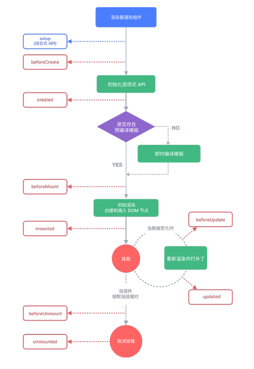
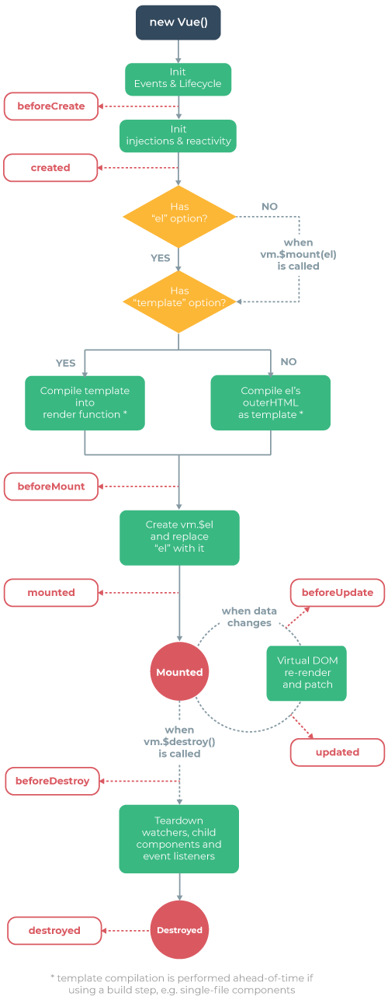
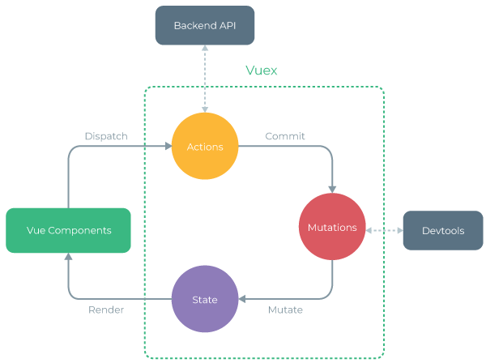
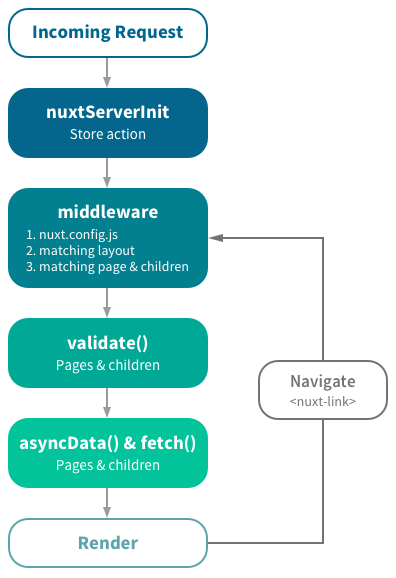

# Vue.js学习笔记

## 目录
1. [Vue 3版本（core）（与Vue 2的区别）](#vue-3版本core与vue-2的区别)

    1. [Vue 3的组合式API](#vue-3的组合式api)
    1. [Vue 3最佳实践](#vue-3最佳实践)
1. [Vue 2版本（vue）](#vue-2版本vue)

    1. [模板插值](#模板插值)
    1. [指令 && 特殊attribute](#指令--特殊attribute)
    1. [组件](#组件)
    1. [单文件组件（Single-File Component，SFC）](#单文件组件single-file-componentsfc)
    1. [过渡/动画](#过渡动画)
    1. [插件（plugin）](#插件plugin)
    1. [组件选项](#组件选项)
    1. [全局API](#全局api)
    1. [Vue实例属性](#vue实例属性)
    1. [响应式系统](#响应式系统)
    1. [虚拟DOM系统](#虚拟dom系统)
    1. [SSR](#ssr)
    1. [Vue性能优化](#vue性能优化)
    1. [例子](#例子)
1. [Vue Router 4 / 5（Vue 3）](#vue-router4vue-3)
1. [vue-router@3(Vue 2)](#vue-router3vue-2)
1. [pinia（替代~~vuex~~）](#pinia替代vuex)

    1. [vuex](#vuex)
1. [create-vue（替代~~vue-cli~~）](#create-vue替代vue-cli)

    1. [vue-cli](#vue-cli)
1. [nuxt](#nuxt)
1. [element-ui例子](#element-ui例子)
1. [element-plus例子](#element-plus例子)
1. [jQuery与Vue.js对比](#jquery与vuejs对比)

---

>约定：`vm`（ViewModel）变量名表示：Vue实例。

## Vue 3版本（[core](https://github.com/vuejs/core)）（与Vue 2的区别）
> 2026-11-26 核对的稳定版为 Vue 3.5.46。Vue 2 已于 2023-12-31 结束官方维护，后面的 Vue 2 章节用于对照存量代码。3.5 的响应式 props 解构依赖单文件组件编译器，升级时核对应用实际使用的 `vue` 与 `@vue/compiler-sfc` 版本。[Vue Core 稳定发布](https://github.com/vuejs/core/releases/tag/v3.5.46) · [Vue 2 维护状态](https://v2.vuejs.org/eol/) · [迁移指南](https://v3-migration.vuejs.org/zh/)

1. Vue 3 用 `Proxy` 拦截对响应式对象的读取、赋值、删除等操作，用 getter/setter 跟踪 `ref.value`。渲染或副作用执行时读取哪些键，就建立对应依赖；嵌套对象可在访问时被包装。绕过代理直接修改原始对象不会通知依赖它的视图。与 Vue 2 相比，Vue 3 可跟踪通过代理添加属性、通过数组下标替换元素等操作。[响应性详解](https://vuejs.org/guide/extras/reactivity-in-depth.html)
1. API风格

    1. 选项式API（Options API）

        >Vue 2、Vue 3支持。

        用 `data`、`methods`、`mounted` 等选项组织组件。普通方法和生命周期钩子中的 `this` 指向组件实例，可通过它访问数据、计算属性和方法。

        > 在普通组件中，`setup()` 是组合式 API 的入口，也可与选项式 API 共用。在单文件组件中主要使用组合式 API 时，可采用 `<script setup>`。[setup()](https://cn.vuejs.org/api/composition-api-setup)

        > 两种 API 风格在 Vue 3 中都受支持。

    2. 组合式API（Composition API）

        >[Vue 2.7](https://v2.cn.vuejs.org/v2/guide/migration-vue-2-7.html#与-Vue-3-的行为差异)、Vue 3的内置功能。对于更老的Vue 2版本，安装[composition-api](https://github.com/vuejs/composition-api)后支持。

        组合式 API 用导入的函数声明状态、生命周期钩子等，可以把同一功能的逻辑写在一起。`setup()` 中的 `this` 是 `undefined`，在 `<script setup>` 中直接使用顶层绑定。

        Vue 2.7 内置组合式 API 和 `<script setup>`，仍沿用 Vue 2 的 getter/setter。对普通可扩展对象 `obj`，在 2.7 中 `reactive(obj) === obj`，在 Vue 3 中则会得到一个新的代理。2.7 项目新增响应式属性、按下标替换数组项时，仍需遵守 Vue 2 的限制。[Vue 2.7 行为差异](https://v2.vuejs.org/v2/guide/migration-vue-2-7.html#Behavior-Differences-from-Vue-3)

        >[优势](https://cn.vuejs.org/guide/extras/composition-api-faq.html)
1. `:属性名`（等价于`v-bind:同名="同名"`、`:同名="同名"`）

    Vue 3.4 起，attribute 名称与绑定的 JS 变量同名时可以省略属性值，例如 `` 等价于 ``。
1. 深度选择器

    | SFC 的 `<style scoped>` 写法 | 使用场景 |
    |---|---|
    | `>>>` | 旧版 vue-loader 支持。Sass 等预处理器可能无法解析。 |
    | `/deep/`、`::v-deep` 组合器 | 旧项目常见的别名。升级到 Vue 3 时改为函数形式。 |
    | `:deep(.child)` | Vue 3 推荐写法，如 `.card :deep(.title) { color: red; }` 可匹配卡片内子组件的标题。 |

    这些选择器由 SFC 工具链编译，与组件使用哪种 API 风格无关。[Vue 2 深度选择器](https://vue-loader.vuejs.org/guide/scoped-css.html#deep-selectors) · [Vue 3 组件样式](https://vuejs.org/api/sfc-css-features.html#deep-selectors)
1. 当同时存在于一个节点上时，`v-if`比`v-for`的优先级更高（与 Vue 2 相反）

    >最稳妥的写法仍然是不要把二者放在同一个节点上，而是先过滤数据，再渲染列表。

    <details>
    <summary>这意味着<code>v-if</code>的条件将无法访问到<code>v-for</code>作用域内定义的变量别名</summary>

    ```vue
    <!-- 这会抛出一个错误，因为属性 todo 此时没有在该实例上定义 -->
    <li v-if="!todo.isComplete" v-for="todo in todos">
      {{ todo.name }}
    </li>
    ```
    </details>
1. 内置组件

    1. `<Teleport to="body">` 可将弹窗等内容渲染到指定的 DOM 容器，同时保留原来的组件父子关系、props 和依赖注入。
    1. `<Suspense>` 可在等待子树中的异步依赖时展示 fallback；Vue 3.5 仍将该内置组件标为实验性 API。[Suspense](https://vuejs.org/guide/built-ins/suspense.html)
1. 支持Fragments（片段）

    允许：`<template>多个节点</template>`（组件不再被强制要求只有一个根节点）
1. `$attrs`、`inheritAttrs`区别

    | 特性 | Vue 2 | Vue 3 |
    |------|-------|-------|
    | `$attrs`是否包含`class`、`style` | ❌ 不包含 | ✅ 包含 |
    | 事件监听器存储位置 | `$listeners` | `$attrs`（已移除 ~~`$listeners`~~） |
    | 事件名 | `$listeners`中保持原样（事件名的大小写、`-`不会做任何变化） | `$attrs`中`@click`转化为`onClick`这样的驼峰事件名（`@`前缀被移除，事件名转为驼峰） |
    | `inheritAttrs`影响（并非影响`$attrs`） | 影响**根元素**`不被认作props`的attribute传递，除了`class`、`style` | 影响**根元素**`不被认作props`的attribute传递，包括`class`、`style` |
    | `$attrs` 包含内容 | 未被 props 接收的普通 attribute，另行处理 `class`、`style` 和监听器 | 未被 props 或 emits 接收的普通 attribute 与监听器，如 `$attrs['data-id']`、`$attrs.onClick`；Vue 保留的 `key`、`ref` 不在其中。 |

    - 多根组件需要显式选择接收透传 attribute 的元素。下例把父级传入的 class、ARIA 属性及未声明事件的监听器都转给段落。

        可以通过组件的`$attrs`属性来指定接收的元素：

        ```vue
        <template>
          <p v-bind="$attrs">Hi!</p>
          <span>This is a child component</span>
        </template>
        ```

    - 模板中使用 `$attrs`，选项式 API 中使用 `this.$attrs`，普通 `setup(props, ctx)` 中读取 `ctx.attrs`，`<script setup>` 中使用 `useAttrs()`。这些入口反映最新透传值。需要侦听某个输入的变化时，将它声明为 prop。[透传 Attributes](https://cn.vuejs.org/guide/components/attrs.html)
1. 插槽统一为函数。Vue 2 通过 `$slots.name` 取得普通插槽的 VNode 数组，通过 `$scopedSlots.name` 取得作用域插槽函数。Vue 3 中两者统一从 `$slots` 读取。

    - Vue 3 已移除 `$scopedSlots`。
    - 在 `<script setup>` 中可通过 `useSlots()` 取得插槽对象。渲染函数中调用 `slots.default?.()` 或 `slots.item?.({ item })`，得到对应的 VNode 数组。[插槽统一](https://v3-migration.vuejs.org/breaking-changes/slots-unification.html)
1. `v-model`

    > Vue 3.4+ 的 `defineModel()` 返回模型 ref。需要读取修饰符时可用数组解构。同一组件中，每个模型名只声明一次。
    >
    >```js
    >const [model, modifiers] = defineModel()
    >// 不读取修饰符时，上面一行可以写成 const model = defineModel()
    >```

    1. `v-model:xx`

        1. `v-model`默认：props`modelValue`+事件`update:modelValue` 或 `defineModel()`
        2. `v-model:xx`修改为：props`xx`+事件`update:xx` 或 `defineModel('xx')`
    1. `v-model.修饰符`（文本框的 `.lazy` 会改为监听 `change`，自定义组件可读取修饰符并实现对应行为）

        1. defineModel

            ```js
            const [model, modifiers] = defineModel({
              type: String,
              set(value) {
                return modifiers.uppercase ? value.toUpperCase() : value
              }
            })
            // 父级写 <NameInput v-model.uppercase="name" /> 时，
            // 子级更新 model.value 会将大写字符串传回父级。
            ```
        2. 手动声明 props 时，默认模型从 `modelModifiers` 读取。父级传入 `.uppercase` 时，`props.modelModifiers?.uppercase` 为 `true`。
    1. `v-model:xx.修饰符`

        1. defineModel

            ```vue
            <!-- 父组件的模板片段 -->
            <UserName
              v-model:first-name.capitalize="first"
              v-model:last-name.uppercase="last"
            />
            ```

            ```vue
            <!-- 子组件读取修饰符 -->
            <script setup>
            const [firstName, firstNameModifiers] = defineModel('firstName')
            const [lastName, lastNameModifiers] = defineModel('lastName')

            console.log(firstNameModifiers) // { capitalize: true }
            console.log(lastNameModifiers) // { uppercase: true }
            </script>
            ```
        2. props、emits

            ```vue
            <!-- 子组件也可以显式声明 props 和事件 -->
            <script setup>
            const props = defineProps({
              firstName: String,
              lastName: String,
              firstNameModifiers: { default: () => ({}) },
              lastNameModifiers: { default: () => ({}) }
            })
            defineEmits(['update:firstName', 'update:lastName'])

            console.log(props.firstNameModifiers) // { capitalize: true }
            console.log(props.lastNameModifiers) // { uppercase: true }
            </script>
            ```

    父组件模板中，`<Child v-model="name" />` 会展开为 `<Child :model-value="name" @update:model-value="name = $event" />`。子组件可用以下任一种实现。

    ```vue
    <!-- Child.vue，Vue 3.4+ -->
    <script setup>
    const model = defineModel({ type: String, required: true })
    </script>
    <template>
      <input v-model="model" />
    </template>
    ```

    ```vue
    <!-- Child.vue，显式声明 prop 和事件 -->
    <script setup>
    const props = defineProps({ modelValue: { type: String, required: true } })
    const emit = defineEmits(['update:modelValue'])
    </script>
    <template>
      <input
        :value="props.modelValue"
        @input="emit('update:modelValue', $event.target.value)"
      />
    </template>
    ```

    具名模型也接受选项，例如 `const title = defineModel('title', { type: String, required: true })`。若子组件设置 `default`，而父组件绑定的 ref 初值是 `undefined`，子组件会先显示默认值，父级仍是 `undefined`。需要相同初值时在父组件初始化。[组件 v-model](https://cn.vuejs.org/guide/components/v-model.html)
1. 在子组件上添加原生事件监听器，如`<SonCmp @click="方法">`

    | 特性 | Vue 2 | Vue 3 |
    |---|---|---|
    | `@click` 默认行为 | 所有在子组件的事件都是自定义事件（除非手动加`.native`），需`$emit`触发 | 已在 emits 声明的事件由子组件显式发出；其余监听器默认透传到单一根元素 |
    | `.native`（监听组件根元素的原生事件，仅在父级引用子组件处添加） | 若需要监听原生事件，则添加 | 已移除，默认效果 |
    | 事件触发次数 | 普通组件监听器由 `$emit` 调用 | 未声明 `click` 且监听器透传到根元素时，如果子组件又在同一次原生点击中调用 `$emit('click')`，父级处理器会执行两次。 |

    封装按钮时，若希望自己决定何时通知父级，就声明 `emits: ['click']` 并显式发出一次。若希望父级直接监听原生点击，就让监听器透传到按钮。验证一次点击只增加一次计数。[组件事件](https://vuejs.org/guide/components/events.html#declaring-emitted-events) · [透传事件监听器](https://vuejs.org/guide/components/attrs.html#v-on-listener-inheritance)
1. 应用入口与全局组件注册。Vue 2 使用 `Vue.component('MyButton', MyButton)` 注册，再以 `new Vue({ render: h => h(App) }).$mount('#app')` 挂载。Vue 3 先创建应用，注册范围限于该应用。需要稍后卸载时应保留 `app`，`app.mount()` 的返回值是根组件公开实例。[全局 API 迁移](https://v3-migration.vuejs.org/breaking-changes/global-api.html)

    ```js
    const app = createApp(App)
    app.component('MyButton', MyButton)
    app.mount('#app')
    // 页面退出时可调用 app.unmount()
    ```
1. Vue 3.4+ 的 prop 校验器 `validator(value, props)` 可读取其他已解析的 props。校验返回 `false` 会在开发环境提示警告，值仍会传入。[Prop 校验](https://vuejs.org/guide/components/props.html#prop-validation)
1. 依赖注入

    1. `provide`可以直接提供响应式值，后代组件可以由此和提供者建立响应式的联系。

        ```js
        import { ref, provide } from 'vue'

        const count = ref(0)
        provide('key', count) // 注入时是 ref 对象，不会自动解包
        ```
    1. `inject( 名 )`、`inject( 名, 默认值 )`、`inject( 名, 工厂函数, true )`

        - 在组件初始化阶段同步调用 `inject()`。多个祖先提供同一键时，采用最近祖先的值。Vue 3.3+ 的 `hasInjectionContext()` 可判断当前位置是否允许注入。
    1. **全局**提供依赖`const app = createApp(根组件); app.provide( 名, 值 )`
    1. 若想确保提供的数据不能被注入方的组件更改，则使用`readonly()`来包装提供的值

        ```vue
        <script setup>
        import { ref, provide, readonly } from 'vue'

        const count = ref(0)
        provide('read-only-count', readonly(count))
        </script>
        ```

    ```vue
    <!-- 在供给方组件内 -->
    <script setup>
    import { provide, ref } from 'vue'
    const location = ref('North Pole')
    function updateLocation() {
      location.value = 'South Pole'
    }
    provide('location', {
      location,
      updateLocation
    })
    </script>
    ```

    ```vue
    <!-- 在注入方组件内 -->
    <script setup>
    import { inject } from 'vue'
    const { location, updateLocation } = inject('location')
    </script>
    <template>
      <button @click="updateLocation">{{ location }}</button>
    </template>
    ```
    - Vue 3.3+ 还可在 `app.runWithContext(() => inject('名'))` 的同步回调内取得该应用通过 `app.provide()` 提供的值。[应用上下文](https://vuejs.org/api/application.html#app-runwithcontext)
1. 在 `<script setup>` 中，将指令定义命名为 `vMyDirective`，即可在模板中使用 `v-my-directive`。

    1. 如果指令是从别处导入的，可以通过重命名来使其符合命名规范：

        ```vue
        <script setup>
        import { myDirective as vMyDirective } from './MyDirective.js'
        </script>
        ```

    >不推荐在组件上使用自定义指令。当组件具有多个根节点时可能会出现预期外的行为：当在组件上使用自定义指令时，它会始终应用于组件的根节点，和透传 attributes 类似；当应用到一个多根组件时，指令将会被忽略且抛出一个警告。和 attribute 不同，指令不能通过 v-bind="$attrs" 来传递给一个不同的元素。

    2. **全局**注册自定义指令`const app = createApp(根组件); app.directive('自定义指令名', 钩子对象)`

    ><details>
    ><summary><code>钩子对象中的钩子函数</code></summary>
    >
    >```js
    >const myDirective = {
    >  // 在绑定元素的 attribute 前
    >  // 或事件监听器应用前调用
    >  created(el, binding, vnode) {
    >    // 下面会介绍各个参数的细节
    >  },
    >  // 在元素被插入到 DOM 前调用
    >  beforeMount(el, binding, vnode) {},
    >  // 在绑定元素的父组件
    >  // 及他自己的所有子节点都挂载完成后调用
    >  mounted(el, binding, vnode) {},
    >  // 绑定元素的父组件更新前调用
    >  beforeUpdate(el, binding, vnode, prevVnode) {},
    >  // 在绑定元素的父组件
    >  // 及他自己的所有子节点都更新后调用
    >  updated(el, binding, vnode, prevVnode) {},
    >  // 绑定元素的父组件卸载前调用
    >  beforeUnmount(el, binding, vnode) {},
    >  // 绑定元素的父组件卸载后调用
    >  unmounted(el, binding, vnode) {}
    >}
    >```
    >
    >钩子函数参数：
    >```text
    >el：指令绑定到的元素。这可以用于直接操作 DOM。
    >
    >binding：一个对象，包含以下属性。
    >  value：传递给指令的值。例如在 v-my-directive="1 + 1" 中，值是 2。
    >  oldValue：之前的值，仅在 beforeUpdate 和 updated 中可用。无论值是否更改，它都可用。
    >  arg：传递给指令的参数 (如果有的话)。例如在 v-my-directive:foo 中，参数是 "foo"。
    >  modifiers：一个包含修饰符的对象 (如果有的话)。例如在 v-my-directive.foo.bar 中，修饰符对象是 { foo: true, bar: true }。
    >  instance：使用该指令的组件实例。
    >  dir：指令的定义对象。
    >vnode：代表绑定元素的底层 VNode。
    >
    >prevVnode：代表之前的渲染中指令所绑定元素的 VNode。仅在 beforeUpdate 和 updated 钩子中可用。
    >```
    ></details>
1. 插件（Plugins）是一种能为 Vue 添加全局功能的工具代码`const app = createApp(根组件); app.use( 插件, 传递给install函数的第二个参数 )`

    插件没有严格定义的使用范围，但是插件发挥作用的常见场景主要包括以下几种：

    1. 通过`app.component()`、`app.directive()`注册一到多个全局组件或自定义指令。
    2. 通过`app.provide()`使一个资源可被注入进整个应用。
    3. 向`app.config.globalProperties`中添加一些全局实例属性或方法
    4. ~~app.mixin()~~（不推荐）
1. Vue 2全局功能注册在Vue上，Vue 3全局功能注册在app实例上
1. 模板过滤器已移除。展示派生值可用计算属性，带参数的格式化可在模板中调用方法。
1. `.sync` 已移除。`:title.sync="title"` 可改为 `v-model:title="title"`，子组件通过 `update:title` 通知父级。
1. `v-memo`（Vue 3.2+）可按依赖数组跳过子树更新，见本节末尾的性能优化示例。
1. Vue 2的[jsx](https://github.com/vuejs/jsx-vue2)与Vue 3的[jsx](https://github.com/vuejs/babel-plugin-jsx)有区别

    1. Vue 2 的渲染函数按用途拆分 VNode 数据，如 `createElement(Button, { props: { label }, on: { click: save } })`。常见分组还有 `attrs`、`domProps` 和 `nativeOn`。[Vue 2 渲染函数](https://v2.cn.vuejs.org/v2/guide/render-function.html)
    2. Vue 3 使用扁平对象，如 `h(Button, { label, onClick: save })`，相应的 JSX 为 `<Button label={label} onClick={save} />`。要转交一组属性时仍可用 `<Button {...attrs} />`。[Vue 3 渲染函数](https://cn.vuejs.org/api/render-function.html#h)
1. 将 Vue 的响应性系统与外部状态管理方案集成的大致思路是：将外部状态放在一个`shallowRef`中。一个浅层的 ref 中只有它的 .value 属性本身被访问时才是有响应性的，而不关心它内部的值。当外部状态改变时，替换此 ref 的 .value 才会触发更新。

    1. `shallowRef()`：`ref()`的浅层作用形式；`shallowReactive()`：`reactive()`的浅层作用形式；`shallowReadonly()`：`readonly()`的浅层作用形式。

        ```js
        const state = shallowRef({ count: 1 })

        // 不会触发更改
        state.value.count = 2

        // 会触发更改
        state.value = { count: 2 }
        ```

        ```js
        const state = shallowReactive({
          foo: 1,
          nested: {
            bar: 2
          }
        })

        // 更改状态自身的属性是响应式的
        state.foo++

        // ...但下层嵌套对象不会被转为响应式
        isReactive(state.nested) // false

        // 不是响应式的
        state.nested.bar++
        ```

        ```js
        const state = shallowReadonly({
          foo: 1,
          nested: {
            bar: 2
          }
        })

        // 更改状态自身的属性会失败
        state.foo++

        // ...但可以更改下层嵌套对象
        isReadonly(state.nested) // false

        // 这是可以通过的
        state.nested.bar++
        ```

        - 手动触发`triggerRef(shallowRef返回对象)`
1. <details>

    <summary>虚拟DOM的diff算法不同</summary>

    1. Vue 2

        有 key 的子节点列表会从两端比对并复用节点。Vue 2 的模板编译器也会标记静态子树，使更新时可以跳过它们。[Vue 2 编译器源码](https://github.com/vuejs/vue/blob/v2.7.16/src/compiler/optimizer.ts)
    2. Vue 3

        1. 对有 key 的列表，先从首尾匹配。中间仍需重排时，在可复用的旧节点索引中找出最长递增子序列（LIS），保留这组节点的位置，移动其余需要重排的节点。
        2. 模板编译器可缓存静态节点，用 patch flag 标注文本、class 等动态部分。
        3. 编译器组织的区块（block）记录动态后代，更新时可直接访问这些节点。[Vue 3 渲染机制](https://vuejs.org/guide/extras/rendering-mechanism.html)
    </details>
1. Vue 2 和 Vue 3 的应用都可使用 TypeScript。Vue 2 早期核心源码使用 Flow，Vue 2.7 已包含 TypeScript 源码，Vue 3 核心用 TypeScript 编写。[Vue 2 的 TypeScript 支持](https://v2.vuejs.org/v2/guide/typescript.html)
1. 调试 Vue 3 可使用 [Vue DevTools](https://github.com/vuejs/devtools)，Vue 2 项目可使用 [DevTools v6](https://github.com/vuejs/devtools-v6)。同一浏览器装有多个版本时，可只启用当前项目需要的扩展。
1. 单文件组件（*.vue）

    1. 最多可以包含一个顶层`<template>`块
    1. 最多可以包含一个`<script>`块
    1. 最多可以包含一个`<script setup>`

        >这个脚本块将被预处理为组件的`setup()`函数
    1. 可以包含多个`<style>`标签
1. 命名空间组件

    ```vue
    <script setup>
    import * as Form from './form-components'
    </script>

    <template>
      <Form.Input>
        <Form.Label>label</Form.Label>
      </Form.Input>
    </template>
    ```
1. 样式

    1. `scoped`

        1. 默认情况下，作用域样式不会影响到`<slot/>`渲染出来的内容，因为它们被认为是父组件所持有并传递进来的。使用`:slotted`伪类以明确地将插槽内容作为选择器的目标：

            ```vue
            <style scoped>
            :slotted(div) {
              color: red;
            }
            </style>
            ```
        2. 如果想让其中一个样式规则应用到全局，比起另外创建一个`<style>`，可以使用`:global`伪类来实现：

            ```vue
            <style scoped>
            :global(.red) {
              color: red;
            }
            </style>
            ```
    2. `module`

        一个`<style module>`标签会被编译为 CSS Modules 并且将生成的 CSS class 作为`$style`对象暴露给组件：

        ```vue
        <template>
          <p :class="$style.red">This should be red</p>
        </template>

        <style module>
        .red {
          color: red;
        }
        </style>
        ```

        - 可以通过给 module attribute 一个值来自定义注入 class 对象的属性名：

            ```vue
            <template>
              <p :class="classes.red">red</p>
            </template>

            <style module="classes">
            .red {
              color: red;
            }
            </style>
            ```
        - 可以通过`useCssModule`API 在`setup()`和`<script setup>`中访问注入的 class。对于使用了自定义注入名称的`<style module="名称">`块，`useCssModule`接收一个匹配的 module attribute 值作为第一个参数：

            ```js
            import { useCssModule } from 'vue'

            // 在 setup() 作用域中...
            // 默认情况下，返回 <style module> 的 class
            useCssModule()

            // 具名情况下，返回 <style module="classes"> 的 class
            useCssModule('classes')
            ```
    3. `<style>` 中的 `v-bind()` 可将组件状态绑定到 CSS 属性。例如脚本声明 `const color = ref('red')` 后，`.label { color: v-bind(color); }` 会随之更新。表达式用引号包裹，如 `v-bind('theme.color')`。

### Vue 3的组合式API

>[Vue 3 API 参考](https://cn.vuejs.org/api/)

1. `<script setup>` 中的初始化代码在每个组件实例创建时执行一次，后续渲染由响应式依赖驱动。
1. `reactive()` 用于普通对象、数组及 Map、Set 等集合，不接受基本类型。`ref()` 可以保存任意值，在脚本中通过 `.value` 读写。
1. 普通 `ref()` 持有对象时会对其进行深层响应式转换，`reactive()` 默认也支持嵌套更新。

    Vue 3对具有深层响应性的代理对象 **新增属性** 能够保证新增属性的响应性。

    > Vue 2 中，给已观察的嵌套对象新增响应式属性需要 `Vue.set` 或 `vm.$set`，根级数据属性应预先在 `data` 中声明。Vue 3 可直接在响应式代理上新增属性。

    <details>
    <summary>e.g. </summary>

    ```js
    import { ref } from 'vue'
    const data = ref({  // reactive效果相同
      a: { b: { c: 1, d: [{ e: 1 }] } },
    })
    // 都会保持响应性
    function changeData() {
      data.value.a.b.d[data.value.a.b.d.length - 1].e = 2
      data.value.a.b.d.push({ e: 3 })
    }
    function changeData2() {
      data.value.a = { b: 1 }
    }
    function changeData3() {
      data.value.a.b = 2
    }
    function changeData4() {
      data.value.a.f = 2
    }
    ```
    </details>
1. 解包（.value）与自动解包（automatically unwrapped。不需要手动输入`.value`就能返回`.value`的值）

    1. `<script setup>` 的顶层绑定可直接用于模板。模板表达式会解包顶层 ref，例如 `const count = ref(0)` 在模板中写作 `count + 1`。普通对象内嵌的 ref 参与运算时要取 `.value`；如果 ref 已经是文本插值的最终结果，插值会显示其值。[模板中的 ref 解包](https://vuejs.org/guide/essentials/reactivity-fundamentals.html#caveat-when-unwrapping-in-templates)

        `<script setup>` 的初始化代码会为每个组件实例执行一次。在其中创建的 ref 通常为实例所有；从模块导入的同一个 ref 仍由多个实例共享。

        1. `ref()`、`shallowRef()`、`customRef()`、`computed()` 和 `toRef()` 可返回 ref。`toRefs()` 和 Pinia 的 `storeToRefs()` 返回普通对象，属性值才是 ref。
        2. `reactive()`、`shallowReactive()`、`readonly()` 和 `shallowReadonly()` 用于创建代理。读取代理属性时对 ref 的处理还取决于代理种类与容器类型，见下文。
    1. `ref`的自动解包逻辑

        1. `ref`对象作为`reactive()`返回对象的属性时，会自动解包

            <details>
            <summary>e.g. </summary>

            ```js
            const count = ref(0)
            const state = reactive({  // state.count 指向ref对象，作为reactive因此会自动解包
              count
            })

            console.log(state.count) // 0

            state.count = 1
            console.log(count.value) // 1

            const otherCount = ref(2)

            state.count = otherCount
            console.log(state.count) // 2
            // 原始 ref 现在已经和 state.count 失去联系
            console.log(count.value) // 1
            ```
            </details>
        1. `ref`对象作为`shallowReactive()`返回对象的属性时 或 `shallowReadonly()`返回对象的属性时，不会~~自动解包~~
        1. `ref`对象作为`reactive()`返回对象的数组或集合的项时，不会~~自动解包~~

            <details>
            <summary>e.g. </summary>

            ```js
            const books = reactive([ref('Vue 3 Guide')])
            // 这里需要 .value
            console.log(books[0].value)

            const map = reactive(new Map([['count', ref(0)]]))
            // 这里需要 .value
            console.log(map.get('count').value)
            ```
            </details>
        1. 在模板渲染上下文中，只有**顶级**的`ref`属性才会被解包

            若`ref`是文本插值的最终计算值（即`{{ }}`标签），则它将被解包。

            ```vue
            <script setup>
            import { ref } from 'vue'
            const count = ref(0)
            const object = { id: ref(1) }
            const { id } = object
            </script>

            <template>
              <p>{{ count + 1 }}</p>           <!-- 1，count 是顶层 ref -->
              <p>{{ object.id + 1 }}</p>       <!-- [object Object]1，普通对象内的 ref 参与运算 -->
              <p>{{ object.id.value + 1 }}</p> <!-- 2，显式读取后运算 -->
              <p>{{ object.id }}</p>           <!-- 1，ref 是文本插值的最终结果 -->
              <p>{{ id + 1 }}</p>              <!-- 2，id 是顶层 ref -->
            </template>
            ```
1. 响应式对象 整体替换

    1. `reactive()`（、`shallowReactive()`）返回的对象：

        >1. 只能在「属性层面」更新，不能替换整个proxy
        >2. 对同一个对象多次调用`reactive()`，Vue返回的是同一个proxy
        >3. 对一个已存在的代理对象调用`reactive()`会返回这个已存在的代理对象本身

        ```js
        const state = reactive({ a: 1, b: 2 })

        Object.assign(state, { a: 100, b: 200 })  // ✅ 更新已有代理上的属性，未列出的属性会保留

        // 如果改用 let 并重新给 state 赋值，已持有旧代理的代码仍指向旧对象。
        ```
    2. `ref()`（、`shallowRef()`）返回的对象：

        >ref本质是对任意值（包括对象）的响应式"壳子"，替换 .value 等于换了一个新引用。

        ```js
        const state = ref({ a: 1, b: 2 })

        state.value = { a: 100, b: 200 }          // ✅ 可以整体替换，响应式保留
        ```
1. 复杂`reactive`赋值

    >`ref`代理对象直接`.value =`赋新值，或类似`reactive`赋值的方式都行。

    ```js
    const apiData = reactive({
      pagination: {
        current: 1,
        pageSize: 10,
        total: 0,
      },
      list: [],
    })

    // 数组可以直接赋值，Vue 会自动处理。
    apiData.list = 新数组
    // 对象属性也可以直接替换。若其他代码持有原 pagination 引用，则用 Object.assign 原地更新。
    apiData.pagination = 新对象
    ```
1. 解构时区分值、代理和编译器改写

    1. 从普通 `reactive()` 对象、`setup(props)` 的 props 或 `ref.value` 解构基本类型属性，得到当时的值。嵌套对象可能仍是代理，但父对象替换这个属性后，手中的旧引用仍指向原对象。传递 `() => state.field` 或 `toRef(state, 'field')` 可以持续读取该属性。
    2. Vue 3.5+ 的 SFC 编译器会改写同一 `<script setup>` 中直接从 `defineProps()` 解构的属性读取。传给组合式函数时，传 `() => id` 才能在函数内部再次读取最新值；`useDetail(id)` 已经计算成普通实参。Vue 3.4 及更早的默认配置用 `const props = defineProps(...)` 和 `() => props.id`。[响应式 props 解构](https://vuejs.org/api/sfc-script-setup.html#reactive-props-destructure)
    3. Pinia 的 state 和 getter 可用 `storeToRefs(store)` 解构，action 可以直接从 store 解构。`defineModel()` 的数组解构则用于取得模型 ref 和修饰符。
1. `toRefs`、`toRef`创建的 ref 与其源属性保持同步：改变源属性的值将更新 ref 的值，反之亦然。

    ```js
    const state = reactive({
      foo: 1,
      bar: 2
    })

    // 双向 ref，会与源属性同步
    const fooRef = toRef(state, 'foo')    // 不同于：const fooRef = ref(state.foo)，state.foo是一个纯数值

    // 更改该 ref 会更新源属性
    fooRef.value++
    console.log(state.foo) // 2

    // 更改源属性也会更新该 ref
    state.foo++
    console.log(fooRef.value) // 3


    const stateAsRefs = toRefs(state)   // 支持解构（保持响应式）： const {foo, bar} = stateAsRefs。通过 foo.value、bar.value 响应式访问
    // 这个 ref 和源属性已经“链接上了”
    state.foo++
    console.log(stateAsRefs.foo.value) // 4

    stateAsRefs.foo.value++
    console.log(state.foo) // 5
    ```

    - `toRefs()`在调用时只会为源对象上可以枚举的属性创建 ref。若要为可能还不存在的属性创建 ref，则改用`toRef()`

        ```js
        const state = reactive({
          foo: 1,
        })

        const fooRef = toRef(state, 'foo1') // 对目前不存在的属性设置toRef

        state.foo1 = 1 // 新增属性
        console.log('fooRef.value', fooRef.value) // 1

        fooRef.value++
        console.log('state.foo1', state.foo1) // 2


        const stateAsRefs = toRefs(state) // stateAsRefs 不会包含目前不存在的属性foo2

        state.foo2 = 1 // 新增属性
        console.log('stateAsRefs', stateAsRefs) // 不存在foo2
        ```
1. `toRaw`

    `toRaw(proxy)` 返回 Vue 代理对应的原始对象。普通对象传入后原样返回。`shallowRef(obj).value` 保留传入的对象，通常无需调用 `toRaw()`。通过原始对象修改属性会绕过 Vue 的更新通知。[toRaw](https://vuejs.org/api/reactivity-advanced.html#toraw)
1. `markRaw`

    将一个对象标记为不可被转为代理。返回该对象本身。
1. `computed`

    > 返回计算属性 ref，按响应式依赖缓存结果。getter 应只计算并返回值，网络请求、DOM 修改等副作用放在侦听器或事件处理器中。

    1. Vue 3.4+ 的组合式写法可以在 getter 第一个参数中读取上一次结果，例如 `computed(previous => count.value <= 3 ? count.value : previous)`。首次计算时 `previous` 为 `undefined`。
    2. 可写计算属性：`computed({ get(previous) {/* 按需return */}, set(newValue) { /* 特殊设置给其他值 */ } })`

        >Vue 2也有get（但没有参数）、set写法。
1. 侦听器

    1. `watch(source, (newValue, oldValue, onCleanup) => {}, options)` 可以侦听 ref（包括计算属性）、响应式对象、getter 或由这些来源组成的数组。默认先收集依赖，来源变化后才调用回调。

        ```js
        const obj1 = reactive({ count: 0 })
        const obj2 = ref({ count: 0 })


        // ❌不能直接侦听响应式对象的属性值，这里 watch() 得到的参数是一个 number，不是响应式对象
        watch(obj1.count, (count) => {console.log(`Count: ${count}`)})
        watch(obj2.value.count, (count) => {console.log(`Count: ${count}`)})


        // ✅需要用一个返回该属性的 getter 函数
        watch(
          () => obj1.count,
          (count) => {console.log(`Count: ${count}`)},
        )
        watch(
          () => obj2.value.count,
          (count) => {console.log(`Count: ${count}`)},
        )
        watch(
          () => obj2.value.count + obj1.count + 2,  // 包含响应式对象即可
          (count) => {console.log(`Count: ${count}`)},
        )
        ```

        - **直接给`watch()`传入一个响应式对象，会隐式地创建一个深层侦听器**——该回调函数在所有嵌套的变更时都会被触发。相比之下，一个返回响应式对象的 getter 函数，只有在返回不同的对象时，才会触发回调

            ```js
            const state = reactive({ someObject: { count: 0 } })

            watch(state.someObject, (newValue, oldValue) => {
              console.log('state.someObject1',newValue, oldValue)
              // 在嵌套的属性count变更时触发
              // 注意：`newValue` 此处和 `oldValue` 是相等的
              // 因为它们是同一个对象！

              // 替换 state.someObject 后，此监听器仍侦听旧对象，新对象的变化不会触发它
            })

            watch(
              () => state.someObject,
              (newValue, oldValue) => {
                console.log('state.someObject2', newValue, oldValue)
                // 仅当 state.someObject 被替换时触发（count变化不会触发）
              }
            )

            watch(
              () => state.someObject,
              (newValue, oldValue) => {
                console.log('state.someObject3', newValue, oldValue)
                // state.someObject 被替换时触发（`newValue`和`oldValue`不相等）
                // state.someObject.count 变化时也触发（`newValue`和`oldValue`相等）
              },
              { deep: true }
            )
            ```
        - Vue 3.5+ 的 `deep` 选项还可以是一个数字，表示最大遍历深度——即 Vue 应该遍历对象嵌套属性的级数。

            >深度侦听需要遍历被侦听对象中的所有嵌套的属性，当用于大型数据结构时，开销很大。因此请只在必要时才使用它，并且要留意性能。
        - 监听数组 ref 的增删时，Vue 3.5+ 可用 `watch(items, callback, { deep: 1 })`。它跟踪整个数组替换和数组自身变化。若只改元素对象内部字段，则需要更深的侦听或具体字段的 getter。[数组侦听迁移](https://v3-migration.vuejs.org/breaking-changes/watch.html)
        - `immediate: true` 会立即执行首次回调；`once: true`（Vue 3.4+）在首次回调执行后停止。两者一起用时，立即执行的那次就会用掉这一次。
    1. `watchEffect`（类似：`watchPostEffect`、`watchSyncEffect`）

        首次立即执行，并自动追踪同步执行时读取的响应式依赖。对于异步函数，只追踪第一次 `await` 之前读取的依赖。下例会追踪 `todoId.value`。

        ```js
        import { ref, watchEffect } from 'vue'

        const todoId = ref(1)
        const data = ref(null)
        const error = ref(null)

        watchEffect(async (onCleanup) => {
          const id = todoId.value
          const controller = new AbortController()
          onCleanup(() => controller.abort())
          error.value = null
          data.value = null
          try {
            const response = await fetch(`/api/todos/${id}`, { signal: controller.signal })
            if (!response.ok) throw new Error(`HTTP ${response.status}`)
            const todo = await response.json()
            if (!controller.signal.aborted) data.value = todo
          } catch (err) {
            if (!controller.signal.aborted) error.value = err
          }
        })
        ```
    1. 副作用清理

        侦听器重新运行前或停止时会执行已登记的清理函数，适合取消上一次请求、移除监听器或清除定时器。

        1. `onWatcherCleanup`（Vue 3.5+）

            必须在`watchEffect`效果函数或`watch`回调函数的同步执行期间调用：不能在异步函数的 await 语句之后调用它。
        2. onCleanup 函数还作为`watch`回调函数的第三个参数，以及`watchEffect`作用函数的第一个参数：

            >通过函数参数传递的 onCleanup 与侦听器实例相绑定，因此不受 `onWatcherCleanup` 的同步限制。

            ```js
            watch(id, (newId, oldId, onCleanup) => {
              // ...
              onCleanup(() => {
                // 清理逻辑
              })
            })

            watchEffect((onCleanup) => {
              // ...
              onCleanup(() => {
                // 清理逻辑
              })
            })
            ```
    1. 触发时机。默认 `flush: 'pre'` 的回调会批量执行，在父组件更新之后、所属组件 DOM 更新之前运行。

        读取本次更新后的 DOM 用 `flush: 'post'` 或 `watchPostEffect()`。需要在响应式写入时同步响应可用 `flush: 'sync'` 或 `watchSyncEffect()`，同步回调不会批处理。[侦听器](https://cn.vuejs.org/guide/essentials/watchers.html)
    1. 停止侦听器

        在 `setup()` 或 `<script setup>` 中同步创建的侦听器，会随组件卸载自动停止。延后开始处理数据时，可以同步创建侦听器，在回调内判断数据是否就绪。

        ```js
        const data = ref(null)
        const stop = watchEffect(() => {
          if (data.value) console.log(data.value)
        })
        // 如需在组件卸载前停止，可调用 stop()。
        ```

        在定时器等异步回调中创建的侦听器，需要保存并调用其返回的停止函数。
1. SFC 编译器在 `<script setup>` 中识别 `defineProps`、`defineEmits`、`defineExpose`、`defineModel`、`defineOptions` 和 `defineSlots` 等宏调用，使用时无需导入。宏名本身不作为普通运行时函数传递。有返回值的宏可以赋值，例如 `const props = defineProps(...)` 取得 props，`const emit = defineEmits(...)` 取得事件发送函数，`const model = defineModel()` 取得模型 ref。[SFC 编译器宏](https://vuejs.org/api/sfc-script-setup.html#defineprops-defineemits)

    `defineProps` 和 `defineEmits` 的运行时选项会提升到组件实例作用域外，可引用导入的定义。需要依赖某个实例中的 ref 或 computed 时，把这段逻辑放在实例的处理函数中。`defineExpose({ focus })` 则可以显式暴露该实例定义的方法。

    ```vue
    <script setup>
    const props = defineProps({ // 支持解构
      msg: String
    })
    console.log(props.msg)  // 此例将返回值绑定为 props
    </script>

    <template>
      <h2>{{ msg }} === {{ props.msg }}</h2> <!-- 可以直接用msg，也可以props.msg，都是响应式 -->
    </template>
    ```

    ```js
    const emit = defineEmits(['select'])
    function selectItem(id) {
      emit('select', id)
    }
    // 模板中也可直接调用 $emit('select', id)。
    ```

    ```js
    // 或者使用对象形式声明并校验事件（就算校验失败，也会触发事件并传参）
    const emit2 = defineEmits({
      // 没有校验
      click: null,

      // 校验 submit 事件
      submit: ({ email, password }) => {
        if (email && password) {
          return true
        } else {
          console.warn('Invalid submit event payload!')
          return false
        }
      }
    })

    function submitForm(email, password) {
      emit2('submit', { email, password })
    }
    ```

    ```vue
    <script setup>
      defineOptions({
        inheritAttrs: false
      })
    </script>
    ```

    `defineOptions()` 与 `defineSlots()` 自 Vue 3.3 起可用。`defineSlots<...>()` 通过类型参数描述插槽名及插槽参数，为 TypeScript 与 IDE 提供检查和补全。
1. 模板引用（组件、DOM）

    1. `useTemplateRef()`

        Vue 3.5+。首次挂载前引用为 `null`，通过 `v-if` 移除元素后也会回到 `null`。

        ```vue
        <script setup>
        import { useTemplateRef, onMounted } from 'vue'

        // 第一个参数必须与模板中的 ref 值匹配
        const input = useTemplateRef('my-input')
        const div2Ref = useTemplateRef('div2')

        onMounted(() => {
          input.value.focus()
          console.log(div2Ref.value)  // => 数组
        })
        </script>

        <template>
          <input ref="my-input" />
          <div v-for="item in 5" ref="div2" :key="item" />
        </template>
        ```
    1. `ref`

        ```vue
        <script setup>
        import { ref, onMounted } from 'vue'

        // 声明一个 ref 来存放该元素的引用
        // 必须和模板里的 ref 同名
        const myInput = ref(null)
        const div1 = ref([])

        onMounted(() => {
          myInput.value.focus()
          console.log(div1.value)  // => 数组
        })
        </script>

        <template>
          <input ref="myInput" />
          <div v-for="item in 4" ref="div1" :key="item" />
        </template>
        ```
    - 支持与`v-for`配合使用，对应的 ref 中包含的值是一个数组，它将在元素被挂载后包含对应整个列表的所有元素

        >ref 数组并不保证与源数组相同的顺序。
    - 除了使用字符串值作名字，`:ref`还可以绑定为一个函数，会在每次组件更新时都被调用。该函数会收到元素引用作为其第一个参数：

        `<input :ref="(el) => { /* 将 el 赋值给一个数据属性或 ref 变量 */ }">`

        当绑定的元素被卸载时，函数也会被调用一次，此时的 `el` 参数会是 `null`。你当然也可以绑定一个组件方法而不是内联函数。
    - 子组件的暴露信息

        1. 选项式组件默认公开实例上的数据和方法，可用 `expose: ['focus']` 限定对外接口。普通 `setup(props, { expose })` 中也可调用 `expose({ focus })`。
        2. `<script setup>` 的局部绑定默认私有。父组件通过模板引用调用子组件方法时，子级应使用 `defineExpose({ focus })` 显式公开。

            >`defineExpose`必须在任何 await 操作之前调用。否则，在 await 操作后暴露的属性和方法将无法访问。
        - 公开实例上的顶层 ref 会自动解包，如下例中的 `b`。

            ```vue
            <script setup>
            import { ref } from 'vue'

            const a = 1
            const b = ref(2)

            defineExpose({
              a,    // 父级：子ref.value.a => 1
              b     // 父级：子ref.value.b => 2 （自动解包）
            })
            </script>
            ```
1. 生命周期钩子应当在组件初始化时被**同步**注册。

    这并不意味着对生命周期钩子的调用必须放在`setup()`或`<script setup>`内的词法上下文中，也可以在一个外部函数中调用，只要调用栈是同步的，且最终起源自`setup()`就可以。

    ```js
    setTimeout(() => {
      onMounted(() => {
        // ❌ 异步注册时当前组件实例已丢失。这将不会正常工作
      })
    }, 100)
    ```

    - 组合式 API 直接在 `setup()` 中写实例初始化逻辑；若与选项式 API 共用，这段代码会在 `beforeCreate` 和 `created` 之前执行。

    `<script setup>`的同步代码、`onBeforeMount`、`onMounted`、`onBeforeUpdate`、`onUpdated`、`onBeforeUnmount`、`onUnmounted`，`onErrorCaptured`、`onRenderTracked`、`onRenderTriggered`、`onActivated`、`onDeactivated`、`onServerPrefetch`

    <details>

    <summary>生命周期图示</summary>

    
    </details>
1. <details>

    <summary>异步组件</summary>

    ```js
    import { defineAsyncComponent, hydrateOnVisible } from 'vue'
    import LoadingCard from './LoadingCard.vue'
    import ErrorCard from './ErrorCard.vue'

    const ReportCard = defineAsyncComponent({
      loader: () => import('./ReportCard.vue'),
      loadingComponent: LoadingCard,
      errorComponent: ErrorCard,
      delay: 200,
      timeout: 10000,
      hydrate: hydrateOnVisible({ rootMargin: '100px' })
    })
    ```

    纯客户端首次渲染 `<ReportCard />` 时才调用 loader，等待期间可以显示 LoadingCard。SSR 中，HTML 已由服务端生成；3.5+ 的 `hydrateOnVisible` 将客户端激活推迟到元素接近视口。项目可按需求选择一种策略，如 `hydrateOnIdle`、`hydrateOnMediaQuery` 或 `hydrateOnInteraction`。被父级 `<Suspense>` 接管时，默认由边界决定加载状态；若组件需要自己的 loading/error/delay/timeout，设置 `suspensible: false`。[异步组件与延迟激活](https://vuejs.org/guide/components/async.html) · [Suspense](https://vuejs.org/guide/built-ins/suspense.html)
    </details>
1. `unref()`若参数是 ref（`isRef()`返回`true`），则返回内部值，否则返回参数本身（`val = isRef(val) ? val.value : val`的语法糖）
1. `toValue()`（Vue 3.3+）把普通值、ref 或 getter 归一化为值。传入 getter 时会调用它，因此组合式函数若想追踪其依赖，可在 `watchEffect` 中调用 `toValue(source)`。[响应式工具](https://vuejs.org/api/reactivity-utilities.html#tovalue)
1. `<script setup>` 的顶层 `await` 经过编译器处理，恢复后仍可调用依赖当前组件实例的组合式函数，如 `useRoute()`。

    <details>

    <summary>e.g.</summary>

    ```vue
    <script setup>
    import { useRoute } from 'vue-router'

    await fetchUser() // ✅顶层await

    // 这里依然能工作！
    const route = useRoute()
    </script>
    ```

    ```js
    // ❌ 普通 setup() 函数
    export default {
      async setup() {
        // 此时 getCurrentInstance() 是有值的
        await someAsyncWork()

        // ❌ 此时 getCurrentInstance() 变成了 null
        // 下面这行代码会报错，或者无法获取正确的值
        const route = useRoute()
      }
    }
    ```

    ```vue
    <script setup>
    const myFunc = async () => {
      await someAsyncOp() // ❌非顶层await
      // ❌ 这里的上下文丢失了，编译器不会进入函数内部去注入恢复代码
      useRoute()
    }
    </script>
    ```
    </details>

    - SFC 顶层 `await` 会被编译为 `async setup()`。

        1. 纯客户端首次渲染时，等待期间可以显示边界的 fallback，待异步依赖就绪后再显示组件内容。
        2. 在客户端，`async setup()` 需要祖先 `<Suspense>` 边界协调首次渲染。只想懒加载组件代码时可用 `defineAsyncComponent`，它自带加载机制，可以独立使用。[异步依赖](https://vuejs.org/guide/built-ins/suspense.html#async-dependencies)

            ```vue
            <Suspense>
              <template #default>
                <AsyncPanel />
              </template>
              <template #fallback>
                <div>Loading...</div>
              </template>
            </Suspense>
            ```

### Vue 3最佳实践
>可维护性、TypeScript支持、代码复用、性能优化。

- 结论先行：

    1. 新项目采用 SFC 和组合式 API 时可用 `<script setup>` 配合 TypeScript。状态只服务于一个组件时放在组件内，需要跨页面共享且独立于组件生命周期时再考虑 Pinia。
    1. 状态声明默认优先：`ref`
    1. 逻辑复用默认优先：Composables，而不是 mixins
    1. 性能优化默认优先：稳定 `key`、异步组件、避免深度 watch 滥用

1. 使用组合式 API 编写 SFC 时优先考虑 `<script setup>`

    `<script setup>` 将顶层绑定直接暴露给模板，可减少组合式组件的样板代码。

    - `<script setup>`支持很多特殊逻辑：

        1. 按 `vMyDirective` 形式命名的指令定义可直接用在模板中。
        2. 顶层绑定可直接用于模板。模板读取顶层 ref 时会自动解包。普通对象内嵌的 ref 参与模板运算时须显式读取 `.value`。
        3. 在 setup 中创建的状态归各个实例所有，模块级导入仍可在实例间共享。
        4. 编译器处理顶层宏调用。`defineEmits()` 返回的 `emit` 同样可赋值并调用。
        5. 编译器会在顶层 `await` 恢复后保留当前组件实例。

2. 用Composables（组合式函数）替代~~mixins~~

    组合式函数常以`use`开头，提供更好的类型推断、逻辑复用、代码组织、明确的依赖关系、避免命名冲突、易于测试。

    ```js
    // composables/useCounter.js
    import { ref } from 'vue'
    export function useCounter(initialValue = 0) {
      const count = ref(initialValue)
      const increment = () => count.value++
      const decrement = () => count.value--
      return { count, increment, decrement }
    }
    ```
3. 优先使用`ref`，谨慎使用`reactive`

    >接口结果需要整体替换时用 `ref`，例如 `result.value = nextPage`。一组字段需要保留同一对象引用、逐项更新时，`reactive` 也合适。

    1. `ref`的特性：

        1. 可以接受任何值类型，使用更灵活
        1. 可以整体替换（`ref.value = 新值`），`reactive`只能属性层面更新
        1. 是包裹对象，但在模板中能自动解包（还有其他自动解包逻辑）
        1. 解构 `const { value } = someRef` 只会取出当时的值。需要跟踪整体替换时，持续从 `someRef.value` 读取。

    2. `reactive`的限制：

        1. 适用于普通对象、数组和支持的集合类型
        1. 只能在「属性层面」更新，不能替换整个proxy
        1. 属性修改

            1. 若是数组则可以直接赋值`proxy.属性 = 新数组`
            1. 若是对象也可以直接赋值 `proxy.属性 = 新对象`，要保留原对象引用时用 `Object.assign(proxy.属性, 新对象)`
        1. 持续跟踪属性可用 getter 或 `toRef`/`toRefs`；普通解构保留当时读到的值或对象引用。
4. 使用 TypeScript 定义 Props 和 Emits

    在 `<script setup lang="ts">` 中可用类型参数声明 props / emits。下面为事件参数使用命名元组的写法需要 Vue 3.3+。

    ```ts
    const props = defineProps<{
      id: string
      disabled?: boolean
    }>()

    const emit = defineEmits<{
      change: [value: string]
      submit: []
    }>()
    ```
5. 状态管理：使用 Pinia 替代 Vuex

    Pinia API 更贴近组合式API，类型推导更自然，也更适合 Vue 3 项目。
6. 合理使用`v-model`和多个`v-model`（通过`v-model:propName`的形式）

    组件需要支持多个受控字段时，优先考虑多个`v-model`，避免把多个值塞进一个对象再手动拆分。
7. 性能优化

    1. 异步组件

        使用`defineAsyncComponent`延迟加载组件，减少初始包大小。

        ```js
        import { defineAsyncComponent } from 'vue'
        const AsyncComp = defineAsyncComponent(() => import('./Heavy.vue'))
        ```
    2. `v-memo`指令

        在测量确认的大型列表更新瓶颈中，可用固定长度的依赖数组跳过子树更新。与 `v-for` 配合时写在同一元素。依赖应覆盖该行所有会变化的渲染输入，遗漏会导致界面保留旧值。

        ```vue
        <div v-for="item in list" :key="item.id" v-memo="[item.label, item.selected]">
          {{ item.label }} {{ item.selected ? '已选中' : '未选中' }}
        </div>
        ```
    3. `shallowRef`和`shallowReactive`

        对于大型数据结构，若只需要浅层响应性，则使用`shallowRef`或`shallowReactive`可以提升性能。
    4. 合理使用`computed`和`watch`

        - 使用`computed`处理派生状态，而不是在模板中写复杂表达式
        - 使用`watchEffect`自动追踪依赖，避免手动维护依赖列表
        - 对于大型数据结构，使用`watch`的`deep`选项要谨慎，考虑使用`shallowRef`
        - `immediate` 决定创建时是否运行，`once`（3.4+）适合只需响应一次的业务。两者改变副作用时机，详情页需要响应后续 ID 变化时应保持持续侦听。
    5. 列表渲染优化

        - 对会排序、增删或带有组件状态的列表，使用稳定且在同级中唯一的 `key`，例如 `item.id`。
        - 避免在`v-for`中使用复杂计算，使用`computed`预处理
        - 对于超长列表，考虑虚拟滚动
    6. 组件懒加载

        路由记录可直接写 `component: () => import('./Detail.vue')`。Vue Router 在首次进入该路由时加载并缓存结果。[路由懒加载](https://router.vuejs.org/guide/advanced/lazy-loading.html)
8. 组件设计原则

    1. 单一职责：每个组件只做一件事
    2. 组件命名：使用 PascalCase，语义清晰
    3. Props 验证：使用 TypeScript 或运行时验证
    4. 事件命名：脚本可用 `emit('saveDraft')`，父组件模板用 `@save-draft` 监听。
    5. 组件大小：保持组件小而专注，复杂逻辑提取到 Composables
9. 一个实用的团队约定（Vue 2、Vue 3都一样）

    - 页面组件负责组装数据和交互流程
    - 业务组件负责可复用的界面片段
    - Composable 负责状态与副作用复用
    - 工具函数负责纯逻辑，不依赖 Vue 实例上下文

---

## Vue 2版本（[vue](https://github.com/vuejs/vue)）

> 本节适用于维护 Vue 2 项目。Vue 2 已于 2023 年 12 月 31 日结束官方维护，最终版本为 2.7.16。[官方说明](https://v2.vuejs.org/eol/)

- 心得

    1. 针对不在vue视图内出现的变量：

        >同一模块中的可变对象会被多个组件实例共享。需要各实例独立的对象或数组，应在组件的 `data()` 中新建并返回。

        1. 若是常量，则可以放在组件外，用`const` + 大写和下划线组成。
        2. 视图依赖的可变状态应预先在 `data()` 中声明，派生值用 `computed`。创建后直接写 `this.新属性 = 值` 仅会增加普通实例属性，Vue 2 无法追踪新增的根级数据。[深入响应式原理](https://v2.cn.vuejs.org/v2/guide/reactivity.html)
    2. 注意内存泄漏（全局副作用）：

        1. 第三方实例、DOM 引用和定时器句柄可以保存在实例上，以便之后释放。保存引用本身不会触发垃圾回收。
        2. 在 `beforeDestroy` 中移除手动注册的全局事件监听器，清理定时器、订阅及第三方实例。被 `<keep-alive>` 缓存的组件停用时，可在 `deactivated` 暂停工作，在 `activated` 恢复。[避免内存泄漏](https://v2.cn.vuejs.org/v2/cookbook/avoiding-memory-leaks.html)
    3. 请求异步数据的业务结构：

        1. 由独立的 API 模块封装异步请求。
        2. 在view层触发异步请求（页面创建钩子触发、或用户交互触发）

            1. 需要跨组件共享数据时，可以使用 Vuex：

                1. 在view层使用store的`dispatch`发起（模板的响应式数据使用store的`state/getters`）；
                2. 在store模块内引入异步API模块，在`actions`内请求异步数据，得到数据后`commit`改变`state`；
                3. 返回的数据保存位置：

                    1. （一般情况下，）保存在store的`state`，供所有组件使用。
                    2. 当且仅当数据仅是某组件单独使用时（不需要共享数据），`actions`的方法`return`数据给view层，保存在Vue组件实例的`data`。
            2. 不使用vuex、直接在view层引入API模块：

                返回的数据保存在Vue组件实例的`data`。
    4. 项目内文件的命名（以下为项目约定）：

        1. 图片文件用：`_`；（除了.vue）其他所有文件用：`-`
        2. .vue组件用：大驼峰式（PascalCase）或`-`短横线隔开式（kebab-case）
        3. 路由.vue组件用：按该网站当前已有的路由规范命名，如：`-`短横线隔开式（kebab-case）
    5. `props`、`data`、`methods`、`computed` 和声明的 `inject` 可通过 `this.名字` 访问，应避免重名。`provide` 声明供后代注入的值。框架自带的实例属性和方法通常以 `$` 开头，如 `vm.$el`、`vm.$data`、`vm.$watch`。

        能通过实例访问，与修改后是否触发渲染，是两个问题。组件渲染时会跟踪实际读取的响应式数据，相关值发生变化后，Vue 将 DOM 更新放入异步队列。
    6. 在需要访问组件 `this` 的选项中，用普通函数声明方法、计算属性或生命周期钩子。方法内部的箭头回调可以继承外层方法的 `this`。
    7. 因为HTML不区分大小写，所以大/小驼峰式命名的JS内容，在HTML使用时要转换为相应的`-`短横线隔开式。

        不受限制、不需要转换：`.vue`组件、JS字符串模版（`<script type="text/x-template">`、内联模板字符串`template: '模板内容'`）。

        >[Vue 2 组件名大小写](https://v2.cn.vuejs.org/v2/guide/components-registration.html#组件名大小写)
    8. 调试时可以用 Vue Devtools 查看组件实例。DOM 上可能出现的 `__vue__` 属于内部实现，业务代码应通过组件的 `ref` 获取引用。

### 模板插值
双大括号——“Mustache”语法。

1. 支持JS表达式（单个），不支持~~语句~~、~~流控制~~。

    >一个简单的判断 是单一表达式 的方法：是否可以合法地写在 `return` 后面。

    <details>
    <summary>e.g.</summary>

    ```html
    <!-- 可行 -->
    {{ number + 1 }}
    {{ ok ? 'YES' : 'NO' }}
    {{ Array.from(words).reverse().join('') }}
    <div :id="'list-' + id"></div>
    <div :id="`list-${id}`"></div>

    <!--
    是语句，不是表达式
    {{ var a = 1 }}

    流控制不会生效，请使用三元运算符表达式
    {{ if ... }}

    不支持分号，无法添加多个表达式
    {{ message; 1 + 1 }}
    -->
    ```
    </details>

    - 双大括号~~不能在HTML attributes中使用~~。想要响应式地绑定一个attribute，应该使用`v-bind`。
2. Vue 2 模板表达式可读取组件作用域及少量内置全局对象（如 `Math`、`Date`）。在选项式 API 中，要让模板使用模块导入的函数，可把它显式暴露为组件方法。[模板语法](https://v2.cn.vuejs.org/v2/guide/syntax.html)
3. 作用域在所属Vue实例范围内。

    >在模板中使用Vue实例的属性/方法时，省去 ~~`this`~~。

    父级模板里的所有内容都是在父级作用域中编译的；子级模板里的所有内容都是在子级作用域中编译的。

    >作用域插槽中，父级模板仍在父级作用域编译，可通过 `v-slot` 的局部变量访问子级显式传出的值。Vue 2 的 `inline-template` 则会把包裹的内容作为子级自身的模板。
4. `v-slot`和`<slot>`

    父级使用 `<template #header="slotProps">` 提供内容，子级使用 `<slot name="header" :title="title"></slot>` 指定插入位置。父级可以在该插槽中读取 `slotProps.title`。
5. 用于条件、循环或插槽分组的 `<template>` 不生成额外 DOM 元素。
6. 注意：在.html的DOM上书写模板时，不能用大写字母命名组件（同理：HTML中的属性名也是大小写不敏感的）。

    ><https://v2.cn.vuejs.org/v2/guide/components-registration.html#组件名大小写>

### 指令 && 特殊attribute
指令（directives）是带有`v-`前缀的DOM的特殊属性。

>编译器将模板转换为渲染函数。组件执行渲染函数时记录读取的响应式依赖，之后相关数据变化才会触发更新。

1. `:`参数

    用于添加指令后的参数。

    - `某指令:[表达式]` 动态指令参数（Vue 2.6+）

        由表达式计算的结果为最终`:`后跟的值。表达式计算的结果应当是 字符串 或 `null`（意为显式移除该绑定）。注意在.html的DOM上书写模板时，对表达式的约束（应避免使用：**空格、引号、大写字母**）。

        >e.g. `v-bind:[表达式]='xx'`（`:[表达式]='xx'`）、`v-on:[表达式]='xx'`（`@[表达式]='xx'`）、`v-slot:[表达式]`（`#[表达式]`）、`v-自定义指令:[表达式]`
2. `v-if`、`v-else`、`v-else-if`

    条件初次为假时，分支不会挂载。条件切换时，Vue 会移除失效分支并渲染新分支；同类型节点可能复用。由 `<keep-alive>` 缓存的组件可以停用并保留状态。

    - 若切换的DOM或组件是相同的，则根据`key`属性是否相同判断是否复用（若未设置`key`则也认为是相同）。

        ><details>
        ><summary>e.g.</summary>
        >
        >```vue
        ><template v-if="loginType === 'username'">
        >  <label>Username</label><!-- 复用 -->
        >  <input placeholder='username' key='username'><!-- 不复用（仅复用相同key值或无key值的DOM） -->
        >  <input placeholder='password'><!-- 复用 -->
        ></template>
        ><template v-else>
        >  <label>Email</label><!-- 复用 -->
        >  <input placeholder='address' key='email'><!-- 不复用 -->
        >  <input placeholder='password'><!-- 复用 -->
        ></template>
        >```
        ></details>
3. `v-for="值/(值, 键)/(值, 键, 索引) in/of JS表达式/整数"`

    ><details>
    ><summary>处于同一节点时，<code>v-for</code>比<code>v-if</code>优先级更高（<code>v-if</code>将分别重复运行于每个<code>v-for</code>循环中）</summary>
    >
    >```html
    ><!-- e.g. -->
    ><li v-for="li in lis" v-if="!li.isComplete">
    >  {{ li }} v-if在v-for循环的每一次都运行判断
    ></li>
    >```
    >
    >避免`v-if`和`v-for`同时用在同一个元素上，可用`<template>`分开。
    >
    >按项过滤时，可将 `visibleItems() { return this.lis.filter(li => !li.isComplete) }` 定义为计算属性，再遍历结果：
    >
    >```html
    ><li v-for="li in visibleItems" :key="li.id">
    >  {{ li }}
    ></li>
    >```
    ></details>

    - 在组件中使用`v-for`时，必须添加`key`属性
    - 尽可能在使用`v-for`时提供`key`属性（除非输出的DOM非常简单，或刻意重用DOM以获取性能提升）

        ><details>
        ><summary>e.g.</summary>
        >
        >```html
        ><div v-for="item in items" :key="item.id">
        >  <!-- 内容 -->
        ></div>
        >```
        ></details>
    - 在组件上使用 `v-for` 时，循环变量处于父级作用域，需要显式传给子级，例如 `<todo-item v-for="item in items" :key="item.id" :todo="item"></todo-item>`。

    >默认的就地更新按位置复用相同类型的元素。列表调序时，输入框的临时值或子组件内部状态可能留在旧位置。稳定的 `key` 让 Vue 按数据项识别和移动节点。[列表渲染](https://v2.cn.vuejs.org/v2/guide/list.html)

4. `v-bind`（`v-bind:xx`缩写：`:xx`；`v-bind:[表达式]='xx'`缩写：`:[表达式]='xx'`）绑定DOM属性与JS表达式的结果

    >绑定是单向的。对于普通原生 attribute，如 `title`，Vue 2 在值为 `null`、`undefined` 或 `false` 时移除属性。布尔属性、枚举属性和 `value` 等 DOM property 有各自的处理规则。

    1. 绑定修饰符：

        1. <details>

            <summary><code>.sync</code>（Vue 2.3+）</summary>

            1. 仅为语法糖：`<my-component :foo.sync="bar"/>`

                >子组件发出 `update:foo` 时，父级用事件携带的新值更新 `bar`。

                等价于：`<my-component :foo="bar" @update:foo="val => bar = val"/>`

                - 若要达到效果（同步更新bar），还需要在组件中添加：

                    ```js
                    Vue.component('myComponent', {
                      props: ['foo'],
                      template: '<p @click="doIt">{{foo}}</p>',
                      methods: {
                        doIt () {
                          this.$emit('update:foo', 'new value') // 触发自己的事件（调用父级的回调函数），父级事件改变值，再传入子组件
                        }
                      }
                    })
                    ```
                >右侧必须可赋值，例如 `doc.title`。拼接结果 `doc.title + '!'` 无法写回。
            2. 同时设置多个prop的语法糖：`<my-component v-bind.sync="对象1"/>`（`对象1`假设有`属性1`、`属性2`）

                等价于：`<my-component :属性1.sync="对象1.属性1" :属性2.sync="对象1.属性2"/>`

                >不能将`v-bind.sync`用在一个字面量的对象上，错误：~~`v-bind.sync="{ title: doc.title }"`~~，必须是`v-bind.sync="对象变量"`。
            </details>
        2. `.prop`（绑定到DOM的`property`而不是HTML标签的 ~~`attribute`~~）
        3. `.camel`（将kebab-case（短横线隔开式）转换为camelCase（小驼峰式））
    2. 特殊的DOM属性：

        `:class`和`:style`指令可以和一般的`class attribute`和`style attribute`共存。

        1. 绑定`class`

            1. `:class="'a b'"`：`class="a b"`
            2. `:class="{ 'a': true, 'b': false }"`：`class="a"`

                `` :class="level ? `level-${level}` : ''" `` === `` :class="{ [`level-${level}`]: level }" ``
            3. `:class="['a', 'b']"`：`class="a b"`
            4. **`:class="[{ 'a': true, 'b': false }, { 'c': true }, 'd', ['e']]"`：`class="a c d e"`**
        2. 绑定`style`

            >1. 自动添加样式前缀。
            >2. CSS属性名可以用小驼峰式（camelCase）或`-`短横线隔开式（kebab-case，需用单引号包裹）命名。

            1. `:style="{ '属性名1': '属性值1', '属性名2': '属性值2' }"`
            2. `:style="[{ '属性名1': '属性值1' }, { '属性名2': '属性值2', '属性名3': '属性值3' }]"`

            - 多重值：渲染数组中最后一个被浏览器支持的值

                e.g. `:style="{ display: ['-webkit-box', '-ms-flexbox', 'flex'] }"`
        3. 对于原生布尔 attribute（如 `disabled`），Vue 2 在绑定值为 `false`、`null` 或 `undefined` 时移除它。空字符串、数值 `0` 和字符串 `"false"` 都会保留该属性，因此按钮仍被禁用。[Vue 2 属性处理源码](https://github.com/vuejs/vue/blob/v2.7.16/src/platforms/web/runtime/modules/attrs.ts)

        组件标签上的 `class`、`style` 会与根元素已有的类名、样式合并，即使指定 `inheritAttrs: false` 也一样。Vue 2 将它们单独处理，组件的 `$attrs` 中不含这两项。
    3. 传递给子组件DOM属性的值类型

        <details>
        <summary>e.g.</summary>

        ```html
        <!-- 传递字符串 -->
        <my-component some-prop="1">传递字符串'1'</my-component>
        <my-component some-prop="a">传递字符串'a'</my-component>

        <!-- 传递表达式的值 -->
        <my-component :some-prop="1">传递表达式：1（Number）</my-component>
        <my-component :some-prop="'1'">传递表达式：'1'（String）</my-component>
        <my-component :some-prop="a">传递表达式：a（变量是什么类型就是什么类型）</my-component>
        ```
        </details>
    4. 若不带参数的`v-bind="表达式"`（不能用缩写 ~~`:属性名`~~：不是同一个含义，并且这个写法在Vue 3.4+才支持），则绑定表达式的所有属性到DOM。

        >Vue 2 中，单独声明的普通属性优先于 `v-bind="对象"` 的同名属性，与两者书写顺序无关。Vue 3 改为按书写顺序合并。[迁移指南](https://v3-migration.vuejs.org/breaking-changes/v-bind.html)

        <details>
        <summary>e.g.</summary>

        ```html
        <div id="test">
          <div v-bind="objs">绑定了title和href属性</div>
          <div v-bind="{alt: 123, href:'https://asd.asd'}">绑定了alt和href属性</div>
        </div>

        <script>
          const vm = new Vue({
            el: '#test',
            data: {
              objs: {
                title: 'My title',
                href: 'http://asd.asd'
              }
            }
          })
        </script>
        ```

        `v-bind="{...$props, ...$attrs}"`（$props：组件显式接收的属性，`-`转化为驼峰。$attrs：除了$props、class、style之外，传给组件的属性，**不受`inheritAttrs`取值影响**，属性名的大小写、`-`不会做任何变化）
        </details>
5. `v-on`（`v-on:xx`缩写：`@xx`；`v-on:[表达式]='xx'`缩写：`@[表达式]='xx'`）事件监听

    >和原生DOM事件不一样，组件触发的事件没有~~冒泡机制~~，只能监听到直接子组件触发的事件。

    0. 绑定方法名，如 `@click="submit"`；或写内联表达式，如 `@click="submit(item)"`。

        >模板编译器会通过检查 v-on 的值是否是合法的JS标识符或属性访问路径来断定是何种形式的事件处理器。举例来说，`foo、foo.bar、foo['bar']`会被视为方法事件处理器（指向一个在组件方法methods中预先定义好的函数），而`foo()、count++`会被视为内联事件处理器（内联地执行）。
    1. 事件修饰符：

        1. `.stop` 阻止事件继续传播，`.prevent` 取消默认行为，`.capture` 在捕获阶段监听，`.self` 仅在事件目标为当前元素时执行，`.once` 只执行一次。`.passive` 告知浏览器监听器不会取消默认行为，适用于滚动相关的触摸事件，不能与 `.prevent` 合用。

            - 特殊：

                `.stop/prevent`：不带方法名的修饰符也有效果。`@click.stop`所有该节点的点击事件阻止冒泡，`@click.prevent`所有该节点的点击事件阻止默认行为。
        2. `.enter`、`.tab`、`.delete`、`.esc`、`.space`、`.up`、`.down`、`.left`、`.right`、`.数字键值`、[KeyboardEvent.key的短横线形式](https://developer.mozilla.org/zh-CN/docs/Web/API/UI_Events/Keyboard_event_key_values)、`Vue.config.keyCodes`自定义的键位别名

            键盘。

            - 系统按键：`.ctrl`、`.alt`、`.shift`、`.meta`

                系统按键修饰符和常规按键不同：与`keyup`事件一起使用时，该按键必须在事件发出时处于按下状态。换句话说，`@keyup.ctrl`只会在你仍然按住`ctrl`但松开了另一个键时被触发。若你单独松开`ctrl`键将不会触发。
        3. `.left`、`.right`、`.middle`

            鼠标。
        4. `.native`

            监听组件根元素的原生事件，仅在父级引用子组件处添加。
        5. `.exact`

            只匹配指定的系统修饰键组合（Ctrl、Alt、Shift、Meta）。

        >- 可同时使用，但改变顺序会产生不同效果。
        >
        >    <details>
        >    <summary>e.g.</summary>
        >
        >    ```html
        >    <!-- Alt + C -->
        >    <input @keyup.alt.67="clear">
        >
        >    <!-- Ctrl + Click -->
        >    <div @click.ctrl="doSomething">...</div>
        >
        >    <!-- 会阻止所有点击的默认行为，该元素点击触发doThat -->
        >    <div @click.prevent.self="doThat">...</div>
        >
        >    <!-- 只会阻止该元素点击的默认行为，该元素点击触发doThat -->
        >    <div @click.self.prevent="doThat">...</div>
        >    ```
        >    </details>
    2. 在内联处理器中，`$event` 表示原生 DOM 事件，也可以是组件 `$emit` 传来的第一个参数。直接绑定方法名时，方法接收事件的参数；写成箭头函数时，在形参中接收。

        <details>
        <summary>e.g.</summary>

        ```html
        <div id="test">
          <button @click="report($event)">传入点击事件</button>
          <button @click="report(1, $event)">额外传入数字</button>
          <button @click="report">直接绑定方法</button>
          <button @click="e => report(1, e)">用形参接收事件</button>
        </div>

        <script>
          new Vue({
            el: '#test',
            methods: {
              report(...args) { console.log(...args) }
            }
          })
        </script>
        ```
        </details>
    3. 自定义事件

        在父组件的模板中用 `@事件名` 监听子组件 `this.$emit(事件名, ...参数)` 发出的通知。事件名必须匹配，使用短横线命名可避开 DOM 模板的大小写转换。

        >Vue 2所有写在子组件上的事件（无论是不是原生事件名）都需要由子组件内部触发，除非加了`.native`才表示原生事件。
    4. 支持不带参数绑定（值为**事件-监听器**的键-值的对象）

        >不支持修饰符。

        e.g. `<button v-on="{ mousedown: doThis, mouseup: doThat }"/>`
6. `v-slot`（`v-slot:xx`缩写：`#xx`；`v-slot:xx="变量"`缩写：`#xx="变量"`；`v-slot="变量"`缩写：`#default="变量"`；`v-slot:[表达式]`缩写：`#[表达式]`；`v-slot:[表达式]="变量"`缩写：`#[表达式]="变量"`）插槽

    `v-slot` 从 Vue 2.6 起可用。具名插槽写在所引用子组件的直接子级 `<template>` 上。子组件通过 `<slot>` 指定内容出口。[Vue 2 插槽](https://v2.cn.vuejs.org/v2/guide/components-slots.html)

    >只有默认插槽时，可以把 `v-slot="slotProps"` 或 `#default="slotProps"` 直接写在组件标签上。与具名插槽并用时，需要读取默认插槽参数的内容放进 `<template #default="slotProps">`，普通未包裹的内容也可以作为默认插槽。

    0. 未使用的插槽内容

        1. 父级提供具名插槽后，只有子组件渲染对应的 `<slot name="名字">` 出口时，这部分内容才会出现。
        2. 使用显式 `<template #default>` 时，把属于默认插槽的内容都放在该模板内。

    >同一个组件调用中，每个插槽名应只提供一份内容。需要多段内容时，将它们放在同一个 `<template #名字>` 中。

    1. 后备内容

        1. 子组件的 `<slot>` 和 `<slot name="default">` 都渲染默认插槽。父级可以显式提供 `#default`，也可以直接在组件标签内书写默认内容。

            >`<slot>`默认`name`、`v-slot`默认插槽名都为：`default`。

            >default的slot（父级插槽 传递给 子级的`<slot>` 的default部分）类似React父子间传递的`props.children`。
        2. 子组件中`<slot>`内的DOM内容，当且仅当没有父级匹配占用时显示。
    2. 具名插槽

        父级引用子组件，在元素内部添加的标签的DOM属性`v-slot:某名字`，会匹配子组件模板的`<slot name="某名字">`。
    3. 作用域插槽

        父级引用子组件时，使用子组件`<slot>`上的属性对应的值（除了`name`属性）。

        >`<slot>`插槽上的`name`是一个 Vue 特别保留的 attribute，不会作为 props 传递给插槽内容v-slot。

        1. 子组件的模板，在插槽出口上添加：

            `<slot 子组件属性1="字符串" :子组件属性2="表达式">`

            >`<slot>`内部是子组件的作用域，和在其上添加的属性内容无关。
        2. 父级利用`v-slot="变量"`去使用 子组件`<slot>`上显性提供的属性对应值：

            `<template v-slot="临时变量">{{ 临时变量.子组件属性1 }}{{ 临时变量.子组件属性2 }}</template>`

            （`临时变量 === { 子组件属性1: '字符串', 子组件属性2: 表达式 }`）

            >`临时变量`支持解构。

    - `vm.$slots.名字` 提供普通插槽的 VNode 数组；Vue 2.6+ 还允许通过 `vm.$scopedSlots.名字` 以函数形式访问所有插槽。调用前应确认该插槽存在。

        >0. `<slot>`模板里的插槽出口
        >1. `vm.$slots`不包含父级使用了 作用域插槽 的那个slot（`vm.$scopedSlots`都包含）。
        >2. `vm.$scopedSlots.名(参数)`会把 参数 传递给 父级 作用域插槽 的 临时变量。
        >
        >    e.g.
        >
        >    ```vue
        >    // 父级调用
        >    <Son>
        >      <template v-slot:name1="sonData">
        >        <div>
        >          父级使用子级显性提供的属性对应值：
        >          {{ sonData.a }}
        >          {{ sonData.b }}
        >        </div>
        >      </template>
        >    </Son>
        >
        >
        >    // Son子级调用
        >    vm.$scopedSlots.name1({ a: 'a' }) // 返回插槽内容对应的 VNode 数组
        >    ```

    - 嵌套与非嵌套

        `v-slot`针对的是离它最近（**就近原则**）的子组件。

        ```vue
        <Son1>
          <template v-slot:xx1>
            传递给Son1的插槽，下面的内容也是插槽的一部分

            <slot>Son1中替换</slot>

            <Son2>
              <template v-slot:xx2>
                传递给Son2的插槽（不是Son1插槽的嵌套）

                <slot>Son1中替换</slot>
              </template>
            </Son2>
          </template>
        </Son1>
        ```

        >`<slot>`没有~~就近原则~~的说法，仅作用在当前组件作用域（可以理解为：先统一换成父级传入的内容——不再是`<slot>`后，继续渲染）。

        - 根据上面的原理，实现**传递插槽**（父级传给子级的插槽`v-slot`，子级不丢失任何信息地传给子子级的插槽`v-slot`）：

            ```vue
            // 父级
            <子级>
              <template v-slot:default>
                1
              </template>
              <template v-slot:xx="abc">
                2{{ abc }}
              </template>
            </子级>
            ```

            ```vue
            // 子级
            <div>
              ...
              <子子级>
                <!-- ①+②+③=传递插槽 -->
                <template v-for="(slotFunc, name) in $scopedSlots" v-slot:[name]="slotProps">   <!-- ①就近原则，写入<子子级>的v-slot -->
                  <slot :name="name" v-bind="slotProps" />  <!-- ②<slot>没有就近原则，仅是当前组件作用域功能 --><!-- ③slotProps是上层的临时变量 -->
                </template>

                <!-- 默认插槽的名称也是 default -->
              </子子级>
            </div>
            ```

    <details>
    <summary>e.g.</summary>

    ```vue
    // 父级
    <template>
      <div>
        <!-- 特例：被引用的子组件只使用默认插槽 -->
        <VSlotSon v-slot="临时变量">父级内容{{临时变量.xx}}</VSlotSon>
        <VSlotSon v-slot:default="临时变量">父级内容{{临时变量.xx}}</VSlotSon>
        <VSlotSon #default="临时变量">父级内容{{临时变量.xx}}</VSlotSon>

        <VSlotSon>
          <template v-slot:default>
            default 父级内容
          </template>
          <template v-slot:other1>
            other1 父级内容
          </template>
          <template v-slot:other2="sonData">
            other2 父级内容

            other2 父级使用子级显性提供的属性对应值：
            {{ sonData.someData }}
            {{ sonData.a }}
            {{ sonData.b }}
          </template>
        </VSlotSon>
      </div>
    </template>

    <script>
    import VSlotSon from '@/components/VSlotSon.vue'

    export default {
      components: {
        VSlotSon
      }
    }
    </script>


    // 子级
    <template>
      <div>
        <slot xx="xxx">slot默认内容</slot>
        <br>
        <slot name="other1">other1 slot默认内容</slot>
        <br>
        <slot name="other2" :someData="obj" :a="obj.a" b="B!哈">other2 slot默认内容</slot>
        <br>
      </div>
    </template>

    <script>
    export default {
      data () {
        return {
          obj: { a: 'aaa', b: 'bbb' }
        }
      }
    }
    </script>
    ```
    </details>
7. `v-model`表单的双向绑定

    >忽略表单元素上的`value`、`checked`、`selected`等初始值、忽略`<textarea>`包裹的内容，而仅通过Vue实例赋值。

    1. 表单修饰符：

        `.lazy` 让文本输入在 `change` 时同步。`.number` 尝试用 `parseFloat()` 转为数值，失败时保留原始值（清空输入框时得到空字符串）。在 Vue 2 中，`type="number"` 仍需显式加 `.number` 才执行这一转换。`.trim` 去除首尾空白。[Vue 2 表单绑定](https://v2.cn.vuejs.org/v2/guide/forms.html)
    2. 仅针对部分元素：`<input>`、`<textarea>`、`<select>`、组件

        1. 文本类型的`<input>`、`<textarea>`会绑定`value`并侦听`input`事件
        2. 复选框和单选框通过 `checked` 和 `change` 同步。单个复选框默认绑定布尔值，可设 `true-value`、`false-value`；绑定数组时按选中状态增删该选项的值。单选框写入选中项的值。
        3. 单选 `<select>` 读取选中项的值；`<select multiple>` 绑定数组。两者均通过 `change` 更新。
        4. 组件默认使用 `value` prop 和 `input` 自定义事件。原生文件选择框的文件列表只读，应用 `@change` 并读取 `$event.target.files`。

    >双向绑定的目标必须可赋值，例如 `form.title` 或带 setter 的计算属性。

    3. <details>

        <summary>仅为语法糖</summary>

        1. 普通DOM

            `<input v-model="bar">`

            对于普通文本输入，核心行为相当于 `<input :value="bar" @input="bar = $event.target.value">`。Vue 还会处理输入法组字。

            >加 `.trim` 时，赋值前会调用 `$event.target.value.trim()`。[Vue 2 编译器实现](https://github.com/vuejs/vue/blob/v2.7.16/src/platforms/web/compiler/directives/model.ts)
        2. 组件

            `<my-input v-model="bar"/>`

            默认等价于 `<my-input :value="bar" @input="bar = $event"/>`。子组件可用 `model: { prop: 'checked', event: 'change' }` 改写这对名称。

            >子组件应发出新值。例如文本框发出 `this.$emit('input', e.target.value)`，父级可用 `v-model.trim` 处理收到的字符串。

            - 若要达到效果（双向数据绑定），还需要在组件中添加：

                ```js
                Vue.component('myInput', {
                  props: ['value'],
                  template: '<input :value="value" @input="updateValue($event)">',
                  methods: {
                    updateValue (e) {
                      this.$emit('input', e.target.value) // 触发自己的事件（调用父级的回调函数），父级事件改变值，再传入子组件
                    }
                  }
                })
                ```
        </details>
    4. 对于需要使用[IME](https://zh.wikipedia.org/wiki/输入法)的语言（如：中文、日文、韩文等），`v-model`不会在IME输入还在拼字阶段时触发更新。若需要拼字阶段也触发更新，则使用`input`事件监听器和`value`绑定而不要使用 ~~`v-model`~~。
8. `v-once`只渲染元素和组件一次

    随后的重新渲染，元素/组件及其所有的子节点将被视为静态内容并跳过。这可以用于优化更新性能。
9. `v-text` 设置元素的整个 `textContent`，`{{ 表达式 }}` 可以只替换文本中的一部分。

    - 例如 `<span v-text="name"></span>` 渲染姓名；`<span>你好，{{ name }}</span>` 会保留问候语。两种写法都把动态值作为纯文本处理；字符串中的 `<b>` 或 `&nbsp;` 会原样显示。
10. `v-html` 将绑定字符串作为 HTML 插入元素

    ><details>
    ><summary>与其他插值（如：模板插值）的区别</summary>
    >
    >1. `v-html`：`innerHTML`。
    >2. `v-text` 写入 `textContent`，文本插值生成文本节点。
    >
    >    >`innerText`与`textContent`的区别：[MDN：textContent](https://developer.mozilla.org/zh-CN/docs/Web/API/Node/textContent#与innerText的区别)。
    ></details>

    - 不能使用`v-html`来拼接组合模板（会把值原封不动地`el.innerHTML=值`，而不会 ~~把值进行模板编译`<template>值</template>`~~），因为Vue不是一个基于字符串的模板引擎。在使用Vue时，应当使用组件作为UI重用和组合的基本单元。

    >仅向 `v-html` 传入可信 HTML。需要展示用户提交的富文本时，应先用合适的 HTML 净化库按允许列表清洗，再渲染。[Vue 2 安全指南](https://v2.vuejs.org/v2/guide/security.html)
11. `v-pre`不编译

    >e.g. `<p v-pre>{{ 不编译 }}</p>`
12. `v-show`

    总是渲染出DOM，根据值切换`display`值。

    >不支持`<template>`、不支持`v-else`。
13. `v-cloak`指令保持在元素上直到关联实例结束编译

    与CSS一起使用时，在编译完成前使用样式，编译完成后去除样式。

    >e.g.
    >
    >```vue
    ><template>
    >  <div v-cloak>
    >    {{context}}
    >  </div>
    ></template>
    >
    ><style>
    >  [v-cloak] {
    >    display: none;
    >  }
    ></style>
    >```
14. `.`修饰符

    >用于指出一个指令应该以特殊方式绑定。

    使用在`v-on`、`v-bind`、`v-model`后添加。
15. `|`使用filters过滤器，参数带入函数运行出结果（支持过滤器串联）

    仅可以在`{{ }}`和`v-bind`中使用（其他如：~~`v-html`~~ 无效、无法在Vue实例中使用）。

    <details>
    <summary>e.g.</summary>

    ```html
    <div id="test">
      <p>{{ 1 | a | b }}</p>    <!-- 3 -->
      <p>{{ num | a | b }}</p>  <!-- 5 -->
      <p :title="num | a | b"></p>  <!-- title 为 5 -->
    </div>

    <script>
      // 局部
      const vm = new Vue({
        el: '#test',
        data: {
          num: 2
        },
        filters: {
          a: function (e) {
            return e * 2
          },
          b: function (e) {
            return e + 1
          }
        }
      })


      // 全局
      Vue.filter('a', value => value * 2)
      Vue.filter('b', value => value + 1)
    </script>
    ```
    </details>
16. 自定义指令（在钩子函数中进行业务）

    >只有当所需功能只能通过直接的 DOM 操作来实现时，才应该使用自定义指令。

    `v-自定义指令名`（或`v-自定义指令名="表达式"`、`v-自定义指令名:参数`（`v-自定义指令名:[动态指令]`）、`v-自定义指令名.修饰符` 这些组合）

    ><details>
    ><summary>同一个节点可以添加多个不同参数/修饰符的同一个自定义指令名</summary>
    >
    >e.g. `<div v-observer:10="{ show: xx }" v-observer:20="{ show: yy }" />`：添加2个独立的自定义指令。
    ></details>

    ```js
    // 局部
    new Vue({
      // 在局部的模板内使用
      directives: {
        自定义指令名: 钩子对象,
      }
    })


    // 全局
    Vue.directive('自定义指令名', 钩子对象)
    ```

    ><details>
    ><summary><code>钩子对象中的钩子函数</code></summary>
    >
    >```js
    >{
    >  // 只调用一次，指令第一次绑定到元素时调用。在这里可以进行一次性的初始化设置
    >  bind (el, binding, vnode) {},
    >
    >  // 被绑定元素插入父节点时调用 (仅保证父节点存在，但不一定已被插入文档中)
    >  inserted (el, binding, vnode) {},
    >
    >  // 所在组件的 VNode 更新时调用，但是可能发生在其子 VNode 更新之前。指令的值可能发生了改变，也可能没有。但是你可以通过比较更新前后的值来忽略不必要的模板更新
    >  update (el, binding, vnode, oldVnode) {},
    >
    >  // 指令所在组件的 VNode 及其子 VNode 全部更新后调用
    >  componentUpdated (el, binding, vnode, oldVnode) {},
    >
    >  // 只调用一次，指令与元素解绑时调用
    >  unbind (el, binding, vnode) {}
    >}
    >```
    >
    >钩子函数参数：
    >```js
    >// 可以把副作用的内容绑定到`el`，方便钩子函数之间传递信息
    >el  //指令所绑定的元素，可以用来直接操作 DOM
    >
    >// 钩子对象的函数的第二个参数
    >binding: {
    >  name         // 指令名，不包括`v-`前缀
    >  value        // 指令的绑定值，例如：`v-my-directive="1 + 1"`中，绑定值为`2`
    >  oldValue     // 指令绑定的前一个值，仅在`update`和`componentUpdated`钩子中可用。无论值是否改变都可用
    >  expression   // 字符串形式的指令表达式。例如：`v-my-directive="1 + 1"`中，表达式为`"1 + 1"`
    >  arg          // 传给指令的参数，可选。例如：`v-my-directive:foo`中，参数为`"foo"`
    >  modifiers    // 一个包含修饰符的对象。例如：`v-my-directive.foo.bar`中，修饰符对象为`{ foo: true, bar: true }`
    >}
    >
    >vnode  // Vue 编译生成的虚拟节点
    >
    >oldVnode // 上一个虚拟节点，仅在 update 和 componentUpdated 钩子中可用
    >```
    ></details>
17. 特殊attribute

    1. `key`

        <details>
        <summary>决定是否重用DOM（无<code>key</code>或<code>key</code>相同：保持原DOM尽量不变化，尽量仅在原DOM上修改属性和内部内容；有<code>key</code>且变化：销毁再新建DOM 或 移动DOM来匹配数据项的顺序）</summary>

        `key`主要用在Vue的虚拟DOM算法，在新旧nodes对比时辨识VNode。

        1. 若不使用`key`，则Vue会使用一种最大限度减少动态元素并且尽可能的尝试修复/再利用相同类型元素的算法。
        2. 使用`key`，它会基于`key`的变化重新排列元素顺序，并且会移除`key`不存在的元素。

            1. 切换的DOM的没有`key`属性或`key`属性相同时：最大化重用DOM。
            2. 切换的DOM的`key`属性不同：不重用DOM（就算DOM完全相同，也会重新渲染）。

                >对于仅有的一个元素（不是数组），`key`的变化会导致销毁再新建DOM。
        </details>

        >针对：有相同父元素的子元素必须有独特的`key`（重复的`key`会造成渲染错误）。相同标签名的DOM切换展示、或相同组件间切换展示。主要当出现这些时使用：`v-for`、`v-if`、`<transition/>`、`<transition-group/>`。

        - `key`的取值：

            1. 数据可排序、插入或删除时，数组索引只表示位置，无法标识具体记录。对象遍历的属性名若本身就是稳定的业务标识，则可以作为 `key`。
            2. 尽量不要用随机数（如：`Math.random()`），除了小概率会碰撞之外，框架无法优化性能。
            3. 在同一组兄弟节点中，优先用稳定、唯一的字符串或数字，如记录 ID。仅保存在客户端的新条目，可以在创建时分配一次 ID 并一直保留。

                <details>
                <summary>e.g.</summary>

                ```js
                let localCounter = 1

                function getLocalCounter () {
                  return localCounter++
                }


                // 拉到的每个数据加入唯一id
                const item1 = {}
                item1._id = getLocalCounter()
                ```
                </details>
            4. 已有稳定 ID 时，直接使用 ID；拼上数组索引会使同一项在移动后换键，丢失局部状态。
    2. `ref`

        被用来给原生DOM元素或子组件注册引用信息。引用信息注册在`vm.$refs`对象上。

        >1. 首次读取放在 `mounted`；若刚切换了 `v-if`，在 `this.$nextTick()` 之后读取更新后的引用。
        >2. `vm.$refs`不是响应式的，因此不应该在`template`或`computed`做数据绑定。
        >3. 对于不在循环中的元素，应分别命名；不要依赖重复名称的覆盖顺序。
        >4. Vue 2 将循环内同名的字符串引用收集到数组中；数组下标不应作为数据项移动后的稳定标识。

        1. 添加在原生DOM：指向DOM元素

            >替代原生JS获取DOM，如：~~`document.getElementById`~~。
        2. 添加在子组件：指向子组件Vue实例。
        3. 当与`v-for`一起使用时：指向包含 DOM元素或子组件Vue实例 的数组。
    3. `is`

        有效标签或动态组件。
    4. ~~`slot`~~（已废弃，用`v-slot`替代）

        父级向子组件引入内容。

        `<组件 slot="名字"/>`或`<template slot="名字"><组件/></template>` 改为 `<template v-slot:名字><组件/></template>`。
    5. ~~`slot-scope`、`scope`~~（已废弃，用`v-slot`替代）

        父级使用子组件字符串的作用域名字。

        `<template slot-scope="临时变量"><组件/></template>` 改为 `<template v-slot="临时变量"><组件/></template>`。

- 针对`<template>`

    1. Vue 2 的 `<template>` 可以组合 `v-if`、`v-else-if`、`v-else`、`v-for`，也可以用 `v-slot` 声明插槽。在 `<template v-for>` 中，应给其实际子元素分别设置唯一 `key`。Vue 3 才把 `key` 移到 `<template>` 上。[迁移指南](https://v3-migration.vuejs.org/breaking-changes/key-attribute.html)
    2. 分组用的 `<template>` 不生成元素，因此需要实际元素的 `class`、`style`、DOM 事件和自定义指令应写在子元素上。

- <details>

    <summary>官方建议的顺序：<a href="https://v2.cn.vuejs.org/v2/style-guide/index.html#元素-attribute-的顺序推荐">元素特性的顺序</a></summary>

    1. 定义（提供组件的选项）

        - `is`
    2. 列表渲染（创建多个变化的相同元素）

        - `v-for`
    3. 条件渲染（元素是否渲染/显示）

        - `v-if`
        - `v-else-if`
        - `v-else`
        - `v-show`
        - `v-cloak`
    4. 渲染方式（改变元素的渲染方式）

        - `v-pre`
        - `v-once`
    5. 全局感知（需要超越组件的知识）

        - `id`
    6. 唯一的特性（需要唯一值的特性）

        - `ref`
        - `key`
        - `v-slot`
        - ~~`slot`~~
        - ~~`slot-scope`~~
        - ~~`scope`~~
    7. 双向绑定（把绑定和事件结合起来）

        - `v-model`
    8. 其它特性（所有普通的绑定或未绑定的特性）
    9. 事件（组件事件监听器）

        - `v-on`
    10. 内容（覆写元素的内容）

        - `v-html`
        - `v-text`
    </details>

### 组件
>普通有状态组件的每个实例都有独立的 Vue 实例。Vue 2 的函数式组件没有实例，也没有组件自己的 `this`。

1. 注册组件方式：

    >全局组件一般在创建根实例之前注册。局部注册的组件可在声明它的组件模板中使用。

    ```js
    // 局部
    new Vue({
      components: {
        '组件元素名': 对象 // 仅在此Vue实例中可用
      }
    })

    // 全局
    Vue.component('组件元素名', 对象)
    ```
2. 组件命名：

    >Vue 建议组件使用多词名称，以免与原生 HTML 元素冲突。注册浏览器原生自定义元素时，名称还必须含短横线；Vue 组件也可以使用 PascalCase 注册。

    1. JS注册组件或`props`：

        `-`短横线隔开式（kebab-case）、小驼峰式（camelCase）、大驼峰式（PascalCase）。
    2. HTML中：

        1. 仅能使用`-`短横线隔开式（把大/小驼峰式用`-`隔开并小写单词替代）
        2. 在JS字符串模版、`.vue`组件，可以使用额外方式

            <details>
            <summary>e.g.</summary>

            ```html
            <script>
            // 注册的组件（https://eslint.vuejs.org/rules/component-definition-name-casing）
            new Vue({
              components: {
                'kebab-cased-component': {},
                camelCasedComponent: {},
                PascalCasedComponent: {}
              }
            })
            </script>


            <!-- HTML必须是`-`短横线隔开式 -->
            1. <kebab-cased-component></kebab-cased-component>
            2. <camel-cased-component></camel-cased-component>
            3. <pascal-cased-component></pascal-cased-component>

            <!-- 在JS字符串模版、.vue组件额外可以使用（https://eslint.vuejs.org/rules/component-name-in-template-casing.html） -->
            1. 无
            2. <camelCasedComponent/>
            3. <pascalCasedComponent/>、<PascalCasedComponent/>
            ```
            </details>
3. 使用组件：

    1. `<组件名/>`

        >单文件组件和字符串模板可使用自闭合写法。浏览器先解析的 DOM 模板中，自定义组件必须写结束标签，例如 `<my-card></my-card>`。
    2. DOM 模板需保留合法的 HTML 嵌套，如表格中用 `<tr is="my-row"></tr>` 渲染行组件。
    3. 动态组件：`<component :is="表达式"/>`

        >~~`<component is="组件名字符串"/>`~~ 也可执行，只不过写死了某个组件，没有了「动态」的意义。

        ```html
        <div id="test">
          <component :is="current1"></component>
          <component :is="current2"></component>
        </div>

        <script>
          const vm = new Vue({
            el: '#test',
            data: {
              current1: { template: '<p>111</p>' }, // 对象，则当作组件对象渲染
              current2: 'component2'                // 字符串，则搜索已注册的components
            },
            components: {
              component2: { template: '<p>222</p>' }
            }
          })
        </script>
        ```

        - 外层使用 `<keep-alive>` 可缓存切走的组件实例，切回时保留局部状态。缓存的实例仍会响应数据更新。
    4. `<keep-alive/>`

        `<keep-alive>组件</keep-alive>`，会缓存不活动的组件实例，而不是销毁、重建。当组件在其内被切换时，组件的`activated`、`deactivated`被对应执行。
4. 通信

    >日常父子通信可用 props 和事件，使数据的来源和修改位置清楚。需要调用输入框的聚焦方法等命令式操作时，可使用 `ref`。

    1. 父子组件间通信

        1. 父（`props`） -> 子：传入属性值；子（`vm.$emit`） -> 父：触发外部环境事件，外部事件再改变传进组件的`props`值。

            >单向数据流：父组件可以向子组件传递props，但子组件不能修改父组件传递来的props，子组件只能通过事件通知父组件进行数据更改。

            1. 父 -> 子：通过 `props` 传递数据；父级更新绑定值，子级也会收到新值。

                >已声明的 prop 由组件接收。其余普通 attribute 默认落到组件根元素；设置 `inheritAttrs: false` 后，可用 `v-bind="$attrs"` 将它们传给指定元素或内部组件。Vue 2 单独处理 `class` 和 `style`。

                1. `props`是单向传递的：当父级的属性变化时，将传导给子组件，不会反过来

                    每次父组件更新时，子组件的所有prop都会更新为最新值。
                2. 不应该 ~~在子组件内部改变`props`~~（只能`vm.$emit`到父级再由父级传`props`进子组件来改变）。

                    1. 仅展示：直接在模板引用`props`。
                    2. 仅用作本地可编辑状态的初始值：`props` -> `data`。父级替换 prop 后，此本地字段不会自动同步。
                    3. 每次对传值内容进行修改后使用：`props` -> `computed`。
                    4. 每次根据传值内容进行其他逻辑：`props` -> `watch`。

                    <details>
                    <summary>e.g.</summary>

                    ```js
                    Vue.component(
                      'myComponent',
                      {
                        props: ['father'], // 可以直接用在子组件内展示
                        data () {
                          return {
                            son1: this.father  // 取初始值；父级随后替换 father 时不跟随
                          }
                        },
                        computed: {
                          son2() {
                            return this.father // 每次对传值内容进行修改后使用
                          }
                        },
                        watch: {
                          father(data) { // 每次根据传值内容进行其他逻辑
                            console.log(data)
                          }
                        },
                        template: '<div>{{ father }}-{{ son1 }}- {{ son2 }}</div>'
                      }
                    )
                    ```
                    </details>

                >对象和数组按引用传递。用 prop 初始化本地字段后，如果两者仍指向同一对象，修改内部属性仍会影响父级数据。

                ><details>
                ><summary>传递<code>Function</code>数据类型</summary>
                >
                >```vue
                ><template>
                >  <div>
                >    <Son
                >      :func-data="funcData"
                >      :func-methods="funcMethods"
                >    />
                >  </div>
                ></template>
                >
                ><script>
                >import Son from '@/components/Son'
                >
                >function f () {
                >  return '父级方法'
                >}
                >
                >export default {
                >  name: 'Father',
                >  components: {
                >    Son
                >  },
                >  data () {
                >    return {
                >      funcData () {
                >        console.log(f())   // 可访问定义所在模块的函数
                >        console.log(this)  // data 中的函数不会绑定到父实例；this 取决于调用方式
                >      }
                >    }
                >  },
                >  methods: {
                >    funcMethods () {
                >      console.log(f())     // 同样可以访问模块函数
                >      console.log(this)    // 会bind本组件上下文，this指向本组件（传递给子组件或其他bind都不改变this指向本组件）
                >    }
                >  }
                >}
                ></script>
                >```
                ></details>
            2. 子 -> 父：通过`vm.$emit`向上传递事件、参数

                >`vm.$listeners`包含了父作用域中的 (不含 .native 修饰器的) v-on 事件监听器。

                1. 在父级引用子组件处添加`@自定义事件1="父方法"`监听；

                    >若`自定义事件1`是原生事件，可以添加`.native`修饰符，监听组件根元素的原生事件（不再接收子组件的 ~~`vm.$emit`~~）。
                2. 在子组件方法体内添加`vm.$emit('自定义事件1', 参数)`向上传递。

                ><details>
                ><summary><code>this.$emit('事件名', e)</code>和<code>this.$listeners['事件名']?.(e)</code>虽然都能触发父组件的事件，但它们的机制和适用场景有本质区别</summary>
                >
                >| ​对比项​ | `this.$emit('事件名', e)` | `this.$listeners['事件名']?.(e)` |
                >|------------|-------------|--------------|
                >| ​通信方向​ | 子组件主动通知父组件（向上通信） | 子组件直接调用父组件方法（类似反向调用） |
                >| 事件监听 | 调用当前实例上为此事件注册的监听器 | 直接访问父级用 `v-on` 传入的监听器 |
                >| ​调试可见性​ | Vue DevTools可追踪事件流 | Vue DevTools无法追踪直接方法调用 |
                >| 返回值 | `$emit` 返回组件实例 | 监听器可能被合并或包装，不适合依赖其返回值 |
                >| 适用场景 | 通知父级发生了某事 | 包装组件一般用 `v-on="$listeners"` 整体转交监听器 |
                ></details>

        >（不推荐）可以传递组件的Vue实例，提供给父级或子级调用。

        2. 父 -> 子：触发子组件的方法

            1. 父级引用子组件通过`$refs`直接调用子组件的方法（`vm.$refs.子组件引用名.子组件的methods方法()`）。
            2. 父级引用子组件通过`$refs`直接触发子组件事件，子组件监听后触发子组件方法（父：`vm.$refs.子组件引用名.$emit("子组件事件名")`，子：`vm.$on("子组件事件名", function () {})`）。
            3. 父级通过传递`props`，子组件`watch`而触发子组件方法（或其他方式让子组件能够`watch`而执行的方式，如：vuex、pinia）。
    2. 非父子组件通信

        1. 祖孙组件间的通信

            1. `provide/inject` 可从最近的提供者向任意层后代传递数据。Vue 2 不会自动跟踪提供者对普通值的重新赋值；若传递的是已观察对象，读取其响应式属性仍会跟踪变化。

                >可以传递组件的Vue实例，提供给孙辈调用。
            2. 逐层传递

                1. 祖（`props`） -> 孙：逐层往下传递
                2. 孙（`vm.$emit`） -> 祖：逐层往上传递

                    <details>
                    <summary>e.g.</summary>

                    1. 祖辈

                        ```vue
                        <template>
                          <Emit1
                            @transmission="transmission"
                          />
                        </template>

                        <script>
                        import Emit1 from '@/components/Emit1'

                        export default {
                          name: 'Emit',
                          components: {
                            Emit1
                          },
                          methods: {
                            transmission (...data) {
                              console.log('transmission', ...data)
                            }
                          }
                        }
                        </script>
                        ```
                    2. 中间传递的子级

                        1. 新增方法名（传递参数列表）

                            ```vue
                            <template>
                              <Emit2
                                @transmission="transmission"
                              />
                            </template>

                            <script>
                            import Emit2 from '@/components/Emit2'

                            export default {
                              components: {
                                Emit2
                              },
                              methods: {
                                transmission (...data) {
                                  this.$emit('transmission', ...data)   // 传递参数列表
                                }
                              }
                            }
                            </script>
                            ```
                        2. 不增加方法名（将父级监听器直接传给孙组件，原样保留各参数）

                            ```vue
                            <template>
                              <Emit2 v-on="$listeners" />
                            </template>

                            <script>
                            import Emit2 from '@/components/Emit2'

                            export default {
                              components: {
                                Emit2
                              }
                            }
                            </script>
                            ```
                    3. 孙辈

                        ```vue
                        <template>
                          <button type="button" @click="$emit('transmission', 1, [], {a:3})">
                            Emit2按钮
                          </button>
                        </template>
                        ```
                    </details>
                3. `v-slot`和`<slot>`：逐层插槽

                    <details>
                    <summary>e.g.</summary>

                    ```vue
                    // 祖辈
                    <template>
                      <Son>
                        <template v-slot:next="sonData">
                          {{ sonData }}
                          <br>
                          祖辈信息
                        </template>
                      </Son>
                    </template>

                    <script>
                    import Son from '@/components/Son.vue'

                    export default {
                      components: {
                        Son
                      }
                    }
                    </script>


                    // 中间子级 Son.vue
                    <template>
                      <SonSon>
                        <template v-slot:next="sonSonData">
                          {{ sonSonData }}
                          <br>
                          <slot name="next" son1="son1" son2="son2" />
                        </template>
                      </SonSon>
                    </template>

                    <script>
                    import SonSon from '@/components/SonSon.vue'

                    export default {
                      components: {
                        SonSon
                      }
                    }
                    </script>


                    // 孙辈 SonSon.vue
                    <template>
                      <div>
                        孙辈
                        <br>
                        <slot name="next" sonson1="sonson1" sonson2="sonson2" />
                      </div>
                    </template>
                    ```
                    </details>
        2. 通用

            1. 需要多个组件读写的共享状态，可集中在 [Vuex](https://github.com/realgeoffrey/knowledge/blob/master/网站前端/Vue.js学习笔记/README.md#vuex)；已有 Vue 2 项目选用 Pinia 时，应使用支持 Vue 2 的 2.x 版本。[Pinia 迁移说明](https://pinia.vuejs.org/cookbook/migration-v2-v3.html)
            2. 在简单的场景下，可以使用一个空的Vue实例作为中央事件总线。

                ```js
                const bus = new Vue() // 将同一实例导出给发布者和订阅者

                // 组件 B 的选项
                const subscriber = {
                  created() { bus.$on('saved', this.onSaved) },
                  beforeDestroy() { bus.$off('saved', this.onSaved) },
                  methods: {
                    onSaved(id) { console.log(id) }
                  }
                }

                // 组件 A 在保存完成后触发；B 此时应已订阅
                bus.$emit('saved', 42)
                ```
            3. ~~其他能被任意地方调用的全局属性（如：cookie、Web Storage、window、等）~~
            4. ~~`postMessage`（或`MessageChannel`）~~

    - 组件的API来自三部分

        `<my-component :子属性="父属性" @父事件="父方法"><template v-slot:某名字="临时变量">插槽内容</template></my-component>`

        1. `props`：允许外部环境传递数据给组件。

            >`$attrs`、`inheritAttrs`
        2. `events`：允许从组件内触发外部环境的副作用。

            >`$listeners`

        >DOM 模板中的属性名和事件名会先被浏览器转为小写。为便于两种模板共用，同一个自定义事件在声明和监听时都写成短横线形式。

        >在 Vue 2 中，`$attrs` 和 `$listeners` 是只读的浅层响应式入口。父级更新绑定时会更新这两个入口，包装组件可直接将它们转交给内部组件。[Vue 2 实现](https://github.com/vuejs/vue/blob/v2.7.16/src/core/instance/render.ts)

        3. `slots`：允许外部环境将额外的内容组合在组件中。

            >`<slot>`、`$scopedSlots`、`$slots`
        - *ref直接引用*
5. 内置组件

    1. `<component/>`动态组件
    2. `<transition/>` 为单个元素或组件的进入、离开添加过渡。
    3. `<transition-group/>` 对列表项的增删与移动应用过渡，每个直接子项都要有唯一的 `key`。
    4. `<keep-alive/>`
    5. `<slot/>` 是标记插槽出口的模板元素。

- 杂项

    1. 父级引用组件时添加属性`ref="字符串"`，可以在Vue实例的`$refs`中访问子组件。
    2. 内联模板：

        引用组件时，添加`inline-template`DOM属性。包裹的内容当做子组件的模板，而不是分发内容。

        <details>
        <summary>e.g.</summary>

        ```vue
        <son-component inline-template>
          <div>
            直接作为 son-component 组件的template，
            并且可以直接使用 son-component 的属性渲染，如：{{ son的属性 }}
          </div>
        </son-component>
        ```
        </details>
    3. `<script type=text/x-template id="id名">`

        ```js
        Vue.component('组件名', {
          template: '#id名'
        })
        ```
    4. `v-once` 会保留首次渲染结果，适合预期之后不再变化的子树。
    5. 若组件内有多个`if-else`的展示逻辑，则尽量创建新的子组件，把每个子组件的逻辑放到子组件内部。
    6. 异步组件。

        ```js
        Vue.component(
          'async-webpack-example',
          // 这个动态导入会返回一个 `Promise` 对象。
          () => import('./my-async-component')
        )


        Vue.component('async-webpack-example', function (resolve) {
          // 这个特殊的 `require` 语法将会告诉 webpack：
          //   自动将你的构建代码切割成多个包，这些包会通过 Ajax 请求加载
          require(['./my-async-component'], resolve)
        })
        ```
    7. Vue 2.3+ 的异步组件工厂可返回含 `component`（Promise）、`loading`、`error`、`delay` 和 `timeout` 的对象，分别配置加载过程和失败状态。[动态组件与异步组件](https://v2.cn.vuejs.org/v2/guide/components-dynamic-async.html)
    8. 递归组件可通过自身 `name` 在模板内引用自己，并用 `v-if` 提供终止条件，例如仅在节点有子项时继续渲染。
    9. 两个文件相互导入组件时，若注册时拿到的组件尚未定义，可以让其中一边通过异步组件延迟解析。[处理边界情况](https://v2.cn.vuejs.org/v2/guide/components-edge-cases.html)

    - 包装组件：转发普通属性、事件和插槽，并显式公开需要的方法。

        >1. vm.$attrs：包含了父作用域中不作为 prop 被识别 (且获取) 的 attribute 绑定 (~~class~~、~~style~~除外)。（**不受`inheritAttrs`取值影响**）
        >
        >    配合inheritAttrs：false。根元素传递class和style。
        >2. vm.$listeners：包含了父作用域中的 (不含 .native 修饰器的) v-on 事件监听器
        >
        >在 DOM 模板中，浏览器会先将属性名转为小写。
        >
        >3. vm.$scopedSlots：包含了父作用域中加入的所有插槽的函数

        ```vue
        <template>
          <!-- 父级 ref 引用包装组件；内部组件单独保存在 innerComponent -->
          <BaseInput ref="innerComponent" v-bind="$attrs" v-on="$listeners">
            <!-- 传递插槽 -->
            <template v-for="(slotFunc, name) in $scopedSlots" #[name]="slotProps">
              <slot :name="name" v-bind="slotProps" />
            </template>
          </BaseInput>
        </template>

        <script>
        import BaseInput from './BaseInput.vue'

        export default {
          components: { BaseInput },
          inheritAttrs: false,
          methods: {
            // 假设 BaseInput 提供 focus()；父级可调用 this.$refs.field.focus()
            focus() {
              this.$refs.innerComponent.focus()
            }
          }
        }
        </script>
        ```

        >父级的 `ref` 由 Vue 管理。通过包装组件的公开方法调用内部实例，可避免在重排、切换条件或销毁组件时手动同步父级 `$refs`。[组件实例引用](https://v2.cn.vuejs.org/v2/guide/components-edge-cases.html) · [时区选择器的项目案例](https://github.com/realgeoffrey/knowledge/blob/master/网站前端/其他前端专项/海外应用总结/多时区/README.md#多时区的一些问题解决方案)

### 单文件组件（Single-File Component，SFC）
SFC 把模板、组件逻辑和样式放在同一份 `.vue` 文件中。构建工具会预编译模板，也可用 `src` 从独立文件引入脚本或样式：

```vue
<!-- MyComponent.vue -->
<template>
  <div class="message">模板会在构建时编译</div>
</template>

<script src="./my-component.js"></script>
<style src="./my-component.css"></style>
```

1. Vue 2 的普通有状态组件模板需要一个根元素。Vue 3 支持多个根节点（Fragment），此时要明确把透传属性绑定到哪个元素，例如 `<main v-bind="$attrs">`。
2. 组件可以递归引用自身。Vue 2 可用 `name`，Vue 3 的 `<script setup>` 还可通过文件名引用自身，例如 `TreeNode.vue` 中的 `<TreeNode />`。递归渲染必须有可达的终止条件，例如只在当前节点有子节点时继续渲染。[树形组件示例](https://cn.vuejs.org/examples/#tree)
3. 样式引入

    1. 全局样式：入口脚本的 `import './assets/base.css'`、普通 `<style>` 和 `<style src="./base.css"></style>` 都可引入全局规则。HTML 中的 `<link rel="stylesheet">` 也参与层叠。文件是否合并、去重、分包，路径别名是否可用，取决于构建配置。项目共用的基础样式可以放在入口统一引入。

        <details>
        <summary>多处引入同一份 CSS 时会发生什么？</summary>

        入口脚本可以 `import './assets/base.css'`，SFC 也可以 `<style src="./assets/base.css"></style>`。资源查询参数、CSS 预处理、代码分包和生产提取配置都可能影响产物。观察构建输出中的样式文件和浏览器实际应用的规则，才能判断某个工程是否去重。
        </details>
    2. 局部样式

        1. `scoped`：编译器给选择器和对应节点附加作用域标记。例如 `.title` 会编译为类似 `.title[data-v-xxxx]` 的选择器。子组件的单个根元素也可受父组件的 scoped 样式影响，常用于布局。插槽内容由提供内容的父组件管理，Vue 3 的接收方可用 `:slotted(.title)` 明确选中插入的内容。`v-html` 生成的节点没有本组件的作用域标记，可从容器使用深度选择器匹配。

            <details>
            <summary>Vue 2 的 scoped、深度作用选择器解析结果（vue-loader 15）</summary>

            ```css
            .card .title { color: navy; }
            /* 编译后类似 .card .title[data-v-xxxx] { color: navy; } */

            .card >>> .title { color: navy; }
            /* 编译后类似 .card[data-v-xxxx] .title { color: navy; } */
            ```

            后一条规则会匹配作用域内的 `.card` 下更深处的 `.title`，包括子组件内部的元素。vue-loader 15 也支持 `/deep/` 和 `::v-deep` 组合符，可用于无法解析 `>>>` 的预处理器。[vue-loader 的 Scoped CSS](https://vue-loader.vuejs.org/zh/guide/scoped-css.html)
            </details>

            <details>
            <summary>Vue 3 的 scoped、深度作用选择器解析结果</summary>

            ```css
            .card .title { color: navy; }
            /* 编译后类似 .card .title[data-v-xxxx] { color: navy; } */

            .card :deep(.title) { color: navy; }
            /* 编译后类似 .card[data-v-xxxx] .title { color: navy; } */
            ```

            深度选择器的参数是实际要匹配的选择器。直接引入需要作用域处理的独立样式文件可写 `<style scoped src="./card.css"></style>`。[Vue 3 单文件组件 CSS 功能](https://cn.vuejs.org/api/sfc-css-features.html)
            </details>
        2. `module`：`<style module>.title { color: navy; }</style>` 生成局部类名，模板用 `<h2 :class="$style.title">` 引用。可与同一组件的全局样式或 scoped 样式共存。[vue-loader 的 CSS Modules](https://vue-loader.vuejs.org/zh/guide/css-modules.html)
4. <details>

    <summary>Vue 2 手动挂载独立实例</summary>

    当第三方控件只提供一个由它管理的容器时，可以手动挂载组件，并在外层销毁时清理实例和节点。下面假定页面已存在 `#other`。Vue 3 中，仅需改变 DOM 挂载位置时可以用 `<Teleport to="#other">` 保留组件间的逻辑关系。

    ```js
    // 某单文件组件One.vue
    import Vue from 'vue'
    import store from '@/store'     // 若是nuxt，则直接使用实例上：vm.$store
    import router from '@/router'   // 若是nuxt，则直接使用实例上：vm.$router
    import OtherComponent from '@/components/Other.vue'

    export default {
      data () {
        return {
          text: '123',
          vm: null
        }
      },
      mounted () {
        // 新建一个Vue实例
        const OtherVue = Vue.extend(OtherComponent)  // 创建Vue子类，继续创建Vue实例需要再`new`创建好的子类
        this.vm = new OtherVue({  // 后定义，类似于mixin的合并逻辑（钩子和watch：先定义执行 -> 后定义执行；其他：合并，后定义执行、先定义忽略）
          store,  // 共享store。若是nuxt，则直接：store: this.$store
          router, // 共享router。若是nuxt，则直接：router: this.$router
          beforeDestroy () {    // 合并。先定义的钩子先执行，后定义的钩子后执行
            this.$el.remove()   // 删除dom自己
          },
          methods: {  // 合并。若属性名相同则后定义的覆盖先定义的
            changeFatherText: () => {
              this.text = Math.random() // this为当前的组件One.vue
            }
          },
          computed: {  // 合并。若属性名相同则后定义的覆盖先定义的
            myText: () => {
              return this.text  // this为当前的组件One.vue
            }
          },
          propsData: { title: '详情' } // 假设 OtherComponent 声明了 title prop
        }).$mount()

        document.getElementById('other').appendChild(this.vm.$el)
      },
      beforeDestroy () {
        this.vm.$destroy()
      }
    }
    ```
    </details>

- Vue 2 风格指南中的单文件组件命名约定（项目内保持一致）：

    1. 通用

        1. 两个及以上单词
        2. 大驼峰式（PascalCase）或`-`短横线隔开式（kebab-case）

            >选择一种方式后，应该在项目中始终仅使用这种方式，不要在同一个项目中混用两种命名方式。
    2. 基础组件名（以`Base`、`App`、`V`开头）

        用统一前缀标识项目中的基础按钮、输入框等展示组件，例如 `BaseButton.vue`。
    3. 单例组件名（以`The`开头）

        表达每个页面只出现一次的组件，例如 `TheHeader.vue`。这是命名约定，Vue 不限制实例数量或 prop。
    4. 紧密耦合的组件名（以完整父组件名开头）

        和父组件紧密耦合的子组件应该以父组件名作为前缀命名。

<a name="过渡动画"></a>

<details>
<summary><h3>过渡/动画</h3></summary>

>此处描述的「帧」是`requestAnimationFrame`（在浏览器下一次重绘之前执行），而不是~~Vue的`nextTick`~~（在Vue控制的DOM下次更新循环结束之后执行）。

- 插入、更新、移除DOM时，提供过渡/动画的操作

    1. 在CSS过渡/动画中自动应用class（可配合使用第三方CSS动画库，如：[animate.css](https://github.com/animate-css/animate.css)）
    2. 在过渡钩子函数中使用JS直接操作DOM（可配合使用第三方JS动画库，如：[velocity](https://github.com/julianshapiro/velocity)）

1. `<transition/>`（单元素或组件）

    它为当前唯一的直接子元素添加**进入/离开**过渡，本身不渲染额外的 DOM 元素。子组件应渲染可应用动画的单个根元素。

    1. 触发条件：在被包裹的子节点上切换下列条件，也可改变其 `key` 来触发节点替换。自制过渡组件可把 `<transition>` 当作根节点，把条件放在它的子节点上。Vue 2 中从外部切换整个封装组件而碰巧触发内部过渡的行为已在 Vue 3 移除。[过渡作为根节点](https://v3-migration.vuejs.org/breaking-changes/transition-as-root.html)

        1. `v-if`（`v-else`、`v-else-if`）
        2. `v-show`
        3. `<component :is="表达式"/>`
    2. 触发机制：

        1. 启用 CSS 过渡时，Vue 在进入/离开的不同阶段切换类名，并根据元素计算样式判断何时结束。CSS 控制插值与动画。
        2. 注册了 JavaScript 钩子时，Vue 在相应阶段调用它们。纯 JavaScript 动画可用 `:css="false"` 跳过 CSS 检测。
    3. 特殊的props（在`<transition/>`组件引用上添加）：

        1. `name`：用于自动生成CSS过渡/动画类名的前缀（默认：`'v'`）

            <details>
            <summary>进入/离开时如何切换 CSS 类</summary>

            >以下列出 Vue 2 的类名。Vue 3 将两个起始类改为 `v-enter-from` 和 `v-leave-from`，对应自定义属性改为 `enter-from-class` 和 `leave-from-class`。指定 `name="fade"` 后，把默认前缀 `v-` 换成 `fade-`。[Vue 2 过渡](https://v2.vuejs.org/v2/guide/transitions.html) · [Vue 3 过渡](https://cn.vuejs.org/guide/built-ins/transition.html)

            1. 进入过程

                1. `v-enter`：

                    >定义具体进入过渡的样式（若`v-enter-active`使用`animation 配合 @keyframes`，则可以不设置`v-enter`的样式）。

                    定义进入过渡的开始状态。存在时间：在元素插入之前开始；在元素插入之后的下一帧结束（与此同时`v-enter-to`被添加）。
                2. `v-enter-active`：

                    >定义进入过渡/动画的过程时间、延迟、曲线函数（CSS的`transition`或`animation 配合 @keyframes`）。

                    定义进入过渡/动画的整个状态。存在时间：在`v-enter`存在之后、且元素插入之前开始；在过渡/动画完成之后结束。
                3. `v-enter-to`：

                    >定义进入后的目标样式；与元素常态相同时可省略。

                    定义进入过渡的结束状态。存在时间：在元素插入之后下一帧开始 (与此同时`v-enter`被移除)；在过渡/动画完成之后结束。
            2. 离开过程

                1. `v-leave`：

                    >定义元素的初始状态（若和元素本身样式相同，则可以不设置`v-leave`的样式）。

                    定义离开过渡的开始状态。存在时间：在离开过程触发时开始；下一帧结束（与此同时`v-leave-to`被添加）。
                2. `v-leave-active`：

                    >定义离开过渡/动画的过程时间、延迟、曲线函数（CSS的`transition`或`animation 配合 @keyframes`）。

                    定义离开过渡/动画的整个状态。存在时间：在`v-leave`存在之后开始；在过渡/动画完成之后结束。
                3. `v-leave-to`：

                    >定义具体离开过渡的样式（若`v-leave-active`使用`animation 配合 @keyframes`，则可以不设置`v-leave-to`的样式）。

                    定义离开过渡的结束状态。存在时间：在离开过程触发的下一帧开始（与此同时`v-leave`被移除）；在过渡/动画完成之后结束（与此同时元素移除）。
            </details>
        2. 自定义过渡/动画的类名

            >优先级高于普通的类名，主要用于和第三方CSS动画库配合，如：[animate.css](https://github.com/daneden/animate.css)。

            1. `enter-class`
            2. `enter-active-class`
            3. `enter-to-class`
            4. `leave-class`
            5. `leave-active-class`
            6. `leave-to-class`
        3. `type`：指定过渡事件类型（`'transition'`或`'animation'`。默认：自动检测出持续时间长的）
        4. `duration`：不根据过渡/动画的JS事件，而手动设置过渡/动画时间（毫秒）

            >e.g. `:duration="1000"`或`:duration="{ enter: 500, leave: 800 }"`
        5. `css`：是否使用CSS过渡/动画的class（默认：`true`。若`false`，则只触发过渡钩子）
        6. 过渡钩子事件：

            >建议对于仅使用JS过渡的`<transition/>`添加`:css="false"`。

            1. 进入过程

                1. `before-enter`
                2. `enter`（与CSS结合使用。当只用JS过渡时，在`enter`中必须调用函数的第二个参数`done`）
                3. `after-enter`
                4. `enter-cancelled`
            2. 离开过程

                1. `before-leave`
                2. `leave`（与CSS结合使用。当只用JS过渡时，在`leave`中必须调用函数的第二个参数`done`）
                3. `after-leave`
                4. `leave-cancelled`（仅适用于 `v-show`）
        7. `appear`：是否在初始渲染时使用过渡/动画（默认：`false`）

            - （可选）初始渲染时使用额外的类名、钩子事件（`:appear="true"`）

                1. 初始渲染的自定义过渡/动画的类名：

                    1. `appear-class`
                    2. `appear-active-class`
                    3. `appear-to-class`
                2. 初始渲染的过渡钩子事件：

                    1. `before-appear`
                    2. `appear`
                    3. `after-appear`
                    4. `appear-cancelled`
        8. `mode`：（当有子元素切换时，）控制进入/离开的过渡顺序（`'out-in'`：先离开后进入；`'in-out'`：先进入后离开。默认：同时进行）
    4. `<transition/>`内嵌的子元素切换：

        1. Vue 2 会复用同一类型、同一 `key` 的节点。切换两个同标签元素或同类型组件时，为分支指定不同的 `key`，即可触发替换和过渡。不同类型通常已能区分。
        2. Vue 3 为 `v-if/v-else` 分支自动生成不同的 key。若手动指定，分支间要保持不同。

>选择：仅渲染一个节点：`<transition/>`；渲染多个节点：`<transition-group/>`。

2. `<transition-group/>`

    >子元素必须添加 **`key`** 属性。

    1. 触发条件、触发机制与`<transition/>`类似。
    2. 特殊的props（在`<transition-group/>`组件引用上添加）：

        1. `tag`：外层包装元素。Vue 2 默认为 `span`，Vue 3 默认为片段；需要列表语义时可显式写 `tag="ul"`。
        2. `move-class`：用于自动改变定位时引用的类名（默认：`name`属性的值 + `'-move'`）

        - 除了 ~~`mode`~~ 无效之外，拥有与`<transition/>`相同的props

>自制可复用的过渡组件：把`<transition/>`或`<transition-group/>`作为根组件。

</details>

### 插件（plugin）
Vue 2 使用 `Vue.use(plugin, ...options)`。Vue 3 使用 `app.use(plugin, ...options)`，安装范围是当前应用。[Vue 2 插件](https://v2.vuejs.org/v2/guide/plugins.html) · [Vue 3 插件](https://cn.vuejs.org/guide/reusability/plugins.html)

```js
// 插件可以是带 install 方法的对象，也可以直接是安装函数。
const MyPlugin = {}
MyPlugin.install = function (Vue, options) { // 第一个参数是Vue构造器，第二个参数是Vue.use时传入的可选参数对象
  // 0. 插件可以包含所有Vue的全局设置

  // 1. 添加全局方法或属性
  Vue.myGlobalMethod = function () {
    // 逻辑...
  }

  // 2. 添加全局资源（Vue.directive、Vue.filter、Vue.component）

  // 3. 全局混入
  Vue.mixin({
    created: function () {
      // 逻辑...
    },
  })

  // 4. 添加实例方法（约定用`$`开头来命名原型自定义属性）
  Vue.prototype.$myMethod = function (methodOptions) {
    // 逻辑...
  }
}


// 安装插件处使用
Vue.use(MyPlugin, { /* 向MyPlugin传入的参数 */ })

// 同一 Vue 构造器会按插件对象/函数的身份去重。通常在 new Vue() 之前安装，
// 确保首批组件的创建、渲染等流程都能使用插件。
```

- 制作插件供Vue项目使用：

    1. 方案一：导出 包含`install`的对象 或 作为`install`的函数，这样引入者`Vue.use(插件)`就全局注册该插件。
    2. 方案二：导出具体的内容（组件、自定义指令、过滤器、混入），由引入者选择：

        1. 调用对应的全局注册API（如：`Vue.directive('自定义指令名', 导出的自定义指令对象)`）。
        2. 在项目本地插件内局部注册（如：`directives: { '自定义指令名': 导出的自定义指令对象 }`）。

    - 可以合起来导出：

        ```js
        import 组件名字 from './路径/组件名字.vue'

        组件名字.install = (Vue, options = {}) => {
          // 具体install注册组件的各种方式
        }

        export default 组件名字
        ```
        <details>
        <summary>同时导出安装函数和可按需注册的组件</summary>

        ```js
        import BaseButton from './BaseButton.vue'

        export { BaseButton }
        export default {
          install(Vue) {
            Vue.component('BaseButton', BaseButton)
          }
        }
        ```

        Vue 2 的调用方可使用默认导出配合 `Vue.use()`，也可只导入 `BaseButton` 并在组件内局部注册。发布为库时要确保构建产物暴露了约定的导出。
        </details>

### 组件选项
以下按 Vue 2 选项式 API 说明。`new Vue(options)` 创建实例，`Vue.extend(options)` 创建子类，`extends: Base` 与 `mixins: [mixinA, mixinB]` 合并选项。[Vue 2 API](https://v2.vuejs.org/v2/api/)

1. `props`（数组或对象）：声明组件接受的输入

    1. 数组：prop 名的列表。
    2. 对象：`{ prop名: 类型或验证选项 }`。

        - 验证方式：

            1. 内置构造器（如 `String`、`Number`、`Boolean`、`Function`、`Object`、`Array`、`Symbol`、`Date`）或自定义构造器（用 `instanceof` 判断）。`type: null` 表示不限制类型。
            2. 上面类型组成的数组
            3. 对象

                1. `type`：原生构造器、或`自定义构造函数`、或原生构造器和`自定义构造函数`的数组、或`null`
                2. `required`：是否必须（默认：`false`）
                3. `default`：值为 `undefined`（包括未传入）时使用默认值。对象或数组的默认值用工厂函数为每个实例分别创建。显式传入 `null` 会保留该值。

                    `Function`类型的`default`直接就是这个props的默认方法（不是再返回的）：e.g.`func: { type: Function, default(args) { return args }}`，而不是~~default() { return (args) => args }~~。

                    >在默认值工厂中避免依赖组件状态。Vue 3 中默认值工厂可接收原始 props，不能通过 `this` 访问实例。

                >若 未传递prop && 未设置`default`，则`Boolean`类型默认值是`false`，其他类型（基本数据类型+引用数据类型）默认值是`undefined`。

                >`required` 和 `default` 可以同时声明，但前者仍会在开发时提示缺少必传 prop。应根据组件接口决定是否必传。

                4. `validator(value)`：返回布尔值，开发环境对不合规的输入给出警告。验证器应保持纯函数。Vue 3.4+ 还把完整 props 作为第二个参数传入。

    >prop 是父到子的单向输入。需要改值时，子组件发出事件，让父组件更新自己的状态。对象和数组按引用传递，子组件改动嵌套字段会同时改动父组件的数据，组件接口也应明确这种行为。[Vue 2 的 prop](https://v2.vuejs.org/v2/guide/components-props.html)
2. `propsData`（对象`{键:值}`）：创建实例时传递props。

    >限制：只用于`new`创建的实例中。

    常用于测试或手动实例化，传入的值与组件自己的 `props` 声明配合使用。
3. `data`（对象或方法）：数据

    >限制：组件的`data`是方法且返回一个数据对象。

    以`_`或`$`开头的属性不会被Vue实例代理，但可以使用`vm.$data`访问（e.g. `vm.$data._property`）。

4. `computed`（对象）：读取响应式依赖并返回派生值，客户端按依赖缓存结果。getter 应保持同步且无副作用。

    <details>
    <summary>只读计算属性使用 getter，可写计算属性同时提供 get 和 set</summary>

    当未设置`set`时，不能主动去设置`computed`的值（~~`this.计算属性 = 值`~~）；设置了`set`也不能改变自己的值（`set`函数里不能再循环设置自己的值）。

    >异步 getter 会返回 Promise，Vue 不会自动等待其结果。需要随输入发起异步请求时，可用 `watch`，将结果写回状态。

    ```js
    // e.g.
    const vm = new Vue({
      data: {
        firstName: 'firstname',
        lastName: 'lastname'
      },
      computed: {
        fullName: {
          // getter
          get: function () { // 首次读取时求值；依赖变更后，下次读取时重新计算
            return this.firstName + ' ' + this.lastName
          },
          // setter
          set: function (newValue) { // this.fullName被赋值时调用
            const names = newValue.split(' ')
            this.firstName = names[0]
            this.lastName = names[names.length - 1]
            // 这里不允许`this.fullName = 值`会导致死循环
          }
        }
      }
    })

    // 运行 vm.fullName = 'John Doe' 时，setter 会被调用，vm.firstName 和 vm.lastName 也会相应地被更新
    ```
    </details>

    若 getter 没有读取任何响应式依赖，例如只返回 `Date.now()`，客户端就没有可使缓存失效的依赖。

    ><details>
    ><summary>最佳实践​</summary>
    >
    >1. Getter 不应有副作用​
    >
    >    派生排序结果时，先复制数组再操作，例如 `[...this.rows].sort(compareRows)`。直接调用 `this.rows.sort()` 会修改源数组。
    >2. 避免直接修改计算属性值​
    >
    >    返回值由源状态推导。需要改值时修改源状态；可写计算属性的 setter 也应将输入转换为相应的源状态更新。
    ></details>

>在（`props`、）`data`、`computed`先定义再使用，而不要对未使用过的变量进行`this.新变量名 = 值`（不先定义就直接使用无法绑定到响应式系统，无法触发视图更新渲染）。

5. `watch`（对象）：监听实例上的响应式属性或简单点分隔路径，用于执行副作用。需要监听表达式时，可向 `vm.$watch` 传入 getter。

    >支持副作用（改变其他值、异步操作、更改DOM、触发事件、路由跳转、日志记录、持久化写入）

    1. 键名可以是`属性1.子属性2`，来观察嵌套的属性值
    2. 值是对象情况：

        1. `handler`方法（支持`async-await`）
        2. 可以设置`immediate`参数（侦听开始后立即调用一次）
        3. 可以设置`deep`参数

            1. `deep: false`（默认）：通常侦听属性被替换。Vue 2 还会通知数组的变异方法（如 `push`）以及通过 `$set/$delete` 进行的嵌套对象结构变更。
            2. `deep: true`：遍历嵌套属性以收集依赖。原地修改对象时，回调的 `newValue`、`oldValue` 可能是同一引用。Vue 2 动态新增属性仍需 `$set`。
    3. 值是数组情况：逐一调用，e.g. `[方法1, 对象1, ...]`

    >还可以用`vm.$watch`（返回`unwatch`方法，取消观察）来观察属性改变。

>执行顺序是：（`props` -> ）`methods` -> `data` -> `computed` -> `watch`。

6. `el`（CSS选择器字符串 或 HTMLElement实例）：挂载目标

    >限制：只用于`new`创建的实例中。

    实例化时提供 `el` 会立即挂载，也可以稍后调用 `vm.$mount()`。是否需要编译取决于模板是否已经预编译。

    >若`render`和`template`都不存在，挂载DOM元素的HTML会被提取出来用作模板，此时，必须使用 Runtime + Compiler 构建的 Vue 库。
7. `template`（字符串）：组件的字符串模板

    >限制：只在[完整版](https://v2.cn.vuejs.org/v2/guide/installation.html#对不同构建版本的解释)时可用（需要编译器；运行时的runtime版本没有编译器）。

    1. 直接使用字符串，例如 `template: '<div>{{ msg }}</div>'`。
    2. 以 `#` 开头的选择器（如 `template: '#row-template'`）使用所选元素的 innerHTML 作为模板，可搭配 `<script type="text/x-template" id="row-template">`。
8. `render`（`(createElement: () => VNode) => VNode`）：[字符串模板的替代方案，可使用JSX](https://v2.cn.vuejs.org/v2/guide/render-function.html)

    若组件是一个函数组件（`functional: true`），则渲染函数还会接收第二个`context`参数，为没有实例的函数组件提供上下文信息。

    >Vue选项中的`render`函数若存在，则Vue构造函数不会从`template`选项或通过`el`选项指定的挂载元素中提取出的HTML模板编译渲染函数。

    ><details>
    ><summary>e.g.</summary>
    >
    >```js
    >render(createElement) {
    >  return createElement("h1", '标题内容');
    >},
    >```
    ></details>

    - [Vue 2 的 JSX 转换工具](https://github.com/vuejs/jsx-vue2)

        1. **组件输入和事件。** 假设 `Child` 声明了 `label` prop 并触发 `save` 事件。模板写法是 `<Child :label="label" @save="save" />`。以下是相同意图的 Vue 2 JSX 写法，`props` 与 `on` 分别对应 VNode 数据对象的两个字段：

            ```jsx
            render() {
              return <Child {...{ props: { label: this.label }, on: { save: this.save } }} />
            }
            ```

            React 组件的 JSX 常通过普通 props 传回调。Vue 3 的 VNode 属性结构也有变化，不能把 Vue 2 的 `on: { save: fn }` 原样移植。

        2. **属性合并。** Vue 2 模板中，显式声明的普通属性优先于对象形式的 `v-bind`；Vue 3 模板中同名普通属性按书写顺序覆盖。`class`、`style` 等有各自的合并规则。
        3. **插值与子节点。** 模板的 `{{ value }}` 会把值转为展示文本。编写渲染函数或 JSX 时，按用途显式构建文本、VNode 或子节点数组；例如展示对象可用 `JSON.stringify(item)`。

>Vue 2 客户端首次挂载时，先用 `render`，其次是 `template`，都没有时完整版可取挂载元素的外部 HTML 作为模板。常规挂载会用生成的根节点替换挂载元素。Vue 3 的 `app.mount()` 保留容器元素。

9. `renderError`（`(createElement: () => VNode, error: Error) => VNode`）：当`render`遭遇错误时，提供另外一种渲染输出

    >限制：只在dev环境下工作。

    `render`错误将会作为第二个参数传递到`renderError`。
10. `components`（对象）：局部注册组件（仅在此Vue实例中可用）

11. `filters`（对象）：过滤器方法

    方法内部没有代理 ~~`this`~~ 到Vue实例。

    >因为不会被Vue实例代理，所以可以和Vue实例代理的属性同名（`props`、`methods`、`data`、`computed`、`provide/inject`的属性，或`mixins/extends`传入的属性）。
12. `mixins`（`[组件选项1, 组件选项2,...]`）：混入

    mixin数组每一项中的属性，都会合并到组件本身的选项（e.g. mixin的`methods`/`data`/`watch`等，合并到组件的`methods`/`data`/`watch`）。

    1. 同名属性的处理

        1. 生命周期钩子和同名 `watch` 处理器会合并，mixin 的处理器先于组件自身的处理器执行。普通生命周期不会等待前一个处理器返回的 Promise。
        2. Vue 2 的 `data` 会递归合并普通对象，冲突值以组件为先。`methods`、`components` 等按名称合并，同名项以组件为先。Vue 3 的 `data` 合并改为浅合并。
    2. 作用域

        1. 局部：组件局部注册，仅在本组件内起作用，对子组件无效。
        2. 全局：`Vue.mixin`全局注册，将会影响之后创建的（之前的不受影响）Vue实例，包括第三方模板。

>Vue 2 在合并单个组件选项时先处理 `extends`，再按数组顺序处理 `mixins`，最后处理组件自身。每个选项有各自的合并策略。

>Vue的mixin（、extend）有着同React的mixin一样的问题：[不推荐在Vue 3中继续使用mixin](https://cn.vuejs.org/guide/reusability/composables.html#vs-mixins)（隐式依赖、mixin还可以依赖其他mixin，没有依赖关系图、是扁平化结构，名称冲突，重构/改名 风险很大、mixin一旦编写完成就很难移除或修改，使用相同mixin的组件间互相耦合，随业务增长从而复杂性增加、封装边界逐渐瓦解）。

13. `extends`（组件选项 或 Vue组件或Vue子类）：扩展、继承一个组件

    主要是为了便于扩展单文件组件。
14. `directives`（对象）：自定义指令
15. `provide`（对象 或 返回对象的方法）/`inject`（`Array<string> | { [本地绑定名: string]: provide名 | Symbol | {from: provide名, default: 初始值} }`）

    1. 两个需要一起使用，以允许一个祖辈组件向其所有孙辈组件注入一个依赖，不论组件层次有多深，并在其上下游关系成立的时间里始终生效。

        1. 祖辈组件：`provide`写入
        2. 孙辈组件：从组件树中离自身最近（**就近原则**）匹配`provide`中读取到当前的`inject`值。
    2. `provide`/`inject`绑定并不是可响应的。然而，若传入了一个可监听的对象，则其对象的property可响应：

        1. 传递响应式对象

            1. 传递已经响应式的对象。接收方继续访问它的嵌套属性即可跟踪变化。若提供方直接传递当前的基本类型值，后续重新赋值不会自动传到接收方。

                ```js
                export default {
                  data() {
                    return {
                      info: { count: 0 }
                    };
                  },
                  provide() {
                    return {
                      info: this.info // 修改 info.count 可被接收方观察；整体替换 this.info 不会更新已注入的引用
                    };
                  }
                };
                ```
            2. `Vue.observable`创建

                ```js
                const state = Vue.observable({ count: 0 });

                export default {
                  provide() {
                    return {
                      state
                    };
                  },
                };
                ```
        2. 传递方法，方法返回的值是响应式

            ```js
            export default {
              data() {
                return {
                  message: 'Hello from parent'
                }
              },
              provide() {
                return {
                  reactiveMessage: () => this.message // 使用函数返回响应式数据，getter
                }
              }
            }
            ```
    3. 需要引用提供者实例时使用 `provide() { return { ... } }`，在方法内读取 `this`。
    4. `inject` 可以用 `default` 指定缺少提供者时的回退值。每个接收方需要独立对象时使用工厂函数。
16. `methods`（对象）：可调用方法

    >模板中的 `{{ formatLabel(row) }}` 会在执行这段渲染代码时再次调用方法。事件监听 `@click="save"` 则在点击时执行。需要缓存有响应式依赖的派生结果时，用 `computed`。

><details>
><summary><code>methods</code>、生命周期钩子都能使用<code>async-await</code></summary>
>
>e.g.
>
>```js
>async mounted () {
>  await this.login()
>
>  console.log('登录成功后继续')
>},
>methods: {
>  login () {
>    return new Promise((resolve, reject) => {
>      shouldLogin(err => {
>        if (err) {
>          return reject(err)
>        }
>        resolve()
>      })
>    })
>  },
>
>  async openQuestion () {
>    await this.login()
>
>    console.log('登录成功后打开问题')
>  }
>}
>```
></details>

17. 生命周期钩子

    >`async-await`**不**会阻止继续向下执行生命周期，也**不**会阻止mixins/extends的多个同名生命周期执行。e.g. `beforeCreate(); mixins/extends的created(); created()...`。也**不**会阻止父子组件间生命周期执行、组件挂载。—— `async-await`仅影响函数内部执行，不影响函数之外的任何顺序执行逻辑。特殊：注意Vue 3的异步组件特性。

    1. `beforeCreate`

    >实例的（`props`、）`methods`、`data`、`computed`、`watch`等实例内容的创建。

    2. `created`

    >此时可读取已初始化的组件状态，挂载尚未开始。

    3. `beforeMount`
    4. `mounted`

        >同步子组件通常先于父组件挂载。若要在改变状态后读取最新 DOM，可在赋值后 `await this.$nextTick()`。它只等待已排队的 Vue DOM 更新；异步组件、网络请求和浏览器绘制有各自的时机。

    >页面加载后就要展现的数据，可以在`created`、`beforeMount`、`mounted`请求（`vue-router`、`nuxt`等封装了更方便的钩子，可控制更多执行时机，如：路由切换前后、数据加载完毕前后）。

    5. `beforeUpdate`
    6. `updated`

        >`updated` 在本组件因更新而完成 DOM 修补后调用。要读取某次特定状态变更后的 DOM，可在修改处等待 `this.$nextTick()`。
    7. `activated`

        >`<keep-alive/>`组件特有，内部组件激活时在内部组件调用。
    8. `deactivated`

        >`<keep-alive/>`组件特有，内部组件停用时在内部组件调用。
    9. `beforeDestroy`

        >可将大部分内存清理工作放在`beforeDestroy`。

    >卸载组件及其孙辈组件。

    10. `destroyed`

        >调用后，Vue实例指示的所有内容都会解绑，所有Vue事件监听器会被移除，**所有子实例也会被销毁**。

    >`v-if` 移除组件、卸载父组件等操作会触发销毁钩子。浏览器关闭页面时无法依赖这些钩子执行。Vue 3 的对应名称是 `beforeUnmount` 和 `unmounted`。

    11. `errorCaptured`：捕获后代组件传播的错误。返回 `false` 可以阻止继续向上传播，错误回退界面应避免再次渲染出错的内容。

    <details>
    <summary>生命周期图示</summary>

    
    </details>
18. `parent`（Vue实例）：指定父组件
19. `name`（字符串）

    >限制：只有作为组件选项时起作用。

    允许组件模板递归地调用自身。

    >1. 组件在全局用`Vue.component()`注册时，全局ID自动作为组件的name。
    >2. 指定 name 选项的另一个好处是便于调试。有名字的组件有更友好的警告信息。另外，当在有 vue-devtools，未命名组件将显示成`<AnonymousComponent>`，这很没有语义。通过提供 name 选项，可以获得更有语义信息的组件树。
20. `delimiters`（`Array<string>`，默认值：`["{{", "}}"]`）：改变纯文本插入分隔符

    >限制：只在[完整版](https://v2.cn.vuejs.org/v2/guide/installation.html#对不同构建版本的解释)时可用。
21. `functional`（`boolean`）：函数式组件

    使组件无状态 (没有 `data`) 和无实例 (没有 `this` 上下文)。他们用一个简单的 `render` 函数返回虚拟节点使它们渲染的代价更小。
22. `model`（`{ prop?: string, event?: string }`）：修改`v-model`默认使用的属性和事件

    默认：组件上的`v-model`会把`value`用作prop、把`input`用作event。
23. `inheritAttrs`（`boolean`，默认：`true`）

    Vue 2 中，父级传入而当前组件没有声明为 prop 的 attribute，默认会应用到组件根元素。`inheritAttrs: false` 可关闭普通 attribute 的自动继承，按需通过 `v-bind="$attrs"` 转发到内部控件。Vue 2 的 `class`、`style` 仍会合并到根元素，事件监听另取 `$listeners`。Vue 3 把 `class`、`style` 和未声明的监听器也纳入 `$attrs`。
24. `comments`（`boolean`，默认：`false`）

    >限制：只在[完整版](https://v2.cn.vuejs.org/v2/guide/installation.html#对不同构建版本的解释)时可用。

    当设为 true 时，将会保留且渲染模板中的 HTML 注释。默认行为是舍弃它们。

- <details>

    <summary>官方建议的顺序：<a href="https://v2.cn.vuejs.org/v2/style-guide/index.html#组件-实例的选项的顺序推荐">组件/实例的选项的顺序</a></summary>

    1. 副作用（触发组件外的影响）

        - `el`
    2. 全局感知（要求组件以外的知识）

        - `name`
        - `parent`
    3. 组件类型（更改组件的类型）

        - `functional`
    4. 模板修改器（改变模板的编译方式）

        - `delimiters`
        - `comments`
    5. 模板依赖（模板内使用的资源）

        - `components`
        - `directives`
        - `filters`
    6. 组合（向选项里合并属性）

        - `extends`
        - `mixins`
    7. 接口（组件的接口）

        - `inheritAttrs`
        - `model`
        - `props/propsData`
    8. 本地状态（本地的响应式属性）

        - `data`
        - `computed`
    9. 事件（通过响应式事件触发的回调）

        - `watch`
        - 生命周期钩子（按照它们被调用的顺序）

            - `beforeCreate`
            - `created`
            - `beforeMount`
            - `mounted`
            - `beforeUpdate`
            - `updated`
            - `activated`
            - `deactivated`
            - `beforeDestroy`
            - `destroyed`
            - `errorCaptured`
    10. 非响应式的属性（不依赖响应系统的实例属性）

        - `methods`
    11. 渲染（组件输出的声明式描述）

        - `template/render`
        - `renderError`
    </details>

### 全局API

以下均为 Vue 2 入口。Vue 3 将应用配置和全局注册放到 `createApp()` 返回的应用上，工具函数如 `nextTick` 使用具名导入。

1. `new Vue(包含组件选项的对象)`

    创建一个Vue实例。
2. `Vue.extend(包含组件选项的对象 或 Vue组件或Vue子类)`

    使用基础Vue构造器，创建一个`Vue子类`。

    >e.g. `const MyVue = Vue.extend(参数); new MyVue(参数)`：创建一个Vue实例（MyVue实例）。
3. `Vue.nextTick(回调函数)`或`Vue.nextTick().then(回调函数)`

    在下次DOM更新循环结束之后执行延迟回调函数。
4. `Vue.set(响应式对象, 键/索引, 新值)`

    <details>
    <summary>用 setWithPath 按路径更新嵌套的响应式属性</summary>

    Vue 2 组件已在 `data()` 中声明 `form: {}` 时，可以用 `$set` 逐层补齐属性。下面的简化版支持点分隔的普通字段和数组索引，数字段表示数组下标。路径由业务代码给定，已有的中间节点应为普通对象或数组。

    ```js
    function setWithPath(target, path, value) {
      const keys = path.split('.')
      const isIndex = key => /^(0|[1-9][0-9]*)$/.test(key)
      if (!keys.every(key => /^[A-Za-z][A-Za-z0-9_]*$/.test(key) || isIndex(key))
          || keys.some(key => key in Object.prototype || key === 'prototype')) {
        throw new Error('路径含有无效字段')
      }

      let node = target
      for (let i = 0; i < keys.length; i++) {
        const key = keys[i]
        if (node === null || typeof node !== 'object' || Array.isArray(node) !== isIndex(key)) {
          throw new Error('字段与已有数据结构不匹配')
        }
        if (i === keys.length - 1) {
          Vue.set(node, key, value)
        } else {
          if (!Object.prototype.hasOwnProperty.call(node, key)) {
            Vue.set(node, key, isIndex(keys[i + 1]) ? [] : {})
          }
          node = node[key]
        }
      }
    }

    setWithPath(this.form, 'address.city', '上海')
    setWithPath(this.form, 'contacts.0.name', '小林')
    ```

    固定路径只有一处时可直接使用两次 `this.$set`；整体替换已声明的 `form` 也能触发更新，例如 `this.form = { ...this.form, address: { ...this.form.address, city: '上海' } }`。
    </details>
5. `Vue.delete(响应式对象, 键/索引)`
6. `Vue.directive('自定义指令名'[, 钩子对象 或 带参数回调函数])`

    注册或获取 **全局**自定义指令。
7. `Vue.filter('过滤器名'[, 带参数回调函数])`

    注册或获取 **全局**过滤器。
8. `Vue.component('组件名'[, 包含组件选项的对象 或 Vue组件或Vue子类])`

    注册或获取 **全局**组件。
9. `Vue.mixin(包含组件选项的对象)`

    注册 **全局**混入，影响注册之后所有创建的每个Vue实例。
10. `Vue.use(plugin, ...options)` 安装[插件](#插件plugin)。
11. `Vue.compile(template字符串模板)`

    将一个 template字符串模板 编译成 `包含render函数的对象`。

    >只在[完整版](https://v2.cn.vuejs.org/v2/guide/installation.html#对不同构建版本的解释)时可用。
12. `Vue.observable(对象)`（Vue 2.6+）

    让一个对象可响应。返回的对象可以直接用于渲染函数和计算属性内，并且会在发生变更时触发相应的更新；也可以作为最小化的跨组件状态存储器。
13. `Vue.version`

    提供字符串形式的Vue安装版本号。
14. `Vue.config`

    Vue 2 的全局配置对象。通常在创建根实例之前设置，具体配置何时生效取决于读取它的阶段。

    包含配置：`silent`、`optionMergeStrategies`、`devtools`、`errorHandler`、`warnHandler`、`ignoredElements`、`keyCodes`、`performance`、`productionTip`。

### Vue实例属性

以下为 Vue 2 实例 API。Vue 3 已移除 `$children`、`$listeners`、`$on/$once/$off`、`$set/$delete` 等，`$scopedSlots` 合入 `$slots`。组件仍可用 `$emit` 通知父级。

1. 实例属性

    `$data`、`$props`、`$el`、`$options`、`$root`、`$children`、`$slots`、`$scopedSlots`、`$refs`、`$isServer`、`$attrs`、`$listeners`

    >`$parent` 指向运行时组件树中的父实例。插槽的模板作用域属于内容提供者，组件的实际挂载层级则可能包含插槽容器或其他包装组件。用 props、事件或依赖注入表达关系，可避免把逻辑写死在 `$parent.$parent` 上。
2. 实例方法/数据

    `$watch`、`$set`、`$delete`
3. 实例方法/事件

    `$on`、`$once`、`$off`、`$emit`
4. 实例方法/生命周期

    `$mount`、`$forceUpdate`、`$nextTick`、`$destroy`

### 响应式系统
1. Vue 2 在初始化时遍历普通数据对象已有的可枚举自有属性，用 `Object.defineProperty` 安装 getter/setter；数组则通过包装一组变异方法来派发更新。Vue 3 的 `reactive()` 返回 Proxy，对代理的读取和写入进行跟踪，所以也能观察属性新增、删除及数组索引赋值。Vue 3 的 ref 则通过 `.value` 的访问器收集和触发依赖。[Vue 2 响应式原理](https://v2.vuejs.org/v2/guide/reactivity.html) · [Vue 3 深入响应式系统](https://cn.vuejs.org/guide/extras/reactivity-in-depth.html)

    >1. Vue 2 可在对象交给 Vue 之前使用 `Object.freeze()` 表示这一层数据只读。冻结是浅层的，持有该对象的响应式属性本身仍可被替换。
    >
    >    <details>
    >    <summary>e.g.</summary>
    >
    >    `x: Object.freeze({ y: 1 })`：
    >
    >    1. `x`是响应式的。
    >    2. `x`指向的对象不是响应式的，无法通过`x.y = 2`去响应式修改。
    >    3. 若`x = { y: 2 }`指向新的响应式对象，之后`x.y = 3`会响应式触发视图更新。
    >    </details>
    >2. DOM 引用、计时器句柄等无需驱动视图的值，可保存在每个实例私有的字段中并在卸载时清理。真正供所有实例共享的不可变配置可放在模块作用域。
    >3. 在选项式 API 的 `data()` 中可通过 `this` 读取已解析的 props，也可先用局部变量计算相互关联的初值；此时 `data()` 正在创建的字段还没有挂载到实例上。
2. Vue 2 组件渲染时，渲染 watcher 记录这一轮读取的响应式依赖。修改依赖后，Vue 将更新排入队列，同一轮通常只需重新渲染该组件一次。赋值后若要读取更新过的 DOM，可 `await this.$nextTick()`。[虚拟 DOM 系统](#虚拟dom系统)
3. 以下操作专指 **Vue 2**。假设操作的是 `data` 中已经观察的属性、对象或数组，且模板依赖相关数据。Vuex 中的写入还应遵循 store 的 mutation 约定。

    1. 导致视图更新：

        1. 原数组的某些mutator方法：`push`、`pop`、`unshift`、`shift`、`reverse`、`sort`、`splice`
        2. 原属性赋值给任意类型的新值（`=`）

            - 原属性的属性值是原对象/原数组：

                1. 扩展原对象：`原对象 = Object.assign({}, 原对象, { 键: 新值 })`或`原对象 = { ...原对象, 键: 新值 }`
                2. 扩展原数组：`原数组 = [ 新值, ...原数组, 新值 ]`或`concat`等
                - 空对象/空数组赋值（`= []`、`= {}`）也是一次重新赋值操作

            - <details>

                <summary>能够正常渲染的情况</summary>

                ```vue
                <template>
                  <div>
                    <p>{{ a }}</p>        <!-- 能够正常渲染展示 -->
                    <p>{{ a.a1 }}</p>     <!-- 能够正常渲染展示 -->
                    <p>{{ a.a1 && a.a1.a2 }}</p> <!-- a1 尚不存在时也能正常渲染 -->
                    <a @click="handleClick0">handleClick0</a>
                    <a @click="handleClick1">handleClick1</a>
                    <a @click="handleClick2">handleClick2</a>
                  </div>
                </template>

                <script>
                export default {
                  data() {
                    return {
                      a: {},
                    };
                  },
                  methods: {
                    handleClick0() {
                      this.a = {};              // 赋值后，template能够正常渲染展示
                    },
                    handleClick1() {
                      this.a = { a1: 1 };       // 赋值后，template能够正常渲染展示
                    },
                    handleClick2() {
                      this.a = { a1: {a2: 2} }; // 赋值后，template能够正常渲染展示
                    },
                  },
                };
                </script>
                ```
                </details>
        3. `Vue.set(原对象/原数组, 键/索引, 新值)`：对嵌套的响应式对象新增属性，或按索引更新数组。Vue 实例和根 `$data` 上需要响应式的顶层字段须预先声明。
        4. `Vue.delete(原对象/原数组, 键/索引)`：原对象/原数组删除原属性
    2. 无法检测原对象/原数组变动：

        >Vue不能检测到原对象属性的新增或删除，因此添加`Vue.set/delete`。

        1. 原对象的**新**属性赋值（`=`）。

            >替代方法：`Vue.set(原对象, 键, 新值)`或`原对象 = Object.assign({}, 原对象, { 键: 新值 })`或`原对象 = { ...原对象, 键: 新值 }`
        2. 原数组

            1. 原数组按索引赋值（`=`），无论索引是否已存在。

                >替代方法：`Vue.set(原数组, 索引, 新值)`或`原数组.splice(索引, 1, 新值)`
            2. 直接修改数组的 `length`。

                >缩短数组可用 `原数组.splice(新长度)`。
            3. Vue 2 未包装 `copyWithin`、`fill` 等方法。可先复制数组并修改副本，再把结果赋回响应式属性。

### 虚拟DOM系统
>Vue 2 的虚拟 DOM 实现借鉴了 [Snabbdom](https://github.com/snabbdom/snabbdom)。

><details>
><summary>约定</summary>
>
>1. 虚拟节点 (virtual node，VNode)：Vue通过建立一个VNode反映真实DOM结构。
>2. 虚拟DOM（virtual DOM）：由Vue组件树建立起来的整个**VNode树**。
></details>

- 一般算法实现步骤：

    1. 用JS对象模拟DOM结构，生成虚拟DOM；
    2. 比较前后两棵虚拟DOM的差异；
    3. 把差异应用到真正的DOM结构。

1. 在底层的实现上，Vue将模板编译成虚拟DOM渲染函数。

    <details>
    <summary>e.g.</summary>

    ```js
    // 虚拟DOM的伪代码（对象实现的树形结构）
    let domNode = {
      tag: 'ul',
      attributes: { id: 'myId' },
      children: [
        // where the LI's would go
      ]
    }
    ```
    </details>
2. 组件更新时，渲染器比较新旧 VNode，并复用仍可匹配的 DOM 或组件实例。Vue 3 的模板编译器还会标记动态部分，使运行时能跳过部分比较。[Vue 3 渲染机制](https://cn.vuejs.org/guide/extras/rendering-mechanism.html)

><details>
><summary>虚拟DOM系统的辩证思考：<a href="https://svelte.dev/blog/virtual-dom-is-pure-overhead">Virtual DOM is pure overhead</a></summary>
>
>创建并比较 VNode 本身需要时间，而复用已有节点可减少真实 DOM 的改动。具体性能取决于更新范围和实现，直接更新一个文本节点和重写整块 `innerHTML` 的代价也不同。
></details>

3. （响应式系统和）虚拟DOM系统只能单向操作DOM结构。

    手动变更 Vue 管理的 DOM 不会自动改写响应式状态，下一轮渲染可能覆盖这些修改。集成图表或富文本编辑器时，可让 Vue 管理容器，让第三方库负责容器内部的节点，并在组件卸载时清理。

- Vue实现原理

    模板 → 渲染函数 → VNode 树 → 浏览器中的 DOM。手写渲染函数时也可直接用 `h` 创建 VNode。

    1. `h`函数

        创建VNode的方法封装。
    2. VNode

        用对象来反映真实DOM的情况。

        1. 种类

            1. html/svg元素
            2. 组件
            3. 纯文本
            4. 注释节点
            5. Vue 3 还支持 Fragment（多个根节点）与 Teleport（将内容渲染到其他 DOM 容器）
    3. 渲染器（render）

        将VNode渲染成特定平台下真实DOM的函数。

        1. `mount`（原本没有VNode）
        2. `patch`（原本有VNode）

            渲染器按节点类型和 `key` 等判断是否能够复用。一个新旧节点对无法复用时，旧节点被卸载并挂载新节点。对同级列表，稳定的 `key` 帮助算法识别移动、插入和删除。

### [SSR](https://v2.ssr.vuejs.org/zh/)
1. **客户端激活（hydration）。** 服务端运行应用，输出首屏 HTML，可同时传送安全序列化的初始状态。浏览器解析 HTML 后，客户端以相同的状态运行组件、生成 VNode，与既有 DOM 对应并绑定事件。Nuxt 的数据载荷可用于恢复状态；VNode 由客户端运行渲染函数生成。

    <details>
    <summary>如何排查 hydration mismatch</summary>

    先比较服务端输出与客户端**首次渲染**所需的结构。常见差异来自无效 HTML 被浏览器纠正、随机数、时区差异、读取浏览器存储，以及第三方脚本提前重写节点。可复用服务端生成的初始数据，或两端先渲染相同的占位内容，待 `mounted` 后再显示浏览器专属内容。Vue 2 开发版在发现不匹配时可能退回客户端重新渲染；Vue 3 会尝试恢复不匹配的节点，恢复会增加开销。[Vue 2 客户端激活](https://v2.ssr.vuejs.org/guide/hydration.html) · [Vue 3 SSR](https://cn.vuejs.org/guide/scaling-up/ssr.html)
    </details>

2. **服务端会运行的代码。** 选项式 API 的 `beforeCreate`、`created` 以及组合式 API 的 `setup()` 会在服务端运行；挂载、更新和卸载钩子只在客户端运行。访问 `window`、绑定 DOM 事件或开启需要卸载时清理的定时器，可放入 `mounted`。服务端预取数据可用 `serverPrefetch`（Vue 2.6+）或 Vue 3 的 `onServerPrefetch`。

    >服务端通常在同一进程处理多个请求。每个请求应创建独立的应用、路由和包含用户数据的 store，避免模块级可变单例把前一个用户的数据带入下一次渲染。

    >Nuxt 2 的页面可用 `asyncData`，也可按版本使用 `fetch` 钩子；Nuxt 3/4 可用 `useAsyncData` 或 `useFetch`，使服务端结果可供客户端激活复用。[Nuxt 数据请求](https://nuxt.com/docs/4.x/getting-started/data-fetching)

3. **接口依赖。** 独立请求可并行发起；依赖某个结果的请求，应取得结果后再调用对应函数。下面假设每个 `api*` 都是返回 Promise 的函数。

    ```js
    function apiFetch () {
      return Promise.all([
        apiA().then(a => Promise.all([apiAA(a), apiAB(a), apiAC(a)])),
        apiB(),
        apiC()
      ])
    }
    ```

    调用方可在整批请求的边界处理失败。若某个失败允许局部回退，再在对应请求处处理。

### Vue性能优化
先区分首屏加载慢与已加载后的交互慢，用浏览器性能面板或 Vue Devtools 记录一次具体操作，再对比优化前后结果。[Vue 性能指南](https://cn.vuejs.org/guide/best-practices/performance.html)

1. 减少不必要的更新。

    1. 在可重排列表中使用稳定、唯一的业务 `key`，使节点与对应的数据项匹配。每次渲染生成随机 key 会强制重建。
    2. 确认内容在组件生命周期内固定时，可用 `v-once`。
    3. Vue 3.2+ 的 `v-memo` 可按依赖数组跳过子树更新，适合测量后确认有开销的大列表；遗漏依赖会造成过期的视图。
    4. 与渲染无关的实例句柄可保存在非响应式字段中。Vue 2 的只读大数据可在观察前浅冻结。
    5. 保持 prop 稳定。例如每项只接收布尔值 `:active="item.id === activeId"`，切换选中项时多数子项的 prop 仍相同。
    6. 用 `computed` 缓存由响应式数据推导的值。Vue 3.4+ 在计算结果保持相同时，可减少对依赖它的副作用的触发；每次创建新对象可能失去这项收益。
    7. Vue 3 中，大量深层数据按不可变方式使用时，可用 `shallowRef` 并整体替换 `.value` 触发更新，或用 `shallowReactive` 跟踪根属性。
2. 清理全局副作用。组件手动添加的事件监听、定时器、第三方控件和不再需要的请求需按其 API 移除、销毁或取消。把引用放入 `data` 不会自动释放资源。Vue 2 常在 `beforeDestroy` 清理，Vue 3 可用 `beforeUnmount/onUnmounted`。
3. 长列表若只有少量行可见，可使用虚拟列表，只渲染可视区域及邻近的行。[vue-virtual-scroller](https://github.com/Akryum/vue-virtual-scroller)
4. 在大量重复的行中，减少只为转发数据而存在的组件层级。
5. 路由或较重的非首屏功能可用动态导入拆包，按需加载异步组件。
6. SSR 或静态预渲染可改善首屏内容出现时间。评估时也应计入服务端耗时、客户端脚本和激活开销。

- [网站性能优化](https://github.com/realgeoffrey/knowledge/blob/master/网站前端/前端内容/README.md#网站性能优化)-JS代码性能优化（JS通用）

### 例子
1. <details>

    <summary>使用 debounce 或 throttle</summary>

    这两个包装器都持有计时状态。需要给每个组件实例新建包装函数，并在销毁时取消待执行的尾调用；否则多个组件可能互相覆盖输入或在销毁后继续执行。[有状态的方法](https://vuejs.org/guide/essentials/reactivity-fundamentals.html#stateful-methods)

    ```vue
    <template>
      <div>
        <input v-model="msg" type="text" @input="handleInput($event.target.value)">
        {{ msg }}
      </div>
    </template>

    <script>
    import debounce from 'lodash.debounce'  // 或：import throttle from 'lodash.throttle'

    export default {
      data () {
        return {
          msg: ''
        }
      },
      created () {
        this.handleInput = debounce(value => this.$emit('search', value), 500)
      },
      beforeDestroy () {
        this.handleInput.cancel()
      }
    }
    </script>
    ```

    ```vue
    <template>
      <div>
        <div ref="referenceDom" style="position: fixed;">参照物DOM</div>
        ...
        <div ref="actDom">滚动需要判定的DOM</div>
        ...
      </div>
    </template>

    <script>
    import throttle from 'lodash.throttle'

    export default {
      data () {
        return {
          isTooHigh: false
        }
      },
      mounted () {
        this.scrollHandle = throttle(this.updatePosition, 400)
        window.addEventListener('scroll', this.scrollHandle, { passive: true })
        this.updatePosition()
      },
      beforeDestroy () {
        window.removeEventListener('scroll', this.scrollHandle)
        this.scrollHandle.cancel()
      },
      methods: {
        updatePosition () {
          const target = this.$refs.actDom.getBoundingClientRect()
          const reference = this.$refs.referenceDom.getBoundingClientRect()
          this.isTooHigh = target.bottom < reference.bottom
        }
      }
    }
    </script>
    ```
    </details>

---
### [vue-router@4](https://github.com/vuejs/router)(Vue 3)
Vue Router 5 将基于文件的路由插件并入主包。已有 Router 4 项目如果手写路由表，可继续使用相同 API；使用 `unplugin-vue-router` 的项目需按迁移指南更新插件与类型导入，直接使用 IIFE 构建的项目还需核对 DevTools 依赖。[Vue Router 4 → 5](https://router.vuejs.org/guide/migration/v4-to-v5.html) · [Vue Router 3 → 4](https://router.vuejs.org/guide/migration/)

路由启用 `props: true` 后，会把路径参数作为 props 传给页面组件。例如从 `/users/1` 切换到 `/users/2`，同一路由记录可复用组件实例。页面需要重新取数时，可侦听 `() => props.id` 并设置 `immediate: true`，同时在侦听器清理回调中取消上次请求。

```js
// main.js（Vue 3 + Vue Router 4 / 5）。App.vue 中用 <RouterView /> 渲染页面。
import { createApp } from 'vue'
import { createRouter, createWebHistory } from 'vue-router'
import App from './App.vue'

const router = createRouter({
  history: createWebHistory(import.meta.env.BASE_URL),
  routes: [
    { path: '/users/:id', component: () => import('./UserPage.vue'), props: true },
  ],
})
createApp(App).use(router).mount('#app')
```

`createWebHistory()` 使用普通 URL。部署 SPA 时，服务器需要将前端路由回退到应用入口，直接访问或刷新 `/users/1` 才能打开页面。无法配置回退时可用 `createWebHashHistory()`。[路由模式](https://router.vuejs.org/guide/essentials/history-mode.html)

<a name="vue-router3vue-2"></a>

<details>
<summary><h3><a href="https://github.com/vuejs/vue-router">vue-router@3</a>(Vue 2)</h3></summary>

1. 初始化

    ```js
    import Vue from 'vue'
    import VueRouter from 'vue-router'
    import App from './App.vue'
    import UserPage from './UserPage.vue'
    import NotFound from './NotFound.vue'

    Vue.use(VueRouter)
    const router = new VueRouter({
      mode: 'hash', // 浏览器中默认 hash，也可选 history
      routes: [
        { path: '/users/:id', name: 'user', component: UserPage, props: true },
        { path: '/members/:id', redirect: to => ({ name: 'user', params: to.params }) },
        { path: '*', component: NotFound }, // Router 3 的兜底路由放在末尾
      ],
    })
    new Vue({ router, render: h => h(App) }).$mount('#app')
    ```

    - 动态路径可用 `/users/:id?` 匹配可选参数，或用 JS 字符串 `'/users/:id(\\d+)'` 限制为数字。`alias` 保留访问时的 URL，`redirect` 会导航到目标地址。[Router 3 动态路由](https://v3.router.vuejs.org/guide/essentials/dynamic-matching.html)
    - 命名视图用 `components: { default: Main, sidebar: Sidebar }` 配置，各视图可分别指定 `props`。嵌套路由用 `children` 配置，在父组件的 `<router-view />` 中渲染。
    - `base` 指定应用的基路径，`scrollBehavior` 控制滚动位置，`parseQuery` 与 `stringifyQuery` 自定义查询串的解析和生成。`fallback` 是 Router 3 的布尔选项，控制不支持 HTML5 history 的浏览器是否退回 hash 模式。[Router 3 配置](https://v3.router.vuejs.org/api/#router-construction-options)
2. 内置组件

    1. `<router-link/>`：导航

        1. `to`：目标地址
        2. `replace`：（默认：`false`）是否使用`replace`替换`push`
        3. `tag`：（默认：`a`）生成其他标签名
        4. `append`：（默认：`false`）相对导航时将目标追加到当前路径
        5. `exact`：（默认：`false`）：是否精确激活
        6. `event`：（默认：`'click'`）：触发导航的事件
        7. `active-class`：（默认：`'router-link-active'`）：链接激活时使用的CSS类名
        8. `exact-active-class`：（默认：`'router-link-exact-active'`）：被精确匹配时应该激活的CSS类名
    2. `<router-view/>`：渲染路由匹配的组件（可嵌套）

        `name`：（默认：`'default'`）命名视图的名字
3. 注入后在组件中增加

    1. `$router`：路由器实例对象

        1. `app`：Vue根实例
        2. `mode`：路由模式
        3. `currentRoute`：`$route`
        4. `beforeEach/beforeResolve/afterEach(方法)`：导航守卫
        5. `go(数字)`
        6. `back()`
        7. `forward()`
        8. `push(路由字符串或对象[, 完成回调函数[, 失败回调函数]])`
        9. `replace(路由字符串或对象[, 完成回调函数[, 失败回调函数]])`

        >`router.push({ query: { page: '2' } })` 只改查询参数也会更新 `$route.query` 和 `$route.fullPath`。组件通常复用，浏览器无需整页刷新。仅修改 hash 也可产生一次路由更新。

        10. `getMatchedComponents(location?)`
        11. `resolve(location, current?, append?)`
        12. `addRoute(route)`（3.5+），旧接口 `addRoutes(routes)` 已弃用。
        13. `onReady(callback, [errorCallback])`
        14. `onError(callback)`
    2. `$route`：当前激活的路由的状态信息

        1. `path`：绝对路径
        2. `params`：动态路由的路由参数对象
        3. `query`：查询参数对象
        4. `hash`：hash值
        5. `matched`：匹配到的路由数组
        6. `fullPath`：完整路径
        7. `name`：路由名称
        8. `redirectedFrom`：发生重定向时记录来源的完整路径（Router 3 中为字符串）。

        - <details>

            <summary>检测路由变化，可以在组件中<code>watch</code>注入的<code>$route</code>或使用额外的钩子（导航守卫）</summary>

            ```js
            new Vue({
              watch: {
                '$route' (to, from) {
                  // 对路由变化作出响应...
                }
              }
            })
            ```
            </details>
    3. 增加钩子：`beforeRouteEnter`、`beforeRouteUpdate`、`beforeRouteLeave`
4. 导航守卫

    ><details>
    ><summary>守卫接收三个参数<code>to, from, next</code></summary>
    >
    >1. `to`：即将进入的目标`$route`
    >2. `from`：正在离开的`$route`
    >3. `next`：Router 3 的前置守卫在每条执行分支中应调用一次。`next()` 放行，`next(false)` 取消，`next('/login')` 重定向。后置钩子 `afterEach` 没有 `next` 参数。
    ></details>

    1. 全局（通过router对象）

        1. `router.beforeEach((to, from, next) => next())`
        2. `router.beforeResolve((to, from, next) => next())`
        3. `router.afterEach((to, from) => {})`
    2. 路由配置中

        `beforeEnter (to, from, next) { next() }`
    3. 组件内新增钩子

        1. `beforeRouteEnter (to, from, next) { next() }`
        2. `beforeRouteUpdate (to, from, next) { next() }`
        3. `beforeRouteLeave (to, from, next) { next() }`

    - 完整的导航解析流程

        1. 导航被触发；
        2. 在失活的组件里调用`beforeRouteLeave`守卫；
        3. 调用全局的`beforeEach`守卫；
        4. 在重用的组件里调用`beforeRouteUpdate`守卫；
        5. 在路由配置里调用`beforeEnter`；
        6. 解析异步路由组件；
        7. 在被激活的组件里调用`beforeRouteEnter`；
        8. 调用全局的`beforeResolve`守卫；
        9. 导航被确认；
        10. 调用全局的`afterEach`钩子；
        11. 触发DOM更新；
        12. 用创建好的实例调用`beforeRouteEnter`中的`next`回调函数。
4. 注意

    1. 同一路由记录仅参数变化时，页面实例通常复用，因而 `created`、`mounted` 不会重跑。需要响应参数变化时，可侦听具体参数或使用 `beforeRouteUpdate`。
    2. 匹配优先级：有时候，同一个路径可以匹配多个路由，此时，匹配的优先级就按照路由的定义顺序：谁先定义的，谁的优先级就最高。
    3. 若`path`设置为绝对路径，则会忽略之前嵌套路径的`path`

        ```js
        {
          path: '/layout',
          name: 'layout',
          component: Layout,
          children: [
            {
              path: '/welcome1',            // 解析路径为：/welcome1
              name: 'Welcome',
              component: () => import(/* webpackChunkName: "default/welcome" */ '@/default/views/welcome/index'),
             },
            {
              path: 'welcome2',            // 解析路径为：/layout/welcome2
              name: 'WelcomeNested',
              component: () => import(/* webpackChunkName: "default/welcome" */ '@/default/views/welcome/index'),
             },
          ]
        }
        ```
</details>

### [pinia](https://github.com/vuejs/pinia)（替代~~vuex~~）

Vue 2 项目使用支持 Vue 2 的 Pinia 2.x。Pinia 3 起仅支持 Vue 3。下文 Pinia 示例使用 Vue 3，折叠区的 `new Vuex.Store()` 示例使用 Vue 2 + Vuex 3。[Pinia 迁移说明](https://pinia.vuejs.org/cookbook/migration-v2-v3.html)

1. `createPinia()`创建pinia实例
2. `defineStore(id名, {state: 方法, getters: 对象, actions: 对象} 或 类似setup的方法[, 选项对象])`创建一个 useStore 函数，检索 store 实例（`useStore()`返回store实例）

    ```js
    // stores/session.js
    import { defineStore } from 'pinia'

    export const useSessionStore = defineStore('session', {
      state: () => ({ user: null }),
      getters: { isLoggedIn: state => state.user !== null },
      actions: { signOut() { this.user = null } },
    })
    ```

    ```js
    // main.js（SPA）
    import { createApp } from 'vue'
    import { createPinia } from 'pinia'
    import App from './App.vue'

    const app = createApp(App)
    app.use(createPinia())
    app.mount('#app')
    ```

    ```vue
    <!-- 组件中直接访问 state、getter 和 action -->
    <script setup>
    import { useSessionStore } from './stores/session.js'
    const session = useSessionStore()
    </script>
    <template>
      <button v-if="session.isLoggedIn" @click="session.signOut">退出登录</button>
    </template>
    ```

    SSR 中，每次请求都应创建独立的 app、router 和 Pinia 实例。组件外的代码可显式传入该请求的 Pinia，例如在应用工厂中注册守卫。[组件外使用 store](https://pinia.vuejs.org/core-concepts/outside-component-usage.html)

    ```js
    // pinia 和 router 均由当前请求的应用工厂创建
    router.beforeEach(to => {
      const session = useSessionStore(pinia)
      if (to.meta.requiresAuth && !session.isLoggedIn) return '/login'
    })
    ```

    >选项式 store 应在 `state()` 中声明所有状态字段，即使初值是 `null`。给 `store` 临时挂一个普通属性，无法把它注册成供订阅、重置和 SSR 序列化使用的 state。Setup Store 则需返回所有参与状态管理的 ref。[定义 state](https://pinia.vuejs.org/core-concepts/state.html)

    1. state

        1. 重置state为初始值

            1. 选项式API：store的`$reset()`方法将state重置为初始值

                ```js
                const store = useSessionStore()
                store.$reset()
                ```
            2. Setup Stores：需要创建自己的`$reset()`方法（未默认提供）

                ```js
                export const useCounterStore = defineStore('counter', () => {
                  const count = ref(0)
                  function $reset() { count.value = 0 }
                  return { count, $reset }
                })
                ```

            - 默认情况下，`$reset()`不会重置**插件**添加的 state，但可以重写它来重置插件添加的 state：

                ```js
                import { toRef, ref } from 'vue'

                pinia.use(({ store }) => {
                  // 为了正确地处理 SSR，我们需要确保我们没有重写任何一个现有的值
                  if (!store.$state.hasOwnProperty('hasError')) {
                    const hasError = ref(false)
                    store.$state.hasError = hasError
                  }
                  store.hasError = toRef(store.$state, 'hasError')

                  // 确认将上下文 (`this`) 设置为 store
                  const originalReset = store.$reset.bind(store)

                  // 覆写其 $reset 函数
                  return {
                    $reset() {
                      originalReset()
                      store.hasError = false
                    },
                  }
                })
                ```
        2. 直接改变state

            `$patch(新的store对象的部分 或 方法)`

            ```js
            // 仅更新列出的字段。此例假定这些字段均已在 state() 中声明。
            store.$patch({
              count: store.count + 1,
              age: 120,
              name: 'DIO',
            })

            store.$patch((state) => {
              state.items.push({ name: 'shoes', quantity: 1 })
              state.hasChanged = true
            })
            ```

            - 改变state的方式：

                1. 直接修改`store.count++`
                2. 对`storeToRefs`解构后通过`.value`修改响应式变量`count.value++`
                3. action暴露的方法
                4. `$patch(对象或方法)`
                5. `store.$state = 对象` 会通过 `$patch` 将值写入现有 state，保留原有响应式对象的身份。
                6. 直接修改`mapWritableState`的注入属性，`computed: {...mapWritableState(useCounterStore, ['count'])}`后`this.count++`
                - `$reset`重置为初始值
        3. 订阅state

            `store.$subscribe((mutation/* type,storeId,payload */, state) => {}, {vue 3的watch选项 + detached})`

            - 默认情况下，state subscription会被绑定到添加它们的组件上（如果 store 在组件的 `setup()` 里面），当该组件被卸载时，它们将被自动删除。如果你想在组件卸载后依旧保留它们，请将 `{ detached: true }` 作为第二个参数，这将state subscription从当前组件中分离。

            - `$subscribe((mutation, state) => …)` 的第二个参数是变更后的 state。`mutation.type` 可区分直接赋值、对象补丁和函数补丁。以 Pinia 3 的选项式 store 为例，内置 `$reset()` 通过函数补丁恢复初值，订阅收到 `'patch function'`。Setup Store 的行为取决于自己实现的 `$reset()`。[订阅状态](https://pinia.vuejs.org/core-concepts/state.html#subscribing-to-the-state) · [Pinia 3 实现](https://github.com/vuejs/pinia/blob/v3/packages/pinia/src/store.ts)
    2. getter

        1. 第一个参数是state
        2. （`this`获取当前store的整个实例）`this.当前store的其他getter`（注意不要用箭头函数）
        3. 其他store实例的值（state、getter、action）：直接执行其他store实例的useXXStore来用（跟组件中使用store一样）

        ```js
        import { useOtherStore } from './other-store'

        export const useXXStore = defineStore('XX', {
          state: () => ({ localData: 0 }),
          getters: {
            otherGetter(state) {
              const otherStore = useOtherStore()
              return state.localData + otherStore.data
            },
            doubleCount: state => state.localData * 2,
            doublePlusOne() { // 不要用箭头函数，否则this === undefined
              return this.doubleCount + 1
            },
          },
        })
        ```
    3. action

        1. `this`获取当前store的整个实例（包括state、getter、action）
        2. 其他store实例的值（state、getter、action）：直接执行其他store实例的useXXStore来用（跟组件中使用store一样）
        3. 可以异步（`async-await`）
        4. 订阅action

            ```js
            // 传递给它的回调函数会在 action 本身执行之前执行
            const unsubscribe = oneStore.$onAction(
              ({
                name, // action 名称
                store, // store 实例，等于`oneStore`
                args, // 传递给 action 的参数数组
                after, // 在 action 返回或解决后的钩子
                onError, // action 抛出或拒绝的钩子
              }) => {
                // 为这个特定的 action 调用提供一个共享变量
                const startTime = Date.now()
                // 这将在执行 "store "的 action 之前触发。
                console.log(`Start "${name}" with params [${args.join(', ')}].`)

                // 这将在 action 成功并完全运行后触发。
                // 它等待着任何返回的 promise
                after((result) => {
                  console.log(
                    `Finished "${name}" after ${
                      Date.now() - startTime
                    }ms.\nResult: ${result}.`
                  )
                })

                // 如果 action 抛出或返回一个拒绝的 promise，这将触发
                onError((error) => {
                  console.warn(
                    `Failed "${name}" after ${Date.now() - startTime}ms.\nError: ${error}.`
                  )
                })
              } /* ,true ：此订阅器即便在组件卸载之后仍会被保留 */
            )

            // 手动删除监听器
            unsubscribe()
            ```

            - 默认情况下，action 订阅器会被绑定到添加它们的组件上（如果store在组件的`setup()`内），当该组件被卸载时，它们将被自动删除。如果你想在组件卸载后依旧保留它们，请将`true`作为第二个参数传递给 action 订阅器，以便将其从当前组件中分离。
3. `pinia实例.use(插件)`

    >先注册 `pinia.use(plugin)`，再在应用安装 Pinia 后创建 store。每创建一个新的 store 实例，插件都会收到一次该实例的上下文。多次获取同一实例会复用它。[Pinia 插件](https://pinia.vuejs.org/core-concepts/plugins.html)

    ```js
    // 插件：一个 接受上下文参数、可返回扩展对象 的方法
    export function myPiniaPlugin({
      pinia, // 用 `createPinia()` 创建的 pinia （每个插件共用）
      app, // 用 `createApp()` 创建的当前应用(仅 Vue 3)（每个插件共用）
      store, // 该插件想扩展的具体的每一个 store实例
      options, // 定义传给 `defineStore()` 的 store 的可选对象（选项式API的第二个参数对象 或 Setup Stores的第三个参数）
    }) {
      // 做一些副作用的事情，e.g. 本地存储
      // 可以直接写入 store（不推荐，推荐在return的对象中添加属性） 、 app

      store.属性1 = '值' // 不在return的话，不会自动加入customProperties，需要以下代码手动加入 // 若是新属性，则赋值修改，无法触发订阅
      if (import.meta.env.DEV) { // Vite 项目
          store._customProperties.add('属性1')
      }

      // 返回对象，其属性会添加到所有store
      return { 属性2: '值' } // 会被加入到customProperties（若是新属性，则赋值修改，无法触发订阅）
    }
    ```

    1. 在插件中，state变更或添加（包括调用`store.$patch()`）都是发生在 store 被激活之前，因此不会触发任何订阅函数

        >Store 创建 → 插件执行（若此时修改state，则不触发该Store的订阅）→ Store 激活（建立订阅机制）→ 后续状态变更开始触发该Store的订阅
    2. 若想给 store 添加新的 state 属性或者在服务端渲染的激活过程中使用的属性，则必须同时在两个地方添加它：

        >按下面的方式两个地方添加完毕后，新增的属性就跟初始化在state效果一样了，也支持修改后触发Store订阅。

        1. 添加到 store 上，然后才可以用 store.myState 访问它；
        2. 添加到 store.$state 上，然后你才可以在 devtools 中使用它，并且在 SSR 时被正确序列化(serialized)。

        ```js
        import { toRef, ref } from 'vue'

        pinia.use(({ store }) => {
          // 为了正确地处理 SSR，我们需要确保我们没有重写任何一个现有的值
          if (!store.$state.hasOwnProperty('hasError')) {
            const hasError = ref(false)
            // 在 `$state` 上设置变量，允许它在 SSR 期间被序列化。
            store.$state.hasError = hasError
          }
          // 我们需要将 ref 从 state 转移到 store
          // 这样的话,两种方式：store.hasError 和 store.$state.hasError 都可以访问并且共享的是同一个变量
          store.hasError = toRef(store.$state, 'hasError')

          // 在这种情况下，最好不要return `hasError`
          // 因为它将被显示在 devtools 的 `state` 部分
          // 如果我们返回它，devtools 将显示2次。
        })
        ```
    3. 添加路由器、第三方类实例等无需响应式代理的对象时，可先用 `markRaw()` 保留对象身份。字符串、数字等原始值无需包装。

        ```js
        import { markRaw } from 'vue'
        // 根据你的路由器的位置来调整
        import { router } from './router'

        pinia.use(({ store }) => {
          store.router = markRaw(router)
        })
        ```
    4. 可以在插件中使用 `store.$subscribe` 和 `store.$onAction`

- 每个 store 都是`reactive`包装对象（state 和 getter 用 `storeToRefs` 解构后按 ref 读取，action 可以直接解构），所以可以自动解包任何它所包含的 Ref（`ref()`、`computed()`、等）

    ```vue
    // 组件已自动解包
    <script setup>
    import { useXXStore } from '@/stores/xx'
    const xxStore = useXXStore()

    // 自动解包
    console.log(xxStore.hello, xxStore.state1)
    </script>
    ```

    ```js
    // 插件已自动解包
    const sharedRef = ref('shared')
    pinia.use(({ store }) => {
      // 每个 store 都有单独的 `hello` 属性
      store.hello = ref('secret')
      // 自动解包
      store.hello // 'secret'

      // 所有的 store 都在共享 `shared` 属性的值
      store.shared = sharedRef
      store.shared // 'shared'
    })
    ```

4. `storeToRefs`产生有包裹的对象

    不能直接解构store，需要用`storeToRefs`解构响应式引用，会跳过 **所有action或非响应式属性**（action和非响应式属性可以直接解构，~~不需要用`storeToRefs`~~）

    ```vue
    <script setup>
    import { storeToRefs } from 'pinia'
    const store = useCounterStore()
    // 下面的代码同样会提取那些来自插件的属性的响应式引用
    // 但是会跳过所有的 action 或者非响应式（非 ref 或者 非 reactive）的属性
    const { name, doubleCount } = storeToRefs(store)
    // 名为 increment 的 action 可以被解构
    const { increment } = store
    </script>
    ```
5. 作用于：选项式API

    1. `mapState`

        不区分state、getter。

        ```js
        import { mapState } from 'pinia'
        import { useCounterStore } from '../stores/counter'

        export default {
          computed: {
            // 可以访问组件中的 this.count
            // 与从 store.count 中读取的数据相同
            ...mapState(useCounterStore, ['count']),
            // 与上述相同，但将其注册为 this.myOwnName
            ...mapState(useCounterStore, {
              myOwnName: 'count',
              // 你也可以写一个函数来获得对 store 的访问权
              double: store => store.count * 2,
              // 它可以访问 `this`，但它没有标注类型...
              magicValue(store) {
                return store.someGetter + this.count + this.double
              },
            }),
          },
        }
        ```
    1. `mapWritableState`

        与`mapState`类似，但可以直接修改store，但不能像`mapState()`那样传递一个函数。

        ```js
        import { mapWritableState } from 'pinia'
        import { useCounterStore } from '../stores/counter'

        export default {
          computed: {
            // 可以访问组件中的 this.count，并允许设置它。
            // this.count++
            // 与从 store.count 中读取的数据相同
            ...mapWritableState(useCounterStore, ['count']),
            // 与上述相同，但将其注册为 this.myOwnName
            ...mapWritableState(useCounterStore, {
              myOwnName: 'count', // 不能传递函数
            }),
          },
        }
        ```
    1. `mapActions`

        ```js
        import { mapActions } from 'pinia'
        import { useCounterStore } from '../stores/counter'

        export default {
          methods: {
            // 访问组件内的 this.increment()
            // 与从 store.increment() 调用相同
            ...mapActions(useCounterStore, ['increment']),
            // 与上述相同，但将其注册为this.myOwnName()
            ...mapActions(useCounterStore, { myOwnName: 'increment' }),
          },
        }
        ```
    1. `mapStores`
    1. ~~`mapGetters`~~

- TypeScript 可推断 state 和多数 getter、action 的类型。选项式 getter 如果通过 `this` 引用其他 getter，应显式标注返回类型。
- 支持SSR

<a name="vuex"></a>

<details>
<summary><h4><a href="https://github.com/vuejs/vuex">vuex</a></h4></summary>

>store的概念：vuex提供的容器，state的集合。

一个专为Vue.js应用程序开发的**状态管理模式**。采用集中式存储管理应用的所有组件的状态（仅一个实例对象就能负责保存整个应用的状态，「唯一数据源」），并以相应的规则保证状态以一种可预测的方式发生变化。vuex的状态存储是**响应式的**，若store中的状态发生变化，则有读取状态的组件（`computed`依赖状态或直接输出状态）也会相应地得到高效更新。



1. `state`

    Vuex 约定通过 mutation 同步修改 state。开启严格模式后，在 mutation 外直接改动 state 会触发错误。

    1. 通过store的`state.state名`（或`state.module名.state名`）获取。
    2. 响应规则（和[Vue的响应式系统](https://github.com/realgeoffrey/knowledge/blob/master/网站前端/Vue.js学习笔记/README.md#响应式系统)一致）

        >约定：原对象、原数组、原属性均为已存在的、响应式的数据。

        - 最好提前初始化所需的state（初始化的任何位置都被`Object.defineProperty`处理过，能够响应式更新）。

        1. 原数组的某些mutator方法：`push`、`pop`、`unshift`、`shift`、`reverse`、`sort`、`splice`
        2. 原属性赋值给任意类型的新值（`=`）
        3. 原对象/原数组添加**新**属性或修改原属性：

            1. `Vue.set(state或state.原对象/原数组, 键/索引, 新值)`
            2. `state.原对象 = Object.assign({}, state.原对象, { 键: 新值 })`
            3. `state.原对象 = { ...state.原对象, 键: 新值 }`
            4. `state.原数组 = 经过处理的新数组`
        4. 原对象/原数组删除原属性：Vue.delete(state或state.原对象/原数组, 索引/键)

    - <details>

        <summary><code>mapState</code></summary>

        返回对象，用于组件`computed`属性的简写（`data1 () { return this.$store.state.state1 }`）。

        ```js
        // 组件中
        import { mapState } from 'vuex'

        new Vue({
          computed: {
            ...mapState({
              // 不需要使用组件属性
              data1: 'state1',  // 等价于：data1: state => state.state1,

              // 需要使用组件属性
              data2 (state) {
                return state.state2 + this.组件属性
              }
            }),
            // 或
            ...mapState([ // computed使用与state属性相同名字可用数组
              'state1',
              'state2'
            ])
          },
        })
        ```
        </details>
2. `getters`

    由state或其他getter派生的值。

    1. 通过store的`getters['getter名']`（或`getters['module名/getter名']`）获取。
    2. getter 读取 state 或其他 getter，返回派生值。保持 getter 无副作用，把状态修改写进 mutation。
    3. （就像Vue的`computed`一样，）getter的返回值会根据它的依赖被缓存起来，且只有当它的依赖值发生了改变才会被重新计算；若getter返回一个函数，每次都会去进行调用，而不会缓存结果。

    - <details>

        <summary><code>mapGetters</code></summary>

        返回对象，用于组件`computed`属性的简写（`data1 () { return this.$store.getters['getters1'] }`）。

        ```js
        // 组件中
        import { mapGetters } from 'vuex'

        new Vue({
          computed: {
            ...mapGetters({
              data1: 'getters1',
              data2: 'getters2',
            }),
            // 或
            ...mapGetters([ // computed使用与getters属性相同名字可用数组
              'getters1',
              'getters2'
            ])
          }
        })
        ```
        </details>
3. `mutations`

    改变state的唯一方式。

    1. 通过store调用`commit('mutation方法名'[, 参数])`或`commit({ type: 'mutation方法名'[, 参数的项: 值] })`（或`commit('module名/mutation方法名'[, 参数])`或`commit({ type: 'module名/mutation方法名'[, 参数的项: 值] })`）触发。
    2. 必须是同步函数。

        >返回的内容无效，使用时不会有返回值。
    3. 改变state使其保持与视图的响应——和[Vue的响应式系统](https://github.com/realgeoffrey/knowledge/blob/master/网站前端/Vue.js学习笔记/README.md#响应式系统)一致。

    - <details>

        <summary><code>mapMutations</code></summary>

        返回对象，用于组件`methods`方法的简写（`method1 (data) { this.$store.commit('mutate1', data) }`）。

        ```js
        // 组件中
        import { mapMutations } from 'vuex'

        new Vue({
          methods: {
            ...mapMutations({ // 方法都可传参数。e.g. this.method1(参数)
              method1: 'mutate1',
              method2: 'mutate2',
            }),
            // 或
            ...mapMutations([ // methods使用与mutations方法相同名字可用数组
              'mutate1',
              'mutate2'
            ])
          }
        })
        ```
        </details>
4. `actions`

    仅触发mutations，而不直接改变~~state~~。

    1. 通过store调用`dispatch('action方法名'[, 参数])`或`dispatch({ type: 'action方法名'[, 参数的项: 值] })`（或`dispatch('module名/action方法名'[, 参数])`或`dispatch({ type: 'module名/action方法名'[, 参数的项: 值] })`）触发。
    2. 可以进行异步操作。

        >可以返回任何内容，包括Promise。
    3. 第一个参数对象包含：`state`、`getters`、`commit`、`dispatch`（，模块模式还有：`rootState`、`rootGetters`）。

    - <details>

        <summary><code>mapActions</code></summary>

        返回对象，用于组件`methods`方法的简写（`method1 (data) { this.$store.dispatch('act1', data) }`）。

        ```js
        // 组件中
        import { mapActions } from 'vuex'

        new Vue({
          methods: {
            ...mapActions({ // 方法都可传参数。e.g. this.method1(参数)
              method1: 'act1',
              method2: 'act2',
            }),
            // 或
            ...mapActions([ // methods使用与actions方法相同名字可用数组
              'act1',
              'act2'
            ])
          }
        })
        ```
        </details>

><details>
><summary>非模块模式使用vuex</summary>
>
>```js
>import Vue from 'vue'
>import Vuex from 'vuex'
>
>Vue.use(Vuex) // 注入
>
>export default new Vuex.Store({ // 导出Vuex实例
>  state: { // 暴露的state数据
>    state1: 0,
>    state2: 0
>  },
>
>  getters: { // 暴露的state计算数据
>    getters1: (state, getters) => { // 第一个参数是state对象，第二个参数是getters对象（只读）
>      return state.state1
>    },
>    getters2: (state, getters) => {
>      return state.state2 + getters['getters1']
>    },
>    getters3: (state, getters) => { // 成员可以返回方法，若返回方法则不缓存，每次都需要调用执行
>      return () => state.state1 * 2
>    }
>  },
>
>  mutations: {  // 暴露的改变state的方法
>    mutate1 (state, 参数) { // 第一个参数是state对象，第二个参数是commit调用方法的第二个参数
>      // 仅同步操作
>      state.state1++
>    }
>  },
>
>  actions: {  // 暴露的触发mutations的方法（可异步操作，也可返回Promise实例，也可使用async-await，还可触发其他actions）
>    act1 (context, 参数) {  // 第一个参数是类似Vuex.Store实例对象（只读），第二个参数是dispatch调用方法的第二个参数
>      return new Promise((resolve, reject) => {
>        setTimeout(() => {
>          context.commit('mutate1', 参数)
>          resolve()
>        }, 0)
>      })
>    },
>    async act2 (context) {
>      await context.dispatch('act1', 123)  // 等待 act1 完成
>
>      console.log('act1完成后才往下继续执行')
>    }
>  }
>})
>
>
>// new Vue({ store: 上面导出的内容 })的实例中通过this.$store访问Vuex实例
>this.$store.state.state1            // 输出state
>this.$store.getters['getters1']     // 输出getters
>this.$store.getters['getters3']()   // 输出getters方法的值
>this.$store.commit('mutate1', 参数)  // 触发mutations
>this.$store.dispatch('act1', 参数)   // 触发actions
>```
></details>

5. 模块方式

    1. 模块内部

        >模块可通过 `rootState` 和 `rootGetters` 读取全局数据，需要更新时提交对应的 mutation。

        1. getters的第三个参数`rootState`是根state、第四个参数`rootGetters`是根getters。
        2. actions的第一个参数`context`的：`rootState`属性是根state、`rootGetters`属性是根getters。

        >使用其他模块的信息：`rootState.模块名.state属性`、`rootGetters['命名空间/getter名']`。

        3. **（组件使用）** state需要增加路径：store的`state.模块路径.state名`获取。
        4. 命名空间`namespaced`（主要针对getters、mutations、actions）

            >不使用`mapState`的直接使用states时，无论`namespaced`是`false/true`，都是相同的引用方式：`vm.$store.state.module名.state名`。

            1. `false`（默认）

                **（组件使用）** getters、mutations、actions是注册在全局命名空间，与非模块方式调用相同；无法针对某个模块而使用`mapState/mapGetters/mapMutations/mapActions`的第一个参数或`createNamespacedHelpers`。

                >此时若要用`mapState`，则只能：`...mapState({ 名字: state => state.module名.state名 })`
            2. `true`

                **（组件使用）** getters、mutations、actions调用要在名称中增加路径：`模块路径/名称`；可以针对某个模块而使用`mapState/mapGetters/mapMutations/mapActions`的第一个参数或`createNamespacedHelpers`。

                - actions的定义内部

                    1. 默认的`commit`和`dispatch`只对本模块；
                    2. 添加`{ root: true }`至第三参数，表示针对根vuex：

                        1. `commit('mutation方法名 或 模块名/mutation方法名', 参数, { root: true })`
                        2. `dispatch('action方法名 或 模块名/action方法名', 参数, { root: true })`
    2. 动态注册`registerModule`、动态卸载`unregisterModule`

- 若在`new`Vue实例时，把（已经`Vue.use(Vuex)`的）Vuex.Store实例通过`store`属性注入，则子组件内就能通过`vm.$store`访问此Vuex实例。

</details>

### [create-vue](https://github.com/vuejs/create-vue)（替代~~vue-cli~~）

新建 Vue 3 项目可运行 `npm create vue@latest`，按提示选择 TypeScript、Router、Pinia 等功能，再进入生成的目录运行 `npm install` 和 `npm run dev`。`npm run build` 生成生产构建。Vite 项目通过 `import.meta.env.VITE_API_URL` 读取显式对客户端公开的自定义变量，变量值会进入前端构建产物。[Vue 快速上手](https://cn.vuejs.org/guide/quick-start) · [Vite 环境变量](https://vite.dev/guide/env-and-mode)

<a name="vue-cli"></a>

<details>
<summary><h4><a href="https://github.com/vuejs/vue-cli">vue-cli</a></h4></summary>

快速构建Vue应用的脚手架，可以使用Vue官方或第三方模板来进行Vue应用的配置，主要包括webpack等工具的配置。Vue CLI 已进入维护模式；新项目优先使用 `create-vue` + Vite。

1. 任何放置在public文件夹的静态资源都会被简单的复制，而不经过~~webpack~~。需要通过**绝对路径**来引用。

    >1. 绝对路径：`/images/foo.png`、`http://xxx`
    >2. 相对路径：以`.`、`~`、`@`开头。作为一个模块请求被webpack解析。
2. [环境变量](https://cli.vuejs.org/zh/guide/mode-and-env.html)

    1. 构建时：根据命令额外加载环境变量文件

        >已有进程环境变量的优先级高于 `.env` 文件。不带 `VUE_APP_` 前缀的自定义变量默认仅供构建配置读取。

        1. 所有情况 加载 `.env`
        2. `vue-cli-service serve` 加载 `.env.development`
        3. `vue-cli-service build` 加载 `.env.production`
    2. 客户端页面：自动添加环境变量文件中以`VUE_APP_`开头的环境变量

        >除了`VUE_APP_`开头的环境变量之外，还有`NODE_ENV`和`BASE_URL`会自动添加到客户端页面。

        1. 在.js访问：`process.env.VUE_APP_API_URL`、`process.env.NODE_ENV`、`process.env.BASE_URL`
        2. 在public的.html访问：`<%= BASE_URL %>` 等模板变量
</details>

### [nuxt](https://github.com/nuxt/nuxt)

Nuxt 2 使用 Vue 2。Nuxt 3 / 4 使用 Vue 3，首屏数据可在 `<script setup>` 中通过 `await useFetch('/api/items')` 获取。服务端结果随页面载荷传给客户端，水合时可复用，避免同一请求执行两次。用户点击后提交表单等操作可直接调用 `$fetch`。[Nuxt 数据获取](https://nuxt.com/docs/4.x/getting-started/data-fetching)

<details>
<summary>Nuxt 2（Vue 2）项目的目录、配置、生命周期与部署</summary>

>Nuxt 2 按 `pages/` 中的页面文件生成路由。下列 `asyncData`、`<nuxt/>`、`store/` 等约定适用于 Nuxt 2。

1. 目录结构

    >大部分新增的方法都可以用`async-await`。

    1. `pages`：页面目录

        Vue单文件组件。目录中的`.vue`文件自动生成对应的路由配置和页面。

        <details>
        <summary>页面组件可用的选项及其作用范围</summary>

        1. `asyncData`（拥有上下文）

            >可在客户端**或**服务端渲染时调用（二选一）。

            >`async-await`会阻止继续向下执行生命周期。e.g. `await asyncData(); beforeCreate(); ...`

            页面组件被初始化前调用（组件还未创建，无法使用`this`引用组件实例）。`return`的数据与`data`方法返回的数据合并后返回当前页面组件，数据可以被修改（与`data`的数据一致）。
        2. `fetch`（Nuxt 2.12 起有新旧两种签名）

            旧式页面钩子 `fetch(context)` 在页面实例创建前执行，通常通过 context 操作 store。2.12 起，页面或子组件都可定义无参数的 `async fetch()`，通过 `this` 写入已声明的 data。SSR 默认等待它完成，客户端导航时可用 `$fetchState.pending` 和 `$fetchState.error` 显示加载或错误状态。[Nuxt 2 数据获取](https://nuxt.com/docs/2.x/getting-started/data-fetching)

            ><details>
            ><summary>旧式页面钩子里重定向或展示错误</summary>
            >
            >```js
            >// 某页面
            >export default {
            >  async fetch({ params, store, error }) {
            >    await store.dispatch('items/load', params.id)
            >    if (!store.state.items.current) {
            >      return error({ statusCode: 404, message: '找不到该条目' })
            >    }
            >  }
            >}
            >// 若业务要求更改地址，可在上面的钩子中从 context 取 redirect，
            >// 然后 return redirect(302, '/items')。
            >```
            ></details>

        >SSR 首次访问时，Nuxt 在服务端取数并把结果交给客户端。之后通过 `<nuxt-link/>` 切换页面时，可在客户端重新执行数据钩子。需要在显示页面前完成的数据用 `asyncData`，组件局部加载可用新版 `fetch()`。只在浏览器中操作 DOM 的逻辑放到 `mounted`。

        3. `head`（`this`指向本组件vue实例）

            >在非页面组件也完全有效，如：`components`（组件目录）、`layouts`（布局目录）。

            添加、覆盖`nuxt.config.js`的`head`属性（按加载顺序，后引用的覆盖先前的值）。
        4. `layout`（拥有上下文）

            引用 `layouts/` 目录中的布局文件。
        5. `middleware`

            引用`middleware`目录的中间件JS文件。
        6. `scrollToTop`

            控制导航到该页时是否滚动到顶部。Nuxt 2 默认在顶层页面间切换时回到顶部，嵌套子路由可显式设为 `true`。
        7. `transition`

            Vue的`<transition/>`组件配置。
        8. `validate`（拥有上下文）

            用于校验动态路由参数的有效性。`return false`则自动加载显示错误页面（加载layouts的error.vue，浏览器路由不会变化）。
        9. `watchQuery`

            默认只改查询串不会重新执行 `asyncData`。例如 `watchQuery: ['page']` 可在分页参数变化时重新取数。Nuxt 2.12+ 的无参数 `fetch()` 可在页面中使用 `watch: { '$route.query.page': '$fetch' }` 响应同一变化。[watchQuery](https://nuxt.com/docs/2.x/api/components/watchquery)
        10. `loading`
        </details>
    2. `assets`：待编译资源目录

        默认使用webpack的vue-loader、file-loader、url-loader加载器进行编译的资源，如：`脚本（js、jsx、tsx、coffee）`、`样式（css、scss、sass、less）`、`模版（html、tpl）`、`JSON`、`图片`、`字体`文件。

        - 引用方式：组件中HTML、ES6引用`~/assets/`

        >对于不需要编译的静态资源可以放在`static`目录。
    3. `static`：静态资源目录

        不需要webpack编译的静态资源。该目录下的文件会映射至项目根路径。

        - 引用方式：组件中HTML引用`/`

        >需随站点自行托管且不经打包的资源，可放到 `static/`。
    4. `components`：组件目录

        Vue单文件组件。提供给项目中所有组件使用。

        - 引用方式：组件中ES6引用`~/components/`
    5. `plugins`：Vue插件目录

        JS文件（可注入`Vue`，拥有上下文）。在Vue根应用的实例化前需要运行的Vue插件（Vue添加全局功能，仅执行一次。切换路由之后不再执行）。

        - 除了Vue原本就有的<code>Vue.use(<a href="https://github.com/realgeoffrey/knowledge/blob/master/网站前端/Vue.js学习笔记/README.md#插件plugin">插件</a>)</code>，还可用nuxt特有的`export default 方法`（操作context、inject）

            ><details>
            ><summary>e.g.</summary>
            >
            >```js
            >// plugins/stat-plugin.js
            >export default (context, inject) => {
            >  // 在Vue实例、组件、`pages`组件新增属性（`asyncData`、`fetch`、`layout`）的上下文.app、store的actions/mutations，创建`$stat`方法
            >  inject('stat', () => {})
            >
            >  // 直接在context上新建属性（不推荐），之后所有用到context的地方都能使用这个属性
            >  context.mydata = '值'
            >}
            >```
            ></details>
        - 引用方式：`nuxt.config.js`中加入`plugins`属性

            <details>
            <summary><code>nuxt.config.js</code>文件引用<code>plugins</code>目录下插件的方式</summary>

            ```js
            // nuxt.config.js
            module.exports = {
              plugins: [  // 一般也会配置在vendor.bundle.js中
                '~/plugins/插件文件名',
                { src: '~/plugins/插件文件名', ssr: false }  // ssr设置是否也在服务端运行。true（默认）：在服务端和客户端都运行；false：仅在客户端运行

                // 对于不支持ssr的插件，可以用ssr: false的方式引入，然后在plugins文件夹内配置安装
              ],
              ...
            }
            ```
            </details>
    6. `store`：状态目录

        >`store/` 中存在有效的 store 文件时，Nuxt 2 会启用 Vuex 并把 store 注入根实例。[Nuxt 2 Store](https://nuxt.com/docs/2.x/directory-structure/store)

        1. 创建

            1. 旧项目的经典模式（已弃用）：

                `store/index.js` 导出工厂函数，每次调用都创建新的 `Vuex.Store` 实例。

                <details>
                <summary>e.g.</summary>

                ```js
                // store/index.js
                import Vuex from 'vuex';

                export default () => {
                  return new Vuex.Store({
                    state: {
                      state1: 0
                    },

                    getters: {
                      state2(state, getters) {
                        return state.state1;
                      },
                      state3(state, getters) {
                        return state.state1 * getters['state2'];
                      },
                    },

                    mutations: {
                      mutate1(state, data) {
                        state.state1 += data;
                      }
                    },

                    actions: {
                      act1(context, data) {
                        context.commit('mutate1', data);
                      }
                    }
                  });
                };
                ```
                </details>
            2. 模块方式：

                `store`目录下`index.js`为根vuex对象，其他每个`.js`文件被转换为以文件名命名的状态模块（开启`namespaced`）。都导出`state`、`getters`、`mutations`、`actions`变量。

                <details>
                <summary>e.g.</summary>

                ```js
                // store/index.js
                export const state = () => ({
                  num: 0
                });

                export const getters = {
                  num2(state, getters) {
                    return state.num;
                  },
                  num3(state, getters) {
                    return state.num * getters['num2'];
                  }
                };

                export const mutations = {
                  mutateNum(state, data) {
                    state.num += data;
                  }
                };

                export const actions = {
                  actNum(context, data) {
                    context.commit('mutateNum', data);
                  }
                };


                ```

                ```js
                // store/module1.js
                export const state = () => ({
                  state1: 0
                });

                export const getters = {
                  state1(state, getters, rootState, rootGetters) {
                    return state.state1 + rootState.num + rootGetters['num2'];
                  }
                };

                export const mutations = {
                  mutateState1(state, data) {
                    state.state1 += data;
                  }
                };

                export const actions = {
                  actState1(context, data) {
                    context.commit('mutateState1', data + context.rootState.num + context.rootGetters['num2']);
                  }
                };
                ```
                </details>
        2. 使用

            <details>
            <summary>创建并自动设置Vue根实例的<code>store</code>属性后，即可在组件的实例内使用<code>vm.$store</code>。引入所有<code>store</code>文件夹内的<code>.js</code>（<code>index.js</code>是非模块方式引入，其他文件均为模块方式引入）。</summary>

            ```vue
            <!--
            .vue组件中使用实例的$store：

            1. 根vuex
              this.$store.state.状态数据、
              this.$store.getters['状态计算数据']、
              this.$store.commit('mutation名', 第二个参数)、
              this.$store.dispatch('action名', 第二个参数)

            2. 模块vuex
              this.$store.state.模块名.状态数据、
              this.$store.getters['模块名/状态计算数据']、
              this.$store.commit('模块名/mutation名', 第二个参数)、
              this.$store.dispatch('模块名/action名', 第二个参数)
            -->
            <template>
              <div>
                <button @click="func1">{{ $store.state.num }}</button>
                <button @click="func2">{{ $store.getters['num2'] }}</button>

                <button @click="func3">{{ $store.state.module1.state1 }}</button>
                <button @click="func4">{{ $store.getters['module1/state1'] }}</button>
              </div>
            </template>

            <script>
              export default {
                methods: {
                  func1() {
                    this.$store.commit('mutateNum', 1);
                  },
                  func2() {
                    this.$store.dispatch('actNum', 1);
                  },
                  func3() {
                    this.$store.commit('module1/mutateState1', 1);
                  },
                  func4() {
                    this.$store.dispatch('module1/actState1', 1);
                  }
                }
              };
            </script>
            ```
            </details>
    7. `layouts`：布局目录

        Vue单文件组件。扩展默认布局（`default.vue`、`error.vue`）或新增自定义布局，在布局文件中添加`<nuxt/>`指定页面主体内容。

        >1. 可添加供所有页面使用的**通用组件**（另外：**静态**的自定义通用内容添加在根目录的`app.html`）。
        >
        >    页面默认使用 `layouts/default.vue`，指定 `layout: 'blog'` 时则使用 `layouts/blog.vue`。
        >2. `layouts/error.vue` 接收 `error` prop，用来定制错误视图。它本身不注册 `/error` 路由。

        - 引用方式：`pages`组件中加入`layout`属性

            <details>
            <summary><code>pages</code>目录下组件引用<code>layouts</code>目录下布局的方式</summary>

            ```vue
            <!-- layouts/布局文件名.vue -->
            <template>
              <div>
                ...
                <通用组件/>
                <nuxt/>
                ...
              </div>
            </template>
            ...
            ```

            ```js
            // pages/页面名.vue
            export default {
              layout: '布局文件名',
              ...
            }
            ```
            </details>
    8. `middleware`：中间件目录

        JS文件（拥有上下文）。在导航完成前执行中间件，可读取由插件注入的依赖。执行顺序：`nuxt.config.js` -> `layouts` -> `pages`。

        >可以做权限、UA等判断后执行跳转、修改store或其他行为。

        - 引用方式：`nuxt.config.js`文件或`layouts`组件或`pages`组件中加入`middleware`属性

            <details>
            <summary><code>nuxt.config.js</code>文件或<code>layouts</code>或<code>pages</code>目录下组件引用<code>middleware</code>目录下中间件的方式</summary>

            ```js
            // middleware/中间件文件名.js
            export default function (context) {
              // 路由跳转之后，且在每页渲染前运行
            }
            ```

            ```js
            // nuxt.config.js
            module.exports = {
              router: {
                middleware: ['中间件文件名']
              },
              ...
            }


            // layouts/布局文件名.vue
            module.exports = {
              middleware: ['中间件文件名'],
              ...
            }


            // pages/页面名.vue
            module.exports = {
              middleware: ['中间件文件名'],
              ...
            }
            ```
            </details>
    9. 根目录中创建自定义文件夹，放置JS模块，提供给其他文件引用（如：`api`存放接口请求、`utils`存放通用方法）
    10. `.nuxt`：nuxt构建过程资源目录（不要修改、加入.gitignore）

        >`nuxt.config.js`的`buildDir`可修改。

    ><details>
    ><summary>别名</summary>
    >
    >1. `srcDir`：`~`或`@`
    >2. `rootDir`：`~~`或`@@`
    >
    >- 默认的`srcDir`等于`rootDir`
    ></details>
2. <details>

    <summary><code>nuxt.config.js</code>：配置文件</summary>

    1. `alias`

        配置引用别名。

        <details>
        <summary>e.g.</summary>

        ```js
        import { resolve } from 'path'
        export default {
          alias: {
            'images': resolve(__dirname, './assets/images'),
            'style': resolve(__dirname, './assets/style'),
            'data': resolve(__dirname, './assets/other/data')
          }
        }
        ```

        JS直接使用，CSS或HTML（非JS的）等，需要加`~`前缀：

        ```vue
        <template>
          
        </template>

        <script>
        import data from 'data/test.json'

        // etc.
        </script>

        <style>
        @import '~style/variables.scss';
        @import '~style/utils.scss';
        @import '~style/base.scss';

        body {
          background-image: url('~images/main-bg.jpg');
        }
        </style>
        ```

        </details>
    1. `build`

        配置webpack构建。

        1. ~~`.vendor`~~（已废弃）：

            >Nuxt 2 使用 webpack 的分包机制处理公共依赖。以下 vendor 配置是旧工程写法。

            添加进公用插件`vendor.bundle.js`，避免每个页面都打包一次插件，以减少项目bundle的体积。

            <details>
            <summary>e.g.</summary>

            ```js
            module.exports = {
              build: {
                vendor: ['已安装插件名', '~/plugins/插件文件名']
              },
              ...
            }
            ```
            </details>

            >可用构建分析工具确认公共依赖进入了哪些 chunk，再决定是否需要调整分包。
        2. `.analyze`

            使用[webpack-bundle-analyzer](https://github.com/webpack-contrib/webpack-bundle-analyzer)分析并可视化构建后的打包文件。
        3. `.extend`

            为客户端和服务端的构建配置进行手工的扩展处理。
        4. `extractCSS`

            使用[extract-css-chunks-webpack-plugin](https://github.com/faceyspacey/extract-css-chunks-webpack-plugin)将各样式内容提取到各自单独的CSS文件中。因此能够缓存样式文件。

            1. `false`（默认）

                样式由 初始化 或 每个路由的.js 插入`<style>`。
            2. `true`

                样式由 初始化 或 每个路由的.js 插入`<link href>`。

            >开发模式建议关闭，否则无法热更新样式；生产环境建议开启：`extractCSS: process.env.NODE_ENV === 'production'`。
    2. `buildDir`

        配置`.nuxt`（默认）目录。
    3. `cli`

        修改CLI打印出的一些效果。

        <details>
        <summary>e.g.</summary>

        ```js
        cli: {
          badgeMessages: ['Hello World!'],
          bannerColor: 'yellow'
        }
        ```
        </details>
    4. `css`

        配置全局（所有页面都引用）的样式，包括文件、模块、第三方库。

        <details>
        <summary>e.g.</summary>

        ```js
        module.exports = {
          css: [
            'bulma',                    // 直接加载一个 Node.js 模块。（在这里它是一个 Sass 文件）
            '@/assets/css/main.css',    // 项目里要用的 CSS 文件
            '@/assets/css/main.scss'    // 项目里要使用的 SCSS 文件
          ],
          ...
        }
        ```
        </details>
    5. `components`

        >来自：[nuxt/components](https://github.com/nuxt/components)。

        自动引入components。针对`nuxt/components`文件夹。
    6. `dev`

        配置开发/生产模式。
    7. `dir`

        配置代码结构路径。

        <details>
        <summary>e.g.</summary>

        ```js
        // 默认：
        dir: {
          assets: 'assets',
          app: 'app',
          layouts: 'layouts',
          middleware: 'middleware',
          pages: 'pages',
          static: 'static',
          store: 'store'
        }
        ```
        </details>
    8. `env`

        配置（客户端和服务端）环境变量（由`webpack.DefinePlugin`实现）。

        - 使用方式：

            1. `process.env.定义的值`
            2. `上下文.env.定义的值`

        >构建时会替换对 `process.env.变量名` 的引用。放入 `env` 的值可能出现在浏览器下载的 JavaScript 中。Nuxt 2.13+ 可用 `publicRuntimeConfig` 提供公开配置，用 `privateRuntimeConfig` 保存仅服务端使用的凭据。服务端返回给页面的 props、state 和接口响应也应排除这些凭据。[Nuxt 2 运行时配置](https://nuxt.com/docs/2.x/api/configuration/configuration-runtime-config)
    9. `extendPlugins`

        定制plugins。
    10. `generate`

        当运行`nuxt generate`命令或在编码中调用`nuxt.generate()`时，Nuxt.js 会使用 generate 属性的配置。
    11. `globalName`
    12. `head`

        >`hid`是标签（如：`<meta>`等）的唯一的标识编号，用于覆盖父组件相同标签（vue-meta中默认是`vmid`）。

        配置HTML的公共静态内容，可在`pages`组件内重置。

        >来自：[vue-meta](https://github.com/nuxt/vue-meta)，可以设置多种内容，包括CSS文件、JS文件、style内容等，可以设置`htmlAttrs`、`headAttrs`、`bodyAttrs`。
    13. `hooks`
    14. `ignore`
    15. `loading`

        配置加载组件。
    16. `loadingIndicator`

        配置内置加载器样式。
    17. `mode`

        配置nuxt启动的服务端（开发模式、生产模式）是否使用SSR。使用SSR（默认）：`'universal'`；关闭SSR：`'spa'`。
    18. `modern`
    19. `modules`

        配置需要添加的nuxt模块。
    20. `modulesDir`
    21. `plugins`

        配置在Vue根应用的实例化前需要运行的JS插件。
    22. `render`
    23. `rootDir`

        配置根目录。
    24. `router`

        配置覆盖默认的`vue-router`配置。

        1. `base`
        2. `mode`：

            配置路由模式（`history`或`hash`）。

            <details>
            <summary>e.g.</summary>

            ```js
            module.exports = {
              router: {
                mode: 'hash' // 默认：'history'
              },
              ...
            };
            ```
            </details>
        3. `middleware`：

            配置全局中间件。

            <details>
            <summary>e.g.</summary>

            ```js
            module.exports = {
              router: {
                middleware: ['中间件文件名']
              },
              ...
            };
            ```
            </details>
        4. `extendRoutes`

            添加自定义路由（pages自动生成的路由 优先于 自定义添加的路由）

            <details>
            <summary>e.g.</summary>

            ```js
            router: {
              extendRoutes (routes, resolve) {
                routes.push({
                  name: 'custom',   // 名字跳转
                  path: '*',        // 路径跳转
                  component: resolve(__dirname, 'pages/404.vue')
                })
              }
            }

            // 路由`/`指向pages/a.vue
            router: {
              extendRoutes (routes, resolve) {
                routes.push({
                  path: '/',        // 路径跳转
                  component: resolve(__dirname, 'pages/a.vue')
                })
              }
            }
            ```
            </details>
    25. `publicRuntimeConfig`、`privateRuntimeConfig`（Nuxt 2.13+）
    26. `server`
    27. `serverMiddleware`
    28. `srcDir`

        配置源码目录。
    29. `ssr`
    30. `target`
    31. `telemetry`
    32. `transition`

        配置过渡效果属性的默认值。
    33. `vue.config`
    34. `watch`

        允许监听自定义文件来重新启动服务器。
    35. `watchers`
    </details>
3. <details>

    <summary>上下文（nuxt特有）</summary>

    >来自：[nuxt: 上下文对象](https://nuxtjs.org/docs/internals-glossary/context/)。

    上下文对象存在于nuxt的生命周期中（如 `plugins`、`middleware`、页面的 `asyncData`、旧式 `fetch(context)`、`validate`，以及 `nuxtServerInit` 的第二个参数），包含属性：

    1. `app`
    2. `route`
    3. `store`
    4. `params`
    5. `query`
    6. `redirect`

        浏览器路由会变化。（类似Vue的`vm.$router.push('/error')`）

        >`redirect('/error')` 会尝试匹配 `/error` 路由。若只需在原地址显示错误视图，可调用下面的 `error`。
    7. `error`

        跳转layouts的error.vue，浏览器路由不会变化。
    8. `env`
    9. `isStatic`
    10. `isDev`
    11. `isHMR`
    12. `req`
    13. `res`
    14. `beforeNuxtRender`
    15. `from`

    >可以在context出现的地方给context添加新属性（不能修改上面列出的已经存在的属性），但不推荐这么做。若要在context添加属性，则最好仅在`plugins`统一给context添加属性。
    </details>
4. 内置组件

    1. `<nuxt/>`

        仅在`layouts`组件中标识引入的`pages`组件。
    2. `<nuxt-child/>`

        仅在嵌套路由的`pages`组件中引入`pages`组件。
    3. `<nuxt-link/>`

        与`<router-link/>`类似。

        - 区别

            1. `<nuxt-link/>`

                默认会在链接进入视口且浏览器条件允许时预取目标页面资源，可按链接设置 `no-prefetch`。
            2. `<router-link/>`

                不会预加载`<router-link/>`指向的pages脚本。
    4. `<client-only>`（旧名 `<no-ssr>`）

        设置组件内部内容不在服务器渲染中呈现。
5. 流程

    <details>
    <summary>流程图</summary>

    
    </details>

    1. 首次 SSR 时，Nuxt 初始化应用并运行插件，随后运行匹配路由的中间件、校验和页面 `asyncData`，再渲染组件。
    2. Vue 2 SSR 执行 `beforeCreate`、`created`，也可等待 `serverPrefetch`。Nuxt 2.12+ 的组件 `fetch()` 可以在服务端参与取数。
    3. 客户端接管服务端 HTML 时会创建自己的组件实例并执行挂载钩子，后续路由导航可复用已有组件。
6. 路由

    依据`pages`目录结构和文件自动生成`vue-router`模块的路由配置；在`nuxt.config.js`的`generate`和`router`属性中修改默认路由配置。

    1. 动态路由：`.vue`文件或文件夹增加`_`前缀

        ```text
        pages/
        --| users/
        -----| _id.vue         # <- /users/id动态值
        -----| index.vue       # <- /users/
        # 或
        --| _num/
        -----| comments.vue    # <- /num动态值/comments
        -----| index.vue       # <- /num动态值/
        ```

        ><details>
        ><summary>静态化动态路由时，区分已生成的页面和 SPA 回退</summary>
        >
        >Nuxt 2.13+ 的生成器可从页面链接发现动态地址。未被链接的地址可通过 `generate.routes` 枚举。静态服务器优先返回对应地址生成的 HTML。若要支持未预生成的地址，再按托管平台配置 SPA 回退页。[Nuxt 2 generate](https://nuxt.com/docs/2.x/api/configuration/configuration-generate)
        ></details>

        - <details>

            <summary>验证动态路由的参数</summary>

            ```js
            export default {
              validate({ params }) {
                return /^\d+$/.test(params.id); // 校验为数字
              },
              ...
            }
            ```
            </details>
    2. 嵌套路由：新增与`.vue`文件（父级）同名的文件夹存放子级，在父级内添加`<nuxt-child/>`展示子级

        >总是显示父级内容，其中`<nuxt-child/>`根据路由选择子级组件。

        ```text
        pages/
        --| users/
        -----| _id.vue         # 若路由为/users/id动态值，则父级内容的<nuxt-child/>指向此组件
        -----| index.vue       # 若路由为/users/，则父级内容的<nuxt-child/>指向此组件
        --| users.vue          # 父级内容
        ```

        - 父级、子级组件，根据`vm.$route.name`来判断在哪一个嵌套路由

            1. 路由`/mine`或`/mine/`（没有 ~~`/mine/index`~~）：路由名字`mine`
            2. 路由`/mine/post`或`/mine/post/`：路由名字`mine-post`
    3. 动态嵌套路由：动态的父级嵌套动态的子级

    - 在组件中使用`<nuxt-link/>`进行路由跳转（与vue-router的`<router-link/>`一致）

    - 自定义路由配置：

        1. `nuxt.config.js`的`router.extendRoutes`配置
        2. 或middleware设置重定向redirect
        3. 或pages下新建一个页面重定向redirect
7. 视图

    1. `layouts`组件（可添加供所有页面使用的**通用组件**）
    2. `nuxt.config.js`的`head`属性
    3. 定制HTML模板

        在根目录添加`app.html`，可添加供所有页面使用的**静态**的自定义通用内容。

        <details>

        <summary><code>app.html</code></summary>

        ```html
        <!DOCTYPE html>
        <html {{ HTML_ATTRS }}>
          <head>
            {{ HEAD }}
          </head>
          <body {{ BODY_ATTRS }}>
            {{ APP }}
            其他自定义HTML内容
          </body>
        </html>
        ```
        </details>
8. 样式

    1. 共用的基础样式可在 `nuxt.config.js` 的 `css` 数组中引入；页面专属样式放入对应页面或组件的 SFC。需要限制选择器范围时使用 `<style scoped>`。[Nuxt 2 全局样式](https://nuxt.com/docs/2.x/api/configuration/configuration-css)
    2. 样式的作用范围与加载时机是两个问题。未加 `scoped` 的页面样式加载后可匹配其他页面的 DOM。是否提取成独立文件、是否随异步页面加载，以及多处引用能否去重，取决于构建配置。可在生产构建后直接访问和切换页面，对照 Network 中的 CSS 请求检查。[Nuxt 2 构建配置](https://nuxt.com/docs/2.x/api/configuration/configuration-build)
9. 使用预处理器

    （nuxt内置依赖了[vue-loader](https://github.com/vuejs/vue-loader)，因此若安装了对应的依赖包后，则能够）在组件中的`<template>`、`<script>`、`<style>`通过`lang`属性使用各种预处理器。

    <details>
    <summary>e.g.</summary>

    ```vue
    <!-- pug pug-plain-loader -->
    <template lang="pug">
      h1.red Hello {{ name }}!
    </template>

    <!-- coffeescript coffee-loader -->
    <script lang="coffee">
      export default data: ->
        { name: 'World' }
    </script>

    <!-- sass-loader（Dart Sass / sass） -->
    <style lang="sass">
      .red
        color: red
    </style>
    <style lang="scss">
      .red {
        color: red
      }
    </style>
    ```
    </details>
10. 错误页面

    `layouts/error.vue` 定制错误页面，通过 `error({ statusCode: 404, message: '找不到页面' })` 可在当前地址展示错误。如需一个能单独访问的 `/error` 路由，应另建 `pages/error.vue`。[Nuxt 2 布局与错误页面](https://nuxt.com/docs/2.x/directory-structure/layouts)
11. `nuxt` CLI

    1. `nuxt`：以开发模式启动一个基于vue-server-renderer的服务端

        >1. `--spa` 模式下数据请求在客户端执行。SSR 模式通常在服务端处理首屏，之后的客户端导航也能触发数据请求。
        >2. 添加`--port 端口号`：指定端口号。
    2. `nuxt build`：利用webpack编译应用，压缩JS、CSS（用于发布SSR或SPA）

        >`ssr: false` 使用客户端渲染，`nuxt build` 编译应用资源。生成可交给静态服务器的输出使用 `target: 'static'` 配合 `nuxt generate`。
    3. `nuxt start`：以生产模式启动一个基于vue-server-renderer的服务端（依赖`nuxt build`生成的资源）
    4. `nuxt generate`：预渲染生成静态化文件（用于发布预渲染的静态页面）

        >启用 SSR 时，生成器在构建期为发现或显式列出的路由取数并输出 HTML。动态地址也可预渲染，例如在 `generate.routes` 中提供 `/users/42`。

        ><details>
        ><summary>优势:</summary>
        >
        >1. 无需服务器运行：静态站点不需要在~~服务器上运行Node.js或其他服务器环境~~，只需将生成的静态文件部署到任何能够提供静态文件服务的服务器上即可。
        >2. 加载速度更快：直接下载静态资源，而不需要服务器运行后导出页面。
        >3. 更好的可缓存性：由于静态站点是预先生成的HTML文件，可以更好地利用浏览器缓存机制，提供更好的缓存性能。
        >4. 更好的搜索引擎优化（SEO）：搜索引擎可以直接抓取并索引静态页面，提高站点在搜索结果中的可见性。
        >
        >- 需要注意的是，适用于那些不需要动态内容的网站或页面，或不频繁更新的内容。
        ></details>
    >增加`--help`参数查看nuxt命令可带参数。

    - 部署发布

        1. SSR

            `nuxt build` -> `nuxt start`
        2. 预渲染

            `nuxt generate`

            >生成的 HTML 和页面数据对应构建时的快照。浏览器接管页面后仍可响应交互，例如通过 `$fetch()` 刷新内容。
        3. SPA

            Nuxt 2 静态托管的 SPA 可设置 `ssr: false`、`target: 'static'` 后运行 `nuxt generate`。
12. 输出至生产环境的方案

    1. SSR：服务端渲染（与开发模式的SSR相同）。
    2. 静态化页面

        1. 已预渲染的 URL 应直接提供对应 HTML，线上须验证深层链接和刷新。
        2. 纯 SPA 若使用 history 模式，需配置服务器回退到入口。hash 模式的路由位于 `#` 后，静态服务器只处理入口地址。
</details>

---

>下面的 Element UI 示例面向 Vue 2，Element Plus 示例面向 Vue 3。迁移时需逐项核对组件的 prop、事件名和 `v-model` 绑定。

### [element-ui](https://github.com/ElemeFE/element)例子
>注意二次开发的组件A，可能变化了被引用组件B的功能、逻辑（如：通信中丢失了信息，最终传入传出组件B的信息失真；直接copy后魔改源码导致逻辑变化）。在使用二次开发的组件库时，不能认为完全兼容被引用组件B的逻辑，虽然还是主观上认为组件A是完全依照组合式方式实现。

1. <details>

    <summary>打开一个复杂的<code>el-dialog</code>或<code>el-drawer</code></summary>

    ```vue
    <!-- 父级。关闭动画结束后再销毁子组件 -->
    <MyCmp v-if="showDialog" @closed="showDialog = false" />
    ```

    ```vue
    <!-- 子级 MyCmp.vue -->
    <template>
      <el-dialog :visible.sync="dialogVisible" @closed="$emit('closed')"><!-- 或：el-drawer -->
        <el-button @click="dialogVisible = false">关闭</el-button>
      </el-dialog>
    </template>

    <script>
    export default {
      mounted() {
        this.dialogVisible = true;
      },
      data() {
        return {
          dialogVisible: false,
        };
      }
    };
    </script>
    ```
    </details>
2. <details>

    <summary><code>el-upload</code>上传，处理limit、限制单文件大小、后缀、处理loading状态</summary>

    ```vue
    <template>
      <el-upload
        v-bind="$attrs"

        action="上传地址"
        :limit="limit"
        :accept="accept"
        :file-list="fileList"

        :before-upload="beforeUpload"
        :on-change="onChange"
        :on-error="onError"
        :on-remove="onRemove"
        :on-exceed="onExceed"
      >
        {{ loading }}

        <div slot="tip" class="el-upload__tip">
          <p v-if="accept">支持的文件后缀: {{ accept }}（不区分大小写）</p>
          <p v-if="limitSize">单个文件大小限制: {{ limitSize }}M</p>
          <p v-if="limit">最大允许上传个数: {{ limit }}个</p>
        </div>
      </el-upload>
    </template>
    <script>
    export default {
      // 支持把原本`<el-upload>`支持的props都传入，因为上面有`v-bind="$attrs"`
      props: {
        limit: { // 最大允许上传个数（0：不限）
          type: Number,
          default: 0,
        },
        accept: {   // 支持文件后缀类型（以文件后缀名，加,分割，如：'.xls,.xlsx'，不区分大小写），若传空字符串则表示不限制
          type: String,
          default: '',
        },
        limitSize: {    // 单文件限制（M），若传0则表示不限制
          type: Number,
          default: 0,
        }
      },
      data() {
        return {
          fileList: [], // 上传的文件数组
          loading: false
        };
      },
      methods: {
        beforeUpload(file) {
          // 本组件的 accept 约定为逗号分隔的文件后缀，如 ".xls,.xlsx"。
          const suffixes = this.accept.toLowerCase().split(',').map(s => s.trim()).filter(Boolean)
          if (suffixes.length && !suffixes.some(suffix => file.name.toLowerCase().endsWith(suffix))) {
            this.$message.error('请选择支持的文件后缀：' + this.accept)
            return false
          }
          if (this.limitSize && file.size > this.limitSize * 1024 * 1024) {
            this.$message.error('单个文件不能超过 ' + this.limitSize + ' MiB')
            return false
          }
          return true
        },

        onError(err, file, fileList) {  // 文件上传网络错误 钩子（不需要在这个事件中修改文件列表）
          this.$message.error('文件上传失败');
        },
        onExceed(files, fileList) {      // 文件超出个数限制时 钩子（不需要在这个事件中修改文件列表）
          this.$message.warning(`当前限制选择 ${this.limit} 个文件，本次选择了 ${files.length} 个文件，共选择了 ${files.length + fileList.length} 个文件`);
        },

        onChange(file, fileList) {      // 添加文件 + on-success + on-error 钩子
          this.handleFileList(fileList);
        },
        onRemove(file, fileList) {      // 文件列表移除文件时 钩子
          this.handleFileList(fileList)
        },
        handleFileList(fileList) {
          this.fileList = fileList
          this.loading = fileList.some(file => file.status === 'ready' || file.status === 'uploading')
        }
      }
    };
    </script>
    ```
    </details>

    >[CodePen demo](https://codepen.io/realgeoffrey/pen/bNVXmMw)
3. <details>

    <summary>解决连续调用Message或Notification导致样式重叠</summary>

    1. 避免样式问题，让所有信息都排列展示

        ```js
        // 需要严格按顺序展示时，在上一条消息关闭后再打开下一条。
        this.$message({
          message: '已保存',
          onClose: () => this.$message('已完成同步'),
        })
        ```
    2. 加上防抖、节流，间隔展示、会丢弃一些间隔期间的信息

        ```js
        import { Message } from 'element-ui';
        import throttle from 'lodash.throttle';
        const sendMessage1 = throttle(
          function (txt) { Message.error(txt); },
          1000,
          { trailing: false }
        );

        sendMessage1('请求失败')
        ```
    3. 间隔时间消费堆积的信息（略）？
    </details>
4. <details>

    <summary>若大于4位小数则仅展示4位小数并支持hover展示完整，否则直接展示完整</summary>

    ```vue
    <template>
      <el-tooltip
        v-if="showTooltip(num)"
        :content="String(num)"
        :placement="placement"
      >
        <span>{{ showToDecimalPlaces4(num) }}</span>
      </el-tooltip>
      <span v-else>{{ num }}</span>
    </template>

    <script>
    import Decimal from "decimal.js";

    export default {
      props: {
        num: {
          type: [Number, String],
          default: "",
        },
        placement: {
          type: String,
          default: "bottom",
        },
      },
      methods: {
        showToDecimalPlaces4(number) {
          if (!number) {
            return "";
          }
          try {
            return Decimal(number).toDecimalPlaces(4).toString();
          } catch {
            return String(number);
          }
        },
        showTooltip(number) {
          return number && this.showToDecimalPlaces4(number) !== String(number);
        },
      },
    };
    </script>
    ```
    </details>
5. <details>

    <summary>点击输入框，不进行输入而是打开弹窗逻辑，输入框支持清空</summary>

    ```vue
    <el-input
      ref="inputRef"
      v-model="text"
      placeholder="请选择"
      suffix-icon="el-icon-search"
      @click.native.prevent="handlerClick($event)"
      clearable
      @clear="text = ''"
      @focus="$refs.inputRef.blur()"
      @keyup.enter.native="$message('搜索:' + text)"
    />

    data() {
      return {
        text: '展示的文案',
      }
    }

    handlerClick(event) {
      // 点击到clear按钮
      if (event.target.nodeName === 'I' && event.target.classList.contains('el-icon-circle-close')) {
        return;
      }
      // 点击到search按钮 或 没有文本时点击任意地方
      else if (!this.text || (event.target.nodeName === 'I' && event.target.classList.contains('el-icon-search'))) {
        this.$prompt('请输入', '模拟某个弹窗，用于确定后传递值', {
          inputValue: this.text,
        }).then(({ value }) => {
          this.text = value.trim()
        })
        this.$refs.inputRef?.blur()
      }
      // 其他情况就是：text有值 && 未点击到search按钮
      else {

      }
    }
    ```
    </details>

    >[CodePen demo](https://codepen.io/realgeoffrey/pen/xbwjamm)
6. <details>

    <summary>日期选择器，限制选择日期长度</summary>

    ```vue
    <el-date-picker
      type="datetimerange"
      v-model="dateValue"
      :picker-options="timePickerOptions"
      @blur="handleBlurAndChange"
      @change="handleBlurAndChange"
    />

    data() {
      return {
        dateValue: "",

        // 允许选择的时间范围
        curSelectDate: {
          minDate: null,
          maxDate: null,
        },
        timePickerOptions: {
          // 点击日期面板后触发
          onPick: ({ maxDate, minDate }) => {
            // 目的：实现「允许选择的时间范围」限制
            this.curSelectDate.minDate = minDate?.valueOf()??minDate;
            this.curSelectDate.maxDate = maxDate?.valueOf()??maxDate;
          },
          disabledDate: (time) => {
            const maxTime = 15 * 24 * 60 * 60 * 1000 - 1000; // 假设半个月

            if (this.curSelectDate.minDate && Math.abs(this.curSelectDate.minDate - time) > maxTime) return true;
            if (this.curSelectDate.maxDate && Math.abs(this.curSelectDate.maxDate - time) > maxTime) return true;
            return false;
          },
        },
      };
    },
    methods: {
      // 取消或修改时重置回组件值（解决：选择开始时间后放弃选择结束时间的交互问题）
      handleBlurAndChange() {
        this.curSelectDate.minDate = this.dateValue ? this.dateValue[0] : null;
        this.curSelectDate.maxDate = this.dateValue ? this.dateValue[1] : null;
      },
    },
    ```
    </details>

    >[CodePen demo](https://codepen.io/realgeoffrey/pen/NWQdavo)
7. <details>

    <summary><code>el-form</code>或<code>el-form-item</code>的<code>rules</code>属性，对应的是<code>el-form-item</code>的<code>prop</code>属性，对应表单校验方法指向的prop（validate、validateField、resetFields、clearValidate）</summary>

    >`<el-form>`的`rules`仅对存在对应`prop`的`<el-form-item>`的字段生效（rules可以设置很多，但是只有存在对应prop的规则起作用）。

    ```vue
    <!-- rules在form -->
    <el-form :model="formData" :rules="{ value1: [{ required: true, message: '请输入内容' }] }">
      <el-form-item prop="value1">
        <el-input v-model="formData.value1"/>
      </el-form-item>
    </el-form>
    ```

    ```vue
    <!-- rules在form-item -->
    <el-form :model="formData">
      <el-form-item prop="value1" :rules="[{ required: true, message: '请输入内容' }]">
        <el-input v-model="formData.value1"/>
      </el-form-item>
    </el-form>
    ```

    ```vue
    <!-- 动态匹配prop -->
    <el-form :model="formData">
      <el-form-item
        v-for="(item, index) in formData.arr"
        :key="item.key"
        :prop="'arr.' + index + '.value1'"
        :rules="{ required: true, message: '请输入内容' }"
      >
        <el-input v-model="item.value1"/>
      </el-form-item>
    </el-form>
    ```

    ```vue
    <!-- 在table内动态匹配prop -->
    <el-form :model="formData">
      <el-table :data="formData.tableData">
        <el-table-column>
          <template #default="{ $index }">
            <el-form-item :prop="'tableData.' + $index + '.value1'" :rules="[{ required: true, message: '请输入内容' }]">
              <el-input v-model="formData.tableData[$index].value1"/>
            </el-form-item>
          </template>
        </el-table-column>
      </el-table>
    </el-form>
    ```
    </details>
8. 表单校验`rules: []`是数组，按顺序校验，可以用自定义`validator`方法，属性可以参考[async-validator](https://github.com/yiminghe/async-validator)

    1. 若`rules`中传递了`message`，则命中校验失败只会展示`message`；若`rules`中未传递`message`，则展示`validator`中的`callback(new Error(错误信息))`
    2. 可动态插入或删除`rules`项（单独触发一个字段校验：`validateField`；触发整个表单所有字段校验：`validate`）

        <details>

        <summary>$refs.formRef.validate的ts形状</summary>

        ```ts
        // 验证失败时的错误字段对象类型(键为表单的 prop 名称，值为对应的错误信息数组)
        type ValidateError = Record<string, { message: string; field: string }[]>;
        // 传入 validate 的回调函数类型
        interface ValidateCallback {
          (isValid: boolean, invalidFields: ValidateError): void;
        }
        // $refs.formRef.validate 方法本身的类型形状 (使用函数重载)
        export interface ElFormValidateMethod {
          /**
          * 重载 1：传入 callback 的传统调用方式
          * @param callback 校验完成后的回调函数
          */
          (callback: ValidateCallback): void;

          /**
          * 重载 2：不传参数的 Promise 调用方式
          * @returns 返回一个 Promise，校验通过 resolve(true)，失败 reject(ValidateError)
          */
          (): Promise<boolean>;
        }
        ```

        ```ts
        // e.g.
        // 成功时逻辑类似于：
        const validate1: ElFormValidateMethod = (callback?: ValidateCallback) => {
          const isValid = true;
          const invalidFields: ValidateError = {};

          if (callback) {
            callback(isValid, invalidFields);
            return;
          }

          return Promise.resolve(true);
        };

        // 失败时逻辑类似于：
        const validate2: ElFormValidateMethod = (callback?: ValidateCallback) => {
          const isValid = false;
          const invalidFields: ValidateError = {
            name: [{ message: 'name is required', field: 'name' }],
          };

          if (callback) {
            callback(isValid, invalidFields);
            return;
          }

          return Promise.reject(invalidFields);
        };
        ```
        </details>
    3. <details>

        <summary>实现：仅提示校验问题，但不阻塞提交</summary>

        1. `<el-input>`触发`@change/input`后去修改`<el-form-item>`的`error`属性，可以做到既展示校验错误信息又提交时不校验

            >修改`<el-form-item>`的`error`属性仅展示/隐藏校验失败信息、不影响校验逻辑，校验逻辑完全遵照rules。
        2. `validator`函数内，用其他方式提示错误、总是通过校验

            e.g. `{ validator(rule, value, callback) { $message('输入的有点问题，但不影响提交'); callback() }, trigger: [ 'blur' ] }`
        3. `validate`忽略某些未通过校验的字段

        >[CodePen demo](https://codepen.io/realgeoffrey/pen/xbGaBVY)
        </details>
9. `<el-tree>`已提供方法：①`仅选中的叶子` `getCheckedNodes(true)`、②`选中的叶子+全选的非叶子节点` `getCheckedNodes(false)`、③`选中的叶子+全选的非叶子节点+半选的非叶子节点` `getCheckedNodes(false,true)`、④`仅半选的非叶子节点` `getHalfCheckedNodes()`

    >若`:check-strictly="true"`，则没有~~半选的非叶子节点~~，只有`全选的非叶子节点`。

    1. 可以实现`仅全选的非叶子节点`（没有业务意义）：②-①
    2. 可以实现`没有 [上级全选节点] 的 [叶子+全选的非叶子节点]`：②去除 在其他项children中的项

    >[CodePen demo](https://codepen.io/realgeoffrey/pen/PwPojyr)
10. `MessageBox`可以用`Vue实例.$msgbox.close()`关闭所有MessageBox（不会触发任何配置的事件处理函数，如：~~callback~~、~~Promise结果~~）

    >源码：<https://github.com/ElemeFE/element/blob/master/src/index.js#L200>、<https://github.com/ElemeFE/element/blob/master/packages/message-box/src/main.js#L208-L213>
11. <details>

    <summary>表单数据的一部分放到子组件，保证相对解耦，在子组件进行展示、校验、业务逻辑，在父级保持表单数据与子组件同步，提交由父级统一进行。额外要求：原表单数据可能不全，由子组件按业务逻辑补全数据</summary>

    ```vue
    // 父级
    <template>
      <div>
        <p>数组顺序不固定，子组件按固定顺序展示：{{ form }}</p>
        <FormList ref="formListRef" :list="form.list" />
        <el-button @click="submit">校验并提交</el-button>
      </div>
    </template>

    <script>
    import FormList from './list.vue'
    export default {
      components: { FormList },
      data() {
        return {
          form: {
            list: [{key:'a',value:1},{key:'b',value:''},{key:'c'},{key:'e',value:1}]
          },
        }
      },
      methods: {
        submit() {
          this.$refs.formListRef.validate((ok) => {
            if (ok) {
              this.$message.success(JSON.stringify(this.form.list))
            }
          })
        },
      },
    }
    </script>


    // 子级
    <template>
      <!-- fieldModel 与 list 同步，供 el-form 按 prop（即 key）校验 -->
      <el-form ref="formRef" :model="fieldModel" :rules="rules" label-width="80px">
        <el-form-item
          v-for="item in orderedList"
          :key="item.key"
          :label="item.key"
          :prop="item.key"
        >
          <el-input-number v-model="item.value" :step="0.5" :precision="1" :min="0" @blur="$nextTick(() => normalizeItemValue(item))"/>
        </el-form-item>
      </el-form>
    </template>
    <script>
    /** 固定展示的 key 全集；父级 list 缺项时由子组件就地 push 补全 */
    const FIXED_KEYS = ['a', 'b', 'c', 'd']

    /** prop 名与 item.key 一致，对应 fieldModel 上的字段 */
    const FIELD_RULES = {
      a: [{ validator: myValidator, trigger: 'blur' }],
      b: [{ validator: myValidator, trigger: 'blur' }],
      c: [{ validator: myValidator, trigger: 'blur' }],
      d: [{ validator: myValidator, trigger: 'blur' }],
    }

    export default {
      props: {
        /** 父组件传入的 [{ key, value }]，顺序任意；子组件内按固定 key 顺序展示 */
        list: {
          type: Array,
          default: () => [],
        },
      },
      computed: {
        /** 先将 list 转成 key => item 的映射，避免 orderedList / fieldModel 各自重复扫描数组 */
        listMap() {
          return this.list.reduce((acc, item) => {
            if (item && item.key) {
              acc[item.key] = item
            }
            return acc
          }, {})
        },
        /** 页面展示顺序固定为 FIXED_KEYS，从 props.list 中按 key 查找（缺项已由 ensureFixedKeys 补全） */
        orderedList() {
          return FIXED_KEYS.map((k) => this.listMap[k])
        },
        /** 从 list 归约为扁平对象，作为 el-form 的 model */
        fieldModel() {
          return FIXED_KEYS.reduce((acc, key) => {
            const item = this.listMap[key]
            acc[key] = item ? item.value : 0
            return acc
          }, {})
        },
        rules() {
          return FIELD_RULES
        },
      },
      watch: {
        /**
         * list 引用变化或初次挂载时补全 a～d；与父组件共用同一数组引用，push 即写回父级 form.list。
         */
        list: {
          immediate: true,
          handler(val) {
            this.ensureFixedKeys(val)
            this.normalizeListValues(val)
            this.$nextTick(() => this.$refs.formRef && this.$refs.formRef.clearValidate())
          },
        },
      },
      methods: {
        /** 父级缺少 FIXED_KEYS 中某项时，追加 { key, value: 0 } */
        ensureFixedKeys(list) {
          if (!Array.isArray(list)) return
          FIXED_KEYS.forEach((k) => {
            if (!list.some((x) => x && x.key === k)) {
              list.push({ key: k, value: 0 })
            }
          })
        },
        /** 空 -> 0；非法或非有限、负数 -> 0 */
        normalizeItemValue(item) {
          if (!item) return
          const v = item.value
          if (v === null || v === undefined || v === '') {
            this.$set(item, 'value', 0)
            return
          }
          const n = Number(v)
          if (!Number.isFinite(n) || n < 0) {
            this.$set(item, 'value', 0)
          }
        },
        /** 批量规整 list，保证进入校验前数据可控 */
        normalizeListValues(list) {
          if (!Array.isArray(list)) return
          list.forEach((item) => {
            if (item && item.key) this.normalizeItemValue(item)
          })
        },
        /** 暴露给父组件调用，由父组件决定提交后的行为 */
        validate(callback) {
          this.normalizeListValues(this.list)
          this.$nextTick(() => this.$refs.formRef.validate(callback)) // 注意，这里是异步。按需删除 this.$nextTick
        },
      },
    }
    // 某些业务逻辑校验：不允许负数；最多一位小数、最小单位 0.5 天。空值由 normalize 写入 0，此处若仍为空则直接通过（提交前会整体 normalize）。
    function myValidator(rule, value, callback) {
      if (value === null || value === undefined || value === '') {
        callback()
        return
      }
      const n = Number(value)
      if (!Number.isFinite(n)) {
        callback(new Error('须为有效数字'))
        return
      }
      if (n < 0) {
        callback(new Error('不能为负数'))
        return
      }
      if (Math.abs(n * 10 - Math.round(n * 10)) > 1e-9) {
        callback(new Error('最多保留一位小数'))
        return
      }
      if (Math.abs(n * 2 - Math.round(n * 2)) > 1e-9) {
        callback(new Error('最小单位为 0.5 天'))
        return
      }
      callback()
    }
    </script>
    ```
    </details>

- 避免问题

    1. 标量选项应使用唯一、类型一致的值。例如，数字 `6` 与字符串 `'6'` 匹配不到同一项。绑定对象时，给 `value-key` 指定能唯一识别记录的字段。

        >[CodePen demo](https://codepen.io/realgeoffrey/pen/MWMpxNW)

        >Element Plus 2.7.0 起，`<el-select>` 可配置空值语义。例如 `:empty-values="[null, undefined]"` 允许空字符串作为有效选项，`:value-on-clear="null"` 让清空操作写入 `null`。[Element Plus 空值配置](https://element-plus.org/zh-CN/component/select#空值配置-2-7-0)

        - 跨类型匹配（`number` / `string`，如 `1` 与 `'1'`、`0` 与 `'0'`）

            **问题**：`<el-select>` / `<el-option>` 用 `===` 匹配。后端回显与选项 `value` 类型不一致时选不中——输入框只显示裸值、下拉无选中态。官方与社区共识：类型一致应由业务保证，组件不做兜底。

            **推荐做法（优先从上到下）**：

            1. 源头统一：选项用 `:value="1"`（number）或 `value="1"`（string），与接口约定对齐。
            2. 数据层 normalize（仍是前端，但改的是表单数据，不是 Select 组件）：接口回填进 `form`、以及提交前，各把值转成与枚举相同的类型。
            3. 仅当两端都改不了时，再用下面的 UI 层兜底（只在 Select 比较时做类型桥接）。

                枚举 `value` 与后端回显都保持原类型；只在交给 `<el-select>` / `<el-option>` 比较时用 `String()`。选中后用该字符串找回选项，把选项原有的 `value` 写回 `v-model` 并提交——提交的是枚举自身类型，不是后台回显类型。单选、多选同理。

                **约定**：
                - 同一组选项中，不存在 `String()` 结果相同的两个 value。
                - `''`、`undefined`、`null` 视为空，不参与匹配。
    2. `<el-option>`的数组若不包含`<el-select>`的值，可以考虑`push`这个值到数组中（若要回显的不是value而是label）。

        >[CodePen demo](https://codepen.io/realgeoffrey/pen/emNJOgp)
    3. 针对非自适应宽度的`<el-table>`，避免所有`<el-table-column>`都设置固定宽度，至少需要一个项不设置宽度或设置`min-width`。
    4. `<el-table>`设置`row-key`后，需要保证数据项的唯一性，会影响 渲染、`selection`选择、`reserve-selection`更新数据后重新选择
    5. `<el-input-number>`设置`max`、`min`、`precision`会直接“纠正”`value/v-model`绑定值，无论是不是`disabled`。

        >[CodePen demo](https://codepen.io/realgeoffrey/pen/VYZmYrB)
    6. `<el-input>`、`<el-button>`等的`disabled`属性，会导致无法触发点击等事件

        >[CodePen demo](https://codepen.io/realgeoffrey/pen/KwpXvqZ)
    7. [element-ui的日期格式](https://element.eleme.cn/#/zh-CN/component/date-picker#ri-qi-ge-shi)与[moment的格式](https://momentjs.cn/docs/#/displaying/format/)是不同的，要注意

        e.g. element-ui不支持 ~~`YYYY`、`DDDD`、等~~
- 注意（feature？）

    1. `<el-input-number>`的`v-model`不支持添加`.trim`（填写了没有效果、不会报错）
    2. `<el-upload>`的`http-request`默认会去使用`action`等参数，并且`action`是必传参数。因此，若要传递`http-request`重写，也必须传递`action`，建议重写的`http-request`也与源码一样去使用`action`

        >源码：<https://github.com/ElemeFE/element/blob/master/packages/upload/src/upload.vue#L137-L156>
    3. `<el-upload>`达到limit限制后，无法再导入文件，因此也无法再触发除了`on-exceed`之外的事件

        若想实现 超过limit后再导入文件替换之前文件，则可以考虑limit设置多一个，导入成功后再事件中手动替换前面的文件。
    4. Element UI 用 `:current-page.sync="page"` 和 `:page-size.sync="size"` 将页码和每页条数同步给父组件。父组件可定义计算属性 `pagination() { return [this.page, this.size] }`，统一侦听 `pagination` 发起请求。这样在第 1 页从每页 10 条切到 20 条也会重新取数。将请求集中在这个侦听器里可避免事件处理函数重复发起请求。

        >[CodePen demo](https://codepen.io/realgeoffrey/pen/LEpqNjy)
    5. `<el-date-picker>`若`type="daterange或datetimerange"`，则上下月份的日期选择没有选中样式

### [element-plus](https://github.com/element-plus/element-plus)例子
1. 基本的 Form表单 - Table表格 - Pagination分页 交互

    >[CodeSandbox demo](https://codesandbox.io/p/github/realgeoffrey/vue3-element-plus-demo/master?file=/src/components/pagination/index.vue)

    >`<el-pagination>` 的 `total` 由业务传入。按父节点分页时传父节点总数，按明细分页时传明细总数。Vue 3 可用 `v-model:current-page` 和 `v-model:page-size` 同步分页状态。[Element Plus 分页](https://element-plus.org/zh-CN/component/pagination)

>日期范围选择器的 `default-time` 控制起止日期的默认时刻。Element UI 可传字符串数组，如 `['00:00:00', '23:59:59']`；Element Plus 传 `Date` 对象数组，如 `[new Date(2000, 0, 1, 0, 0, 0), new Date(2000, 0, 1, 23, 59, 59)]`。[Element UI DatePicker](https://github.com/ElemeFE/element/blob/dev/examples/docs/en-US/date-picker.md) · [Element Plus DatePicker](https://element-plus.org/en-US/component/date-picker#default-time-for-start-date-and-end-date)

### jQuery与Vue.js对比

<details>
<summary>编程模型与适用场景</summary>

1. 做的事情

    1. jQuery

        （旧时代到现在）相对于原生JS，更好的API，兼容性极好的DOM、AJAX操作。面向网页元素编程。
    2. Vue.js

        用响应式状态和模板声明视图。状态变化驱动 DOM 更新，`v-model` 把控件或组件的值与更新事件组合起来。
2. 优劣势对比

    1. jQuery

        1. 兼容性好，兼容基本所有当今浏览器；出现早，学习、使用成本低。
        2. 程序员关注DOM，频繁操作DOM；代码量较多且不好维护、扩展，当页面需求变化之后代码改动难度大。
    2. Vue.js

        1. 程序员关注数据，DOM的操作交给框架；代码清晰、强制规范，利于维护；有自己的组件系统。
        2. Vue 2 可运行在支持 ES5 的浏览器中（IE9+，具体依赖另计）。Vue 3 的响应式系统依赖 Proxy，官方不支持 IE。
</details>
