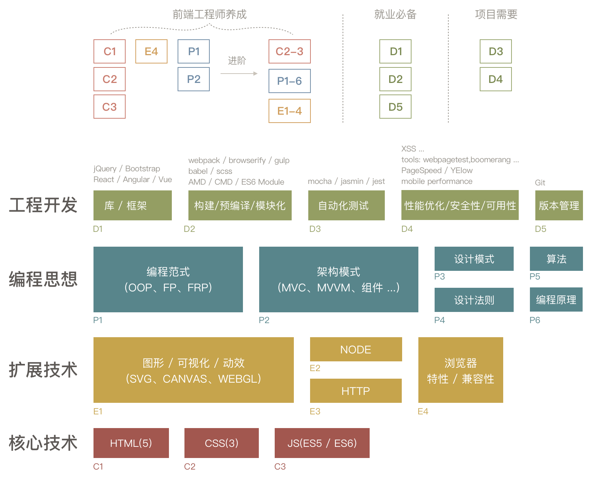
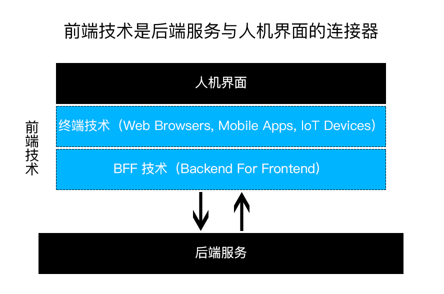
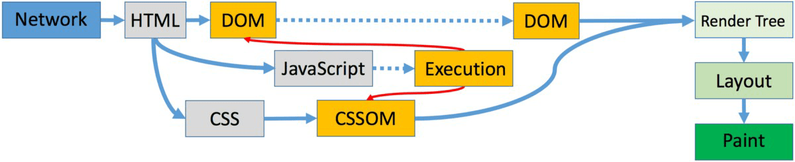

# 前端概念

## 目录
1. [前端涉及内容](#前端涉及内容)
1. [前端工程化](#前端工程化)
1. [网站性能优化](#网站性能优化)
1. [页面解析、渲染步骤](#页面解析渲染步骤)
1. [前端「增量」原则](#前端增量原则)
1. [前端架构](#前端架构)
1. [前端项目中 文件、依赖库的精简](#前端项目中-文件依赖库的精简)

---
>1. 好的程序员能够独立的解决某个技术难题，主动的关心项目进度与潜在瓶颈，能够负责模块小组，合理地分配任务，与项目经理、产品经理、美工、测试、服务端的同事高效包容地沟通。
>2. 好的架构师的标准则是整个项目的工程化程度：[前端工程化](https://github.com/realgeoffrey/knowledge/blob/master/网站前端/前端内容/README.md#前端工程化)。

### 前端涉及内容


>更详细的线路图：[Frontend Roadmap](https://github.com/kamranahmedse/developer-roadmap/blob/master/readme.md#-frontend-roadmap)。

1. 从本质上讲，所有Web应用都是一种运行在网页浏览器中的软件，这些软件的GUI（Graphical User Interface，图形用户界面）即为前端。
2. 服务端Node.js与各种终端的涌现，让前端进入了大前端范畴，这时的前端，已远远不只是浏览器端的页面实现技术，而是后端服务与人机界面的连接器。

    
3. 前端涉及：

    性能（用户体验），稳定性（监控告警），开发效率（工具，开发、构建流程，开发者体验）

    - <details>

        <summary>重视监控系统</summary>

        >来自：[如何识别牛逼的前端工程师](https://zhuanlan.zhihu.com/p/22026860)。

        1. 初级前端看功能，中级前端看测试，高级前端看监控。
        2. 前端做监控的目的就是在产品上线之后要从用户端拿到第一手的数据，毕竟用户端好用才是真正的好用。
        3. 目前多数公司对于前端的监控做的是不够的。在前后端分离的技术架构之下，前端要有自身的一整套监控体系才行。
        4. 很多时候后台监控到的是结果，结合前端监控才能分析出原因。我举个例子，比如后台监控到实时订单量骤减，这个是最终的结果，如果有前端的监控，我们就要看一下前端的可用性状况、各个页面的UV、加载性能、每个交互环节的点击量，各个接口的性能和出错占比、前端代码报错的量和位置，然后定位出问题所在。
        5. 真正经历过大型项目并且做过技术架构的工程师都会重视监控系统的建设。
        6. 做好监控需要有很好的大局观，一方面是产品的大局观，包括思考用户会如何使用产品，如何量化这些行为，每个环节数据的预期变化。另一方面是技术的大局观，要了解到整个技术架构不同模块是如何协作的，怎样测量它们是否正常工作。
        </details>

- 行业趋势总结

    1. [狼叔：2022大前端总结和2023就业分析](https://github.com/i5ting/fe-2022-in-china)
    2. 未来前端的发展

        1. 移动端、跨平台开发

            RN、flutter、ionic、~~weex~~，小程序。
        2. web组件和微前端

            1. shadow dom、custom elements
            2. [qiankun](https://github.com/umijs/qiankun)、[single-spa](https://github.com/single-spa/single-spa)、webpack模块联邦（Module Federation）
        3. 低代码

            <https://github.com/alibaba/lowcode-engine>
        4. 性能优化

            1. webpack，替代webpack的一系列轮子
            2. 监控、分析
            3. 性能api：`PerformanceNavigationTiming`
        5. 与人工智能结合

            TensorFlow.js（在浏览器中运行机器学习模型，支持图像、文本和声音等多种应用场景）、
              BrainJS（js实现，用于创建和训练神经网络，支持多种类型的神经网络）
              convnetjs（在浏览器中进行图像分类、物体检测等任务）
              ml5js（js实现，用于创建和训练机器学习模型，支持多种应用场景，包括图像、文本、音频等）
        6. WebAssembly

### 前端工程化
[带你入门前端工程](https://github.com/woai3c/introduction-to-front-end-engineering)：

1. 接到新需求，进行需求评审后根据具体情况做技术选型。
2. 开发前需要统一规范。
3. 学会模块化、组件化，对于写代码很有好处。
4. 开发完，需要对代码进行测试。
5. 构建打包。
6. 部署上线。
7. 对项目进行监控，随时发现问题。
8. 根据项目运行情况决定是否要做性能优化。
9. 项目越来越复杂，需要重构以提高可维护性。
- 项目越来越大，可以考虑是否按业务边界拆分前端；多个团队需要独立交付时，可评估微前端。
- 不想自己管理服务器或数据库，可以考虑使用 Serverless。


<details>

<summary><a href="https://github.com/fouber/blog/issues/10">张云龙：前端工程——基础篇</a></summary>

1. 第一阶段：库/框架选型

    >提升开发效率。（使用自动化工具也能够提升开发效率，如：浏览器自动刷新、IDEs）
2. 第二阶段：简单构建优化

    >提升运行性能。

    对代码进行压缩、校验，以页面为单位进行简单的资源合并。
3. 第三阶段：JS/CSS模块化开发

    >提升维护效率。

    **分而治之**

    1. [JS模块化方案](https://github.com/realgeoffrey/knowledge/blob/master/网站前端/JS模块化方案/README.md)：

        CommonJS/AMD/CMD/ES6 Module/UMD
    2. CSS模块化方案：

        Sass/Less/Stylus等CSS预处理器的`import`、`mixin`特性支持实现。

    - Monorepo方案
4. 第四阶段：前端工程化

    >优化部署、开发。

    1. CI/CD，融入：测试、校验、打包发布CDN等。
    2. 资源管理

        >静态资源加载的技术实现。不包括.html（`.html`设置不缓存或协商缓存或超短时间强缓存）。

        1. 静态资源管理系统 = 资源表 + 资源加载框架
        2. [大公司的静态资源优化方案](https://github.com/fouber/blog/issues/6)：

            1. 配置超长时间的强缓存 —— 节省带宽，提高性能
            2. 采用文件内容哈希（如：MD5/SHA 系列摘要）作为缓存更新依据 —— 精确的缓存控制
            3. 静态资源CDN部署 —— 优化网络请求
            4. 非覆盖式更新资源 —— 平滑升级
    3. 组件化开发

        >模块化开发的升华。

        1. 页面上的每个**独立的**可视/可交互区域视为一个组件；
        2. 每个组件对应一个**工程目录**，组件所需的各种资源都在这个目录下**就近维护**；
        3. 由于组件具有独立性，因此组件与组件之间可以**自由组合**；
        4. 页面只不过是组件的容器，负责组合组件形成功能完整的界面；
        5. 当不需要某个组件，或想要替换组件时，可以整个目录替换、删除。

>[从零开始构建 JavaScript 技术栈](https://github.com/wooo-on/js-stack-from-scratch)。

</details>

### 网站性能优化
>性能优化是一个[工程](https://github.com/realgeoffrey/knowledge/blob/master/网站前端/前端内容/README.md#前端工程化)问题。所有优化都是梳理完整个执行链路后，逐步优化链路中每个环节。

先区分用户遇到的是内容显示慢、操作响应慢，还是加载时布局跳动。线上按移动端和桌面端分别看真实访问的第 75 百分位；Core Web Vitals 的良好阈值为 LCP ≤ 2.5 秒、INP ≤ 200 毫秒、CLS ≤ 0.1。再用本地录制定位请求、长任务或位移来源。[Web Vitals 指标说明](https://web.dev/articles/vitals)

1. <details>

    <summary>URL输入：</summary>

    服务端（运维）对HTTP请求、资源发布和缓存、服务器配置的优化。

    1. 服务器开启gzip（如：nginx）。

        >前端查看Response头是否有：`Content-Encoding: gzip`。
    2. 优先开启使用[HTTP/3或HTTP/2](https://github.com/realgeoffrey/knowledge/blob/master/网站前端/HTTP相关/README.md#http协议迭代http3http2http1)（替代HTTP/1.1、HTTP/1.0）
    3. 减少DNS查找，设置合适的TTL值，避免重定向。
    4. 使用CDN。
    5. [静态资源和API分开域名放置](https://github.com/realgeoffrey/knowledge/blob/master/网站前端/前端内容/基础知识.md#静态资源使用额外域名的原因)；尽量减少保存进cookie的数据种类和大小（浏览器会随请求发送符合域名、路径、Secure、SameSite等条件的cookie）；合理减少HTTP头数量。
    6. 对资源进行缓存：

        1. 多页复用的 JS、CSS 适合独立缓存。少量首屏关键样式可内联，代价是随每份 HTML 重复传输。
        2. 使用[缓存相关HTTP头](https://github.com/realgeoffrey/knowledge/blob/master/网站前端/HTTP相关/README.md#http缓存)

            `Expires` `Cache-Control` `Last-Modified/If-Modified-Since` `ETag/If-None-Match`
        3. 把内容哈希写入静态资源 URL，内容变化时生成新地址。对这类资源可设置 `Cache-Control: public, max-age=31536000, immutable`。

            >经常更新的 HTML 入口可用 `Cache-Control: no-cache` 配合 `ETag`，允许存储但要求复用前验证。先发布新资源，再切换入口，并为仍在使用旧入口的客户端保留旧资源。

            [非覆盖式更新资源](https://github.com/fouber/blog/issues/6)。

            - 针对无法修改url地址的资源（如：头像等），若既要长缓存又要及时更新，则后台需要额外存储资源更新时间

                e.g. https://xxx.com/avatar/uid?t=更新时间
    </details>
2. 载入页面时，优化CRP（Critical Rendering Path，关键渲染路径，优先显示与用户操作有关内容）：

    1. 减少关键资源、减少HTTP请求：

        1. 资源合并、去重。
        2. 首屏主要内容可以服务端渲染（SSR）或静态生成，让浏览器在首份 HTML 中发现正文和主图。评估收益时同时看首字节时间、LCP 和交互所需的脚本。
        3. 非首屏资源延迟异步加载：

            1. 增量加载资源：

                1. 非首屏图片可用 `loading="lazy"` 并声明宽高，给图片预留空间。首屏主图应尽早加载。[图片的延迟加载（lazyload）](https://github.com/realgeoffrey/knowledge/blob/master/网站前端/JS方法积累/实用方法/README.md#jquery图片延时加载lazyload)。
                2. AJAX加载。

                    如：[滚动加载](https://github.com/realgeoffrey/knowledge/blob/master/网站前端/JS方法积累/实用方法/README.md#jquery滚动加载)、[IntersectionObserver判断DOM可见再发起异步加载](https://github.com/realgeoffrey/knowledge/blob/master/网站前端/JS方法积累/实用方法/README.md#原生jsdom展示或消失执行方法intersectionobserver)。
                3. 功能文件按需加载（模块化、组件化）。

                    [webpack的动态加载](https://github.com/realgeoffrey/knowledge/blob/master/网站前端/webpack学习笔记/README.md#动态加载按需加载代码分割异步组件路由组件-懒加载)
            2. 使AJAX可缓存。

                当用GET方式时添加缓存HTTP头：`Expires` `Cache-Control` `Last-Modified/If-Modified-Since`。
        4. 使用缓存替代每次请求。

            客户端： Web Storage（`localStorage`、`sessionStorage`）、cookie、IndexedDB等；服务端：Redis等。
        5. 对当前页面较晚才会发现的关键资源用 `preload` 提早发起请求；后续导航可能用到的资源可考虑低优先级的 `prefetch`。[预加载](https://github.com/realgeoffrey/knowledge/blob/master/网站前端/JS学习笔记/README.md#预加载)。
        6. 第三方经典脚本有执行顺序依赖时用 `defer`，彼此独立时可用 `async`。只对当前页面确有需要的关键资源设置[`<link>`预加载](https://github.com/realgeoffrey/knowledge/blob/master/网站前端/JS学习笔记/README.md#预加载)。
        - 其他

            1. 利用CDN combo（利用构建打包工具，如webpack，把多个文件合并为一个文件，并使用特定的URL来请求该合并后的文件）。
            2. ~~避免使用空链接的``、`<link>`、`<script>`、`<iframe>`（老版本浏览器依旧会请求）。~~
    2. 最小化字节：

        1. 压缩资源。

            >[webpack性能优化](https://github.com/realgeoffrey/knowledge/blob/master/网站前端/webpack学习笔记/README.md#webpack性能优化)
        2. 图片优化

            1. 压缩。
            2. 小图合并雪碧图。

                >雪碧图减少小图请求，但修改其中一个图标会使整张图的缓存失效。是否合并，应结合图标复用情况和实际传输大小判断。
            3. 合理使用：[Base64](https://github.com/realgeoffrey/knowledge/blob/master/网站前端/程序员的自我修养/README.md#base64)、WebP 或 AVIF、`srcset`属性、[不同ppi的设备使用不同分辨率的图片](https://github.com/realgeoffrey/knowledge/blob/master/网站前端/HTML+CSS学习笔记/响应式相关.md#不同ppi的设备使用不同分辨率的图片)。

                >1. 服务端（或CDN）处理图片资源，提供返回多种图片类型的接口（如：[七牛](https://developer.qiniu.com/dora/manual/3683/img-directions-for-use)）。
                >2. [判断浏览器是否支持WebP](https://github.com/realgeoffrey/knowledge/blob/master/网站前端/JS方法积累/实用方法/README.md#原生js判断是否支持webp)，对不同浏览器请求不同的图片类型。
                >3. 用 `<picture>` 中的 `<source type="…">` 提供不同格式，保留 `` 回退；用 `srcset` 和 `sizes` 帮助浏览器选择合适的图片宽度。
                >4. ~~`navigator.connection`（实验中的功能，兼容性差、不靠谱、基本没用）获取浏览器网络情况，从而在不同网络（2G/3G/4G/wifi）使用不同尺寸的图片。~~
    3. 缩短CRP长度：

        在 `<head>` 尽早声明首屏样式；需要 DOM 的外部经典脚本可在同处用 `defer` 加载，使下载与 HTML 解析并行。
    4. 用户体验：

        >本质上是减弱用户对加载时长的感知，并没有真的提高程序性能。

        1. <details>

            <summary>骨架屏</summary>

            1. 适用场景

                1. 当网络较慢或加载内容较多时：使用骨架屏向用户提供一个对即将出现内容的预期，解决等待加载过程中出现白屏或界面闪烁造成的割裂感。
                2. 当内容区域的布局排版固定时：常用于列表、详情头部等相对比较规则的页面。
                3. 当该模块信息暂时空缺，但需要提前占位时。
            2. 不适合场景

                1. 当内容布局和排版不固定时，轮廓和内容布局之间会有巨大差异，使用骨架屏不仅不能给用户顺畅和期待感，反而会造成落差。
                2. 当内容区域有空页面时，不建议使用骨架屏。
                3. 当加载时长低于1秒时或加载游戏资源这种场景过长时，不建议展示加载样式；当加载时长高于10秒时，建议给出用户加载失败反馈和出口。
            </details>
        2. lazyload默认图
        3. loading图/进度条
3. 载入页面后进行的[页面解析、渲染](https://github.com/realgeoffrey/knowledge/blob/master/网站前端/前端内容/README.md#页面解析渲染步骤)、线程执行性能：

    >页面脚本、事件处理、样式计算和布局通常共享渲染进程的主线程。主线程被长任务占用时，下一次交互反馈可能延迟。

    1. **JS代码性能优化（JS通用）**：

        1. 用 Performance 录制定位热点，再用相同输入比较优化前后的耗时。常见细节包括：

            1. 用直接表达数据形状的写法，如 `[3]` 表示一个数值元素，`Array(3)` 表示长度为 3 的稀疏数组。
            2. 在热点循环中复用查询到的 DOM 节点。缓存集合长度前，先确认循环期间集合不会增删。
            3. [闭包合理使用](https://github.com/realgeoffrey/knowledge/blob/master/网站前端/JS学习笔记/README.md#闭包closure)。
            4. [避免内存泄漏](https://github.com/realgeoffrey/knowledge/blob/master/网站前端/JS学习笔记/README.md#内存泄漏)（全局变量、闭包引用的变量、定时器、事件监听、DOM引用）。
            5. 已有字符串数组时可用 `parts.join('')`；少量片段用模板字符串或 `+` 即可。长字符串的性能取决于引擎和数据规模。
        2. 动态列表中可在稳定的父节点上代理会冒泡的事件，避免为每个新增条目重复绑定。
        3. [定时器取舍，合理使用重绘函数替代](https://github.com/realgeoffrey/knowledge/blob/master/网站前端/JS学习笔记/README.md#定时器--重绘函数)。
        4. 高频事件（如：`scroll`、`mousemove`、`touchmove`）使用[函数防抖、函数节流](https://github.com/realgeoffrey/knowledge/blob/master/网站前端/JS学习笔记/README.md#函数防抖函数节流)，避免在高频事件中进行运行时间长的代码。
        5. 将布局读取和 DOM 写入分批处理。在循环中修改宽度后立刻读取 `offsetWidth`，可能反复触发同步布局。
        6. 使用`Web Worker`处理复杂的计算。

            >[MDN：Web Workers可以使用的函数和类](https://developer.mozilla.org/zh-CN/docs/Web/API/Web_Workers_API/Functions_and_classes_available_to_workers)。
        7. 正则表达式尽可能准确地匹配目标字符串，以减少不必要的回溯。
        8. 针对在用框架，使用合理的特性实现业务逻辑。

            1. [vue性能优化](https://github.com/realgeoffrey/knowledge/blob/master/网站前端/Vue.js学习笔记/README.md#vue性能优化)
            2. [react性能优化](https://github.com/realgeoffrey/knowledge/blob/master/网站前端/React学习笔记/README.md#react性能优化)
        9. 长列表考虑虚拟列表（针对非可见区域先销毁，注意分析具体场景的重新创建优劣）
    2. CSS性能：

        1. [CSS选择器性能](https://github.com/realgeoffrey/knowledge/blob/master/网站前端/HTML+CSS学习笔记/README.md#css选择器)。
        2. [渲染性能](https://github.com/realgeoffrey/knowledge/blob/master/网站前端/HTML+CSS学习笔记/README.md#渲染性能rendering-performance)

            1. 样式缩小计算范围、降低复杂度。
            2. 减少重绘和重排。
            3. 动画合理触发GPU加速。
            4. 尽量仅使用`opacity`、`transform: translate/scale/rotate/skew`处理动画。
    3. HTML：

        1. 减少层级嵌套。
        2. 在拥有`target="_blank"`的`<a>`中添加`rel="noopener"`。
4. 客户端配合优化

    1. [WebView优化](https://github.com/realgeoffrey/knowledge/blob/master/网站前端/Hybrid前端开发/README.md#webview性能)：

        配合客户端开发落地优化方案。
    2. 首屏数据请求 提前至 页面加载前（利用客户端加载页面阶段，并行数据请求）
    3. 离线包（内置包、缓存包，运行前已提前下载准备好）
    - [hippy流程和优化（前端）](https://github.com/realgeoffrey/knowledge/blob/master/网站前端/Hippy学习笔记/README.md#hippy流程和优化前端)

>- <details>
>
>    <summary>优先优化对性能影响大、导致瓶颈的部分</summary>
>
>    1. （本地纠错）DevTools：
>
>        - 或客户端的性能查看工具：[其他语言2Native调试](https://github.com/realgeoffrey/knowledge/blob/master/网站前端/代码调试相关/README.md#其他语言2native调试)
>
>        1. 用 Performance 面板找到长帧和长任务，再从调用栈判断时间花在脚本、样式计算、布局还是绘制。
>        2. Rendering、Layers查看CSS渲染情况。
>        3. Memory、JavaScript Profiler、Performance monitor查询内存占用情况。
>    2. 以真实用户数据观察分布和变化，再用以下工具定位具体页面的问题
>
>        - 在客户端运行[`window.performance`](https://github.com/realgeoffrey/knowledge/blob/master/网站前端/前端内容/标准库文档.md#performance)查看页面从打开到加载完成的时间数据，或其他约定好的性能口径。
>
>        1. [lighthouse](https://github.com/GoogleChrome/lighthouse)
>
>           DevTools的Lighthouse、Chrome的扩展程序[Lighthouse](https://chrome.google.com/webstore/detail/lighthouse/blipmdconlkpinefehnmjammfjpmpbjk)、Node.js全局安装[lighthouse](https://www.npmjs.com/package/lighthouse)并执行`lighthouse 域名`。
>        2. 分析网站：
>
>            1. google的性能分析[PageSpeed Insights](https://developers.google.com/speed/pagespeed/insights/)
>            2. W3C
>
>                1. [标签验证](https://validator.w3.org/)
>                2. [CSS验证](https://jigsaw.w3.org/css-validator/validator.html.zh-cn)
>                3. [链接测试](https://validator.w3.org/checklink)
>            3. [性能测试](https://gtmetrix.com/)
>    3. （依赖包分析）webpack的[webpack-bundle-analyzer](https://github.com/webpack-contrib/webpack-bundle-analyzer)分析包体积。
>    </details>
>- <details>
>
>    <summary>网络应用的生命期建议：</summary>
>
>    1. load
>
>        1000ms内完成CRP。
>    2. idle
>
>        进行50ms内的空闲时期预加载，包括图片、多媒体文件、后续内容（如：评论）。
>    3. animations
>
>        60 Hz 屏幕每帧约 16.7 毫秒，120 Hz 约 8.3 毫秒。脚本、布局和绘制共享这段预算。[浏览器渲染性能](https://web.dev/articles/rendering-performance)
>    4. response
>
>        100ms内对用户的操作做出响应。
>    </details>

### 页面解析、渲染步骤
>参考：[全方位提升网站打开速度：前端、后端、新的技术](https://github.com/xitu/gold-miner/blob/master/TODO/building-a-shop-with-sub-second-page-loads-lessons-learned.md#前端性能)、[浏览器的工作原理：新式网络浏览器幕后揭秘](https://www.html5rocks.com/zh/tutorials/internals/howbrowserswork)。



><details>
><summary>约定</summary>
>
>1. 判断是否DOM构造：打印该DOM。
>2. 判断是否完成新的渲染：查看页面显示的DOM结果（DOM结构和样式效果）。
>3. 可以利用抓包工具（如：Charles），breakpoints静态资源来模拟加载缓慢或加载失败，从而判断是否会影响后面的解析或渲染。
>4. 利用DevTools的Network中的Waterfall判断资源加载的开始时间、是否并行。
></details>

1. 解析HTML（parse HTML）

    浏览器可以在 HTML 字节陆续到达时开始解析，**增量式**构建 DOM。样式表解析后形成 CSSOM，供后续计算元素的样式。

    ><details>
    ><summary>总结</summary>
    >
    >1. 解析器按标记的先后顺序构造 DOM；因此同步脚本可访问它前面已经解析的节点。
    >2. HTML 解析与资源下载可以重叠：
    >
    >    1. 外部经典脚本的 `defer` 和 `async` 都允许并行下载，两者的执行时机不同。
    >    2. 主解析器等待脚本时，预加载扫描器可能提前发现后续 HTML 中写明的资源。
    >    3. JS 动态生成的资源地址通常要等相应代码运行后才会被发现。
    >3. 解析器遇到同步经典脚本时会暂停构造后续 DOM：
    >
    >    1. 如果前面有阻塞该脚本的样式表，脚本先等待样式表就绪。
    >    2. 然后执行脚本，脚本结束后再继续解析。
    >4. 浏览器获得足够的 DOM 和样式信息后即可开始渲染，因此首屏可能早于 `DOMContentLoaded` 出现。[关键渲染路径](https://web.dev/learn/performance/understanding-the-critical-path)
    ></details>

    1. 发现并解析样式表，生成 CSSOM。浏览器会结合 DOM 与样式规则计算各元素的最终样式（Recalculate Style）。

        1. 首屏所需且匹配当前媒体条件的样式表可能**阻塞渲染**。例如仅用于打印的 `media="print"` 样式表通常不会推迟屏幕首绘。
        2. 下载外部样式表时，HTML 解析通常可以继续。若后续同步脚本需要等待该样式表，解析会间接停在脚本处。

        >动态添加或修改样式也可能触发样式重算；如果几何尺寸改变，还需要重新布局。

        3. 多个外部样式表可并行下载，样式层叠仍遵循规则优先级和文档顺序。
        4. 样式重算的耗时取决于受影响的元素和规则数量，可在 Performance 面板查看。

        ><details>
        ><summary>已经被提取的CSS（<code>&lt;link></code>、<code><style></code>、<code>style</code>内嵌样式），若再次修改或删除（或新添加），会再次影响CSSOM构造。</summary>
        >
        >以下代码可以实时在页面中编辑样式
        >```html
        ><style contenteditable style="display: block">
        >  a {
        >    color: red;
        >  }
        ></style>
        >
        ><a href="javascript:">a标签</a>
        >```
        ></details>
    2. 加载并执行脚本。以下以解析器插入的同步经典脚本为例。

        1. 解析到JS，在脚本执行完之前，**阻塞解析HTML**（DOM构造被暂停）。

            >1. 解析到JS时，若该文件还在下载，则保持阻塞解析HTML，直到下载并执行完毕。
            >2. 外部经典脚本的`defer`或`async`使下载与解析并行；`async`脚本若在解析期间执行，仍会占用主线程。
        2. 如有阻塞该脚本的样式表，先等待其就绪。
        3. 执行脚本，访问、更改DOM和CSSOM。

            ><details>
            ><summary>一个<code>&lt;script&gt;</code>最多执行一次。</summary>
            >
            >1. 已经执行过的脚本（`<script>`：外部脚本`src`或内嵌脚本），若再次修改或删除，不会再执行，也不会影响执行过的内容。
            >
            >    已经执行过的脚本，若删除外部脚本`src`或删除内嵌脚本内容，之后再添加外部脚本`src`或添加内嵌脚本内容，也不会再次执行。
            >2. 没有执行过内容的空脚本`<script></script>`，若添加外部脚本`src`或添加内嵌脚本，会执行一次。
            >3. 已经被浏览器执行到的`<script>`，一旦开始处理，修改元素内容或移除元素都不能可靠取消脚本。外部资源加载失败时会触发 `error`，其中的代码不会执行。
            ></details>
        4. 脚本执行完毕，继续 解析HTML（DOM构造）。

            >[`<script>`的加载和执行时机](https://github.com/realgeoffrey/knowledge/blob/master/网站前端/前端内容/基础知识.md#script的加载和执行时机)。

    - 事件完成顺序

        1. 开始解析HTML；
        2. （额外线程、并行）加载外部资源文件（CSS、JS、图片、媒体、等）；
        3. 处理阻塞解析的经典脚本

            1. 外部脚本先等自身下载完成；
            2. 待阻塞该脚本的样式表就绪后执行。
        4. DOM构造完毕；

            解析完成后，浏览器处理延迟执行的经典脚本和默认模块脚本，再触发 `document` 的 `DOMContentLoaded`。一般无需等待图片或 `async` 脚本。
        5. 解析HTML完成、且会延迟`load`的资源结束加载（如普通图片、样式表、脚本）。启用脚本时，`loading="lazy"`的图片不延迟`load`。禁用脚本时，这些图片按普通图片加载，也可能延迟`load`。

            完毕后触发：`window`的`load`事件。
2. 根据当时已有的 DOM 和 CSSOM 进行渲染，后续解析和样式变化仍可更新页面：

    Render Tree（渲染树）：Layout -> Paint -> Composite

    >1. `display: none`的元素及其后代不生成布局盒；`visibility: hidden`的元素仍占据布局空间。
    >2. `::before` 等伪元素可以生成参与布局和绘制的盒，但不会成为 DOM 子节点。

    - 每一帧需要哪些渲染步骤，取决于页面发生了什么变化

        >[渲染细节和性能](https://github.com/realgeoffrey/knowledge/blob/master/网站前端/HTML+CSS学习笔记/README.md#渲染性能rendering-performance)。

        改变元素宽度通常需要布局和绘制；已合成图层上的某些 `transform` 或 `opacity` 动画只需合成。静止页面无需每帧重新布局。

- 修改 DOM 后，读取结果与屏幕显示的时机：

    1. 显示 `alert` 对话框时，当前脚本会暂停，不能依赖弹窗前的 DOM 修改已经显示。
    2. 长时间占用主线程会延迟页面绘制和事件响应。
    3. `debugger` 的表现取决于是否接入调试器及断点设置。

    <details>
    <summary>e.g.</summary>

    ```html
    <div id="j-div-1">1</div>
    <div id="j-div-2">2</div>
    <div id="j-div-3">3</div>

    <script>
    const dom1 = document.querySelector('#j-div-1')
    dom1.onclick = () => {
      dom1.innerHTML = 'hello'
      console.log(dom1.innerHTML)  // 能打印出：'hello'

      alert()                      // 观察弹窗出现时是否已显示新文本
    }

    const dom2 = document.querySelector('#j-div-2')
    dom2.onclick = () => {
      dom2.innerHTML = 'hello'
      console.log(dom2.innerHTML)  // 能打印出：'hello'

      debugger                     // 有调试器时可在此暂停
    }

    const dom3 = document.querySelector('#j-div-3')
    dom3.onclick = () => {
      dom3.innerHTML = 'hello'
      console.log(dom3.innerHTML); // 能打印出：'hello'

      (function sleep (ms) {       // js运行期间，阻塞浏览器渲染
        ms += new Date().getTime()
        while (new Date() < ms) {}
      }(3000))
    }
    </script>
    ```
    </details>

### 前端「增量」原则
1. 「增量」原则：

    >「增量下载」是前端在工程上有别于客户端GUI软件的根本原因。

    前端应用没有安装过程，其所需程序资源都部署在远程服务器，用户使用浏览器访问不同的页面来加载不同的资源，随着页面访问的增加，渐进式地将整个程序下载到本地运行。
2. 由「增量」原则引申出的前端优化技巧几乎成为了**性能优化**的核心：

    1. 加载相关：延迟加载、AJAX加载、按需加载、预加载、请求合并压缩等策略。
    2. 缓存相关：缓存更新、缓存共享、非覆盖式更新资源等方案。
    3. 复杂的BigRender、BigPipe、Quickling、PageCache等技术。

### 前端架构
1. [前端架构师需要考虑整个项目的工程化程度](https://www.zhihu.com/question/26187669/answer/140542149)

    众所周知，现在前端进入了一种爆炸期，各种技术框架百花齐放，各种应用场景天差地别，前端工程化个人感觉不仅仅是选定某个技术框架、选定代码规范、选定测试方案等等，工程化的根本目标即是以尽可能快的速度实现可信赖的产品。尽可能短的时间包括开发速度、部署速度与重构速度，而可信赖又在于产品的可测试性、可变性以及Bug的重现与定位。笔者感觉遇见的最大的问题在于**需求的不明确、接口的不稳定与开发人员素质的参差不齐**。先不论技术层面，项目开发中我们在组织层面的希望能让每个参与的人无论水平高低都能最大限度的发挥其价值，每个人都会写组件，都会写实体类，但是他们不一定能写出合适的优质的代码。另一方面，好的架构都是衍化而来，不同的行业领域、应用场景、界面交互的需求都会引发架构的衍化。我们需要抱着开放的心态，不断地提取公共代码，保证合适的复用程度。同时也要避免过度抽象而带来的一系列问题。当我们落地到前端时，笔者在历年的实践中感受到以下几个突出的问题：

    1. 前后端业务逻辑衔接：在前后端分离的情况下，前后端是各成体系与团队，那么前后端的沟通也就成了项目开发中的主要矛盾之一。前端在开发的时候往往是根据界面来划分模块，命名变量，而后端是习惯根据抽象的业务逻辑来划分模块，根据数据库定义来命名变量。最简单而是最常见的问题譬如二者可能对于同意义的变量命名不同，并且考虑到业务需求的经常变更，后台接口也会发生频繁变动。此时就需要前端能够建立专门的接口层对上屏蔽这种变化，保证界面层的稳定性。
    2. 多业务系统的组件复用：当我们面临新的开发需求，或者具有多个业务系统时，我们希望能够尽量复用已有代码，不仅是为了提高开发效率，还是为了能够保证公司内部应用风格的一致性。
    3. 多平台适配与代码复用：在移动化浪潮面前，我们的应用不仅需要考虑到PC端的支持，还需要考虑微信小程序、微信内H5、WAP、ReactNative、Weex、Cordova等等平台内的支持。这里我们希望能够尽量的复用代码来保证开发速度与重构速度，这里需要强调的是，笔者觉得移动端和PC端本身是不同的设计风格，笔者不赞同过多的考虑所谓的响应式开发来复用界面组件，更多的应该是着眼于逻辑代码的复用，虽然这样不可避免的会影响效率。鱼与熊掌，不可兼得，这一点需要因地制宜，也是不能一概而论。
2. <details>

    <summary>尽量在还未遇到问题之前或有痛点之后（栽进业务之前 或 就算在做着业务也要抽时间规划），根据以往的经验，规划好要支持的能力。这样能产生一个专门功能系统，而不是每次业务需要就重复拉资源开发</summary>

    如：

    1. 性能相关上报点预埋（才能够支持：如何验证性能好坏，判断秒开率、首屏时间，判断优化效果）
    2. 监控区分到具体页面的数据
    3. 上报系统（页面级、功能组件级；特殊操作，如：营收）
    4. 与客户端交互方式和协议（互相监听事件、回调）

        解决如何高效地由某一端程序员起草协议后，同步给其他端程序员。e.g. 类似[flutter pigeon](https://pub.dev/packages/pigeon)的生成所有端代码（前端、iOS、Android）。
    5. 运营活动配置能力，降低活动研发成本

        （类似low-code）以组件维度开发，多个组件可以任意拼接后由运营人员配置发布，支持换肤、配置活动id（后台服务支持）。
    6. 抽奖配置系统，支持配置奖项内容、次数、用户频控、时间频控
    7. native任意位置弹窗能力，额外支持产品配置的 频控、用户画像等能力
    8. 用户画像系统
    9. 发布相关的CI/CD，还包含发布内容的版本控制、灰度控制
    10. 开发调试效率
    11. 用户反馈系统（弥补监控）

    >产品、运营 不做特别区分。
    </details>

### 前端项目中 文件、依赖库的精简
1. 项目内文件（尤其是根目录文件）

    基本是`依赖库、git/svn、CI/CD、IDE配置`需要的文件（夹），比较杂，需要学习具体知识才能知道某个文件（夹）的使用方式。大部分可以用文件名来推测是谁在使用（靠经验）；CI/CD的文件可能比较特殊又百花齐放，需要咨询前辈或阅读CI/CD工具文档（若有）。
2. 依赖库添加到项目后，提供的功能

    1. 代码引用，项目内全局搜索依赖库完整名称
    2. cli命令创建（安装在bin文件夹），查看依赖库的`package.json`的`bin`属性
3. 依赖库可能需要的配置，添加在：

    1. `package.json`特殊属性
    2. 配置文件（大部分放在根目录）

    >若要删除某个依赖库，则要记得删除其配置。
4. 判断一个依赖库是否不再使用

    1. 项目内全局搜索依赖库全名，看是否有引用（依赖分析）
    2. 若依赖库提供cli命令，则判断依赖库的`package.json`的`bin`属性提供的命令名是否被使用，查找：

        1. `package.json`的scripts
        2. 项目内全局（主要在脚本文件）

    >幽灵依赖：某个包直接使用了 A，却没有在自己的依赖清单中声明 A。例如 npm 提升了另一个包依赖的 A，本地可能碰巧能解析；更换安装布局或清理间接依赖后就会失败。应在实际使用 A 的包中补上合适的依赖声明。

    - `package.json`的scripts中命令使用场景（`npm run 命令`）

        1. 本地开发使用
        2. 脚本文件使用

            1. 项目内全局能搜到的
            2. 依赖库使用（不好的代码架构方式）
        3. CI/CD链路中使用（需要搞懂CI/CD完整链路，哪里配置启动命令、构建命令等）
