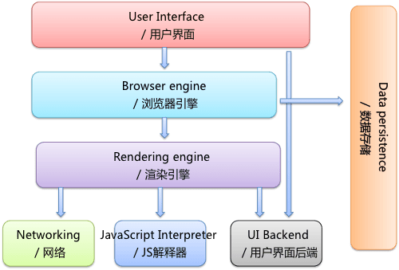
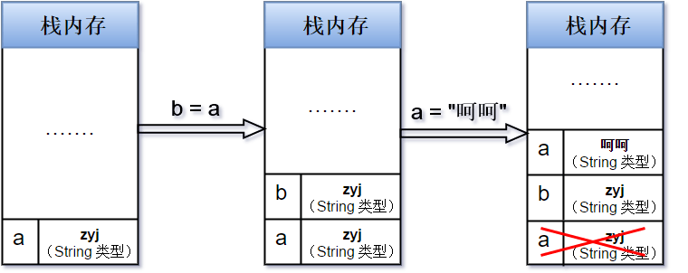
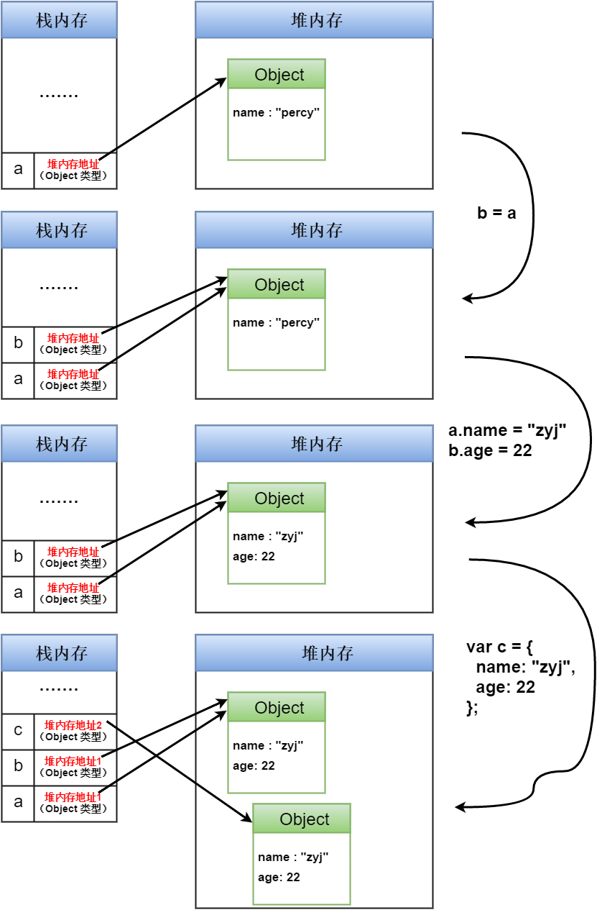
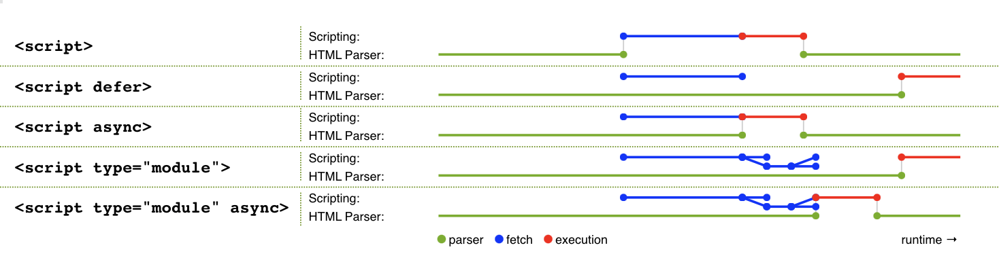

# 基础知识

## 目录
1. [JavaScript](#javascript)
1. [浏览器的主要组件](#浏览器的主要组件)
1. [JS引擎](#js引擎)
1. [JS的预编译](#js的预编译)
1. [JS数据类型](#js数据类型)
1. [基本包装类型](#基本包装类型)
1. [数据创建方式](#数据创建方式)
1. [进制数](#进制数)
1. [运算符优先级](#运算符优先级)
1. [自动插入分号机制（Automatic Semicolon Insertion，ASI）](#自动插入分号机制automatic-semicolon-insertionasi)
1. [ECMAScript语法提案的批准流程](#ecmascript语法提案的批准流程)
1. [AJAX（Asynchronous JavaScript and XML）](#ajaxasynchronous-javascript-and-xml)
1. [浏览器发起网络请求方式](#浏览器发起网络请求方式)
1. [中断请求方式](#中断请求方式)
1. [搜索引擎原理](#搜索引擎原理)
1. [SEO](#seo)
1. [垃圾回收](#垃圾回收)
1. [数组的空位（hole）](#数组的空位hole)
1. [javascript伪协议](#javascript伪协议)
1. [JSON](#json)
1. [`<script>`的加载和执行时机](#script的加载和执行时机)
1. [静态资源使用额外域名的原因](#静态资源使用额外域名的原因)
1. [缓动函数](#缓动函数)
1. [位运算](#位运算)
1. [MIME类型](#mime类型)

---
### JavaScript
1. 头等函数（first-class function）

    一种编程语言被称为具有头等函数时，语言中的函数将会像任何其他变量一样被对待（如：函数可以作为参数传递给其他函数、可以作为返回值被返回、可以作为值赋值给变量）。
2. 原型编程（prototype-based programming）

    读取对象属性时，先找对象自身，再沿原型链逐级查找，直到找到该属性或遇到 `null`。`class` 的普通实例方法定义在类的 `prototype` 上，因此多个实例可以共享同一个方法。

    >JS的面向对象是基于原型的面向对象（the prototype-based OO）。
3. 引擎、编译器、作用域

    1. 引擎

        从头到尾负责整个JS程序的编译及执行过程。
    2. [编译器](https://github.com/realgeoffrey/knowledge/blob/master/网站前端/程序员的自我修养/README.md#编译器编译原理)

        负责语法分析及代码生成等脏活累活。
    3. 作用域

        >JS是[词法作用域](https://github.com/realgeoffrey/knowledge/blob/master/网站前端/程序员的自我修养/README.md#词法作用域动态作用域)。

        负责收集并维护由所有声明的标识符（变量、函数）组成的一系列查询，并实施一套非常严格的规则，确定当前执行的代码对这些标识符的访问权限。
4. JavaScript范围

    >ECMAScript是JavaScript的标准，狭义的JavaScript指ECMAScript。浏览器、Node.js、Deno、Bun等都是JavaScript的运行时环境。

    JavaScript ＝ ECMAScript + 宿主环境提供的API。

    1. 浏览器（web应用）的JavaScript包括：

        1. ECMAScript：描述该语言的语法和基本对象。
        2. Web API：

            1. 文档对象模型（DOM）：描述处理网页内容的方法和接口。
            2. 浏览器对象模型（BOM）：描述与浏览器进行交互的方法和接口。
    2. Node.js 中可用的能力包括：

        1. ECMAScript：描述该语言的语法和基本对象。
        2. Node.js 提供的宿主 API，例如：

            1. 操作系统信息（`node:os`）。
            2. 文件系统（`node:fs`）。
            3. 网络通信（`node:net` 等）。
            4. 数据库访问（如 SQLite，其他数据库通常使用相应的驱动）。
5. <details>

    <summary>浏览器中的JavaScript使用限制</summary>

    为了用户的（信息）安全，在浏览器中的JavaScript的能力是受限的。目的是防止恶意网页获取用户私人信息或损害用户数据。

    - JavaScript最初被创建的目的是“使网页更生动”，它不提供对内存或CPU的底层访问，不需要这些功能。此类限制的例子包括：

        1. 网页中的JavaScript不能读、写、复制和执行硬盘上的任意文件。它没有直接访问操作系统的功能。

            - 现代浏览器允许JavaScript做一些文件相关的操作，但是这个操作是受到限制的。仅当用户做出特定的行为，JavaScript才能操作这个文件。如：用户把文件“拖放”到浏览器中，或者通过`<input>`标签选择了文件。
            - 有很多与相机/麦克风和其它设备进行交互的方式，但是这些都需要获得用户的明确许可。因此，启用了JavaScript的网页应该不会偷偷地启动网络摄像头观察你，并把你的信息发送到网络上。
        2. 不同的标签页/窗口之间通常互不了解。

            有时候，也会有一些联系，例如一个标签页通过JavaScript打开的另外一个标签页。但即使在这种情况下，如果两个标签页不同源（协议、主机或端口不同），脚本不能直接访问对方的DOM；持有对方窗口引用时，可以通过`postMessage`通信。这个限制也是为了用户的信息安全。
        3. JavaScript可以轻松地通过互联网与当前页面所在的服务器进行通信。但是从其他网站/域的服务器中接收数据的能力被削弱了。尽管可以，但是需要来自远程服务器的明确协议（CORS，在HTTP header中）。这也是为了用户的信息安全。
    >JavaScript的能力很大程度上取决于它运行的环境。如果在浏览器环境外（如：在服务器上）使用JavaScript，则不存在此类限制。

    </details>
6. <details>

    <summary>是什么使得JavaScript与众不同？</summary>

    - 至少有3件事值得一提：

        1. 与HTML/CSS完全集成。
        2. 简单的事，简单地完成。
        3. 被所有的主流浏览器支持，并且默认开启。

    JavaScript是将这三件事结合在一起的唯一的浏览器技术。这就是为什么JavaScript与众不同。这也是为什么它是用于创建浏览器界面的使用最广泛的工具。

    </details>

### 浏览器的主要组件


1. 用户界面

    包括地址栏、前进/后退按钮、书签菜单等。除了浏览器主窗口显示的您请求的页面之外，其他显示的各个部分都属于用户界面。
2. 浏览器引擎

    在用户界面和呈现引擎之间传送指令。
3. 渲染引擎

    也称为浏览器内核（web browser engine）、排版引擎（layout engine），是一种软件组件，负责获取标记式内容（如：HTML、XML以及图像文件等）、整理信息（如CSS、XSL），并将排版后的内容输出至显示屏或打印机。

    所有网页浏览器、电子邮件客户端以及其他需要根据表示性的标记语言来显示内容的应用程序，都需要排版引擎。

    ><details>
    ><summary>各浏览器使用的浏览器内核</summary>
    >
    >1. IE：Trident。
    >2. Chrome：前WebKit，现Blink。
    >3. Firefox：Gecko。
    >4. Safari：WebKit。
    >5. Opera：前Presto，现Blink。
    >6. 桌面版 Edge：旧版使用 EdgeHTML，Chromium 版使用 Blink。
    ></details>
4. 网络

    用于网络调用，如：HTTP请求。其接口与平台无关，并为所有平台提供底层实现。
5. 用户界面后端

    用于绘制基本的窗口小部件，如：组合框和窗口。其公开了与平台无关的通用接口，而在底层使用操作系统的用户界面方法。
6. [JS引擎（JS解释器、JS Engine、JS虚拟机）](https://github.com/realgeoffrey/knowledge/blob/master/网站前端/前端内容/基础知识.md#js引擎)
7. 数据存储

    浏览器管理 cookie、Web Storage 和 IndexedDB 等数据。键值设置可用 Web Storage，较大量的结构化数据可用支持索引和事务的 IndexedDB。

### JS引擎
>1. JS引擎提供了执行JavaScript的运行时环境。JS引擎都实现了[Standard ECMA-262](https://www.ecma-international.org/publications-and-standards/standards/ecma-262/)（ECMAScript：JavaScript使用的标准）。
>2. React Native、Node.js、Deno、Bun等都是通过扩展JS Engine，在具备强大的本地资源和原生接口调用能力的同时，结合JavaScript丰富的库、社区及跨平台能力进行开发。

一个专门处理JS脚本的虚拟机。

><details>
><summary>JS引擎使用情况</summary>
>
>1. V8：Chrome，Chromium版Edge，Opera，Node.js，MongoDB，Hippy（Android）。
>2. JavaScriptCore（JSC、JSCore）、Nitro：React Native 0.70之前的默认引擎，Hippy（iOS），Safari。
>3. Hermes：从[React Native 0.70](https://reactnative.dev/blog/2022/09/05/version-070)起成为默认引擎。
>4. SpiderMonkey：Firefox。
>5. Chakra：旧版Edge（EdgeHTML），ie9+。
>6. JScript：ie8-，ASP。
></details>

- 引擎工作流程（不同JS引擎的工作原理基本都大同小异）：

    1. （Parsing：）首先对输入的JS代码进行词法分析（Lexical Analysis），将代码分解为一个个的词法单元（tokens），然后进行语法分析（syntactic analysis），根据语法规则将词法单元组织成抽象语法树（Abstract Syntax Tree，AST）的形式；
    2. 解释执行（Interpretation）或即时编译（Just-In-Time Compilation，JIT）；
    3. 在执行JS代码时，引擎会进行一系列的优化操作，以提高代码的执行效率。引擎还会对执行过程进行监控和分析，根据代码的热度和执行频率进行动态优化，以提高性能。
    - JS引擎使用垃圾回收（Garbage Collection）算法来自动回收不再使用的内存对象。程序持续引用的对象仍可能造成内存泄漏。

>对于前端来说，除了各引擎内部逻辑之外，在调试JS代码时连接的debugger协议也应不同JS引擎而不同。如：[Chrome DevTools Protocol，CDP](https://chromedevtools.github.io/devtools-protocol/)、[Webkit Inspector Protocol](https://github.com/WebKit/webkit/tree/main/Source/JavaScriptCore/inspector/protocol)。

### JS的预编译
>参考：[JavaScript - 预编译](http://www.jianshu.com/p/a91cddc5c705)。

1. JS引擎先解析源码，可使用解释执行或即时编译。下面的「预编译」指声明实例化。
2. 每个经典脚本开始执行前会处理其顶层声明；函数在被调用时处理自己的局部声明。
3. 进入作用域时，引擎先为声明建立绑定，俗称「提升」（hoisting）。

    新建的 `var` 绑定初始值是 `undefined`，函数声明的绑定则已指向函数对象。`let`、`const` 和 `class` 的绑定在执行到相应声明前处于暂时性死区，提前读取会抛出 `ReferenceError`。

    >同一作用域内，词法声明不能重名，也不能与该作用域的 `var` 声明重名。

    - 以经典脚本或函数体顶层的同名 `function` 和 `var` 为例：

        1. 在预编译阶段，同时声明同一名称的函数和变量（顺序不限），会被声明为函数。
        2. 在执行阶段，若变量有赋值，则这个名称会重新赋值给变量。

        ><details>
        ><summary>e.g.</summary>
        >
        >```js
        >// 预编译阶段a1/b2为函数，运行时a1/b2赋值成为变量
        >console.log(a1);        // => ƒ a1() {}
        >var a1 = 1;
        >function a1() {}
        >console.log(a1);        // => 1
        >
        >console.log(b2);        // => ƒ b2() {}
        >function b2() {}
        >var b2 = 1;
        >console.log(b2);        // => 1
        >
        >
        >// 预编译阶段c3/d4为函数，运行时没有赋值
        >console.log(c3);        // => ƒ c3() {}
        >var c3;
        >function c3() {}
        >console.log(c3);        // => ƒ c3() {}
        >
        >console.log(d4);        // => ƒ c4() {}
        >function d4() {}
        >var d4;
        >console.log(d4);        // => ƒ c4() {}
        >
        >
        >// 预编译阶段e5为变量，运行时被赋值给匿名函数
        >console.log(e5);        // => undefined
        >var e5 = function () {};
        >console.log(e5);        // => ƒ () {}（匿名函数）
        >```
        ></details>
4. 声明中的赋值表达式在执行到该语句时求值。例如 `var a = makeValue()` 在声明实例化时不会调用 `makeValue`。

### JS数据类型
1. 基本数据类型：

    `Undefined`、`Null`、`Boolean`、`Number`、`String`、`Symbol`、`BigInt`

    1. 按值访问

        原始值不可变，将它赋给另一个变量后，重新给其中一个变量赋值不影响另一个。具体存储在栈、堆还是寄存器取决于引擎。

        
    2. 原始值不能保留新属性；显式创建的包装对象按对象规则处理。
2. 引用数据类型：

    `Object`（包括原型为`null`的对象、函数和[基本包装类型](https://github.com/realgeoffrey/knowledge/blob/master/网站前端/前端内容/基础知识.md#基本包装类型)）

    1. 赋值时复制对象引用

        两个变量可以引用同一对象，通过其中一个修改对象属性，另一个也能读到新值。

        
    2. 可扩展对象可以添加新属性；已有属性的读取/修改，根据属性描述（数据属性/访问器属性）决定。

- 判断是基本数据类型（不是引用数据类型）：

    ```js
    function isPrimitive(value) {
      return Object(value) !== value // 对象会原样返回，原始值会得到一个新对象
      // 或：return (
      //   typeof value === "number" ||
      //   typeof value === "string" ||
      //   typeof value === "boolean" ||
      //   typeof value === "symbol" ||
      //   typeof value === "bigint" ||
      //   value === null ||
      //   value === undefined
      // );
    }
    ```

### 基本包装类型
1. 针对基本数据类型

    `Boolean`、`Number`、`String`、`Symbol`、`BigInt`（除了 ~~`Undefined`~~、~~`Null`~~）
2. 作用

    读取这些原始值的属性时，JS 使用对应包装对象的属性查找规则，例如从 `String.prototype` 找到字符串方法。

    1. 基本数据类型与基本包装类型的自动转换

        ```js
        'abc'.length // 3
        // 读取字符串的 length 属性，原始字符串仍是 'abc'。
        ```
    2. 向原始值添加普通数据属性无法保存该属性

        ```js
        var s = '' // 在非严格模式的经典脚本中运行
        s.x = 1    // 赋值被忽略。严格模式下这一行会抛出 TypeError
        s.x        // undefined
        ```

- 在非严格模式，若是基本数据类型（除了`undefined/null`之外）使用[this替代](https://github.com/realgeoffrey/knowledge/blob/master/网站前端/前端内容/标准库文档.md#this替代)设置`this`，则`this`成为那个值的基本包装类型。

    ><details>
    ><summary>e.g.</summary>
    >
    >```js
    >function A () {
    >  console.log(this)
    >}
    >
    >A.call()          // => 全局对象
    >A.call(undefined) // => 全局对象
    >A.call(null)      // => 全局对象
    >A.call(1)         // => Number的基本包装类型
    >A.apply(1)        // => Number的基本包装类型
    >A.bind(1)()       // => Number的基本包装类型
    >
    >
    >function B () {
    >  'use strict'
    >  console.log(this)
    >}
    >
    >B.call()          // => undefined
    >B.call(undefined) // => undefined
    >B.call(null)      // => null
    >B.call(1)         // => 1
    >B.apply(1)        // => 1
    >B.bind(1)()       // => 1
    >```
    ></details>

<details>
<summary>e.g.</summary>

- 基本包装类型种类

    ```js
    // Boolean
    new Boolean(true)
    // 或
    Object(true) // 或：`new Object(true)`、`Object(Boolean基本包装类型)`、`new Object(Boolean基本包装类型)`


    // Number
    new Number(1)
    // 或
    Object(1) // 或：`new Object(1)`、`Object(Number基本包装类型)`、`new Object(Number基本包装类型)`


    // String
    new String('')
    // 或
    Object('') // 或：`new Object('')`、`Object(String基本包装类型)`、`new Object(String基本包装类型)`


    // Symbol
    Object(Symbol()) // 或：`new Object(Symbol())`


    // BigInt
    Object(BigInt(1)) // 或：`new Object(BigInt(1))`、`Object(1n)`、`new Object(1n)`
    ```
- 判断数据类型

    ```js
    // 以 Number 为例：

    new Number(1) == 1  // true
    new Number(1) === 1 // false

    Object.prototype.toString.call(1)             // "[object Number]"
    Object.prototype.toString.call(new Number(1)) // "[object Number]"

    typeof 1             // 'number'
    typeof new Number(1) // 'object'

    1 instanceof Number             // false
    new Number(1) instanceof Number // true
    ```
</details>

### 数据创建方式
1. 引用数据类型

    >1. 对象、数组和正则有字面量写法。函数可以用函数声明或表达式定义。
    >2. 构造函数有各自的参数规则。例如 `[2]` 创建含一个元素的数组，`Array(2)` 创建长度为 2 的稀疏数组。
    >3. 通常优先选择能直接表达意图的写法。正则模式来自变量时可用 `new RegExp(pattern)`；普通对象或数组的构造不涉及编译源代码。

    1. 对象

        e.g.

        ```js
        // ①对象字面量
        var obj1 = {a: 'b'}


        // ②构造函数实例化

        // 基本包装类型：null 或 undefined 得到普通空对象，其他原始值变为对应的包装对象
        new Object()            // {}
        new Object(null)        // {}
        new Object(undefined)   // {}
        new Object(1)           // Number的基本包装类型，等价于：new Number(1)
        new Object(true)        // Boolean的基本包装类型，等价于：new Boolean(true)
        new Object('str')       // String的基本包装类型，等价于：new String('str')
        new Object(Symbol())    // Symbol的基本包装类型
        new Object(1n)          // BigInt的基本包装类型

        // 传入对象时返回该对象本身
        new Object({a: 'b'})    // {a: 'b'}
        new Object(new Date())  // new Date()


        // ③普通函数（与new的实例化方式返回结果一致）
        Object()
        ```
    2. 数组

        e.g.

        ```js
        // ①数组字面量
        var arr1 = [2, 3];          // [2, 3]


        // ②构造函数实例化
        var arr2 = new Array();     // []
        var arr3 = new Array(2);    // 长度为 2，两个索引都是空位
        var arr4 = new Array(2, 3); // [2, 3]


        // ③普通函数（与new的方式结果一致）
        var arr5 = Array();         // []
        var arr6 = Array(2);        // 长度为 2，两个索引都是空位
        var arr7 = Array(2, 3);     // [2, 3]
        ```
2. 基本数据类型

    >1. 字面量和普通函数可产生原始值，使用 `new` 会得到包装对象：
    >
    >    `Boolean`、`Number`、`String`
    >2. 有字面量和普通函数方式：
    >
    >    `BigInt`
    >3. 有普通函数方式：
    >
    >    `Symbol`
    >4. `null` 是字面量。`undefined` 是全局属性，表达式 `void 0` 也会产生 Undefined 类型的唯一值。

    1. 字符串

        e.g.

        ```js
        // ①字符串字面量
        var str1 = 'string';                // 'string'


        // ②普通函数（与字面量的方式结果一致）
        var str2 = String('string');        // 'string'


        // ③构造函数实例化
        var str3 = new String('string');    // 基本包装类型，等价于：new Object('string')


        console.log(typeof str1, str1 instanceof String);   // => string false
        console.log(typeof str2, str2 instanceof String);   // => string false
        console.log(typeof str3, str3 instanceof String);   // => object true

        console.log(str1 === str2, str2 === str3);          // => true false
        ```

### 进制数
1. 2进制表示：

    `0b二进制数`、`0B二进制数`
2. 8进制表示：

    `0o八进制数`、`0O八进制数`

    >`0八进制数`属于旧式八进制写法，严格模式中是语法错误。
3. 16进制表示：

    `0x十六进制数`、`0X十六进制数`

进制前缀决定如何读取字面量。同一个数值可以有多种写法，例如 `0b1010 === 0xa` 为 `true`。使用 `(10).toString(2)` 可以得到表示二进制的字符串 `"1010"`。

>[不同进制数互相转换](https://github.com/realgeoffrey/knowledge/blob/master/网站前端/JS方法积累/实用方法/README.md#原生js不同进制数互相转换)、用`Number(字符串)`将带进制前缀的字符串解析为数值。

### 运算符优先级
优先级和结合性决定操作数如何分组。分组与操作数表达式的求值顺序是两个问题。

1. [运算符优先级](https://developer.mozilla.org/zh-CN/docs/Web/JavaScript/Reference/Operators/Operator_Precedence#汇总表)决定不同运算符如何分组。例如 `a() + b() * c()` 按 `a() + (b() * c())` 分组，三个函数仍按 `a`、`b`、`c` 的顺序调用。
2. 优先级相同时看结合性。例如 `10 - 3 - 2` 等于 `(10 - 3) - 2`，而 `2 ** 3 ** 2` 等于 `2 ** (3 ** 2)`。
3. 短路运算可能跳过整个操作数。例如 `a ?? b()` 只在 `a` 为 `null` 或 `undefined` 时调用 `b`。

    e.g. 在表达式`a && (b++)`中，若`a`为假时（falsy），则即使`(b++)`在圆括号中，也不会被求值、不会被执行到。

### 自动插入分号机制（Automatic Semicolon Insertion，ASI）
1. 解析器按语法规则自动补入分号。例如换行后的标记无法接续当前语句、遇到右花括号或输入结束时，可能需要补入分号。单独的换行并不保证结束语句。[ECMAScript 的 ASI 规则](https://tc39.es/ecma262/multipage/ecmascript-language-lexical-grammar.html#sec-automatic-semicolon-insertion)
2. 有些语法位置限制换行：

    1. `return` 后立即换行会结束返回语句，函数返回 `undefined`。返回多行表达式时，可将左括号写在 `return` 同一行。
    2. `throw` 与抛出的表达式之间换行会产生语法错误。
    3. `break`、`continue` 与标签之间换行时，标签不属于该语句。后缀 `++`、`--` 与操作数之间也不能换行。

>省略行末分号时，要特别留意以 `[`、`(` 或模板字符串开头的独立语句。例如 `const n = list.length` 下一行写 `[1, 2].forEach(fn)`，可能接成同一个表达式。可在前一语句末尾或后一语句开头显式加分号。

### ECMAScript语法提案的批准流程
[TC39提案流程](https://tc39.es/process-document/)包含六个阶段：

1. Stage 0 - Strawman（展示阶段）
2. Stage 1 - Proposal（征求意见阶段）
3. Stage 2 - Draft（草案阶段）
4. Stage 2.7（方案获原则认可，进入测试验证）
5. Stage 3 - Candidate（候选人阶段）
6. Stage 4 - Finished（定案阶段）

>Stage 2开始起草规范，达到Stage 4后才准备纳入标准。

### AJAX（Asynchronous JavaScript and XML）
综合了多项技术的浏览器端网页开发技术，能在不刷新整个页面的前提下维护数据。

1. 运用HTML或XHTML + CSS来表达信息；
2. 运用JavaScript操作DOM来运行动态效果；
3. 按接口约定处理数据，常见格式有 JSON、文本或 XML；
4. 运用`XMLHttpRequest`或`Fetch`与网页服务器进行异步数据交换。

### 浏览器发起网络请求方式
1. `XMLHttpRequest`

    1. 支持异步和同步模式。页面主线程上的同步请求会阻塞交互。
    2. 脚本读取跨源响应需要服务端通过 CORS 允许。
    3. 同源请求可携带匹配的 cookie。跨源请求希望携带 cookie 时须设置 `xhr.withCredentials = true`，并满足 cookie 和浏览器的发送策略。
2. `fetch`

    1. 异步发起请求。
    2. 跨源请求遵循 CORS。在携带凭据的模式下读取跨源响应，服务端需返回具体允许的源和 `Access-Control-Allow-Credentials: true`。[Fetch 规范](https://fetch.spec.whatwg.org/#cors-protocol-and-credentials)
    3. `credentials` 默认是 `"same-origin"`。使用 `"include"` 可以让跨源请求携带符合条件的 cookie。
    4. 收到响应头后，Promise 即可兑现为 `Response`。HTTP 404、500 等状态也走兑现分支，应用可用 `response.ok` 判断是否为 2xx，再按需读取响应体。
3. `navigator.sendBeacon(url, data)`

    小批量诊断事件可异步 POST 到同源接收端。平时按批发送，页面从可见转为隐藏时通过 `visibilitychange` 再冲刷一次。移动端杀进程可能没有 `unload` 事件；用户还能返回同一页，因此应只发送本次新增数据。[Beacon 规范](https://www.w3.org/TR/beacon/) · [MDN sendBeacon](https://developer.mozilla.org/en-US/docs/Web/API/Navigator/sendBeacon)

    - 返回 `true` 表示浏览器已将数据排队，服务端是否收到需要接收日志佐证。返回 `false` 时保留未入队事件，减小批量并在下次有机会时重试。浏览器限制待发送的 keepalive 数据总量，切换到另一个 keepalive 请求仍可能遇到相同配额。
    - 需要自定义方法、请求头或读取响应时可用 `fetch`；接近离开页面时可设置 `keepalive: true`。页面关闭后业务代码可能来不及处理返回值。跨源接收端还需核对请求体类型与 CORS 配置。例如以 `application/json` Blob 发送会涉及 CORS 预检；同源接收可简化链路。

- 资源引用（如：``）

    1. 仅GET
    2. 跨源图片通常可以直接展示。将它画入 canvas 后若需读取像素，图片请求和响应都要满足 CORS 条件。
    3. 是否携带 cookie 取决于请求的凭据模式和浏览器的 cookie 策略。

### 中断请求方式
1. [`XMLHttpRequest.abort()`](https://developer.mozilla.org/zh-CN/docs/Web/API/XMLHttpRequest/abort)中断`XMLHttpRequest`
2. [`AbortController`](https://developer.mozilla.org/zh-CN/docs/Web/API/AbortController)或[`AbortSignal`](https://developer.mozilla.org/zh-CN/docs/Web/API/AbortSignal)中断`fetch`

    ```js
    const controller = new AbortController();

    fetch('链接', {
      // signal: controller.signal,           // 手动中止
      // signal: AbortSignal.timeout(5000),   // 超时中止
      signal: AbortSignal.any([controller.signal, AbortSignal.timeout(5000), ]), // 任一
    }).catch((err) => {
      if (err.name === 'AbortError') { // 手动中止且abort不传参
        console.error(controller.signal.reason, err === controller.signal.reason);    // err.__proto__ === DOMException.prototype
      } else if (err.name === "TimeoutError") { // 超时中止
        console.error("TimeoutError: signal timed out")         // err.__proto__ === DOMException.prototype
      } else {
        console.error(err)
      }
    })

    // 手动中止
    controller.abort()  // 若不传参则是DOMException错误类型
    ```
3. ~~`navigator.sendBeacon`~~
- ~~资源引用（如：``）~~


### 搜索引擎原理
1. 在互联网中发现、搜集、下载网页信息

    - 搜索引擎蜘蛛

        1. 判断：

            User-Agent 只能作为线索。要确认 Googlebot，可将请求 IP 与 Google 公布的范围比对，或进行反向和正向 DNS 核验。[Google 爬虫身份验证](https://developers.google.com/crawling/docs/crawlers-fetchers/verify-google-requests)
        2. 各爬虫的脚本执行能力不同。Googlebot 可以渲染 JavaScript，但抓取与渲染可能发生在不同时间。

            >将重要内容放在可直接访问的页面上，确保无需点击或滚动也能发现它。
        3. 抓取互联网上的网页：顺着当前网页上的超链接到达另一个网页，不断进行。
2. 对信息进行提取和组织建立索引库

    1. 提取网站信息后对主要内容进行`分词`。
    2. 对分词进行`倒排索引（inverted index）`：从`关键词`匹配到`文档、文档中位置、次数`等信息的索引库。
3. 检索器根据用户输入的查询内容，在索引库检出文档，对将要输出的结果进行排序，最后将查询结果返回用户

    1. 对用户输入的查询内容进行分词。
    2. 对每个分词查找索引库，合并查找结果。
    3. 排序规则。

### SEO
SEO（search engine optimization，搜索引擎优化）：利用搜索引擎的规则提高网站在有关搜索引擎内的自然排名。

1. 站内SEO

    1. 优化、语义化HTML结构
    2. 添加信息：

        1. `<title>标题</title>`
        2. 为每个页面编写简明、独特的 `<meta name="description" content="描述">`，搜索引擎可能将它用于结果摘要。

            >Google 搜索忽略 `meta keywords`。标题、正文和链接文字应准确说明页面内容。[Google SEO 入门指南](https://developers.google.com/search/docs/fundamentals/seo-starter-guide)
        3. 链接使用能独立访问的 `<a href="…">` 和有意义的链接文字，客户端路由也保留真实 URL。
        4. 信息性图片用 `alt` 描述其用途或内容，纯装饰图片用 `alt=""`。
        5. 用清晰的主标题概括页面主题，按内容层级安排后续标题。
    3. 首屏主要内容可以用服务端渲染或静态生成，让爬虫和用户在第一份 HTML 中都能读到。

        >个性化推荐可在基础内容上增强。向爬虫提供的主要内容应与同一页面的用户可见内容一致。
    4. lazyload 的 SEO

        1. 非首屏图片可用 ``，保留可抓取的资源地址。
        2. 无限滚动列表应为各页提供独立 URL，并用普通链接串联。
        3. 用 Search Console 的网址检查工具查看渲染后的 HTML，确认正文、图片地址和分页链接可见。[Google 延迟加载指南](https://developers.google.com/search/docs/crawling-indexing/javascript/lazy-loading)
2. 站外SEO

    1. 添加各具体搜索引擎提供的SEO配置，使用各搜索引擎后台监控SEO效果

        主动推送网站各页面链接，主动上传sitemap文件，加入各种搜索引擎的认证。
    2. 站点根目录放置`robots.txt`

        可按爬虫配置允许抓取的路径，也可声明 sitemap 地址。禁止抓取的 URL 仍可能被索引；要让爬虫读到页面的 `noindex`，需允许其访问该页。Googlebot 不支持 `Crawl-delay`。
    3. <details>

        <summary>生成合理的站点地图（<a href="https://www.sitemaps.org/protocol.html">sitemap</a>）</summary>

        .xml、.html、.txt

        ```xml
        <?xml version="1.0" encoding="UTF-8"?>
        <urlset xmlns="http://www.sitemaps.org/schemas/sitemap/0.9">
           <url>
              <loc>http://www.example.com/</loc>
              <lastmod>2005-01-01</lastmod>
              <changefreq>weekly</changefreq>
              <priority>1.0</priority>
           </url>
           <url>
              <loc>http://www.example.com/about</loc>
              <lastmod>2005-01-01</lastmod>
              <changefreq>monthly</changefreq>
              <priority>0.8</priority>
           </url>
        </urlset>
        ```
        </details>
    4. 外部链接的导入、导出，影响网页级别（PageRank）

        - 对不想宣传的链接，在`<a>`中添加`rel="nofollow"`。
    5. 用`<link rel="canonical" href="网址">`整合重复的网址

        >搜索引擎认为不同url是不同页面（如：`baidu.com`与`baidu.com?q=1`是不同页面），因此需要避免重复内容导致搜索引擎重复处理（降低抓取效果）。
    6. URL相关：

        1. 域名选择，URL选择。
        2. URL在站点的结构深度。

            用清晰的站内链接让用户和爬虫从导航抵达重要页面；URL 中斜杠的数量不能直接反映页面的可发现性。
        3. URL 尽量稳定；迁移页面时将旧地址永久重定向到对应的新地址。
        4. 新内容增加的规律性。
        5. 内容的独特性。

### 垃圾回收
>引擎根据分配压力等因素调度垃圾回收，具体时间由实现决定。

对象能否回收取决于可达性。例如页面已移除一个 DOM 节点，长期存活的数组若仍保存它，该节点就仍然可达。

1. **标记清除（mark-and-sweep）**（现代回收器常用的基础算法）

    从全局对象、活动调用栈等根出发，沿引用标记可达对象，回收不可达对象。两个对象即使互相引用，只要都无法从根到达，也可以一起回收。
2. 引用计数（reference counting）

    跟踪记录每个值被引用的次数，被引用一次加1，引用取消就减1，当引用次数为0时，则说明没有办法再访问这个值了，当垃圾回收器下次运行时，释放引用次数为0的值所占空间。

    >可能产生一个严重的问题：循环引用，引用次数永远不会是0。

>- 利于垃圾回收的编码方式：
>
>    1. 给变量赋 `null` 只移除这一条引用。清理长期存活的缓存、定时器和事件监听器时，还要检查它们是否持有相关对象。
>    2. 离开作用域后，闭包或其他对象仍可能保留局部值。只要还能访问，该值就有可能继续使用。

### 数组的空位（hole）
>来自：[阮一峰：数组的空位](http://javascript.ruanyifeng.com/grammar/array.html#toc6)、[阮一峰：数组的空位（ES6）](http://es6.ruanyifeng.com/#docs/array#数组的空位)。

1. 数组的空位：数组的某一个位置没有任何值

    1. 读取空位会继续查找原型链；原型上也没有相应索引时，结果为 `undefined`。
    2. 空位不是~~undefined~~，空位没有任何值。一个位置的值等于`undefined`，依然有值。
    3. 使用`delete`删除一个数组成员，会形成空位，并且不会影响`length`属性。
    4. 给一个数组的`length`属性赋予大于其长度的值，新创建的项都是空位。
    5. 给一个数组新增一个下标大于其当前`length`的项，会在中间产生空位。
    6. 用 `Object.hasOwn(arr, i)` 区分自身索引和空位。`in` 还会检查原型链。

    <details>
    <summary>e.g.</summary>

    ```js
    ;[, , ][0]                           // undefined
    0 in [undefined, undefined]          // true
    0 in [, undefined]                   // false
    0 in Array.apply(null, new Array(2)) // true（密集数组：没有空位的数组）
    0 in Array.from({length: 2})         // true（密集数组：没有空位的数组）
    0 in new Array(2)                    // false（稀疏数组：有空位的数组）
    ```
    </details>

    >1. `new Array(数量)`（或`Array(数量)`）返回的是有空位的稀疏数组。
    >2. `Array.apply(null, new Array(数量));`返回的是没有空位的密集数组。
    >3. 若数组最后一个元素后面有逗号，并不会产生空位，而是忽略这个逗号：`[1, ].length === 1`。
2. ES5和ES6对处理空位的区别：

    1. ES5大多数情况下会忽略空位：

        1. `forEach`、`filter`、`every`、`some`、`reduce`、`reduceRight`等遍历方法的回调函数会跳过空位；`map`的回调函数会跳过空位，但返回值保留空位。
        2. `join`、`toString`将`空位`、`undefined`、`null`处理成空字符串`''`。
    2. ES6新增的数组迭代器会逐个读取下标。

        如`for...of`、展开语法和`Array.from`会把空位读作`undefined`，原有方法仍按各自的规则处理。

### javascript伪协议
>`javascript:` 是浏览器在导航场景中处理的一种 URL scheme。

1. 在允许执行脚本的导航上下文中，脚本的完成值若为字符串，浏览器可将该字符串解析成 HTML 文档。
2. 常见位置是链接的 `href`。资源元素各自有加载规则，例如 `` 用于取得图片。
3. 表示动作时使用 `<button>` 并绑定事件，表示导航时使用带目标 URL 的链接。

### JSON

>[JSON（JavaScript Object Notation）](https://www.rfc-editor.org/rfc/rfc8259)是一种独立于编程语言的文本数据交换格式，适合 API、配置和跨语言传输。

1. **基本结构与类型**

    JSON 的值可任意嵌套，只有以下六类：

    | 类型 | 示例 | 注意 |
    | --- | --- | --- |
    | Object | `{"name":"Geoffrey"}` | 键必须是双引号字符串，不允许尾随逗号 |
    | Array | `[1, true, null]` | 元素有顺序，不允许尾随逗号 |
    | String | `"hello"` | 只能使用双引号 |
    | Number | `-12.5e2` | 只支持十进制有限数，不支持 `NaN`、`Infinity` |
    | Boolean | `true`、`false` | 必须小写 |
    | Null | `null` | 表示空值 |

    - 对象表示键值映射，数组表示有序序列，其余为标量。
    - 字符串外只允许空格、制表符、换行和回车；跨系统交换时使用 UTF-8。
    - `undefined`、`Symbol`、`BigInt` 和原始二进制数据不是 JSON 类型；二进制数据通常先编码为 Base64 字符串，或改用二进制格式。

2. **[JavaScript 中使用 JSON](https://github.com/realgeoffrey/knowledge/blob/master/网站前端/前端内容/标准库文档.md#json)**

    使用 `JSON.stringify` 序列化，使用 `JSON.parse` 解析；JavaScript 对象字面量不等于 JSON，前者还允许单引号、方法、`undefined` 等语法和值。

3. **相关规范、格式与协议**

    | 名称 | 解决的问题 | 与标准 JSON 的关系 |
    | --- | --- | --- |
    | [JSON Schema](https://json-schema.org/) | 描述并校验 JSON 的结构、类型和约束 | JSON 的校验规范 |
    | [JSON5](https://json5.org/) | 让人工编写的配置支持注释、单引号、尾随逗号等 | JSON 的扩展语法，不能直接交给标准 JSON 解析器 |
    | JSONC | 在配置文件中加入注释 | 工具形成的约定，没有统一标准；具体语法取决于解析器 |
    | [JSON Lines](https://jsonlines.org/) | 逐行读取、追加日志和处理大数据 | 每行一个完整 JSON 值，常用扩展名为 `.jsonl`、`.ndjson` |
    | [JSON-RPC](https://www.jsonrpc.org/specification) | 通过 `method`、`params`、`result` / `error` 描述远程调用 | 使用 JSON 作为消息格式的 RPC 协议 |
    | [MessagePack](https://msgpack.org/) | 减少文本编码的体积和解析成本 | 结构类似 JSON 的二进制序列化格式 |

    >这些概念都不是 JSON 的“数据类型”：有的是规范，有的是扩展格式或协议。

4. **JSON 与 XML**

    | 对比项 | JSON | XML |
    | --- | --- | --- |
    | 数据模型 | 对象、数组和标量 | 带属性和命名空间的树形标记 |
    | 优势 | 语法简洁，适合一般数据交换 | 文档表达、命名空间和成熟的校验/转换能力更强 |
    | 常见场景 | Web API、配置 | 文档、行业协议、旧系统集成 |

5. <a id="bson"></a>**BSON（Binary JSON）**

    >[BSON](https://www.mongodb.com/docs/manual/reference/bson-types/)不是 JSON 的数据类型，而是 MongoDB 用于存储和传输文档的二进制序列化格式。

    - **产生原因**：标准 JSON 不能直接表达日期、二进制数据、整数宽度和 `ObjectId` 等数据库类型。
    - **解决问题**：BSON 为值记录类型和长度，使 MongoDB 能按类型存储、查询和排序，驱动也能在编程语言对象与 BSON 之间转换。

    | 分类 | BSON 类型 |
    | --- | --- |
    | 结构与基础值 | Document、Array、String、Boolean、Null |
    | 数值、时间与标识 | Double、Int32、Int64、Decimal128、Date、Timestamp、ObjectId |
    | 特殊值 | Binary、Regular Expression、JavaScript、MinKey、MaxKey |
    | 已废弃类型 | Undefined、DBPointer、Symbol、JavaScript with Scope |

    - `Date` 表示时间点；`Timestamp` 主要是 MongoDB 内部使用的逻辑时间戳。UUID 通常使用 Binary 子类型表示。
    - 驱动负责 BSON 编解码；需要文本表示时，[Extended JSON](https://www.mongodb.com/docs/manual/reference/mongodb-extended-json/)用 `$oid`、`$date` 等标记保留 BSON 类型。
    - BSON 不是“压缩后的 JSON”，不保证比 JSON 更小。MongoDB 普通集合文档必须有唯一 `_id`，单个文档最大 16 MiB、最多嵌套 100 层。

6. <a id="postgresql-jsonb"></a>**PostgreSQL `jsonb`**

    >[`jsonb`](https://www.postgresql.org/docs/current/datatype-json.html)是 PostgreSQL 将合法 JSON 解析后保存的二进制列类型；它不是 BSON，也不是独立文件格式。

    - **产生原因**：文本 JSON 每次查询都要重新解析，难以高效检索内部的键和值。
    - **解决问题**：`jsonb` 在写入时解析数据，提供结构化查询、修改和索引能力，适合关系表中的半结构化数据。

    | 对比项 | `json` | `jsonb` |
    | --- | --- | --- |
    | 存储 | 保留原始 JSON 文本 | 保存解析后的结构 |
    | 写入与查询 | 写入较快，查询时重新解析 | 写入多一步转换，通常更适合查询 |
    | 原文细节 | 保留空白、键顺序和重复键 | 不保留空白、键顺序；重复键只保留最后一个值 |
    | 索引 | 不支持 GIN 结构化检索 | 支持 GIN 等索引 |

    **常用操作与索引：**

    | 用途 | 方式 |
    | --- | --- |
    | 取 JSON / 文本值 | `->`、`#>` / `->>`、`#>>` |
    | 包含、存在、JSONPath 查询 | `@>`、`?`、`@?`、`@@` |
    | 设置、合并、删除 | `jsonb_set`、`\|\|`、`-`、`#-` |
    | 通用结构查询 | GIN `jsonb_ops`（默认，覆盖面广） |
    | 以包含、JSONPath 查询为主 | GIN `jsonb_path_ops`（通常更小，不支持键存在查询） |
    | 固定路径的等值、范围或排序 | 对该表达式建立 B-tree 索引 |

    ```sql
    SELECT data ->> 'name'
    FROM document
    WHERE data @> '{"status":"active"}'::jsonb;

    CREATE INDEX document_data_gin ON document USING gin (data);
    ```

    - 适合扩展属性、元数据等稀疏或会演进的数据；结构稳定、频繁过滤/关联或需要外键等约束的核心字段优先使用普通列。
    - `jsonb` 只保证 JSON 语法合法，不保证业务结构正确；需要时增加 `CHECK`、生成列或应用层校验。
    - 路径不存在、JSON `null` 和 SQL `NULL` 含义不同；SQL 中的 JSON 值仍应使用参数绑定。
    - 大文档频繁修改会产生新行版本并维护索引，应拆出频繁变化的字段。

### `<script>`的加载和执行时机
1. 由HTML解析器插入的经典脚本，没有`defer`或`async`：

    立即加载并顺序执行（同步），阻塞解析HTML。
2. `defer`：

    对解析器插入的外部经典脚本，下载与解析并行，解析结束后按文档顺序执行，随后才触发 `DOMContentLoaded`。

    >内联经典脚本上的 `defer` 无效。外部经典脚本同时设置 `async` 和 `defer` 时按 `async` 处理。
3. `async`：

    异步下载，就绪后执行，执行顺序不保证。`DOMContentLoaded`不等待`async`脚本；若脚本需要操作DOM，应确认目标节点已经解析。

    >动态创建的`<script>`默认是`async`（可以手动设置`dom.async = false`，使动态外部经典脚本按插入顺序执行，下载仍可并行，也不会等待DOM解析完成）。
4. 模块化属性：

    1. `type="module"`：HTML 解析器遇到外部模块脚本时，获取入口模块与解析 HTML 可以同时进行。浏览器解析模块后才发现其中的静态导入，已发现的不同依赖可以并行获取。省略 `async` 时，脚本会等文档解析结束且依赖就绪后开始求值。模块有独立作用域，并自动启用严格模式。
    2. `type="module" async`：模块及其依赖就绪后即可开始求值，可能早于文档解析结束。[HTML 脚本元素规范](https://html.spec.whatwg.org/multipage/scripting.html#the-script-element)



><details>
><summary>判断JS、CSS文件是否加载完毕</summary>
>
>1. JS
>
>    1. 监听文件的`load`事件，触发则加载完成。
>    2. ~~监听JS文件的`readystatechange`事件（大部分浏览器只有`document`能够触发），当文件的`readyState`值为`loaded/complete`则JS加载完成。~~
>2. CSS
>
>    1. 监听文件的`load`事件，触发则加载完成。
>    2. 样式表可通过 `link.sheet` 或 `document.styleSheets` 取得。直接读取跨源样式表的 `cssRules` 可能抛出 `SecurityError`。
>    3. 写一个特殊样式，轮询判断这个样式是否出现，来判断CSS加载完成。
></details>

### 静态资源使用额外域名的原因
1. cookie free

    cookie按域名和路径等条件匹配，且不按端口隔离。静态资源域名应避开业务cookie的Domain范围，才能省去这些cookie。
2. 请求排队与连接复用

    HTTP/1.x 的每源连接数限制可能使小资源排队，域名分片曾用于增加并发。HTTP/2、HTTP/3 支持在连接上复用多个流，增加域名还可能增加 DNS、建连开销。在 DevTools Network 显示 Protocol、Connection ID，比较同一页面分域前后的排队时间、连接复用和 LCP，再决定是否分域。[HTTP/1.x 连接管理](https://developer.mozilla.org/en-US/docs/Web/HTTP/Guides/Connection_management_in_HTTP_1.x) · [Network 面板](https://developer.chrome.com/docs/devtools/network/reference/)
3. 动静分离，静态资源方便做CDN

    将网站静态资源（HTML、JS、CSS、图片、字体、多媒体资源等）与后台应用（API）分开部署。

    1. 缺点：

        1. 需要处理[跨域请求](https://github.com/realgeoffrey/knowledge/blob/master/网站前端/JS学习笔记/README.md#跨域请求)。
        2. 开发量大。
    2. 优点

        1. 资源独立域名可简化 CDN 配置，并按实际域名范围减少请求携带的 cookie。
        2. API更加便利、易维护。
        3. 前后端分离开发。
        4. 减轻API服务端压力。

### 缓动函数
缓动函数将时间进度映射为动画进度。例如 `linear` 在一半时间对应一半进度；三次贝塞尔曲线还可让输出超出 0 到 1，产生越过终点再回落的效果。

1. CSS

    >[MDN：easing-function](https://developer.mozilla.org/zh-CN/docs/Web/CSS/easing-function)。

    1. `animation`的`animation-timing-function`
    2. `transition`的`transition-timing-function`
    3. 借助[postcss-easing-gradients](https://github.com/larsenwork/postcss-easing-gradients)实现`background`的属性值`linear-gradient`按缓动函数渐变的背景色
2. JS

    1. Canvas 2D API

        1. `ctx.bezierCurveTo(cp1x, cp1y, cp2x, cp2y, x, y)`

            绘制三次贝塞尔曲线路径的方法。
        2. `ctx.quadraticCurveTo(cpx, cpy, x, y)`

            绘制二次贝塞尔曲线路径的方法。
    2. JS实现三次贝塞尔曲线：[bezier-easing](https://github.com/gre/bezier-easing)、[bezierjs](https://github.com/Pomax/bezierjs)。

[缓动函数速查表](https://easings.net/zh-cn)。

### 位运算
位运算按二进制位处理整数，适用于标志位和掩码。Number 与 BigInt 有不同的位宽规则。

1. 符号（以下移位规则以 Number 为例）

    | 位运算            | 用法      | 描述                                                                        |
    | ----------------- | --------- | --------------------------------------------------------------------------- |
    | 按位与(`&`)       | `a & b`   | 对于每一个比特位，两个操作数都为 1 时，结果为 1，否则为 0                    |
    | 按位或(`\|`)      | `a \| b`  | 对于每一个比特位，两个操作数都为 0 时，结果为 0，否则为 1                    |
    | 按位异或(`^`)     | `a ^ b`   | 对于每一个比特位，两个操作数相同时，结果为 0，否则为 1                       |
    | 按位非(`~`)       | `~ a`     | 反转操作数的比特位，即 0 变成 1，1 变成 0                                   |
    | 左移(`<<`)        | `a << b`  | 向左移动，位数取 b 的低 5 位，右边用 0 填充                      |
    | 有符号右移(`>>`)  | `a >> b`  | 向右移动，位数取 b 的低 5 位，丢弃被移除的位，左侧以最高位来填充 |
    | 无符号右移(`>>>`) | `a >>> b` | 向右移动，位数取 b 的低 5 位，丢弃被移除的位，并用 0 在左侧填充  |

2. Number 和 BigInt 的位宽规则

    1. Number 位运算使用 32 位整数。`>>>` 产生无符号结果，例如 `-1 >>> 0` 等于 `4294967295`。移位次数只取低 5 位，所以 `1 << 32` 等于 `1`。
    2. 有限 Number 先向零截断再保留低 32 位，`NaN` 和正负无穷都按 0 处理。
    3. BigInt 位运算保留任意精度，如 `1n << 32n` 等于 `4294967296n`。BigInt 不支持 `>>>`，与 Number 混用按位二元运算符会抛出 `TypeError`。[ECMAScript 数值类型](https://tc39.es/ecma262/multipage/ecmascript-data-types-and-values.html#sec-numeric-types)

        例如 Number 运算保留低 32 位：

        ```text
        Before: 11100110111110100000000000000110000000000001
        After:              10100000000000000110000000000001
        ```
- 基本使用举例

    >为了方便比较，以下演示代码中的注释，只写出低 8 位。

    1. 枚举属性:

        通过位移的方式, 定义一些枚举常量

        ```js
        const A = 1 << 0; // 0b00000001
        const B = 1 << 1; // 0b00000010
        const C = 1 << 2; // 0b00000100
        ```
    2. 位掩码:

        通过位移定义的一组枚举常量，可以利用位掩码的特性，快速操作这些枚举常量（增加、删除、比较）

        ```js
        const A = 1 << 0; // 0b00000001
        const B = 1 << 1; // 0b00000010
        const C = 1 << 2; // 0b00000100

        // ①增加属性
        const ABC = A | B | C; // 0b00000111
        // ②删除属性
        const AB = ABC & ~C; // 0b00000011

        // ③属性比较
        // AB（A | B）当中包含B
        console.log((AB & B) === B); // true
        // AB（A | B）当中不包含C
        console.log((AB & C) === 0); // true
        // A和B是否相等
        console.log(A === B); // false
        ```

### MIME类型
1. MIME类型（Multipurpose Internet Mail Extensions，多用途互联网邮件扩展）

    ><https://www.iana.org/assignments/media-types/media-types.xhtml>

    IANA维护的标准，用来表示文档、文件或一组数据的性质和格式。

    1. 格式：`类型/子类型`或`类型/子类型;参数=值`

        - 类型对大小写不敏感，传统写法都是小写
        - 参数值可以是大小写敏感，可多个参数（`charset`字符集、`boundary`边界符、`profile`、`version` 等；`Accept` 中的 `q` 表示偏好权重）
    2. 主要类型分类：

        - `text/*`：文本类（`text/plain`、`text/html`、`text/css`、`text/javascript`、`text/xml`）
        - `image/*`：图片类（`image/jpeg`、`image/png`、`image/gif`、`image/svg+xml`、`image/webp`、`image/x-icon`）
        - `audio/*`：音频类（`audio/mpeg`、`audio/ogg`、`audio/wav`、`audio/webm`）
        - `video/*`：视频类（`video/mp4`、`video/webm`、`video/ogg`）
        - `application/*`：应用程序类（`application/json`、`application/xml`、`application/javascript`、`application/pdf`、`application/zip`、`application/octet-stream`）
        - `multipart/*`：多部分类型（`multipart/form-data`、`multipart/byteranges`）
    3. 在HTTP中的应用：

        - `Content-Type`响应头、请求头：声明MIME类型（如：`application/json`、`application/x-www-form-urlencoded`、`multipart/form-data`）
        - `Accept`请求头：客户端告知服务器可接受的MIME类型（如：`text/html,application/xhtml+xml,application/xml;q=0.9,*/*;q=0.8`）
2. `<input type="file">`的`accept`支持的格式（用逗号`,`分隔多个值）：

    >`accept`是浏览器、平台的选择提示或过滤器，并不安全（用户可通过修改请求或绕过）——必须在服务器端再次验证。

    1. 文件扩展名：以点号（`.`）开头的，**大小写不敏感**的文件扩展名

        e.g. `.jpg`、`.pdf`、`.doc`、`.docx`
    2. MIME类型：有效的MIME类型字符串

        e.g. `image/png`、`application/pdf`、`text/html`
    3. 通配符：使用`*`表示一类文件

        - `audio/*`：任何音频文件
        - `video/*`：任何视频文件
        - `image/*`：任何图像文件
    >e.g. Microsoft Word文档的兼容性写法：`.doc, .docx, application/msword, application/vnd.openxmlformats-officedocument.wordprocessingml.document`
